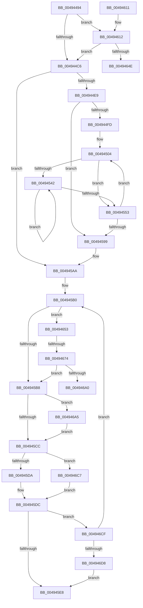

# HalpTscAdvSynchToLeader

- RVA: `0x00494494`–`0x004946DD` (길이 `585` bytes)
- VA: `0x0000000140494494`
- 실행 섹션: `.text`
- PDB 이름 있음: `예`; PDB Function 태그: `예`
- unwind 정보 RVA: `0x000B33F8`
- 디코드: `138`개 명령, `585/585` bytes 표시
- 미해석 바이트: `0` (있으면 어셈블리에 `.byte`로 보존)

> 이 문서는 커널 이미지의 기계어와 PDB 기호를 분석해 생성했습니다. 4번과 5번은 함수 원형과 자료형을 바이너리 사용 방식에서 추정한 C 해석이며 원본 소스 복구 결과는 아닙니다.

## 1. Dependencies

- 직접 호출 지점: **4**; 고유 호출 대상: **2**
- 직접 호출자로 확인된 함수: **1**
- RIP 상대 이미지 참조: **5**

### Outgoing calls
- `0x004944CA` → [HalpTscAdvSynchCalculateRemoteDelta](HalpTscAdvSynchCalculateRemoteDelta_function_004946E4.md) (function, `0x004946E4`)
- `0x00494557` → [HalpTscAdvSynchCalculateRemoteDelta](HalpTscAdvSynchCalculateRemoteDelta_function_004946E4.md) (function, `0x004946E4`)
- `0x004945BC` → [HalpTscAdvSynchCalculateRemoteDelta](HalpTscAdvSynchCalculateRemoteDelta_function_004946E4.md) (function, `0x004946E4`)
- `0x004946BD` → [HalpTscTraceProcessorSynchronization](../54/HalpTscTraceProcessorSynchronization_function_0054B268.md) (function, `0x0054B268`)

### Direct callers
- [HalpTscAdvSynchLeader](../54/HalpTscAdvSynchLeader_function_0054A690.md) at `0x0054A6EA`
- [HalpTscAdvSynchLeader](../54/HalpTscAdvSynchLeader_function_0054A690.md) at `0x0054A779`

### Static image references
- `0x004944B1` → RVA `0x00FC2244` (`.data`; read)
- `0x004944E9` → RVA `0x00E0A7F8` (`.data`; read)
- `0x00494504` → RVA `0x00FC2238` (`.data`; read)
- `0x00494599` → RVA `0x00FC2208` (`.data`; read)
- `0x004945E8` → RVA `0x00FC21F8` (`.data`; read)

## 2. Other-region calls and transfers

- 다른 실행 섹션으로 향하는 call: **0**
- call이 아닌 외부 분기/꼬리 이동: **3**
  - `0x0049464E` → [sub_006F7430](../6F/Unknown_function_006F7430.md) (`tail-transfer`)
  - `0x0049466E` → [sub_006F7430 + 0x2C](../6F/Unknown_function_006F7430.md) (`tail-transfer`)
  - `0x004946A0` → [sub_006F7430 + 0x16](../6F/Unknown_function_006F7430.md) (`tail-transfer`)

## 3. Assembly (complete function range)

```asm
00494494  48 8B C4                        mov rax, rsp
00494497  48 89 58 08                     mov qword ptr [rax + 8], rbx
0049449B  48 89 68 10                     mov qword ptr [rax + 0x10], rbp
0049449F  48 89 70 18                     mov qword ptr [rax + 0x18], rsi
004944A3  48 89 78 20                     mov qword ptr [rax + 0x20], rdi
004944A7  41 54                           push r12
004944A9  41 56                           push r14
004944AB  41 57                           push r15
004944AD  48 83 EC 30                     sub rsp, 0x30
004944B1  80 3D 8C DD B2 00 00            cmp byte ptr [rip + 0xb2dd8c], 0
004944B8  41 BC 01 00 00 00               mov r12d, 1
004944BE  8B D9                           mov ebx, ecx
004944C0  0F 84 4C 01 00 00               je 0x140494612
004944C6  33 D2                           xor edx, edx
004944C8  8B CB                           mov ecx, ebx
004944CA  E8 15 02 00 00                  call 0x1404946e4
004944CF  80 3D 6E DD B2 00 00            cmp byte ptr [rip + 0xb2dd6e], 0
004944D6  4C 8B F0                        mov r14, rax
004944D9  49 BF FF FF FF FF FF FF FF 7F   movabs r15, 0x7fffffffffffffff
004944E3  0F 85 C1 00 00 00               jne 0x1404945aa
004944E9  8B 0D 09 63 97 00               mov ecx, dword ptr [rip + 0x976309]
004944EF  45 33 E4                        xor r12d, r12d
004944F2  48 8B F3                        mov rsi, rbx
004944F5  85 C9                           test ecx, ecx
004944F7  0F 84 9C 00 00 00               je 0x140494599
004944FD  48 8B FB                        mov rdi, rbx
00494500  48 C1 E7 07                     shl rdi, 7
00494504  48 8B 05 2D DD B2 00            mov rax, qword ptr [rip + 0xb2dd2d]
0049450B  49 8B EE                        mov rbp, r14
0049450E  48 C7 44 07 08 00 00 00 00      mov qword ptr [rdi + rax + 8], 0
00494517  C7 44 07 04 64 00 00 00         mov dword ptr [rdi + rax + 4], 0x64
0049451F  F0 83 0C 24 00                  lock or dword ptr [rsp], 0
00494524  48 8B 0D 0D DD B2 00            mov rcx, qword ptr [rip + 0xb2dd0d]
0049452B  B8 02 00 00 00                  mov eax, 2
00494530  87 04 0F                        xchg dword ptr [rdi + rcx], eax
00494533  48 8B 0D FE DC B2 00            mov rcx, qword ptr [rip + 0xb2dcfe]
0049453A  8B 04 0F                        mov eax, dword ptr [rdi + rcx]
0049453D  83 F8 02                        cmp eax, 2
00494540  75 11                           jne 0x140494553
00494542  F3 90                           pause
00494544  48 8B 05 ED DC B2 00            mov rax, qword ptr [rip + 0xb2dced]
0049454B  8B 0C 07                        mov ecx, dword ptr [rdi + rax]
0049454E  83 F9 02                        cmp ecx, 2
00494551  74 EF                           je 0x140494542
00494553  33 D2                           xor edx, edx
00494555  8B CB                           mov ecx, ebx
00494557  E8 88 01 00 00                  call 0x1404946e4
0049455C  48 2B E8                        sub rbp, rax
0049455F  4C 8B F0                        mov r14, rax
00494562  48 B8 0B D7 A3 70 3D 0A D7 A3   movabs rax, 0xa3d70a3d70a3d70b
0049456C  48 F7 ED                        imul rbp
0049456F  48 03 D5                        add rdx, rbp
00494572  48 C1 FA 06                     sar rdx, 6
00494576  48 8B C2                        mov rax, rdx
00494579  48 C1 E8 3F                     shr rax, 0x3f
0049457D  48 03 D0                        add rdx, rax
00494580  8B 05 72 62 97 00               mov eax, dword ptr [rip + 0x976272]
00494586  49 3B D7                        cmp rdx, r15
00494589  4C 0F 4C FA                     cmovl r15, rdx
0049458D  41 FF C4                        inc r12d
00494590  44 3B E0                        cmp r12d, eax
00494593  0F 82 6B FF FF FF               jb 0x140494504
00494599  48 8B 05 68 DC B2 00            mov rax, qword ptr [rip + 0xb2dc68]
004945A0  41 BC 01 00 00 00               mov r12d, 1
004945A6  44 89 3C B0                     mov dword ptr [rax + rsi*4], r15d
004945AA  33 FF                           xor edi, edi
004945AC  33 F6                           xor esi, esi
004945AE  33 ED                           xor ebp, ebp
004945B0  85 FF                           test edi, edi
004945B2  0F 84 9B 00 00 00               je 0x140494653
004945B8  33 D2                           xor edx, edx
004945BA  8B CB                           mov ecx, ebx
004945BC  E8 23 01 00 00                  call 0x1404946e4
004945C1  4C 8B F0                        mov r14, rax
004945C4  85 FF                           test edi, edi
004945C6  0F 84 D9 00 00 00               je 0x1404946a5
004945CC  49 8D 46 18                     lea rax, [r14 + 0x18]
004945D0  48 83 F8 30                     cmp rax, 0x30
004945D4  0F 86 ED 00 00 00               jbe 0x1404946c7
004945DA  33 FF                           xor edi, edi
004945DC  41 03 EC                        add ebp, r12d
004945DF  83 FD 32                        cmp ebp, 0x32
004945E2  0F 82 E7 00 00 00               jb 0x1404946cf
004945E8  48 8B 05 09 DC B2 00            mov rax, qword ptr [rip + 0xb2dc09]
004945EF  48 8B 74 24 60                  mov rsi, qword ptr [rsp + 0x60]
004945F4  48 8B 7C 24 68                  mov rdi, qword ptr [rsp + 0x68]
004945F9  89 2C 98                        mov dword ptr [rax + rbx*4], ebp
004945FC  48 8B 5C 24 50                  mov rbx, qword ptr [rsp + 0x50]
00494601  48 8B 6C 24 58                  mov rbp, qword ptr [rsp + 0x58]
00494606  48 83 C4 30                     add rsp, 0x30
0049460A  41 5F                           pop r15
0049460C  41 5E                           pop r14
0049460E  41 5C                           pop r12
00494610  C3                              ret
00494611  CC                              int3
00494612  48 8B 05 1F DC B2 00            mov rax, qword ptr [rip + 0xb2dc1f]
00494619  48 8B D3                        mov rdx, rbx
0049461C  48 C1 E2 07                     shl rdx, 7
00494620  48 C7 44 02 08 00 00 00 00      mov qword ptr [rdx + rax + 8], 0
00494629  F0 83 0C 24 00                  lock or dword ptr [rsp], 0
0049462E  48 8B 0D 03 DC B2 00            mov rcx, qword ptr [rip + 0xb2dc03]
00494635  41 8B C4                        mov eax, r12d
00494638  87 04 0A                        xchg dword ptr [rdx + rcx], eax
0049463B  48 8B 0D F6 DB B2 00            mov rcx, qword ptr [rip + 0xb2dbf6]
00494642  8B 04 0A                        mov eax, dword ptr [rdx + rcx]
00494645  41 3B C4                        cmp eax, r12d
00494648  0F 85 78 FE FF FF               jne 0x1404944c6
0049464E  E9 DD 2D 26 00                  jmp 0x1406f7430
00494653  48 8B 05 DE DB B2 00            mov rax, qword ptr [rip + 0xb2dbde]
0049465A  49 8B F6                        mov rsi, r14
0049465D  48 8B D3                        mov rdx, rbx
00494660  48 F7 DE                        neg rsi
00494663  48 C1 E2 07                     shl rdx, 7
00494667  80 3D D6 DB B2 00 00            cmp byte ptr [rip + 0xb2dbd6], 0
0049466E  0F 84 E8 2D 26 00               je 0x1406f745c
00494674  48 89 74 02 08                  mov qword ptr [rdx + rax + 8], rsi
00494679  F0 83 0C 24 00                  lock or dword ptr [rsp], 0
0049467E  48 8B 0D B3 DB B2 00            mov rcx, qword ptr [rip + 0xb2dbb3]
00494685  B8 03 00 00 00                  mov eax, 3
0049468A  87 04 0A                        xchg dword ptr [rdx + rcx], eax
0049468D  48 8B 0D A4 DB B2 00            mov rcx, qword ptr [rip + 0xb2dba4]
00494694  8B 04 0A                        mov eax, dword ptr [rdx + rcx]
00494697  83 F8 03                        cmp eax, 3
0049469A  0F 85 18 FF FF FF               jne 0x1404945b8
004946A0  E9 A1 2D 26 00                  jmp 0x1406f7446
004946A5  65 48 8B 0C 25 20 00 00 00      mov rcx, qword ptr gs:[0x20]
004946AE  4C 8B CE                        mov r9, rsi
004946B1  4D 8B C6                        mov r8, r14
004946B4  89 6C 24 20                     mov dword ptr [rsp + 0x20], ebp
004946B8  8B D3                           mov edx, ebx
004946BA  8B 49 24                        mov ecx, dword ptr [rcx + 0x24]
004946BD  E8 A6 6B 0B 00                  call 0x14054b268
004946C2  E9 05 FF FF FF                  jmp 0x1404945cc
004946C7  41 03 FC                        add edi, r12d
004946CA  E9 0D FF FF FF                  jmp 0x1404945dc
004946CF  83 FF 02                        cmp edi, 2
004946D2  0F 82 D8 FE FF FF               jb 0x1404945b0
004946D8  E9 0B FF FF FF                  jmp 0x1404945e8
```

## 4. C-style interpretation (structured pseudocode)

```c
__int64 __fastcall HalpTscAdvSynchToLeader(int a1, int a2)
{
    __int64 result;
    __int64 v_r12;
    __int64 v_r15;
    __int64 v_rbp;
    __int64 v_rdi;
    __int64 v_rsi;
    __int64 v_rsp;
    unsigned int v_stack_m48;
    unsigned int v_stack_p0;
    unsigned __int64 v_stack_p10;
    unsigned __int64 v_stack_p18;
    unsigned __int64 v_stack_p20;
    unsigned __int64 v_stack_p8;

    *(unsigned __int64 *)(v_rsp + 8) = v_rbx;
    *(unsigned __int64 *)(v_rsp + 16) = v_rbp;
    *(unsigned __int64 *)(v_rsp + 24) = v_rsi;
    *(unsigned __int64 *)(v_rsp + 32) = v_rdi;
    v_rsp = (v_rsp) - (48);
    if ((*(unsigned __int8 *)(v_rip + 11722124)) == 0) goto loc_00494612;
loc_004944C6:
    a2 = 0;
    result = HalpTscAdvSynchCalculateRemoteDelta((unsigned int)((unsigned int)((unsigned int)(a1))), a2, a3, a4);
    if ((*(unsigned __int8 *)(v_rip + 11722094)) != 0) goto loc_004945AA;
    v_r12 = 0;
    if ((unsigned int)((unsigned int)(*(unsigned int *)(v_rip + 9921289))) == 0) goto loc_00494599;
    v_rdi = ((unsigned int)(a1)) << (7);
loc_00494504:
    *(unsigned __int64 *)(v_rdi + *(unsigned __int64 *)(v_rip + 11722029) * 1 + 8) = 0;
    *(unsigned int *)(v_rdi + *(unsigned __int64 *)(v_rip + 11722029) * 1 + 4) = 100;
    if (((unsigned int)((unsigned int)(*(unsigned int *)(v_rdi + *(unsigned __int64 *)(v_rip + 11721982) * 1)))) != 2) goto loc_00494553;
loc_00494542:
    if (((unsigned int)((unsigned int)(*(unsigned int *)(v_rdi + *(unsigned __int64 *)(v_rip + 11721965) * 1)))) == 2) goto loc_00494542;
loc_00494553:
    a2 = 0;
    result = HalpTscAdvSynchCalculateRemoteDelta((unsigned int)((unsigned int)((unsigned int)(a1))), a2, a3, a4);
    v_rbp = (result) - (result);
    a2 = (a2) + (v_rbp);
    a2 = (a2) >> (6);
    result = (a2) >> (63);
    a2 = (a2) + (result);
    if (a2 < v_r15) { v_r15 = a2; }
    v_r12 = (unsigned int)((v_r12) + 1);
    if (((unsigned int)(v_r12)) < ((unsigned int)((unsigned int)(*(unsigned int *)(v_rip + 9921138))))) goto loc_00494504;
loc_00494599:
    *(unsigned int *)(*(unsigned __int64 *)(v_rip + 11721832) + (unsigned int)(a1) * 4) = (unsigned int)(v_r15);
loc_004945AA:
    v_rdi = 0;
    v_rsi = 0;
    v_rbp = 0;
loc_004945B0:
    if (0 == 0) goto loc_00494653;
loc_004945B8:
    a2 = 0;
    result = HalpTscAdvSynchCalculateRemoteDelta((unsigned int)((unsigned int)((unsigned int)(a1))), a2, a3, a4);
    if (0 == 0) goto loc_004946A5;
loc_004945CC:
    if ((result + 24) <= 48) goto loc_004946C7;
    v_rdi = 0;
loc_004945DC:
    v_rbp = (unsigned int)((v_rbp) + (1));
    if (((unsigned int)(v_rbp)) < 50) goto loc_004946CF;
loc_004945E8:
    *(unsigned int *)(*(unsigned __int64 *)(v_rip + 11721737) + (unsigned int)(a1) * 4) = (unsigned int)(v_rbp);
    v_rsp = (v_rsp) + (48);
    return *(unsigned __int64 *)(v_rip + 11721737);
loc_00494612:
    a2 = (v_stack_p8) << (7);
    *(unsigned __int64 *)(a2 + *(unsigned __int64 *)(v_rip + 11721759) * 1 + 8) = 0;
    if (((unsigned int)((unsigned int)(*(unsigned int *)(a2 + *(unsigned __int64 *)(v_rip + 11721718) * 1)))) != 1) goto loc_004944C6;
loc_00494653:
    v_rsi = -(result);
    a2 = (v_stack_p8) << (7);
    *(unsigned __int64 *)(a2 + *(unsigned __int64 *)(v_rip + 11721694) * 1 + 8) = v_rsi;
    if (((unsigned int)((unsigned int)(*(unsigned int *)(a2 + *(unsigned __int64 *)(v_rip + 11721636) * 1)))) != 3) goto loc_004945B8;
loc_004946A5:
    v_stack_p20 = (unsigned int)(v_stack_p10);
    result = HalpTscTraceProcessorSynchronization((unsigned int)(*(unsigned int *)(*(unsigned __int64 *)(gs_base + (0 + 32)) + 36)), (unsigned int)((unsigned int)(v_stack_p8)), result, v_rsi);
    goto loc_004945CC;
loc_004946C7:
    v_rdi = (unsigned int)((v_stack_p20) + (1));
    goto loc_004945DC;
loc_004946CF:
    if (((unsigned int)(v_rdi)) < 2) goto loc_004945B0;
    goto loc_004945E8;
}
```

## 5. (Beta) C Style

```c
int64_t HalpTscAdvSynchToLeader(int32_t Arg1, int32_t Arg2)
{
    int64_t result;
    int64_t local_r12;
    int64_t local_r15;
    int64_t local_rbp;
    int64_t local_rdi;
    int64_t local_rsi;
    int64_t local_rsp;
    uint32_t v_stack_m48;
    uint32_t v_stack_p0;
    uint64_t v_stack_p10;
    uint64_t v_stack_p18;
    uint64_t v_stack_p20;
    uint64_t v_stack_p8;

    *(uint64_t *)(local_rsp + 0x8) = local_rbx;
    *(uint64_t *)(local_rsp + 0x10) = local_rbp;
    *(uint64_t *)(local_rsp + 0x18) = local_rsi;
    *(uint64_t *)(local_rsp + 0x20) = local_rdi;
    local_rsp = (local_rsp) - (48);
    if ((*(uint8_t *)(v_rip + 0xB2DD8C)) == 0) goto loc_00494612;
loc_004944C6:
    Arg2 = 0;
    result = HalpTscAdvSynchCalculateRemoteDelta((uint32_t)((uint32_t)((uint32_t)(Arg1))), Arg2, a3, a4);
    if ((*(uint8_t *)(v_rip + 0xB2DD6E)) != 0) goto loc_004945AA;
    local_r12 = 0;
    if ((uint32_t)((uint32_t)(*(uint32_t *)(v_rip + 0x976309))) == 0) goto loc_00494599;
    local_rdi = ((uint32_t)(Arg1)) << (7);
loc_00494504:
    *(uint64_t *)(local_rdi + *(uint64_t *)(v_rip + 0xB2DD2D) * 1 + 0x8) = 0;
    *(uint32_t *)(local_rdi + *(uint64_t *)(v_rip + 0xB2DD2D) * 1 + 0x4) = 100;
    if (((uint32_t)((uint32_t)(*(uint32_t *)(local_rdi + *(uint64_t *)(v_rip + 0xB2DCFE) * 1)))) != 2) goto loc_00494553;
loc_00494542:
    if (((uint32_t)((uint32_t)(*(uint32_t *)(local_rdi + *(uint64_t *)(v_rip + 0xB2DCED) * 1)))) == 2) goto loc_00494542;
loc_00494553:
    Arg2 = 0;
    result = HalpTscAdvSynchCalculateRemoteDelta((uint32_t)((uint32_t)((uint32_t)(Arg1))), Arg2, a3, a4);
    local_rbp = (result) - (result);
    Arg2 = (Arg2) + (local_rbp);
    Arg2 = (Arg2) >> (6);
    result = (Arg2) >> (63);
    Arg2 = (Arg2) + (result);
    if (Arg2 < local_r15) { local_r15 = Arg2; }
    local_r12 = (uint32_t)((local_r12) + 1);
    if (((uint32_t)(local_r12)) < ((uint32_t)((uint32_t)(*(uint32_t *)(v_rip + 0x976272))))) goto loc_00494504;
loc_00494599:
    *(uint32_t *)(*(uint64_t *)(v_rip + 0xB2DC68) + (uint32_t)(Arg1) * 4) = (uint32_t)(local_r15);
loc_004945AA:
    local_rdi = 0;
    local_rsi = 0;
    local_rbp = 0;
loc_004945B0:
    if (0 == 0) goto loc_00494653;
loc_004945B8:
    Arg2 = 0;
    result = HalpTscAdvSynchCalculateRemoteDelta((uint32_t)((uint32_t)((uint32_t)(Arg1))), Arg2, a3, a4);
    if (0 == 0) goto loc_004946A5;
loc_004945CC:
    if ((result + 24) <= 48) goto loc_004946C7;
    local_rdi = 0;
loc_004945DC:
    local_rbp = (uint32_t)((local_rbp) + (1));
    if (((uint32_t)(local_rbp)) < 50) goto loc_004946CF;
loc_004945E8:
    *(uint32_t *)(*(uint64_t *)(v_rip + 0xB2DC09) + (uint32_t)(Arg1) * 4) = (uint32_t)(local_rbp);
    local_rsp = (local_rsp) + (48);
    return *(uint64_t *)(v_rip + 0xB2DC09);
loc_00494612:
    Arg2 = (v_stack_p8) << (7);
    *(uint64_t *)(Arg2 + *(uint64_t *)(v_rip + 0xB2DC1F) * 1 + 0x8) = 0;
    if (((uint32_t)((uint32_t)(*(uint32_t *)(Arg2 + *(uint64_t *)(v_rip + 0xB2DBF6) * 1)))) != 1) goto loc_004944C6;
loc_00494653:
    local_rsi = -(result);
    Arg2 = (v_stack_p8) << (7);
    *(uint64_t *)(Arg2 + *(uint64_t *)(v_rip + 0xB2DBDE) * 1 + 0x8) = local_rsi;
    if (((uint32_t)((uint32_t)(*(uint32_t *)(Arg2 + *(uint64_t *)(v_rip + 0xB2DBA4) * 1)))) != 3) goto loc_004945B8;
loc_004946A5:
    v_stack_p20 = (uint32_t)(v_stack_p10);
    result = HalpTscTraceProcessorSynchronization((uint32_t)(*(uint32_t *)(*(uint64_t *)(gs_base + (0 + 0x20)) + 0x24)), (uint32_t)((uint32_t)(v_stack_p8)), result, local_rsi);
    goto loc_004945CC;
loc_004946C7:
    local_rdi = (uint32_t)((v_stack_p20) + (1));
    goto loc_004945DC;
loc_004946CF:
    if (((uint32_t)(local_rdi)) < 2) goto loc_004945B0;
    goto loc_004945E8;
}
```

## 6. Execution-region graph

[열기: 2D/3D 그래프와 함수 탐색 컨트롤 패널](../../../control-panel.html?section=text&rva=0x00494494&view=graph)

- 2D 그래프는 위에서 아래로 흐르고, 3D 그래프는 빈 공간을 드래그해 회전합니다. Shift+드래그는 이동, 휠은 확대·축소, 함수 노드 선택은 대상 보고서 이동입니다.

### Static fallback


