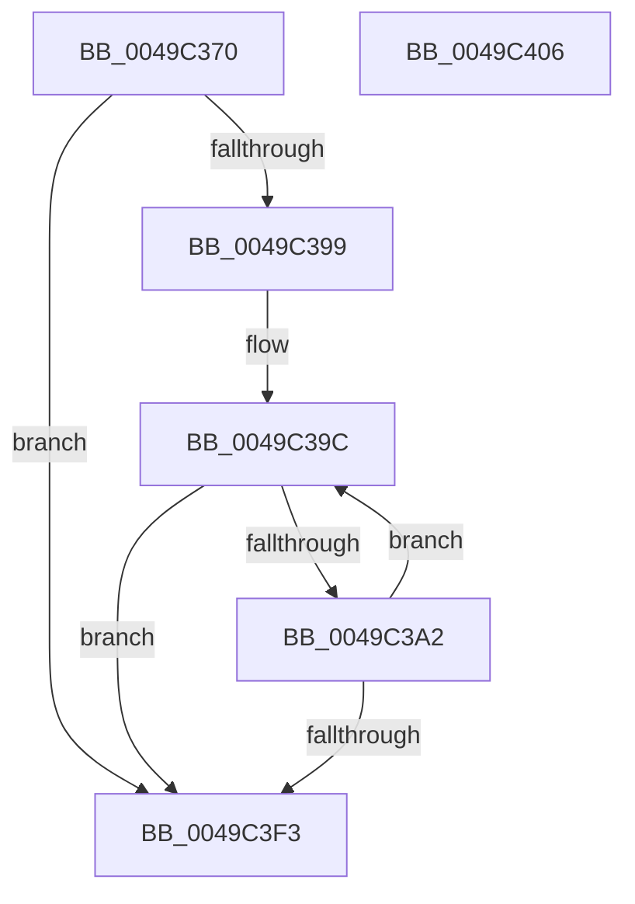

# HsaSlConfigureLeafPhysicalPfn

- RVA: `0x0049C370`–`0x0049C407` (길이 `151` bytes)
- VA: `0x000000014049C370`
- 실행 섹션: `.text`
- PDB 이름 있음: `예`; PDB Function 태그: `아니요`
- unwind 정보 RVA: `0x00069588`
- 디코드: `43`개 명령, `151/151` bytes 표시
- 미해석 바이트: `0` (있으면 어셈블리에 `.byte`로 보존)

> 이 문서는 커널 이미지의 기계어와 PDB 기호를 분석해 생성했습니다. 4번과 5번은 함수 원형과 자료형을 바이너리 사용 방식에서 추정한 C 해석이며 원본 소스 복구 결과는 아닙니다.

## 1. Dependencies

- 직접 호출 지점: **0**; 고유 호출 대상: **0**
- 직접 호출자로 확인된 함수: **0**
- RIP 상대 이미지 참조: **0**

### Outgoing calls
- 직접 디코드된 call 명령이 없습니다.

### Direct callers
- 이 함수 시작 RVA로 연결되는 직접 call은 확인되지 않았습니다. 간접 호출은 완전히 역산할 수 없습니다.

### Static image references
- 디코드된 RIP-relative 메모리 참조가 없습니다.

## 2. Other-region calls and transfers

- 다른 실행 섹션으로 향하는 call: **0**
- 별도 외부 분기/꼬리 이동을 확인하지 못했습니다.

## 3. Assembly (complete function range)

```asm
0049C370  48 89 5C 24 08                  mov qword ptr [rsp + 8], rbx
0049C375  48 89 74 24 10                  mov qword ptr [rsp + 0x10], rsi
0049C37A  48 89 7C 24 18                  mov qword ptr [rsp + 0x18], rdi
0049C37F  41 8B F8                        mov edi, r8d
0049C382  41 8B F0                        mov esi, r8d
0049C385  83 E6 01                        and esi, 1
0049C388  83 E7 02                        and edi, 2
0049C38B  45 33 DB                        xor r11d, r11d
0049C38E  48 8B DA                        mov rbx, rdx
0049C391  4C 8B D1                        mov r10, rcx
0049C394  45 85 C9                        test r9d, r9d
0049C397  74 5A                           je 0x14049c3f3
0049C399  48 2B D9                        sub rbx, rcx
0049C39C  49 83 3A 00                     cmp qword ptr [r10], 0
0049C3A0  75 51                           jne 0x14049c3f3
0049C3A2  8B C7                           mov eax, edi
0049C3A4  F7 D8                           neg eax
0049C3A6  48 B8 00 00 00 00 00 00 00 40   movabs rax, 0x4000000000000000
0049C3B0  4D 1B C0                        sbb r8, r8
0049C3B3  41 FF C3                        inc r11d
0049C3B6  4C 23 C0                        and r8, rax
0049C3B9  8B C6                           mov eax, esi
0049C3BB  48 C1 E0 3D                     shl rax, 0x3d
0049C3BF  4C 0B C0                        or r8, rax
0049C3C2  48 B8 FF 0F 00 00 00 00 F0 FF   movabs rax, 0xfff0000000000fff
0049C3CC  4D 89 02                        mov qword ptr [r10], r8
0049C3CF  4A 8B 0C 13                     mov rcx, qword ptr [rbx + r10]
0049C3D3  48 C1 E1 0C                     shl rcx, 0xc
0049C3D7  48 8B D1                        mov rdx, rcx
0049C3DA  49 33 D0                        xor rdx, r8
0049C3DD  48 23 D0                        and rdx, rax
0049C3E0  48 33 D1                        xor rdx, rcx
0049C3E3  48 83 CA 01                     or rdx, 1
0049C3E7  49 89 12                        mov qword ptr [r10], rdx
0049C3EA  49 83 C2 08                     add r10, 8
0049C3EE  45 3B D9                        cmp r11d, r9d
0049C3F1  72 A9                           jb 0x14049c39c
0049C3F3  48 8B 5C 24 08                  mov rbx, qword ptr [rsp + 8]
0049C3F8  41 8B C3                        mov eax, r11d
0049C3FB  48 8B 74 24 10                  mov rsi, qword ptr [rsp + 0x10]
0049C400  48 8B 7C 24 18                  mov rdi, qword ptr [rsp + 0x18]
0049C405  C3                              ret
0049C406  CC                              int3
```

## 4. C-style interpretation (structured pseudocode)

```c
__int64 __fastcall HsaSlConfigureLeafPhysicalPfn(__int64 a1, __int64 a2, __int64 a3, int a4)
{
    __int64 result;
    __int64 v_r10;
    __int64 v_r11;
    __int64 v_rbx;
    __int64 v_rdi;
    __int64 v_rsi;
    unsigned __int64 v_stack_p10;
    unsigned __int64 v_stack_p18;
    unsigned __int64 v_stack_p8;

    v_stack_p8 = v_rbx;
    v_stack_p10 = v_rsi;
    v_stack_p18 = v_rdi;
    v_rsi = (unsigned int)(((unsigned int)((unsigned int)(a3))) & (1));
    v_rdi = (unsigned int)(((unsigned int)((unsigned int)(a3))) & (2));
    v_r11 = 0;
    if (a4 == 0) goto loc_0049C3F3;
    v_rbx = (a2) - (a1);
loc_0049C39C:
    if ((*(unsigned __int64 *)(a1)) != 0) goto loc_0049C3F3;
    result = (unsigned int)(-((unsigned int)((unsigned int)(v_rdi))));
    v_r11 = (unsigned int)((v_r11) + 1);
    a3 = (a3) & (result);
    result = ((unsigned int)((unsigned int)(v_rsi))) << (61);
    a3 = (a3) | (result);
    *(unsigned __int64 *)(a1) = a3;
    a1 = (*(unsigned __int64 *)(v_rbx + a1 * 1)) << (12);
    a2 = (a1) ^ (a3);
    a2 = (a2) & (result);
    a2 = (a2) ^ (a1);
    a2 = (a2) | (1);
    *(unsigned __int64 *)(a1) = a2;
    v_r10 = (a1) + (8);
    if (((unsigned int)(v_r11)) < a4) goto loc_0049C39C;
loc_0049C3F3:
    return (unsigned int)((unsigned int)(v_r11));
}
```

## 5. (Beta) C Style

```c
int64_t HsaSlConfigureLeafPhysicalPfn(void *Arg1, void *Arg2, int64_t Arg3, int32_t Arg4)
{
    uint8_t *arg1 = (uint8_t *)Arg1;
    uint8_t *arg2 = (uint8_t *)Arg2;

    int64_t result;
    int64_t local_r10;
    int64_t local_r11;
    int64_t local_rbx;
    int64_t local_rdi;
    int64_t local_rsi;
    uint64_t v_stack_p10;
    uint64_t v_stack_p18;
    uint64_t v_stack_p8;

    v_stack_p8 = local_rbx;
    v_stack_p10 = local_rsi;
    v_stack_p18 = local_rdi;
    local_rsi = (uint32_t)(((uint32_t)((uint32_t)(Arg3))) & (1));
    local_rdi = (uint32_t)(((uint32_t)((uint32_t)(Arg3))) & (2));
    local_r11 = 0;
    if (Arg4 == 0) goto loc_0049C3F3;
    local_rbx = (Arg2) - (Arg1);
loc_0049C39C:
    if ((*(uint64_t *)(arg1)) != 0) goto loc_0049C3F3;
    result = (uint32_t)(-((uint32_t)((uint32_t)(local_rdi))));
    local_r11 = (uint32_t)((local_r11) + 1);
    Arg3 = (Arg3) & (result);
    result = ((uint32_t)((uint32_t)(local_rsi))) << (61);
    Arg3 = (Arg3) | (result);
    *(uint64_t *)(arg1) = Arg3;
    Arg1 = (*(uint64_t *)(local_rbx + arg1 * 1)) << (12);
    Arg2 = (Arg1) ^ (Arg3);
    Arg2 = (Arg2) & (result);
    Arg2 = (Arg2) ^ (Arg1);
    Arg2 = (Arg2) | (1);
    *(void **)(arg1) = Arg2;
    local_r10 = (Arg1) + (8);
    if (((uint32_t)(local_r11)) < Arg4) goto loc_0049C39C;
loc_0049C3F3:
    return (uint32_t)((uint32_t)(local_r11));
}
```

### 관측된 메모리 오프셋

구조체 형식이 확인되지 않은 접근은 인자 기준의 오프셋으로만 기록했습니다.

| 기준 인자 | 오프셋 표현 | 폭 (bit) | 접근 |
|---|---:|---:|---|
| `Arg1` | `+ 0x0` | `64` | `R` |
| `Arg1` | `+ 0x0` | `64` | `W` |
| `Arg2` | `+ 0x0 + r10*1` | `64` | `R` |

## 6. Execution-region graph

[열기: 2D/3D 그래프와 함수 탐색 컨트롤 패널](../../../control-panel.html?section=text&rva=0x0049C370&view=graph)

- 2D 그래프는 위에서 아래로 흐르고, 3D 그래프는 빈 공간을 드래그해 회전합니다. Shift+드래그는 이동, 휠은 확대·축소, 함수 노드 선택은 대상 보고서 이동입니다.

### Static fallback


