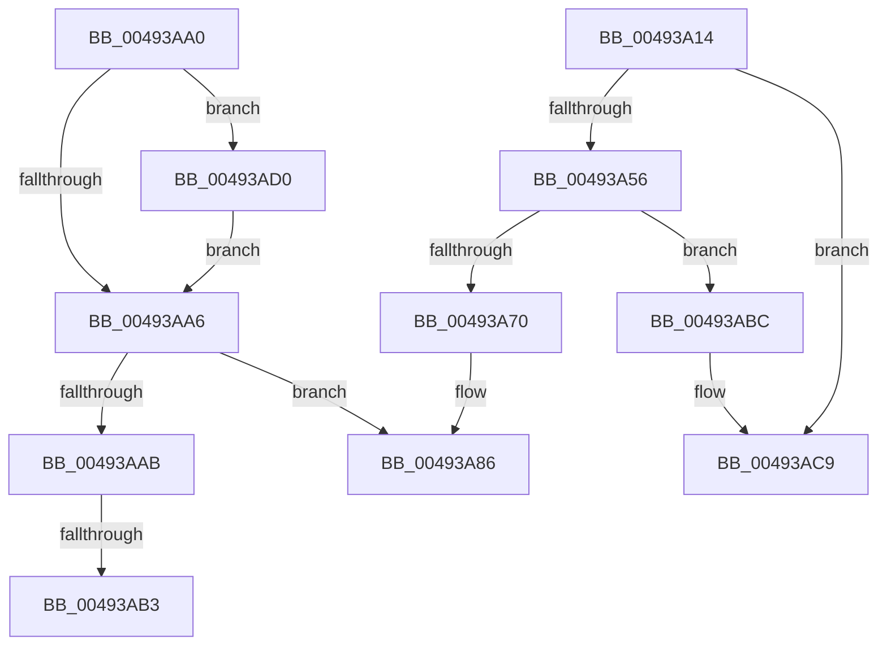

# HvpAllocateLogBuffers

- RVA: `0x00493A14`–`0x00493ADC` (길이 `200` bytes)
- VA: `0x0000000140493A14`
- 실행 섹션: `.text`
- PDB 이름 있음: `예`; PDB Function 태그: `예`
- unwind 정보 RVA: `0x000B31B4`
- 디코드: `63`개 명령, `200/200` bytes 표시
- 미해석 바이트: `0` (있으면 어셈블리에 `.byte`로 보존)

> 이 문서는 커널 이미지의 기계어와 PDB 기호를 분석해 생성했습니다. 4번과 5번은 함수 원형과 자료형을 바이너리 사용 방식에서 추정한 C 해석이며 원본 소스 복구 결과는 아닙니다.

## 1. Dependencies

- 직접 호출 지점: **4**; 고유 호출 대상: **2**
- 직접 호출자로 확인된 함수: **1**
- RIP 상대 이미지 참조: **0**

### Outgoing calls
- `0x00493A49` → [ExAllocatePool2](../../poolcode/B8/ExAllocatePool2_function_00B820F0.md) (function, `0x00B820F0`)
- `0x00493A66` → [ExAllocatePool2](../../poolcode/B8/ExAllocatePool2_function_00B820F0.md) (function, `0x00B820F0`)
- `0x00493AC1` → [ExFreePoolWithTag](../../poolcode/B8/ExFreePoolWithTag_function_00B82870.md) (function, `0x00B82870`)
- `0x00493AD5` → [ExFreePoolWithTag](../../poolcode/B8/ExFreePoolWithTag_function_00B82870.md) (function, `0x00B82870`)

### Direct callers
- [HvpGenerateLogEntry](../../page/9B/HvpGenerateLogEntry_function_009B65F0.md) at `0x009B66AC`

### Static image references
- 디코드된 RIP-relative 메모리 참조가 없습니다.

## 2. Other-region calls and transfers

- 다른 실행 섹션으로 향하는 call: **4**
  - `0x00493A49` → [ExAllocatePool2](../../poolcode/B8/ExAllocatePool2_function_00B820F0.md) (`.text` → `POOLCODE`)
  - `0x00493A66` → [ExAllocatePool2](../../poolcode/B8/ExAllocatePool2_function_00B820F0.md) (`.text` → `POOLCODE`)
  - `0x00493AC1` → [ExFreePoolWithTag](../../poolcode/B8/ExFreePoolWithTag_function_00B82870.md) (`.text` → `POOLCODE`)
  - `0x00493AD5` → [ExFreePoolWithTag](../../poolcode/B8/ExFreePoolWithTag_function_00B82870.md) (`.text` → `POOLCODE`)
- call이 아닌 외부 분기/꼬리 이동: **3**
  - `0x00493AAD` → [sub_006F71BC + 0x13F](../6F/Unknown_function_006F71BC.md) (`tail-transfer`)
  - `0x00493AB7` → [sub_006F71BC + 0x122](../6F/Unknown_function_006F71BC.md) (`tail-transfer`)
  - `0x00493ACB` → [sub_006F71BC](../6F/Unknown_function_006F71BC.md) (`tail-transfer`)

## 3. Assembly (complete function range)

```asm
00493A14  48 89 5C 24 18                  mov qword ptr [rsp + 0x18], rbx
00493A19  48 89 54 24 10                  mov qword ptr [rsp + 0x10], rdx
00493A1E  48 89 4C 24 08                  mov qword ptr [rsp + 8], rcx
00493A23  55                              push rbp
00493A24  56                              push rsi
00493A25  57                              push rdi
00493A26  41 54                           push r12
00493A28  41 55                           push r13
00493A2A  41 56                           push r14
00493A2C  41 57                           push r15
00493A2E  48 83 EC 30                     sub rsp, 0x30
00493A32  48 8B DA                        mov rbx, rdx
00493A35  45 8B E8                        mov r13d, r8d
00493A38  41 8B D0                        mov edx, r8d
00493A3B  48 8B F9                        mov rdi, rcx
00493A3E  41 B8 43 4D 49 6F               mov r8d, 0x6f494d43
00493A44  B9 08 01 00 00                  mov ecx, 0x108
00493A49  E8 A2 E6 6E 00                  call 0x140b820f0
00493A4E  4C 8B F0                        mov r14, rax
00493A51  48 85 C0                        test rax, rax
00493A54  74 73                           je 0x140493ac9
00493A56  BA 18 00 00 00                  mov edx, 0x18
00493A5B  B9 00 01 00 00                  mov ecx, 0x100
00493A60  41 B8 43 4D 49 6F               mov r8d, 0x6f494d43
00493A66  E8 85 E6 6E 00                  call 0x140b820f0
00493A6B  48 85 C0                        test rax, rax
00493A6E  74 4C                           je 0x140493abc
00493A70  83 20 00                        and dword ptr [rax], 0
00493A73  C7 03 01 00 00 00               mov dword ptr [rbx], 1
00493A79  33 DB                           xor ebx, ebx
00493A7B  4C 89 70 08                     mov qword ptr [rax + 8], r14
00493A7F  44 89 68 10                     mov dword ptr [rax + 0x10], r13d
00493A83  48 89 07                        mov qword ptr [rdi], rax
00493A86  8B C3                           mov eax, ebx
00493A88  48 8B 9C 24 80 00 00 00         mov rbx, qword ptr [rsp + 0x80]
00493A90  48 83 C4 30                     add rsp, 0x30
00493A94  41 5F                           pop r15
00493A96  41 5E                           pop r14
00493A98  41 5D                           pop r13
00493A9A  41 5C                           pop r12
00493A9C  5F                              pop rdi
00493A9D  5E                              pop rsi
00493A9E  5D                              pop rbp
00493A9F  C3                              ret
00493AA0  CC                              int3
00493AA1  4D 85 F6                        test r14, r14
00493AA4  75 2A                           jne 0x140493ad0
00493AA6  48 85 FF                        test rdi, rdi
00493AA9  74 DB                           je 0x140493a86
00493AAB  85 ED                           test ebp, ebp
00493AAD  0F 84 48 38 26 00               je 0x1406f72fb
00493AB3  48 8D 77 08                     lea rsi, [rdi + 8]
00493AB7  E9 22 38 26 00                  jmp 0x1406f72de
00493ABC  33 D2                           xor edx, edx
00493ABE  49 8B CE                        mov rcx, r14
00493AC1  E8 AA ED 6E 00                  call 0x140b82870
00493AC6  45 33 F6                        xor r14d, r14d
00493AC9  33 DB                           xor ebx, ebx
00493ACB  E9 EC 36 26 00                  jmp 0x1406f71bc
00493AD0  33 D2                           xor edx, edx
00493AD2  49 8B CE                        mov rcx, r14
00493AD5  E8 96 ED 6E 00                  call 0x140b82870
00493ADA  EB CA                           jmp 0x140493aa6
```

## 4. C-style interpretation (structured pseudocode)

```c
__int64 __fastcall HvpAllocateLogBuffers(__int64 a1, __int64 a2, int a3)
{
    __int64 result;
    __int64 v_r14;
    __int64 v_rbx;
    __int64 v_rsp;
    unsigned __int64 v_stack_p10;
    unsigned __int64 v_stack_p18;
    unsigned __int64 v_stack_p8;

    v_stack_p18 = v_rbx;
    v_stack_p10 = a2;
    v_stack_p8 = a1;
    v_rsp = (v_rsp) - (48);
    result = ExAllocatePool2(264, (unsigned int)(a3), (unsigned int)(0x6F494D43ULL), a4);
    if (result == 0) goto loc_00493AC9;
    result = ExAllocatePool2(256, 24, (unsigned int)(0x6F494D43ULL), a4);
    if (result == 0) goto loc_00493ABC;
    *(unsigned int *)(a2) = 1;
    v_rbx = 0;
    *(unsigned __int64 *)(result + 8) = result;
    *(unsigned int *)(result + 16) = (unsigned int)((unsigned int)(a3));
    *(unsigned __int64 *)(a1) = result;
loc_00493A86:
    v_rsp = (v_rsp) + (48);
    return 0;
loc_00493ABC:
    a2 = 0;
    result = ExFreePoolWithTag(result, a2, (unsigned int)(0x6F494D43ULL), a4);
    v_r14 = 0;
loc_00493AC9:
    v_rbx = 0;
}
```

## 5. (Beta) C Style

```c
int64_t HvpAllocateLogBuffers(void *Arg1, void *Arg2, int32_t Arg3)
{
    uint8_t *arg1 = (uint8_t *)Arg1;
    uint8_t *arg2 = (uint8_t *)Arg2;

    int64_t result;
    int64_t local_r14;
    int64_t local_rbx;
    int64_t local_rsp;
    uint64_t v_stack_p10;
    uint64_t v_stack_p18;
    uint64_t v_stack_p8;

    v_stack_p18 = local_rbx;
    v_stack_p10 = Arg2;
    v_stack_p8 = Arg1;
    local_rsp = (local_rsp) - (48);
    result = ExAllocatePool2(264, (uint32_t)(Arg3), (uint32_t)(0x6F494D43ULL), a4);
    if (result == 0) goto loc_00493AC9;
    result = ExAllocatePool2(256, 24, (uint32_t)(0x6F494D43ULL), a4);
    if (result == 0) goto loc_00493ABC;
    *(uint32_t *)(arg2) = 1;
    local_rbx = 0;
    *(uint64_t *)(result + 0x8) = result;
    *(uint32_t *)(result + 0x10) = (uint32_t)((uint32_t)(Arg3));
    *(uint64_t *)(arg1) = result;
loc_00493A86:
    local_rsp = (local_rsp) + (48);
    return 0;
loc_00493ABC:
    Arg2 = 0;
    result = ExFreePoolWithTag(result, Arg2, (uint32_t)(0x6F494D43ULL), a4);
    local_r14 = 0;
loc_00493AC9:
    local_rbx = 0;
}
```

### 관측된 메모리 오프셋

구조체 형식이 확인되지 않은 접근은 인자 기준의 오프셋으로만 기록했습니다.

| 기준 인자 | 오프셋 표현 | 폭 (bit) | 접근 |
|---|---:|---:|---|
| `Arg1` | `+ 0x0` | `64` | `W` |
| `Arg2` | `+ 0x0` | `32` | `W` |

## 6. Execution-region graph

[열기: 2D/3D 그래프와 함수 탐색 컨트롤 패널](../../../control-panel.html?section=text&rva=0x00493A14&view=graph)

- 2D 그래프는 위에서 아래로 흐르고, 3D 그래프는 빈 공간을 드래그해 회전합니다. Shift+드래그는 이동, 휠은 확대·축소, 함수 노드 선택은 대상 보고서 이동입니다.

### Static fallback


