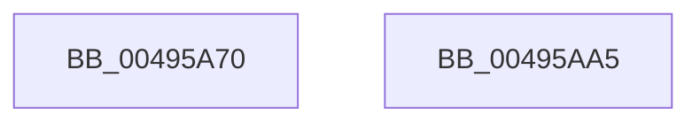

# IoCsqInitialize

- RVA: `0x00495A70`–`0x00495AA6` (길이 `54` bytes)
- VA: `0x0000000140495A70`
- 실행 섹션: `.text`
- PDB 이름 있음: `예`; PDB Function 태그: `아니요`
- unwind 정보 RVA: `0x000DB714`
- 디코드: `14`개 명령, `54/54` bytes 표시
- 미해석 바이트: `0` (있으면 어셈블리에 `.byte`로 보존)

> 이 문서는 커널 이미지의 기계어와 PDB 기호를 분석해 생성했습니다. 4번과 5번은 함수 원형과 자료형을 바이너리 사용 방식에서 추정한 C 해석이며 원본 소스 복구 결과는 아닙니다.

## 1. Dependencies

- 직접 호출 지점: **0**; 고유 호출 대상: **0**
- 직접 호출자로 확인된 함수: **0**
- RIP 상대 이미지 참조: **0**

### Outgoing calls
- 직접 디코드된 call 명령이 없습니다.

### Direct callers
- 이 함수 시작 RVA로 연결되는 직접 call은 확인되지 않았습니다. 간접 호출은 완전히 역산할 수 없습니다.

### Static image references
- 디코드된 RIP-relative 메모리 참조가 없습니다.

## 2. Other-region calls and transfers

- 다른 실행 섹션으로 향하는 call: **0**
- 별도 외부 분기/꼬리 이동을 확인하지 못했습니다.

## 3. Assembly (complete function range)

```asm
00495A70  48 8B 44 24 28                  mov rax, qword ptr [rsp + 0x28]
00495A75  48 83 61 38 00                  and qword ptr [rcx + 0x38], 0
00495A7A  48 89 41 20                     mov qword ptr [rcx + 0x20], rax
00495A7E  48 8B 44 24 30                  mov rax, qword ptr [rsp + 0x30]
00495A83  48 89 41 28                     mov qword ptr [rcx + 0x28], rax
00495A87  48 8B 44 24 38                  mov rax, qword ptr [rsp + 0x38]
00495A8C  48 89 41 30                     mov qword ptr [rcx + 0x30], rax
00495A90  33 C0                           xor eax, eax
00495A92  48 89 51 08                     mov qword ptr [rcx + 8], rdx
00495A96  4C 89 41 10                     mov qword ptr [rcx + 0x10], r8
00495A9A  4C 89 49 18                     mov qword ptr [rcx + 0x18], r9
00495A9E  C7 01 02 00 00 00               mov dword ptr [rcx], 2
00495AA4  C3                              ret
00495AA5  CC                              int3
```

## 4. C-style interpretation (structured pseudocode)

```c
__int64 __fastcall IoCsqInitialize(__int64 a1, __int64 a2, __int64 a3, __int64 a4, __int64 a5, __int64 a6, __int64 a7)
{
    __int64 result;

    *(unsigned __int64 *)(a1 + 32) = a5;
    *(unsigned __int64 *)(a1 + 40) = a6;
    *(unsigned __int64 *)(a1 + 48) = a7;
    result = 0;
    *(unsigned __int64 *)(a1 + 8) = a2;
    *(unsigned __int64 *)(a1 + 16) = a3;
    *(unsigned __int64 *)(a1 + 24) = a4;
    *(unsigned int *)(a1) = 2;
    return result;
}
```

## 5. (Beta) C Style

```c
int64_t IoCsqInitialize(void *Arg1, int64_t Arg2, int64_t Arg3, int64_t Arg4, int64_t Arg5, int64_t Arg6, int64_t Arg7)
{
    uint8_t *arg1 = (uint8_t *)Arg1;

    int64_t result;

    *(uint64_t *)(arg1 + 0x20) = Arg5;
    *(uint64_t *)(arg1 + 0x28) = Arg6;
    *(uint64_t *)(arg1 + 0x30) = Arg7;
    result = 0;
    *(uint64_t *)(arg1 + 0x8) = Arg2;
    *(uint64_t *)(arg1 + 0x10) = Arg3;
    *(uint64_t *)(arg1 + 0x18) = Arg4;
    *(uint32_t *)(arg1) = 2;
    return result;
}
```

### 관측된 메모리 오프셋

구조체 형식이 확인되지 않은 접근은 인자 기준의 오프셋으로만 기록했습니다.

| 기준 인자 | 오프셋 표현 | 폭 (bit) | 접근 |
|---|---:|---:|---|
| `Arg1` | `+ 0x0` | `32` | `W` |
| `Arg1` | `+ 0x8` | `64` | `W` |
| `Arg1` | `+ 0x10` | `64` | `W` |
| `Arg1` | `+ 0x18` | `64` | `W` |
| `Arg1` | `+ 0x20` | `64` | `W` |
| `Arg1` | `+ 0x28` | `64` | `W` |
| `Arg1` | `+ 0x30` | `64` | `W` |
| `Arg1` | `+ 0x38` | `64` | `R/W` |

## 6. Execution-region graph

[열기: 2D/3D 그래프와 함수 탐색 컨트롤 패널](../../../control-panel.html?section=text&rva=0x00495A70&view=graph)

- 2D 그래프는 위에서 아래로 흐르고, 3D 그래프는 빈 공간을 드래그해 회전합니다. Shift+드래그는 이동, 휠은 확대·축소, 함수 노드 선택은 대상 보고서 이동입니다.

### Static fallback


