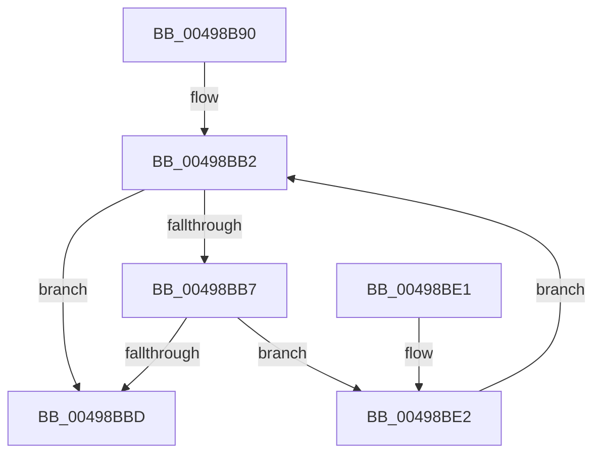

# IoGetDriverObjectExtension

- RVA: `0x00498B90`–`0x00498BE7` (길이 `87` bytes)
- VA: `0x0000000140498B90`
- 실행 섹션: `.text`
- PDB 이름 있음: `예`; PDB Function 태그: `아니요`
- unwind 정보 RVA: `0x0009A3C0`
- 디코드: `27`개 명령, `87/87` bytes 표시
- 미해석 바이트: `0` (있으면 어셈블리에 `.byte`로 보존)

> 이 문서는 커널 이미지의 기계어와 PDB 기호를 분석해 생성했습니다. 4번과 5번은 함수 원형과 자료형을 바이너리 사용 방식에서 추정한 C 해석이며 원본 소스 복구 결과는 아닙니다.

## 1. Dependencies

- 직접 호출 지점: **2**; 고유 호출 대상: **2**
- 직접 호출자로 확인된 함수: **0**
- RIP 상대 이미지 참조: **0**

### Outgoing calls
- `0x00498BA5` → [KeAcquireQueuedSpinLock](../27/KeAcquireQueuedSpinLock_function_00273D80.md) (function, `0x00273D80`)
- `0x00498BC4` → [KeReleaseQueuedSpinLock](../27/KeReleaseQueuedSpinLock_function_00272540.md) (function, `0x00272540`)

### Direct callers
- 이 함수 시작 RVA로 연결되는 직접 call은 확인되지 않았습니다. 간접 호출은 완전히 역산할 수 없습니다.

### Static image references
- 디코드된 RIP-relative 메모리 참조가 없습니다.

## 2. Other-region calls and transfers

- 다른 실행 섹션으로 향하는 call: **0**
- 별도 외부 분기/꼬리 이동을 확인하지 못했습니다.

## 3. Assembly (complete function range)

```asm
00498B90  48 89 5C 24 08                  mov qword ptr [rsp + 8], rbx
00498B95  57                              push rdi
00498B96  48 83 EC 20                     sub rsp, 0x20
00498B9A  48 8B D9                        mov rbx, rcx
00498B9D  48 8B FA                        mov rdi, rdx
00498BA0  B9 0A 00 00 00                  mov ecx, 0xa
00498BA5  E8 D6 B1 DD FF                  call 0x140273d80
00498BAA  48 8B 4B 30                     mov rcx, qword ptr [rbx + 0x30]
00498BAE  48 8B 59 28                     mov rbx, qword ptr [rcx + 0x28]
00498BB2  48 85 DB                        test rbx, rbx
00498BB5  74 06                           je 0x140498bbd
00498BB7  48 39 7B 08                     cmp qword ptr [rbx + 8], rdi
00498BBB  75 25                           jne 0x140498be2
00498BBD  8A D0                           mov dl, al
00498BBF  B9 0A 00 00 00                  mov ecx, 0xa
00498BC4  E8 77 99 DD FF                  call 0x140272540
00498BC9  48 8D 4B 10                     lea rcx, [rbx + 0x10]
00498BCD  48 F7 DB                        neg rbx
00498BD0  48 8B 5C 24 30                  mov rbx, qword ptr [rsp + 0x30]
00498BD5  48 1B C0                        sbb rax, rax
00498BD8  48 23 C1                        and rax, rcx
00498BDB  48 83 C4 20                     add rsp, 0x20
00498BDF  5F                              pop rdi
00498BE0  C3                              ret
00498BE1  CC                              int3
00498BE2  48 8B 1B                        mov rbx, qword ptr [rbx]
00498BE5  EB CB                           jmp 0x140498bb2
```

## 4. C-style interpretation (structured pseudocode)

```c
__int64 __fastcall IoGetDriverObjectExtension(__int64 a1, __int64 a2)
{
    __int64 result;
    __int64 v_rbx;
    __int64 v_rsp;
    unsigned __int64 v_stack_p8;

    v_stack_p8 = v_rbx;
    v_rsp = (v_rsp) - (32);
    result = KeAcquireQueuedSpinLock(10, a2, a3, a4);
loc_00498BB2:
    if (*(unsigned __int64 *)(*(unsigned __int64 *)(a1 + 48) + 40) == 0) goto loc_00498BBD;
    if ((*(unsigned __int64 *)(*(unsigned __int64 *)(*(unsigned __int64 *)(a1 + 48) + 40) + 8)) != a2) goto loc_00498BE2;
loc_00498BBD:
    result = KeReleaseQueuedSpinLock(10, (unsigned __int8)(result), a3, a4);
    v_rbx = -(*(unsigned __int64 *)(*(unsigned __int64 *)(a1 + 48) + 40));
    result = (result) & (*(unsigned __int64 *)(*(unsigned __int64 *)(a1 + 48) + 40) + 16);
    v_rsp = (v_rsp) + (32);
    return result;
loc_00498BE2:
    goto loc_00498BB2;
}
```

## 5. (Beta) C Style

```c
int64_t IoGetDriverObjectExtension(void *Arg1, int64_t Arg2)
{
    uint8_t *arg1 = (uint8_t *)Arg1;

    int64_t result;
    int64_t local_rbx;
    int64_t local_rsp;
    uint64_t v_stack_p8;

    v_stack_p8 = local_rbx;
    local_rsp = (local_rsp) - (32);
    result = KeAcquireQueuedSpinLock(10, Arg2, a3, a4);
loc_00498BB2:
    if (*(uint64_t *)(*(uint64_t *)(arg1 + 0x30) + 0x28) == 0) goto loc_00498BBD;
    if ((*(uint64_t *)(*(uint64_t *)(*(uint64_t *)(arg1 + 0x30) + 0x28) + 0x8)) != Arg2) goto loc_00498BE2;
loc_00498BBD:
    result = KeReleaseQueuedSpinLock(10, (uint8_t)(result), a3, a4);
    local_rbx = -(*(uint64_t *)(*(uint64_t *)(arg1 + 0x30) + 0x28));
    result = (result) & (*(uint64_t *)(*(uint64_t *)(arg1 + 0x30) + 0x28) + 16);
    local_rsp = (local_rsp) + (32);
    return result;
loc_00498BE2:
    goto loc_00498BB2;
}
```

### 관측된 메모리 오프셋

구조체 형식이 확인되지 않은 접근은 인자 기준의 오프셋으로만 기록했습니다.

| 기준 인자 | 오프셋 표현 | 폭 (bit) | 접근 |
|---|---:|---:|---|
| `Arg1` | `+ 0x30` | `64` | `R` |

## 6. Execution-region graph

[열기: 2D/3D 그래프와 함수 탐색 컨트롤 패널](../../../control-panel.html?section=text&rva=0x00498B90&view=graph)

- 2D 그래프는 위에서 아래로 흐르고, 3D 그래프는 빈 공간을 드래그해 회전합니다. Shift+드래그는 이동, 휠은 확대·축소, 함수 노드 선택은 대상 보고서 이동입니다.

### Static fallback


