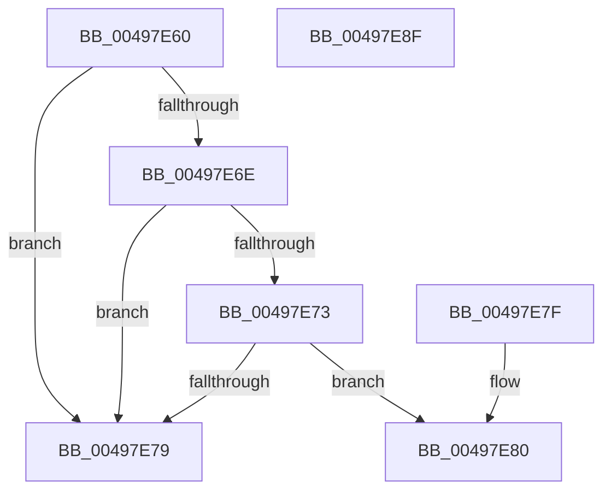

# IoGetFsZeroingOffset

- RVA: `0x00497E60`–`0x00497E90` (길이 `48` bytes)
- VA: `0x0000000140497E60`
- 실행 섹션: `.text`
- PDB 이름 있음: `예`; PDB Function 태그: `아니요`
- unwind 정보 RVA: `0x000DB714`
- 디코드: `17`개 명령, `48/48` bytes 표시
- 미해석 바이트: `0` (있으면 어셈블리에 `.byte`로 보존)

> 이 문서는 커널 이미지의 기계어와 PDB 기호를 분석해 생성했습니다. 4번과 5번은 함수 원형과 자료형을 바이너리 사용 방식에서 추정한 C 해석이며 원본 소스 복구 결과는 아닙니다.

## 1. Dependencies

- 직접 호출 지점: **0**; 고유 호출 대상: **0**
- 직접 호출자로 확인된 함수: **0**
- RIP 상대 이미지 참조: **0**

### Outgoing calls
- 직접 디코드된 call 명령이 없습니다.

### Direct callers
- 이 함수 시작 RVA로 연결되는 직접 call은 확인되지 않았습니다. 간접 호출은 완전히 역산할 수 없습니다.

### Static image references
- 디코드된 RIP-relative 메모리 참조가 없습니다.

## 2. Other-region calls and transfers

- 다른 실행 섹션으로 향하는 call: **0**
- 별도 외부 분기/꼬리 이동을 확인하지 못했습니다.

## 3. Assembly (complete function range)

```asm
00497E60  48 8B 81 C8 00 00 00            mov rax, qword ptr [rcx + 0xc8]
00497E67  90                              nop
00497E68  80 79 47 00                     cmp byte ptr [rcx + 0x47], 0
00497E6C  7C 0B                           jl 0x140497e79
00497E6E  48 85 C0                        test rax, rax
00497E71  74 06                           je 0x140497e79
00497E73  F6 40 02 10                     test byte ptr [rax + 2], 0x10
00497E77  75 07                           jne 0x140497e80
00497E79  B8 25 02 00 C0                  mov eax, 0xc0000225
00497E7E  C3                              ret
00497E7F  CC                              int3
00497E80  48 8B 81 C8 00 00 00            mov rax, qword ptr [rcx + 0xc8]
00497E87  8B 48 28                        mov ecx, dword ptr [rax + 0x28]
00497E8A  33 C0                           xor eax, eax
00497E8C  89 0A                           mov dword ptr [rdx], ecx
00497E8E  C3                              ret
00497E8F  CC                              int3
```

## 4. C-style interpretation (structured pseudocode)

```c
__int64 __fastcall IoGetFsZeroingOffset(__int64 a1, __int64 a2)
{
    __int64 result;

    if ((*(unsigned __int8 *)(a1 + 71)) < 0) goto loc_00497E79;
    if (*(unsigned __int64 *)(a1 + 200) == 0) goto loc_00497E79;
    if (((*(unsigned __int8 *)(*(unsigned __int64 *)(a1 + 200) + 2)) & (16)) != 0) goto loc_00497E80;
loc_00497E79:
    return (unsigned int)(0xC0000225ULL);
loc_00497E80:
    result = 0;
    *(unsigned int *)(a2) = (unsigned int)((unsigned int)(*(unsigned int *)(*(unsigned __int64 *)(a1 + 200) + 40)));
    return result;
}
```

## 5. (Beta) C Style

```c
int64_t IoGetFsZeroingOffset(void *Arg1, void *Arg2)
{
    uint8_t *arg1 = (uint8_t *)Arg1;
    uint8_t *arg2 = (uint8_t *)Arg2;

    int64_t result;

    if ((*(uint8_t *)(arg1 + 0x47)) < 0) goto loc_00497E79;
    if (*(uint64_t *)(arg1 + 0xC8) == 0) goto loc_00497E79;
    if (((*(uint8_t *)(*(uint64_t *)(arg1 + 0xC8) + 0x2)) & (16)) != 0) goto loc_00497E80;
loc_00497E79:
    return (uint32_t)(0xC0000225ULL);
loc_00497E80:
    result = 0;
    *(uint32_t *)(arg2) = (uint32_t)((uint32_t)(*(uint32_t *)(*(uint64_t *)(arg1 + 0xC8) + 0x28)));
    return result;
}
```

### 관측된 메모리 오프셋

구조체 형식이 확인되지 않은 접근은 인자 기준의 오프셋으로만 기록했습니다.

| 기준 인자 | 오프셋 표현 | 폭 (bit) | 접근 |
|---|---:|---:|---|
| `Arg1` | `+ 0x47` | `8` | `R` |
| `Arg1` | `+ 0xC8` | `64` | `R` |
| `Arg2` | `+ 0x0` | `32` | `W` |

## 6. Execution-region graph

[열기: 2D/3D 그래프와 함수 탐색 컨트롤 패널](../../../control-panel.html?section=text&rva=0x00497E60&view=graph)

- 2D 그래프는 위에서 아래로 흐르고, 3D 그래프는 빈 공간을 드래그해 회전합니다. Shift+드래그는 이동, 휠은 확대·축소, 함수 노드 선택은 대상 보고서 이동입니다.

### Static fallback


