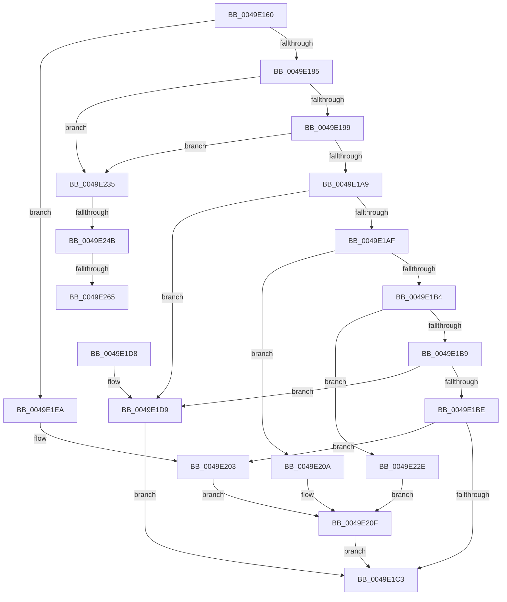

# IoInvalidateDeviceRelations

- RVA: `0x0049E160`–`0x0049E283` (길이 `291` bytes)
- VA: `0x000000014049E160`
- 실행 섹션: `.text`
- PDB 이름 있음: `예`; PDB Function 태그: `예`
- unwind 정보 RVA: `0x000B5054`
- 디코드: `79`개 명령, `291/291` bytes 표시
- 미해석 바이트: `0` (있으면 어셈블리에 `.byte`로 보존)

> 이 문서는 커널 이미지의 기계어와 PDB 기호를 분석해 생성했습니다. 4번과 5번은 함수 원형과 자료형을 바이너리 사용 방식에서 추정한 C 해석이며 원본 소스 복구 결과는 아닙니다.

## 1. Dependencies

- 직접 호출 지점: **8**; 고유 호출 대상: **5**
- 직접 호출자로 확인된 함수: **7**
- RIP 상대 이미지 참조: **0**

### Outgoing calls
- `0x0049E1D9` → [Feature_PdcClientPnpActionQueue__private_ReportDeviceUsage](Feature_PdcClientPnpActionQueue__private_ReportDeviceUsage_function_0049E454.md) (function, `0x0049E454`)
- `0x0049E1E3` → [IopQueueInvalidateBusRelationsRequest](IopQueueInvalidateBusRelationsRequest_function_0049E28C.md) (function, `0x0049E28C`)
- `0x0049E1FD` → [KeBugCheckEx](../4F/KeBugCheckEx_function_004FD660.md) (function, `0x004FD660`)
- `0x0049E227` → [PnpRequestDeviceAction](../47/PnpRequestDeviceAction_function_00477FF8.md) (function, `0x00477FF8`)
- `0x0049E239` → [IoAddTriageDumpDataBlock](../42/IoAddTriageDumpDataBlock_function_00428374.md) (function, `0x00428374`)
- `0x0049E24F` → [IoAddTriageDumpDataBlock](../42/IoAddTriageDumpDataBlock_function_00428374.md) (function, `0x00428374`)
- `0x0049E267` → [IoAddTriageDumpDataBlock](../42/IoAddTriageDumpDataBlock_function_00428374.md) (function, `0x00428374`)
- `0x0049E278` → [IoAddTriageDumpDataBlock](../42/IoAddTriageDumpDataBlock_function_00428374.md) (function, `0x00428374`)

### Direct callers
- [PiProfileUpdateDeviceTreeCallback](../../page/73/PiProfileUpdateDeviceTreeCallback_function_00737630.md) at `0x007376C2`
- [PiSwIrpStartCreateWorker](../../page/8D/PiSwIrpStartCreateWorker_function_008DB398.md) at `0x008DB700`
- [PiSwIrpStartCreateWorker](../../page/8D/PiSwIrpStartCreateWorker_function_008DB398.md) at `0x008DB81C`
- [PiSwProcessRemove](../../page/94/PiSwProcessRemove_function_0094E3B8.md) at `0x0094E65A`
- [PiSwProcessParentStartIrp](../../page/A9/PiSwProcessParentStartIrp_function_00A97FC0.md) at `0x00A9801C`
- [PiSwCloseDevice](../../page/AA/PiSwCloseDevice_function_00AAB6F4.md) at `0x00AAB745`
- [PiSwGetChildPdo](../../page/AC/PiSwGetChildPdo_function_00AC3544.md) at `0x00AC36DA`
- [sub_00B40828](../../page/B4/Unknown_function_00B40828.md) at `0x00B40868`

### Static image references
- 디코드된 RIP-relative 메모리 참조가 없습니다.

## 2. Other-region calls and transfers

- 다른 실행 섹션으로 향하는 call: **0**
- call이 아닌 외부 분기/꼬리 이동: **3**
  - `0x0049E245` → [sub_006F816A](../6F/Unknown_function_006F816A.md) (`tail-transfer`)
  - `0x0049E25F` → [sub_006F816A](../6F/Unknown_function_006F816A.md) (`tail-transfer`)
  - `0x0049E27E` → [sub_006F816A](../6F/Unknown_function_006F816A.md) (`tail-transfer`)

## 3. Assembly (complete function range)

```asm
0049E160  48 89 5C 24 08                  mov qword ptr [rsp + 8], rbx
0049E165  48 89 6C 24 10                  mov qword ptr [rsp + 0x10], rbp
0049E16A  48 89 74 24 18                  mov qword ptr [rsp + 0x18], rsi
0049E16F  57                              push rdi
0049E170  48 83 EC 40                     sub rsp, 0x40
0049E174  33 F6                           xor esi, esi
0049E176  8B FA                           mov edi, edx
0049E178  48 8B D9                        mov rbx, rcx
0049E17B  BD 02 00 00 00                  mov ebp, 2
0049E180  48 85 C9                        test rcx, rcx
0049E183  74 65                           je 0x14049e1ea
0049E185  48 8B 81 38 01 00 00            mov rax, qword ptr [rcx + 0x138]
0049E18C  48 8B 40 28                     mov rax, qword ptr [rax + 0x28]
0049E190  48 85 C0                        test rax, rax
0049E193  0F 84 9C 00 00 00               je 0x14049e235
0049E199  F7 80 8C 01 00 00 00 00 02 00   test dword ptr [rax + 0x18c], 0x20000
0049E1A3  0F 85 8C 00 00 00               jne 0x14049e235
0049E1A9  8B CA                           mov ecx, edx
0049E1AB  85 D2                           test edx, edx
0049E1AD  74 2A                           je 0x14049e1d9
0049E1AF  83 E9 01                        sub ecx, 1
0049E1B2  74 56                           je 0x14049e20a
0049E1B4  83 E9 01                        sub ecx, 1
0049E1B7  74 75                           je 0x14049e22e
0049E1B9  83 E9 03                        sub ecx, 3
0049E1BC  74 1B                           je 0x14049e1d9
0049E1BE  83 F9 01                        cmp ecx, 1
0049E1C1  74 40                           je 0x14049e203
0049E1C3  48 8B 5C 24 50                  mov rbx, qword ptr [rsp + 0x50]
0049E1C8  48 8B 6C 24 58                  mov rbp, qword ptr [rsp + 0x58]
0049E1CD  48 8B 74 24 60                  mov rsi, qword ptr [rsp + 0x60]
0049E1D2  48 83 C4 40                     add rsp, 0x40
0049E1D6  5F                              pop rdi
0049E1D7  C3                              ret
0049E1D8  CC                              int3
0049E1D9  E8 76 02 00 00                  call 0x14049e454
0049E1DE  8B D7                           mov edx, edi
0049E1E0  48 8B CB                        mov rcx, rbx
0049E1E3  E8 A4 00 00 00                  call 0x14049e28c
0049E1E8  EB D9                           jmp 0x14049e1c3
0049E1EA  45 33 C9                        xor r9d, r9d
0049E1ED  48 89 74 24 20                  mov qword ptr [rsp + 0x20], rsi
0049E1F2  4C 8B C3                        mov r8, rbx
0049E1F5  48 8B D5                        mov rdx, rbp
0049E1F8  B9 CA 00 00 00                  mov ecx, 0xca
0049E1FD  E8 5E F4 05 00                  call 0x1404fd660
0049E202  CC                              int3
0049E203  BA 13 00 00 00                  mov edx, 0x13
0049E208  EB 05                           jmp 0x14049e20f
0049E20A  BA 14 00 00 00                  mov edx, 0x14
0049E20F  48 89 74 24 30                  mov qword ptr [rsp + 0x30], rsi
0049E214  45 33 C9                        xor r9d, r9d
0049E217  48 89 74 24 28                  mov qword ptr [rsp + 0x28], rsi
0049E21C  45 33 C0                        xor r8d, r8d
0049E21F  48 8B CB                        mov rcx, rbx
0049E222  48 89 74 24 20                  mov qword ptr [rsp + 0x20], rsi
0049E227  E8 CC 9D FD FF                  call 0x140477ff8
0049E22C  EB 95                           jmp 0x14049e1c3
0049E22E  BA 05 00 00 00                  mov edx, 5
0049E233  EB DA                           jmp 0x14049e20f
0049E235  0F B7 51 02                     movzx edx, word ptr [rcx + 2]
0049E239  E8 36 A1 F8 FF                  call 0x140428374
0049E23E  48 8B 4B 08                     mov rcx, qword ptr [rbx + 8]
0049E242  48 85 C9                        test rcx, rcx
0049E245  0F 84 1F 9F 25 00               je 0x1406f816a
0049E24B  0F BF 51 02                     movsx edx, word ptr [rcx + 2]
0049E24F  E8 20 A1 F8 FF                  call 0x140428374
0049E254  48 8B 4B 08                     mov rcx, qword ptr [rbx + 8]
0049E258  48 83 C1 38                     add rcx, 0x38
0049E25C  66 39 31                        cmp word ptr [rcx], si
0049E25F  0F 84 05 9F 25 00               je 0x1406f816a
0049E265  8B D5                           mov edx, ebp
0049E267  E8 08 A1 F8 FF                  call 0x140428374
0049E26C  48 8B 4B 08                     mov rcx, qword ptr [rbx + 8]
0049E270  0F B7 51 38                     movzx edx, word ptr [rcx + 0x38]
0049E274  48 8B 49 40                     mov rcx, qword ptr [rcx + 0x40]
0049E278  E8 F7 A0 F8 FF                  call 0x140428374
0049E27D  90                              nop
0049E27E  E9 E7 9E 25 00                  jmp 0x1406f816a
```

## 4. C-style interpretation (structured pseudocode)

```c
__int64 __fastcall IoInvalidateDeviceRelations(__int64 a1, int a2, __int64 a3, int a4)
{
    __int64 result;
    __int64 v_rsi;
    __int64 v_rsp;
    unsigned __int64 v_stack_p10;
    unsigned __int64 v_stack_p18;
    unsigned __int64 v_stack_p20;
    unsigned __int64 v_stack_p28;
    unsigned __int64 v_stack_p30;
    unsigned __int64 v_stack_p8;

    v_stack_p8 = v_rbx;
    v_stack_p10 = v_rbp;
    v_stack_p18 = v_rsi;
    v_rsp = (v_rsp) - (64);
    v_rsi = 0;
    if (a1 == 0) goto loc_0049E1EA;
    if (*(unsigned __int64 *)(*(unsigned __int64 *)(a1 + 312) + 40) == 0) goto loc_0049E235;
    if (((*(unsigned int *)(*(unsigned __int64 *)(*(unsigned __int64 *)(a1 + 312) + 40) + 396)) & (0x20000ULL)) != 0) goto loc_0049E235;
    if (a2 == 0) goto loc_0049E1D9;
    a1 = (unsigned int)(((unsigned int)(a2)) - (1));
    if (condition_is_equal) goto loc_0049E20A;
    a1 = (unsigned int)((a1) - (1));
    if (condition_is_equal) goto loc_0049E22E;
    a1 = (unsigned int)((a1) - (3));
    if (condition_is_equal) goto loc_0049E1D9;
    if (((unsigned int)(a1)) == 1) goto loc_0049E203;
loc_0049E1C3:
    v_rsp = (v_rsp) + (64);
    return *(unsigned __int64 *)(*(unsigned __int64 *)(a1 + 312) + 40);
loc_0049E1D9:
    result = Feature_PdcClientPnpActionQueue__private_ReportDeviceUsage(a1, a2, a3, a4);
    result = IopQueueInvalidateBusRelationsRequest(v_stack_p8, (unsigned int)((unsigned int)((unsigned int)(a2))), a3, a4);
    goto loc_0049E1C3;
loc_0049E1EA:
    a4 = 0;
    v_stack_p20 = v_stack_p18;
    result = KeBugCheckEx(202, v_stack_p10, v_stack_p8, a4);
loc_0049E203:
    goto loc_0049E20F;
loc_0049E20A:
loc_0049E20F:
    v_stack_p30 = v_stack_p18;
    a4 = 0;
    v_stack_p28 = v_stack_p18;
    a3 = 0;
    v_stack_p20 = v_stack_p18;
    result = PnpRequestDeviceAction(v_stack_p8, 20, a3, a4);
    goto loc_0049E1C3;
loc_0049E22E:
    goto loc_0049E20F;
loc_0049E235:
    result = IoAddTriageDumpDataBlock(v_stack_p8, *(unsigned __int16 *)(v_stack_p8 + 2), a3, a4);
    result = IoAddTriageDumpDataBlock(*(unsigned __int64 *)(v_stack_p8 + 8), (__int16)(*(unsigned __int16 *)(*(unsigned __int64 *)(v_stack_p8 + 8) + 2)), a3, a4);
    a1 = (*(unsigned __int64 *)(v_stack_p8 + 8)) + (56);
    result = IoAddTriageDumpDataBlock(a1, (unsigned int)((unsigned int)(v_stack_p10)), a3, a4);
    result = IoAddTriageDumpDataBlock(*(unsigned __int64 *)(*(unsigned __int64 *)(v_stack_p8 + 8) + 64), *(unsigned __int16 *)(*(unsigned __int64 *)(v_stack_p8 + 8) + 56), a3, a4);
}
```

## 5. (Beta) C Style

```c
int64_t IoInvalidateDeviceRelations(void *Arg1, int32_t Arg2, int64_t Arg3, int32_t Arg4)
{
    uint8_t *arg1 = (uint8_t *)Arg1;

    int64_t result;
    int64_t local_rsi;
    int64_t local_rsp;
    uint64_t v_stack_p10;
    uint64_t v_stack_p18;
    uint64_t v_stack_p20;
    uint64_t v_stack_p28;
    uint64_t v_stack_p30;
    uint64_t v_stack_p8;

    v_stack_p8 = local_rbx;
    v_stack_p10 = local_rbp;
    v_stack_p18 = local_rsi;
    local_rsp = (local_rsp) - (64);
    local_rsi = 0;
    if (Arg1 == NULL) goto loc_0049E1EA;
    if (*(uint64_t *)(*(uint64_t *)(arg1 + 0x138) + 0x28) == 0) goto loc_0049E235;
    if (((*(uint32_t *)(*(uint64_t *)(*(uint64_t *)(arg1 + 0x138) + 0x28) + 0x18C)) & (0x20000ULL)) != 0) goto loc_0049E235;
    if (Arg2 == 0) goto loc_0049E1D9;
    Arg1 = (uint32_t)(((uint32_t)(Arg2)) - (1));
    if (condition_is_equal) goto loc_0049E20A;
    Arg1 = (uint32_t)((Arg1) - (1));
    if (condition_is_equal) goto loc_0049E22E;
    Arg1 = (uint32_t)((Arg1) - (3));
    if (condition_is_equal) goto loc_0049E1D9;
    if (((uint32_t)(Arg1)) == 1) goto loc_0049E203;
loc_0049E1C3:
    local_rsp = (local_rsp) + (64);
    return *(uint64_t *)(*(uint64_t *)(arg1 + 0x138) + 0x28);
loc_0049E1D9:
    result = Feature_PdcClientPnpActionQueue__private_ReportDeviceUsage(Arg1, Arg2, Arg3, Arg4);
    result = IopQueueInvalidateBusRelationsRequest(v_stack_p8, (uint32_t)((uint32_t)((uint32_t)(Arg2))), Arg3, Arg4);
    goto loc_0049E1C3;
loc_0049E1EA:
    Arg4 = 0;
    v_stack_p20 = v_stack_p18;
    result = KeBugCheckEx(202, v_stack_p10, v_stack_p8, Arg4);
loc_0049E203:
    goto loc_0049E20F;
loc_0049E20A:
loc_0049E20F:
    v_stack_p30 = v_stack_p18;
    Arg4 = 0;
    v_stack_p28 = v_stack_p18;
    Arg3 = 0;
    v_stack_p20 = v_stack_p18;
    result = PnpRequestDeviceAction(v_stack_p8, 20, Arg3, Arg4);
    goto loc_0049E1C3;
loc_0049E22E:
    goto loc_0049E20F;
loc_0049E235:
    result = IoAddTriageDumpDataBlock(v_stack_p8, *(uint16_t *)(v_stack_p8 + 0x2), Arg3, Arg4);
    result = IoAddTriageDumpDataBlock(*(uint64_t *)(v_stack_p8 + 0x8), (int16_t)(*(uint16_t *)(*(uint64_t *)(v_stack_p8 + 0x8) + 0x2)), Arg3, Arg4);
    Arg1 = (*(uint64_t *)(v_stack_p8 + 0x8)) + (56);
    result = IoAddTriageDumpDataBlock(Arg1, (uint32_t)((uint32_t)(v_stack_p10)), Arg3, Arg4);
    result = IoAddTriageDumpDataBlock(*(uint64_t *)(*(uint64_t *)(v_stack_p8 + 0x8) + 0x40), *(uint16_t *)(*(uint64_t *)(v_stack_p8 + 0x8) + 0x38), Arg3, Arg4);
}
```

### 관측된 메모리 오프셋

구조체 형식이 확인되지 않은 접근은 인자 기준의 오프셋으로만 기록했습니다.

| 기준 인자 | 오프셋 표현 | 폭 (bit) | 접근 |
|---|---:|---:|---|
| `Arg1` | `+ 0x8` | `64` | `R` |

## 6. Execution-region graph

[열기: 2D/3D 그래프와 함수 탐색 컨트롤 패널](../../../control-panel.html?section=text&rva=0x0049E160&view=graph)

- 2D 그래프는 위에서 아래로 흐르고, 3D 그래프는 빈 공간을 드래그해 회전합니다. Shift+드래그는 이동, 휠은 확대·축소, 함수 노드 선택은 대상 보고서 이동입니다.

### Static fallback


