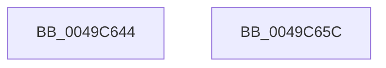

# IoIsDeviceEjectable

- RVA: `0x0049C644`–`0x0049C65D` (길이 `25` bytes)
- VA: `0x000000014049C644`
- 실행 섹션: `.text`
- PDB 이름 있음: `예`; PDB Function 태그: `아니요`
- unwind 정보 RVA: `0x000DB714`
- 디코드: `8`개 명령, `25/25` bytes 표시
- 미해석 바이트: `0` (있으면 어셈블리에 `.byte`로 보존)

> 이 문서는 커널 이미지의 기계어와 PDB 기호를 분석해 생성했습니다. 4번과 5번은 함수 원형과 자료형을 바이너리 사용 방식에서 추정한 C 해석이며 원본 소스 복구 결과는 아닙니다.

## 1. Dependencies

- 직접 호출 지점: **0**; 고유 호출 대상: **0**
- 직접 호출자로 확인된 함수: **3**
- RIP 상대 이미지 참조: **1**

### Outgoing calls
- 직접 디코드된 call 명령이 없습니다.

### Direct callers
- [MiCreateImageFileMap](../../page/98/MiCreateImageFileMap_function_00986830.md) at `0x00986BB9`
- [MiConstructLoaderEntry](../../page/AA/MiConstructLoaderEntry_function_00AAA264.md) at `0x00AAA72C`
- [sub_00B2B0A8](../../page/B2/Unknown_function_00B2B0A8.md) at `0x00B2B389`

### Static image references
- `0x0049C64B` → RVA `0x00E0F3D8` (`.data`; read)

## 2. Other-region calls and transfers

- 다른 실행 섹션으로 향하는 call: **0**
- 별도 외부 분기/꼬리 이동을 확인하지 못했습니다.

## 3. Assembly (complete function range)

```asm
0049C644  F6 41 34 04                     test byte ptr [rcx + 0x34], 4
0049C648  0F 94 C1                        sete cl
0049C64B  0F BA 25 85 2D 97 00 1F         bt dword ptr [rip + 0x972d85], 0x1f
0049C653  0F 93 C0                        setae al
0049C656  84 C8                           test al, cl
0049C658  0F 94 C0                        sete al
0049C65B  C3                              ret
0049C65C  CC                              int3
```

## 4. C-style interpretation (structured pseudocode)

```c
__int64 __fastcall IoIsDeviceEjectable(__int64 a1)
{
    __int64 result;

    a1 = (((*(unsigned __int8 *)(a1 + 52)) & (4)) == 0) ? 1 : 0;
    result = (condition_is_above_or_equal) ? 1 : 0;
    result = ((((unsigned __int8)(result)) & ((unsigned __int8)(a1))) == 0) ? 1 : 0;
    return result;
}
```

## 5. (Beta) C Style

```c
int64_t IoIsDeviceEjectable(void *Arg1)
{
    uint8_t *arg1 = (uint8_t *)Arg1;

    int64_t result;

    Arg1 = (((*(uint8_t *)(arg1 + 0x34)) & (4)) == 0) ? 1 : 0;
    result = (condition_is_above_or_equal) ? 1 : 0;
    result = ((((uint8_t)(result)) & ((uint8_t)(Arg1))) == 0) ? 1 : 0;
    return result;
}
```

### 관측된 메모리 오프셋

구조체 형식이 확인되지 않은 접근은 인자 기준의 오프셋으로만 기록했습니다.

| 기준 인자 | 오프셋 표현 | 폭 (bit) | 접근 |
|---|---:|---:|---|
| `Arg1` | `+ 0x34` | `8` | `R` |

## 6. Execution-region graph

[열기: 2D/3D 그래프와 함수 탐색 컨트롤 패널](../../../control-panel.html?section=text&rva=0x0049C644&view=graph)

- 2D 그래프는 위에서 아래로 흐르고, 3D 그래프는 빈 공간을 드래그해 회전합니다. Shift+드래그는 이동, 휠은 확대·축소, 함수 노드 선택은 대상 보고서 이동입니다.

### Static fallback


