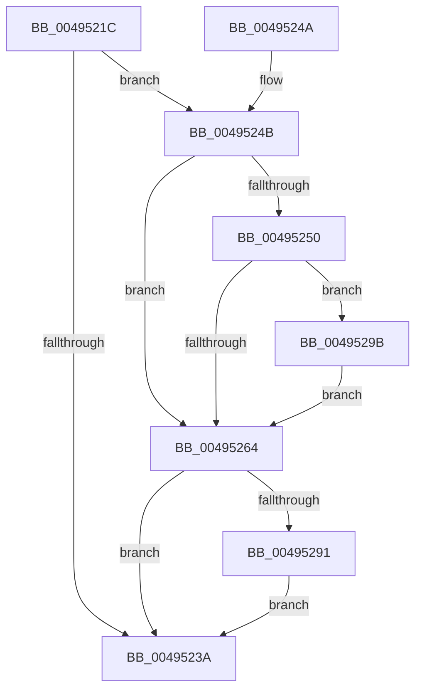

# IoSetDiskIoAttributionOnProcess

- RVA: `0x0049521C`–`0x004952A4` (길이 `136` bytes)
- VA: `0x000000014049521C`
- 실행 섹션: `.text`
- PDB 이름 있음: `예`; PDB Function 태그: `아니요`
- unwind 정보 RVA: `0x000B3640`
- 디코드: `36`개 명령, `136/136` bytes 표시
- 미해석 바이트: `0` (있으면 어셈블리에 `.byte`로 보존)

> 이 문서는 커널 이미지의 기계어와 PDB 기호를 분석해 생성했습니다. 4번과 5번은 함수 원형과 자료형을 바이너리 사용 방식에서 추정한 C 해석이며 원본 소스 복구 결과는 아닙니다.

## 1. Dependencies

- 직접 호출 지점: **3**; 고유 호출 대상: **3**
- 직접 호출자로 확인된 함수: **3**
- RIP 상대 이미지 참조: **1**

### Outgoing calls
- `0x0049526B` → [ExAcquireSpinLockExclusive](../24/ExAcquireSpinLockExclusive_function_00248690.md) (function, `0x00248690`)
- `0x00495287` → [ExReleaseSpinLockExclusive](../2C/ExReleaseSpinLockExclusive_function_002C0EF0.md) (function, `0x002C0EF0`)
- `0x00495294` → [IoDiskIoAttributionDereference](../34/IoDiskIoAttributionDereference_function_00349978.md) (function, `0x00349978`)

### Direct callers
- [PspEstablishJobHierarchy](../../page/87/PspEstablishJobHierarchy_function_0087E17C.md) at `0x0087E4D6`
- [PspEstablishJobHierarchy](../../page/87/PspEstablishJobHierarchy_function_0087E17C.md) at `0x0087E619`
- [PspEstablishJobHierarchy](../../page/87/PspEstablishJobHierarchy_function_0087E17C.md) at `0x0087E62D`
- [PspProcessDelete](../../page/90/PspProcessDelete_function_00907B90.md) at `0x00907E96`
- [PspSetJobIoAttributionProcessCallback](../../page/A8/PspSetJobIoAttributionProcessCallback_function_00A81DA0.md) at `0x00A81DAD`

### Static image references
- `0x00495264` → RVA `0x00F8D1E0` (`.data`; read)

## 2. Other-region calls and transfers

- 다른 실행 섹션으로 향하는 call: **0**
- 별도 외부 분기/꼬리 이동을 확인하지 못했습니다.

## 3. Assembly (complete function range)

```asm
0049521C  48 89 5C 24 08                  mov qword ptr [rsp + 8], rbx
00495221  48 89 74 24 10                  mov qword ptr [rsp + 0x10], rsi
00495226  57                              push rdi
00495227  48 83 EC 20                     sub rsp, 0x20
0049522B  48 8B FA                        mov rdi, rdx
0049522E  48 8B D9                        mov rbx, rcx
00495231  48 39 8A D8 06 00 00            cmp qword ptr [rdx + 0x6d8], rcx
00495238  75 11                           jne 0x14049524b
0049523A  48 8B 5C 24 30                  mov rbx, qword ptr [rsp + 0x30]
0049523F  48 8B 74 24 38                  mov rsi, qword ptr [rsp + 0x38]
00495244  48 83 C4 20                     add rsp, 0x20
00495248  5F                              pop rdi
00495249  C3                              ret
0049524A  CC                              int3
0049524B  48 85 DB                        test rbx, rbx
0049524E  74 14                           je 0x140495264
00495250  B8 01 00 00 00                  mov eax, 1
00495255  F0 48 0F C1 41 20               lock xadd qword ptr [rcx + 0x20], rax
0049525B  48 FF C0                        inc rax
0049525E  48 83 F8 01                     cmp rax, 1
00495262  7E 37                           jle 0x14049529b
00495264  48 8D 0D 75 7F AF 00            lea rcx, [rip + 0xaf7f75]
0049526B  E8 20 34 DB FF                  call 0x140248690
00495270  48 8B B7 D8 06 00 00            mov rsi, qword ptr [rdi + 0x6d8]
00495277  48 8D 0D 62 7F AF 00            lea rcx, [rip + 0xaf7f62]
0049527E  8A D0                           mov dl, al
00495280  48 89 9F D8 06 00 00            mov qword ptr [rdi + 0x6d8], rbx
00495287  E8 64 BC E2 FF                  call 0x1402c0ef0
0049528C  48 85 F6                        test rsi, rsi
0049528F  74 A9                           je 0x14049523a
00495291  48 8B CE                        mov rcx, rsi
00495294  E8 DF 46 EB FF                  call 0x140349978
00495299  EB 9F                           jmp 0x14049523a
0049529B  B9 0E 00 00 00                  mov ecx, 0xe
004952A0  CD 29                           int 0x29
004952A2  EB C0                           jmp 0x140495264
```

## 4. C-style interpretation (structured pseudocode)

```c
__int64 __fastcall IoSetDiskIoAttributionOnProcess(__int64 a1, __int64 a2)
{
    __int64 result;
    __int64 v_rsp;
    unsigned __int64 v_stack_p10;
    unsigned __int64 v_stack_p8;

    v_stack_p8 = v_rbx;
    v_stack_p10 = v_rsi;
    v_rsp = (v_rsp) - (32);
    if ((*(unsigned __int64 *)(a2 + 1752)) != a1) goto loc_0049524B;
loc_0049523A:
    v_rsp = (v_rsp) + (32);
    return result;
loc_0049524B:
    if (v_stack_p8 == 0) goto loc_00495264;
    result = (1) + 1;
    if (result <= 1) goto loc_0049529B;
loc_00495264:
    result = ExAcquireSpinLockExclusive(v_rip + 11501429, a2, a3, a4);
    *(unsigned __int64 *)(a2 + 1752) = v_stack_p8;
    result = ExReleaseSpinLockExclusive(v_rip + 11501410, (unsigned __int8)(result), a3, a4);
    if (*(unsigned __int64 *)(a2 + 1752) == 0) goto loc_0049523A;
    result = IoDiskIoAttributionDereference(*(unsigned __int64 *)(a2 + 1752), (unsigned __int8)(result), a3, a4);
    goto loc_0049523A;
loc_0049529B:
    goto loc_00495264;
}
```

## 5. (Beta) C Style

```c
int64_t IoSetDiskIoAttributionOnProcess(void *Arg1, void *Arg2)
{
    uint8_t *arg1 = (uint8_t *)Arg1;
    uint8_t *arg2 = (uint8_t *)Arg2;

    int64_t result;
    int64_t local_rsp;
    uint64_t v_stack_p10;
    uint64_t v_stack_p8;

    v_stack_p8 = local_rbx;
    v_stack_p10 = local_rsi;
    local_rsp = (local_rsp) - (32);
    if ((*(uint64_t *)(arg2 + 0x6D8)) != Arg1) goto loc_0049524B;
loc_0049523A:
    local_rsp = (local_rsp) + (32);
    return result;
loc_0049524B:
    if (v_stack_p8 == 0) goto loc_00495264;
    result = (1) + 1;
    if (result <= 1) goto loc_0049529B;
loc_00495264:
    result = ExAcquireSpinLockExclusive(v_rip + 11501429, Arg2, a3, a4);
    *(uint64_t *)(arg2 + 0x6D8) = v_stack_p8;
    result = ExReleaseSpinLockExclusive(v_rip + 11501410, (uint8_t)(result), a3, a4);
    if (*(uint64_t *)(arg2 + 0x6D8) == 0) goto loc_0049523A;
    result = IoDiskIoAttributionDereference(*(uint64_t *)(arg2 + 0x6D8), (uint8_t)(result), a3, a4);
    goto loc_0049523A;
loc_0049529B:
    goto loc_00495264;
}
```

### 관측된 메모리 오프셋

구조체 형식이 확인되지 않은 접근은 인자 기준의 오프셋으로만 기록했습니다.

| 기준 인자 | 오프셋 표현 | 폭 (bit) | 접근 |
|---|---:|---:|---|
| `Arg1` | `+ 0x20` | `64` | `R/W` |
| `Arg2` | `+ 0x6D8` | `64` | `R` |
| `Arg2` | `+ 0x6D8` | `64` | `W` |

## 6. Execution-region graph

[열기: 2D/3D 그래프와 함수 탐색 컨트롤 패널](../../../control-panel.html?section=text&rva=0x0049521C&view=graph)

- 2D 그래프는 위에서 아래로 흐르고, 3D 그래프는 빈 공간을 드래그해 회전합니다. Shift+드래그는 이동, 휠은 확대·축소, 함수 노드 선택은 대상 보고서 이동입니다.

### Static fallback


