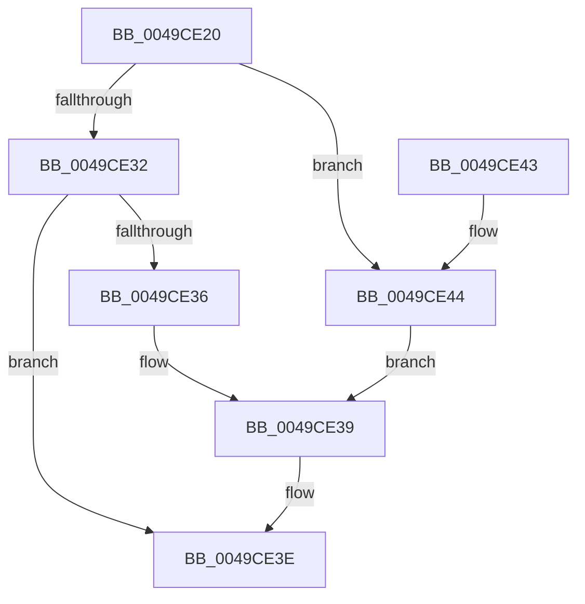

# IoUpdateThreadIoRateThrottle

- RVA: `0x0049CE20`–`0x0049CE48` (길이 `40` bytes)
- VA: `0x000000014049CE20`
- 실행 섹션: `.text`
- PDB 이름 있음: `예`; PDB Function 태그: `아니요`
- unwind 정보 RVA: `0x00069B1C`
- 디코드: `14`개 명령, `40/40` bytes 표시
- 미해석 바이트: `0` (있으면 어셈블리에 `.byte`로 보존)

> 이 문서는 커널 이미지의 기계어와 PDB 기호를 분석해 생성했습니다. 4번과 5번은 함수 원형과 자료형을 바이너리 사용 방식에서 추정한 C 해석이며 원본 소스 복구 결과는 아닙니다.

## 1. Dependencies

- 직접 호출 지점: **1**; 고유 호출 대상: **1**
- 직접 호출자로 확인된 함수: **0**
- RIP 상대 이미지 참조: **0**

### Outgoing calls
- `0x0049CE39` → [KeAbProcessBaseIoPriorityChangeInternal](../3C/KeAbProcessBaseIoPriorityChangeInternal_function_003C406C.md) (function, `0x003C406C`)

### Direct callers
- 이 함수 시작 RVA로 연결되는 직접 call은 확인되지 않았습니다. 간접 호출은 완전히 역산할 수 없습니다.

### Static image references
- 디코드된 RIP-relative 메모리 참조가 없습니다.

## 2. Other-region calls and transfers

- 다른 실행 섹션으로 향하는 call: **0**
- 별도 외부 분기/꼬리 이동을 확인하지 못했습니다.

## 3. Assembly (complete function range)

```asm
0049CE20  48 83 EC 28                     sub rsp, 0x28
0049CE24  8B C2                           mov eax, edx
0049CE26  F0 0F C1 81 E8 05 00 00         lock xadd dword ptr [rcx + 0x5e8], eax
0049CE2E  85 C0                           test eax, eax
0049CE30  74 12                           je 0x14049ce44
0049CE32  03 C2                           add eax, edx
0049CE34  75 08                           jne 0x14049ce3e
0049CE36  8D 50 01                        lea edx, [rax + 1]
0049CE39  E8 2E 72 F2 FF                  call 0x1403c406c
0049CE3E  48 83 C4 28                     add rsp, 0x28
0049CE42  C3                              ret
0049CE43  CC                              int3
0049CE44  33 D2                           xor edx, edx
0049CE46  EB F1                           jmp 0x14049ce39
```

## 4. C-style interpretation (structured pseudocode)

```c
__int64 __fastcall IoUpdateThreadIoRateThrottle(__int64 a1, int a2)
{
    __int64 result;
    __int64 v_rsp;

    v_rsp = (v_rsp) - (40);
    if ((unsigned int)((unsigned int)(a2)) == 0) goto loc_0049CE44;
    result = (unsigned int)(((unsigned int)(a2)) + (a2));
    if (condition_is_not_equal) goto loc_0049CE3E;
loc_0049CE39:
    result = KeAbProcessBaseIoPriorityChangeInternal(a1, result + 1, a3, a4);
loc_0049CE3E:
    v_rsp = (v_rsp) + (40);
    return result;
loc_0049CE44:
    a2 = 0;
    goto loc_0049CE39;
}
```

## 5. (Beta) C Style

```c
int64_t IoUpdateThreadIoRateThrottle(void *Arg1, int32_t Arg2)
{
    uint8_t *arg1 = (uint8_t *)Arg1;

    int64_t result;
    int64_t local_rsp;

    local_rsp = (local_rsp) - (40);
    if ((uint32_t)((uint32_t)(Arg2)) == 0) goto loc_0049CE44;
    result = (uint32_t)(((uint32_t)(Arg2)) + (Arg2));
    if (condition_is_not_equal) goto loc_0049CE3E;
loc_0049CE39:
    result = KeAbProcessBaseIoPriorityChangeInternal(Arg1, result + 1, a3, a4);
loc_0049CE3E:
    local_rsp = (local_rsp) + (40);
    return result;
loc_0049CE44:
    Arg2 = 0;
    goto loc_0049CE39;
}
```

### 관측된 메모리 오프셋

구조체 형식이 확인되지 않은 접근은 인자 기준의 오프셋으로만 기록했습니다.

| 기준 인자 | 오프셋 표현 | 폭 (bit) | 접근 |
|---|---:|---:|---|
| `Arg1` | `+ 0x5E8` | `32` | `R/W` |

## 6. Execution-region graph

[열기: 2D/3D 그래프와 함수 탐색 컨트롤 패널](../../../control-panel.html?section=text&rva=0x0049CE20&view=graph)

- 2D 그래프는 위에서 아래로 흐르고, 3D 그래프는 빈 공간을 드래그해 회전합니다. Shift+드래그는 이동, 휠은 확대·축소, 함수 노드 선택은 대상 보고서 이동입니다.

### Static fallback


