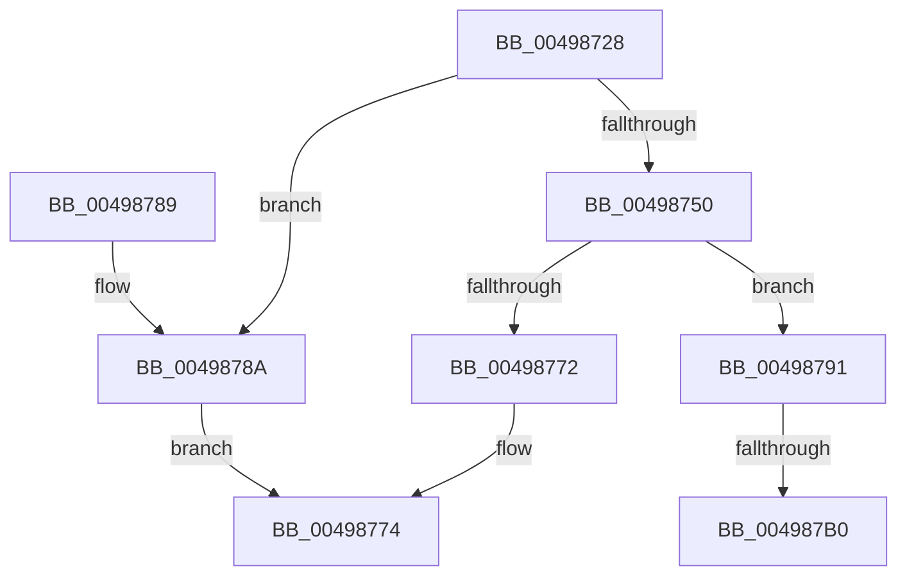

# IommupHvMapDeviceIdentityRange

- RVA: `0x00498728`–`0x004987CC` (길이 `164` bytes)
- VA: `0x0000000140498728`
- 실행 섹션: `.text`
- PDB 이름 있음: `예`; PDB Function 태그: `예`
- unwind 정보 RVA: `0x000B41BC`
- 디코드: `45`개 명령, `164/164` bytes 표시
- 미해석 바이트: `0` (있으면 어셈블리에 `.byte`로 보존)

> 이 문서는 커널 이미지의 기계어와 PDB 기호를 분석해 생성했습니다. 4번과 5번은 함수 원형과 자료형을 바이너리 사용 방식에서 추정한 C 해석이며 원본 소스 복구 결과는 아닙니다.

## 1. Dependencies

- 직접 호출 지점: **3**; 고유 호출 대상: **2**
- 직접 호출자로 확인된 함수: **1**
- RIP 상대 이미지 참조: **2**

### Outgoing calls
- `0x00498767` → [guard_dispatch_icall](../6B/guard_dispatch_icall_function_006BAAD0.md) (function, `0x006BAAD0`)
- `0x004987A3` → [guard_dispatch_icall](../6B/guard_dispatch_icall_function_006BAAD0.md) (function, `0x006BAAD0`)
- `0x004987C6` → [KeBugCheckEx](../4F/KeBugCheckEx_function_004FD660.md) (function, `0x004FD660`)

### Direct callers
- [HalpIommuDomainMapIdentityRange](HalpIommuDomainMapIdentityRange_function_004986AC.md) at `0x004986EE`

### Static image references
- `0x0049875B` → RVA `0x00FC1E38` (`.data`; read)
- `0x00498791` → RVA `0x00FC1E40` (`.data`; read)

## 2. Other-region calls and transfers

- 다른 실행 섹션으로 향하는 call: **0**
- call이 아닌 외부 분기/꼬리 이동: **1**
  - `0x004987AA` → [sub_006F7932](../6F/Unknown_function_006F7932.md) (`tail-transfer`)

## 3. Assembly (complete function range)

```asm
00498728  4C 8B DC                        mov r11, rsp
0049872B  49 89 5B 10                     mov qword ptr [r11 + 0x10], rbx
0049872F  49 89 6B 18                     mov qword ptr [r11 + 0x18], rbp
00498733  49 89 73 20                     mov qword ptr [r11 + 0x20], rsi
00498737  57                              push rdi
00498738  48 83 EC 30                     sub rsp, 0x30
0049873C  49 83 63 08 00                  and qword ptr [r11 + 8], 0
00498741  49 8B D9                        mov rbx, r9
00498744  80 79 34 00                     cmp byte ptr [rcx + 0x34], 0
00498748  49 8B E8                        mov rbp, r8
0049874B  48 8B F9                        mov rdi, rcx
0049874E  75 3A                           jne 0x14049878a
00498750  8B 41 30                        mov eax, dword ptr [rcx + 0x30]
00498753  49 8D 4B 08                     lea rcx, [r11 + 8]
00498757  89 44 24 40                     mov dword ptr [rsp + 0x40], eax
0049875B  48 8B 05 D6 96 B2 00            mov rax, qword ptr [rip + 0xb296d6]
00498762  C6 44 24 44 00                  mov byte ptr [rsp + 0x44], 0
00498767  E8 64 23 22 00                  call 0x1406baad0
0049876C  8B F0                           mov esi, eax
0049876E  85 C0                           test eax, eax
00498770  78 1F                           js 0x140498791
00498772  8B C6                           mov eax, esi
00498774  48 8B 5C 24 48                  mov rbx, qword ptr [rsp + 0x48]
00498779  48 8B 6C 24 50                  mov rbp, qword ptr [rsp + 0x50]
0049877E  48 8B 74 24 58                  mov rsi, qword ptr [rsp + 0x58]
00498783  48 83 C4 30                     add rsp, 0x30
00498787  5F                              pop rdi
00498788  C3                              ret
00498789  CC                              int3
0049878A  B8 0D 00 00 C0                  mov eax, 0xc000000d
0049878F  EB E3                           jmp 0x140498774
00498791  48 8B 05 A8 96 B2 00            mov rax, qword ptr [rip + 0xb296a8]
00498798  48 8D 4C 24 40                  lea rcx, [rsp + 0x40]
0049879D  4C 8B C3                        mov r8, rbx
004987A0  48 8B D5                        mov rdx, rbp
004987A3  E8 28 23 22 00                  call 0x1406baad0
004987A8  85 C0                           test eax, eax
004987AA  0F 89 82 F1 25 00               jns 0x1406f7932
004987B0  48 83 64 24 20 00               and qword ptr [rsp + 0x20], 0
004987B6  4C 8B CF                        mov r9, rdi
004987B9  4C 63 C0                        movsxd r8, eax
004987BC  BA 01 00 00 00                  mov edx, 1
004987C1  B9 D9 01 00 00                  mov ecx, 0x1d9
004987C6  E8 95 4E 06 00                  call 0x1404fd660
004987CB  CC                              int3
```

## 4. C-style interpretation (structured pseudocode)

```c
__int64 __fastcall IommupHvMapDeviceIdentityRange(__int64 a1, __int64 a2, __int64 a3, __int64 a4)
{
    __int64 result;
    __int64 v_rsp;
    unsigned __int64 v_stack_p10;
    unsigned __int64 v_stack_p18;
    unsigned __int64 v_stack_p20;
    unsigned __int64 v_stack_p40;
    unsigned int v_stack_p8;
    unsigned __int8 v_stack_pC;

    *(unsigned __int64 *)(v_rsp + 16) = v_rbx;
    *(unsigned __int64 *)(v_rsp + 24) = v_rbp;
    *(unsigned __int64 *)(v_rsp + 32) = v_rsi;
    v_rsp = (v_rsp) - (48);
    if ((*(unsigned __int8 *)(a1 + 52)) != 0) goto loc_0049878A;
    v_stack_p8 = (unsigned int)((unsigned int)(*(unsigned int *)(a1 + 48)));
    v_stack_pC = 0;
    result = guard_dispatch_icall(v_rsp + 8, a2, a3, a4);
    if (sign_flag) goto loc_00498791;
loc_00498774:
    v_rsp = (v_rsp) + (48);
    return (unsigned int)((unsigned int)((unsigned int)((unsigned int)(result))));
loc_0049878A:
    goto loc_00498774;
loc_00498791:
    result = guard_dispatch_icall(v_stack_p40, v_stack_p18, v_stack_p10, a4);
    result = KeBugCheckEx(473, 1, (int)((unsigned int)(result)), a1);
    return result;
}
```

## 5. (Beta) C Style

```c
int64_t IommupHvMapDeviceIdentityRange(void *Arg1, int64_t Arg2, int64_t Arg3, int64_t Arg4)
{
    uint8_t *arg1 = (uint8_t *)Arg1;

    int64_t result;
    int64_t local_rsp;
    uint64_t v_stack_p10;
    uint64_t v_stack_p18;
    uint64_t v_stack_p20;
    uint64_t v_stack_p40;
    uint32_t v_stack_p8;
    uint8_t v_stack_pC;

    *(uint64_t *)(local_rsp + 0x10) = local_rbx;
    *(uint64_t *)(local_rsp + 0x18) = local_rbp;
    *(uint64_t *)(local_rsp + 0x20) = local_rsi;
    local_rsp = (local_rsp) - (48);
    if ((*(uint8_t *)(arg1 + 0x34)) != 0) goto loc_0049878A;
    v_stack_p8 = (uint32_t)((uint32_t)(*(uint32_t *)(arg1 + 0x30)));
    v_stack_pC = 0;
    result = guard_dispatch_icall(local_rsp + 8, Arg2, Arg3, Arg4);
    if (sign_flag) goto loc_00498791;
loc_00498774:
    local_rsp = (local_rsp) + (48);
    return (uint32_t)((uint32_t)((uint32_t)((uint32_t)(result))));
loc_0049878A:
    goto loc_00498774;
loc_00498791:
    result = guard_dispatch_icall(v_stack_p40, v_stack_p18, v_stack_p10, Arg4);
    result = KeBugCheckEx(473, 1, (int32_t)((uint32_t)(result)), Arg1);
    return result;
}
```

### 관측된 메모리 오프셋

구조체 형식이 확인되지 않은 접근은 인자 기준의 오프셋으로만 기록했습니다.

| 기준 인자 | 오프셋 표현 | 폭 (bit) | 접근 |
|---|---:|---:|---|
| `Arg1` | `+ 0x30` | `32` | `R` |
| `Arg1` | `+ 0x34` | `8` | `R` |

## 6. Execution-region graph

[열기: 2D/3D 그래프와 함수 탐색 컨트롤 패널](../../../control-panel.html?section=text&rva=0x00498728&view=graph)

- 2D 그래프는 위에서 아래로 흐르고, 3D 그래프는 빈 공간을 드래그해 회전합니다. Shift+드래그는 이동, 휠은 확대·축소, 함수 노드 선택은 대상 보고서 이동입니다.

### Static fallback


