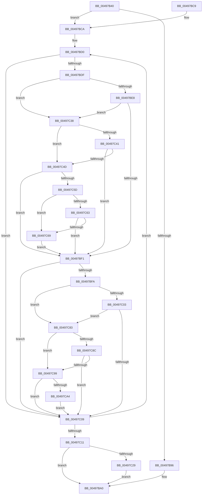

# IopCancelIrpsInCurrentThreadListSpecialApc

- RVA: `0x00497B40`–`0x00497CB3` (길이 `371` bytes)
- VA: `0x0000000140497B40`
- 실행 섹션: `.text`
- PDB 이름 있음: `예`; PDB Function 태그: `아니요`
- unwind 정보 RVA: `0x000B3EE0`
- 디코드: `97`개 명령, `371/371` bytes 표시
- 미해석 바이트: `0` (있으면 어셈블리에 `.byte`로 보존)

> 이 문서는 커널 이미지의 기계어와 PDB 기호를 분석해 생성했습니다. 4번과 5번은 함수 원형과 자료형을 바이너리 사용 방식에서 추정한 C 해석이며 원본 소스 복구 결과는 아닙니다.

## 1. Dependencies

- 직접 호출 지점: **5**; 고유 호출 대상: **4**
- 직접 호출자로 확인된 함수: **0**
- RIP 상대 이미지 참조: **0**

### Outgoing calls
- `0x00497B75` → [KeAcquireSpinLockRaiseToDpc](../20/KeAcquireSpinLockRaiseToDpc_function_00208470.md) (function, `0x00208470`)
- `0x00497B9B` → [KeReleaseSpinLock](../39/KeReleaseSpinLock_function_00392BA0.md) (function, `0x00392BA0`)
- `0x00497BA9` → [KeSetEvent](../33/KeSetEvent_function_0033F310.md) (function, `0x0033F310`)
- `0x00497C1B` → [KeReleaseSpinLock](../39/KeReleaseSpinLock_function_00392BA0.md) (function, `0x00392BA0`)
- `0x00497C2E` → [KeAlertThread](../48/KeAlertThread_function_00489B40.md) (function, `0x00489B40`)

### Direct callers
- 이 함수 시작 RVA로 연결되는 직접 call은 확인되지 않았습니다. 간접 호출은 완전히 역산할 수 없습니다.

### Static image references
- 디코드된 RIP-relative 메모리 참조가 없습니다.

## 2. Other-region calls and transfers

- 다른 실행 섹션으로 향하는 call: **0**
- 별도 외부 분기/꼬리 이동을 확인하지 못했습니다.

## 3. Assembly (complete function range)

```asm
00497B40  48 8B C4                        mov rax, rsp
00497B43  48 89 58 08                     mov qword ptr [rax + 8], rbx
00497B47  48 89 68 10                     mov qword ptr [rax + 0x10], rbp
00497B4B  48 89 70 18                     mov qword ptr [rax + 0x18], rsi
00497B4F  48 89 78 20                     mov qword ptr [rax + 0x20], rdi
00497B53  41 56                           push r14
00497B55  48 83 EC 20                     sub rsp, 0x20
00497B59  65 48 8B 34 25 88 01 00 00      mov rsi, qword ptr gs:[0x188]
00497B62  48 8B D9                        mov rbx, rcx
00497B65  4D 8B 31                        mov r14, qword ptr [r9]
00497B68  40 32 ED                        xor bpl, bpl
00497B6B  48 8D BE 18 06 00 00            lea rdi, [rsi + 0x618]
00497B72  48 8B CF                        mov rcx, rdi
00497B75  E8 F6 08 D7 FF                  call 0x140208470
00497B7A  4C 8D 96 40 05 00 00            lea r10, [rsi + 0x540]
00497B81  44 8A C8                        mov r9b, al
00497B84  49 8B 12                        mov rdx, qword ptr [r10]
00497B87  41 88 2E                        mov byte ptr [r14], bpl
00497B8A  83 A3 84 00 00 00 00            and dword ptr [rbx + 0x84], 0
00497B91  4C 3B D2                        cmp r10, rdx
00497B94  75 34                           jne 0x140497bca
00497B96  8A D0                           mov dl, al
00497B98  48 8B CF                        mov rcx, rdi
00497B9B  E8 00 B0 EF FF                  call 0x140392ba0
00497BA0  48 8D 4B 68                     lea rcx, [rbx + 0x68]
00497BA4  45 33 C0                        xor r8d, r8d
00497BA7  33 D2                           xor edx, edx
00497BA9  E8 62 77 EA FF                  call 0x14033f310
00497BAE  48 8B 5C 24 30                  mov rbx, qword ptr [rsp + 0x30]
00497BB3  48 8B 6C 24 38                  mov rbp, qword ptr [rsp + 0x38]
00497BB8  48 8B 74 24 40                  mov rsi, qword ptr [rsp + 0x40]
00497BBD  48 8B 7C 24 48                  mov rdi, qword ptr [rsp + 0x48]
00497BC2  48 83 C4 20                     add rsp, 0x20
00497BC6  41 5E                           pop r14
00497BC8  C3                              ret
00497BC9  CC                              int3
00497BCA  41 BB 01 00 00 00               mov r11d, 1
00497BD0  0F BE 4A 22                     movsx ecx, byte ptr [rdx + 0x22]
00497BD4  0F BE 42 23                     movsx eax, byte ptr [rdx + 0x23]
00497BD8  83 C1 02                        add ecx, 2
00497BDB  3B C1                           cmp eax, ecx
00497BDD  7D 2A                           jge 0x140497c09
00497BDF  48 8B 43 60                     mov rax, qword ptr [rbx + 0x60]
00497BE3  48 85 C0                        test rax, rax
00497BE6  74 50                           je 0x140497c38
00497BE8  48 8B C8                        mov rcx, rax
00497BEB  48 39 42 28                     cmp qword ptr [rdx + 0x28], rax
00497BEF  74 47                           je 0x140497c38
00497BF1  80 BB 80 00 00 00 00            cmp byte ptr [rbx + 0x80], 0
00497BF8  75 0F                           jne 0x140497c09
00497BFA  48 85 C9                        test rcx, rcx
00497BFD  0F 84 80 00 00 00               je 0x140497c83
00497C03  48 39 4A 28                     cmp qword ptr [rdx + 0x28], rcx
00497C07  74 7A                           je 0x140497c83
00497C09  48 8B 12                        mov rdx, qword ptr [rdx]
00497C0C  4C 3B D2                        cmp r10, rdx
00497C0F  75 BF                           jne 0x140497bd0
00497C11  48 8D 8E 18 06 00 00            lea rcx, [rsi + 0x618]
00497C18  41 8A D1                        mov dl, r9b
00497C1B  E8 80 AF EF FF                  call 0x140392ba0
00497C20  40 84 ED                        test bpl, bpl
00497C23  0F 84 77 FF FF FF               je 0x140497ba0
00497C29  33 D2                           xor edx, edx
00497C2B  48 8B CE                        mov rcx, rsi
00497C2E  E8 0D 1F FF FF                  call 0x140489b40
00497C33  E9 68 FF FF FF                  jmp 0x140497ba0
00497C38  4C 8B 43 58                     mov r8, qword ptr [rbx + 0x58]
00497C3C  4D 85 C0                        test r8, r8
00497C3F  74 0C                           je 0x140497c4d
00497C41  48 8B C8                        mov rcx, rax
00497C44  4C 39 82 A0 00 00 00            cmp qword ptr [rdx + 0xa0], r8
00497C4B  75 A4                           jne 0x140497bf1
00497C4D  44 8B 42 F0                     mov r8d, dword ptr [rdx - 0x10]
00497C51  48 8B C8                        mov rcx, rax
00497C54  41 F7 C0 02 04 00 00            test r8d, 0x402
00497C5B  75 94                           jne 0x140497bf1
00497C5D  41 F6 C0 84                     test r8b, 0x84
00497C61  75 06                           jne 0x140497c69
00497C63  F6 42 27 02                     test byte ptr [rdx + 0x27], 2
00497C67  74 88                           je 0x140497bf1
00497C69  44 88 5A 24                     mov byte ptr [rdx + 0x24], r11b
00497C6D  41 8A EB                        mov bpl, r11b
00497C70  45 88 1E                        mov byte ptr [r14], r11b
00497C73  48 8B 4B 60                     mov rcx, qword ptr [rbx + 0x60]
00497C77  44 89 9B 84 00 00 00            mov dword ptr [rbx + 0x84], r11d
00497C7E  E9 6E FF FF FF                  jmp 0x140497bf1
00497C83  48 8B 43 58                     mov rax, qword ptr [rbx + 0x58]
00497C87  48 85 C0                        test rax, rax
00497C8A  74 0D                           je 0x140497c99
00497C8C  48 39 82 A0 00 00 00            cmp qword ptr [rdx + 0xa0], rax
00497C93  0F 85 70 FF FF FF               jne 0x140497c09
00497C99  8B 42 F0                        mov eax, dword ptr [rdx - 0x10]
00497C9C  A8 02                           test al, 2
00497C9E  0F 85 65 FF FF FF               jne 0x140497c09
00497CA4  45 88 1E                        mov byte ptr [r14], r11b
00497CA7  44 89 9B 84 00 00 00            mov dword ptr [rbx + 0x84], r11d
00497CAE  E9 56 FF FF FF                  jmp 0x140497c09
```

## 4. C-style interpretation (structured pseudocode)

```c
__int64 __fastcall IopCancelIrpsInCurrentThreadListSpecialApc(__int64 a1, __int64 a2, int a3, __int64 a4)
{
    __int64 result;
    __int64 v_rbp;
    __int64 v_rsp;
    unsigned __int64 v_stack_p10;
    unsigned __int64 v_stack_p18;
    unsigned __int64 v_stack_p20;
    unsigned __int64 v_stack_p8;

    *(unsigned __int64 *)(v_rsp + 8) = v_rbx;
    *(unsigned __int64 *)(v_rsp + 16) = v_rbp;
    *(unsigned __int64 *)(v_rsp + 24) = v_rsi;
    *(unsigned __int64 *)(v_rsp + 32) = v_rdi;
    v_rsp = (v_rsp) - (32);
    v_rbp = 0;
    result = KeAcquireSpinLockRaiseToDpc(*(unsigned __int64 *)(gs_base + (0 + 392)) + 1560, a2, a3, a4);
    *(unsigned __int8 *)(*(unsigned __int64 *)(a4)) = 0;
    if ((*(unsigned __int64 *)(gs_base + (0 + 392)) + 1344) != (*(unsigned __int64 *)(*(unsigned __int64 *)(gs_base + (0 + 392)) + 1344))) goto loc_00497BCA;
    result = KeReleaseSpinLock(*(unsigned __int64 *)(gs_base + (0 + 392)) + 1560, (unsigned __int8)(result), a3, (unsigned __int8)(result));
loc_00497BA0:
    a3 = 0;
    a2 = 0;
    result = KeSetEvent(a1 + 104, a2, a3, (unsigned __int8)(result));
    v_rsp = (v_rsp) + (32);
    return result;
loc_00497BCA:
loc_00497BD0:
    a1 = (unsigned int)(((__int8)(*(unsigned __int8 *)(a2 + 34))) + (2));
    if (((unsigned int)((__int8)(*(unsigned __int8 *)(a2 + 35)))) >= ((unsigned int)(a1))) goto loc_00497C09;
    if (*(unsigned __int64 *)(v_stack_p8 + 96) == 0) goto loc_00497C38;
    if ((*(unsigned __int64 *)(a2 + 40)) == (*(unsigned __int64 *)(v_stack_p8 + 96))) goto loc_00497C38;
loc_00497BF1:
    if ((*(unsigned __int8 *)(v_stack_p8 + 128)) != 0) goto loc_00497C09;
    if (*(unsigned __int64 *)(v_stack_p8 + 96) == 0) goto loc_00497C83;
    if ((*(unsigned __int64 *)(a2 + 40)) == (*(unsigned __int64 *)(v_stack_p8 + 96))) goto loc_00497C83;
loc_00497C09:
    if ((*(unsigned __int64 *)(gs_base + (0 + 392)) + 1344) != (*(unsigned __int64 *)(a2))) goto loc_00497BD0;
    result = KeReleaseSpinLock(v_stack_p18 + 1560, (unsigned __int8)((unsigned __int8)(result)), a3, (unsigned __int8)(result));
    if ((unsigned __int8)(v_stack_p10) == 0) goto loc_00497BA0;
    a2 = 0;
    result = KeAlertThread(v_stack_p18, a2, a3, (unsigned __int8)(result));
    goto loc_00497BA0;
loc_00497C38:
    if (*(unsigned __int64 *)(v_stack_p8 + 88) == 0) goto loc_00497C4D;
    if ((*(unsigned __int64 *)(a2 + 160)) != (*(unsigned __int64 *)(v_stack_p8 + 88))) goto loc_00497BF1;
loc_00497C4D:
    if ((((unsigned int)((unsigned int)(*(unsigned int *)(a2 - 16)))) & (0x402ULL)) != 0) goto loc_00497BF1;
    if ((((unsigned __int8)((unsigned int)(*(unsigned int *)(a2 - 16)))) & (132)) != 0) goto loc_00497C69;
    if (((*(unsigned __int8 *)(a2 + 39)) & (2)) == 0) goto loc_00497BF1;
loc_00497C69:
    *(unsigned __int8 *)(a2 + 36) = 1;
    *(unsigned __int8 *)(*(unsigned __int64 *)(a4)) = 1;
    *(unsigned int *)(v_stack_p8 + 132) = 1;
    goto loc_00497BF1;
loc_00497C83:
    if (*(unsigned __int64 *)(v_stack_p8 + 88) == 0) goto loc_00497C99;
    if ((*(unsigned __int64 *)(a2 + 160)) != (*(unsigned __int64 *)(v_stack_p8 + 88))) goto loc_00497C09;
loc_00497C99:
    if ((((unsigned __int8)((unsigned int)(*(unsigned int *)(a2 - 16)))) & (2)) != 0) goto loc_00497C09;
    *(unsigned __int8 *)(*(unsigned __int64 *)(a4)) = 1;
    *(unsigned int *)(v_stack_p8 + 132) = 1;
    goto loc_00497C09;
}
```

## 5. (Beta) C Style

```c
int64_t IopCancelIrpsInCurrentThreadListSpecialApc(void *Arg1, int64_t Arg2, int32_t Arg3, void *Arg4)
{
    uint8_t *arg1 = (uint8_t *)Arg1;
    uint8_t *arg4 = (uint8_t *)Arg4;

    int64_t result;
    int64_t local_rbp;
    int64_t local_rsp;
    uint64_t v_stack_p10;
    uint64_t v_stack_p18;
    uint64_t v_stack_p20;
    uint64_t v_stack_p8;

    *(uint64_t *)(local_rsp + 0x8) = local_rbx;
    *(uint64_t *)(local_rsp + 0x10) = local_rbp;
    *(uint64_t *)(local_rsp + 0x18) = local_rsi;
    *(uint64_t *)(local_rsp + 0x20) = local_rdi;
    local_rsp = (local_rsp) - (32);
    local_rbp = 0;
    result = KeAcquireSpinLockRaiseToDpc(*(uint64_t *)(gs_base + (0 + 0x188)) + 1560, Arg2, Arg3, Arg4);
    *(uint8_t *)(*(uint64_t *)(arg4)) = 0;
    if ((*(uint64_t *)(gs_base + (0 + 0x188)) + 1344) != (*(uint64_t *)(*(uint64_t *)(gs_base + (0 + 0x188)) + 0x540))) goto loc_00497BCA;
    result = KeReleaseSpinLock(*(uint64_t *)(gs_base + (0 + 0x188)) + 1560, (uint8_t)(result), Arg3, (uint8_t)(result));
loc_00497BA0:
    Arg3 = 0;
    Arg2 = 0;
    result = KeSetEvent(Arg1 + 104, Arg2, Arg3, (uint8_t)(result));
    local_rsp = (local_rsp) + (32);
    return result;
loc_00497BCA:
loc_00497BD0:
    Arg1 = (uint32_t)(((int8_t)(*(uint8_t *)(Arg2 + 0x22))) + (2));
    if (((uint32_t)((int8_t)(*(uint8_t *)(Arg2 + 0x23)))) >= ((uint32_t)(Arg1))) goto loc_00497C09;
    if (*(uint64_t *)(v_stack_p8 + 0x60) == 0) goto loc_00497C38;
    if ((*(uint64_t *)(Arg2 + 0x28)) == (*(uint64_t *)(v_stack_p8 + 0x60))) goto loc_00497C38;
loc_00497BF1:
    if ((*(uint8_t *)(v_stack_p8 + 0x80)) != 0) goto loc_00497C09;
    if (*(uint64_t *)(v_stack_p8 + 0x60) == 0) goto loc_00497C83;
    if ((*(uint64_t *)(Arg2 + 0x28)) == (*(uint64_t *)(v_stack_p8 + 0x60))) goto loc_00497C83;
loc_00497C09:
    if ((*(uint64_t *)(gs_base + (0 + 0x188)) + 1344) != (*(uint64_t *)(Arg2))) goto loc_00497BD0;
    result = KeReleaseSpinLock(v_stack_p18 + 1560, (uint8_t)((uint8_t)(result)), Arg3, (uint8_t)(result));
    if ((uint8_t)(v_stack_p10) == 0) goto loc_00497BA0;
    Arg2 = 0;
    result = KeAlertThread(v_stack_p18, Arg2, Arg3, (uint8_t)(result));
    goto loc_00497BA0;
loc_00497C38:
    if (*(uint64_t *)(v_stack_p8 + 0x58) == 0) goto loc_00497C4D;
    if ((*(uint64_t *)(Arg2 + 0xA0)) != (*(uint64_t *)(v_stack_p8 + 0x58))) goto loc_00497BF1;
loc_00497C4D:
    if ((((uint32_t)((uint32_t)(*(uint32_t *)(Arg2 - 0x10)))) & (0x402ULL)) != 0) goto loc_00497BF1;
    if ((((uint8_t)((uint32_t)(*(uint32_t *)(Arg2 - 0x10)))) & (132)) != 0) goto loc_00497C69;
    if (((*(uint8_t *)(Arg2 + 0x27)) & (2)) == 0) goto loc_00497BF1;
loc_00497C69:
    *(uint8_t *)(Arg2 + 0x24) = 1;
    *(uint8_t *)(*(uint64_t *)(arg4)) = 1;
    *(uint32_t *)(v_stack_p8 + 0x84) = 1;
    goto loc_00497BF1;
loc_00497C83:
    if (*(uint64_t *)(v_stack_p8 + 0x58) == 0) goto loc_00497C99;
    if ((*(uint64_t *)(Arg2 + 0xA0)) != (*(uint64_t *)(v_stack_p8 + 0x58))) goto loc_00497C09;
loc_00497C99:
    if ((((uint8_t)((uint32_t)(*(uint32_t *)(Arg2 - 0x10)))) & (2)) != 0) goto loc_00497C09;
    *(uint8_t *)(*(uint64_t *)(arg4)) = 1;
    *(uint32_t *)(v_stack_p8 + 0x84) = 1;
    goto loc_00497C09;
}
```

### 관측된 메모리 오프셋

구조체 형식이 확인되지 않은 접근은 인자 기준의 오프셋으로만 기록했습니다.

| 기준 인자 | 오프셋 표현 | 폭 (bit) | 접근 |
|---|---:|---:|---|
| `Arg1` | `+ 0x58` | `64` | `R` |
| `Arg1` | `+ 0x60` | `64` | `R` |
| `Arg1` | `+ 0x68` | `64` | `R` |
| `Arg1` | `+ 0x80` | `8` | `R` |
| `Arg1` | `+ 0x84` | `32` | `R/W` |
| `Arg1` | `+ 0x84` | `32` | `W` |
| `Arg4` | `+ 0x0` | `64` | `R` |

## 6. Execution-region graph

[열기: 2D/3D 그래프와 함수 탐색 컨트롤 패널](../../../control-panel.html?section=text&rva=0x00497B40&view=graph)

- 2D 그래프는 위에서 아래로 흐르고, 3D 그래프는 빈 공간을 드래그해 회전합니다. Shift+드래그는 이동, 휠은 확대·축소, 함수 노드 선택은 대상 보고서 이동입니다.

### Static fallback


