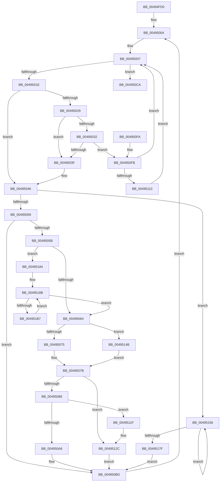

# IopKeepAliveWorker

- RVA: `0x00494FD0`–`0x004951B9` (길이 `489` bytes)
- VA: `0x0000000140494FD0`
- 실행 섹션: `.text`
- PDB 이름 있음: `예`; PDB Function 태그: `아니요`
- unwind 정보 RVA: `0x000B35FC`
- 디코드: `118`개 명령, `489/489` bytes 표시
- 미해석 바이트: `0` (있으면 어셈블리에 `.byte`로 보존)

> 이 문서는 커널 이미지의 기계어와 PDB 기호를 분석해 생성했습니다. 4번과 5번은 함수 원형과 자료형을 바이너리 사용 방식에서 추정한 C 해석이며 원본 소스 복구 결과는 아닙니다.

## 1. Dependencies

- 직접 호출 지점: **15**; 고유 호출 대상: **7**
- 직접 호출자로 확인된 함수: **0**
- RIP 상대 이미지 참조: **5**

### Outgoing calls
- `0x00494FEF` → [KeAcquireSpinLockRaiseToDpc](../20/KeAcquireSpinLockRaiseToDpc_function_00208470.md) (function, `0x00208470`)
- `0x0049504C` → [KeReleaseSpinLock](../39/KeReleaseSpinLock_function_00392BA0.md) (function, `0x00392BA0`)
- `0x0049508B` → [KeAcquireSpinLockRaiseToDpc](../20/KeAcquireSpinLockRaiseToDpc_function_00208470.md) (function, `0x00208470`)
- `0x004950AB` → [KeReleaseSpinLock](../39/KeReleaseSpinLock_function_00392BA0.md) (function, `0x00392BA0`)
- `0x004950B8` → [KeDelayExecutionThread](../20/KeDelayExecutionThread_function_00209550.md) (function, `0x00209550`)
- `0x004950C0` → [KeAcquireSpinLockRaiseToDpc](../20/KeAcquireSpinLockRaiseToDpc_function_00208470.md) (function, `0x00208470`)
- `0x004950DF` → [KeReleaseSpinLock](../39/KeReleaseSpinLock_function_00392BA0.md) (function, `0x00392BA0`)
- `0x00495115` → [ExFreePoolWithTag](../../poolcode/B8/ExFreePoolWithTag_function_00B82870.md) (function, `0x00B82870`)
- `0x0049511F` → [KeReleaseSpinLock](../39/KeReleaseSpinLock_function_00392BA0.md) (function, `0x00392BA0`)
- `0x00495133` → [PspAdjustKeepAliveCountProcess](../../page/A7/PspAdjustKeepAliveCountProcess_function_00A7EE04.md) (function, `0x00A7EE04`)
- `0x00495141` → [ObfDereferenceObjectWithTag](../2F/ObfDereferenceObjectWithTag_function_002F78E0.md) (function, `0x002F78E0`)
- `0x0049515F` → [ObfReferenceObjectWithTag](../21/ObfReferenceObjectWithTag_function_00210710.md) (function, `0x00210710`)
- `0x00495175` → [PspAdjustKeepAliveCountProcess](../../page/A7/PspAdjustKeepAliveCountProcess_function_00A7EE04.md) (function, `0x00A7EE04`)
- `0x0049519A` → [PspAdjustKeepAliveCountProcess](../../page/A7/PspAdjustKeepAliveCountProcess_function_00A7EE04.md) (function, `0x00A7EE04`)
- `0x004951A8` → [ObfDereferenceObjectWithTag](../2F/ObfDereferenceObjectWithTag_function_002F78E0.md) (function, `0x002F78E0`)

### Direct callers
- 이 함수 시작 RVA로 연결되는 직접 call은 확인되지 않았습니다. 간접 호출은 완전히 역산할 수 없습니다.

### Static image references
- `0x00494FE5` → RVA `0x00F8D730` (`.data`; read)
- `0x00494FFD` → RVA `0x00F8D760` (`.data`; write)
- `0x00495007` → RVA `0x00F8D720` (`.data`; read)
- `0x004950CA` → RVA `0x00F8D760` (`.data`; read/write)
- `0x004950D8` → RVA `0x00F8D758` (`.data`; write)

## 2. Other-region calls and transfers

- 다른 실행 섹션으로 향하는 call: **4**
  - `0x00495115` → [ExFreePoolWithTag](../../poolcode/B8/ExFreePoolWithTag_function_00B82870.md) (`.text` → `POOLCODE`)
  - `0x00495133` → [PspAdjustKeepAliveCountProcess](../../page/A7/PspAdjustKeepAliveCountProcess_function_00A7EE04.md) (`.text` → `PAGE`)
  - `0x00495175` → [PspAdjustKeepAliveCountProcess](../../page/A7/PspAdjustKeepAliveCountProcess_function_00A7EE04.md) (`.text` → `PAGE`)
  - `0x0049519A` → [PspAdjustKeepAliveCountProcess](../../page/A7/PspAdjustKeepAliveCountProcess_function_00A7EE04.md) (`.text` → `PAGE`)
- 별도 외부 분기/꼬리 이동을 확인하지 못했습니다.

## 3. Assembly (complete function range)

```asm
00494FD0  48 89 5C 24 08                  mov qword ptr [rsp + 8], rbx
00494FD5  48 89 74 24 10                  mov qword ptr [rsp + 0x10], rsi
00494FDA  48 89 7C 24 18                  mov qword ptr [rsp + 0x18], rdi
00494FDF  41 56                           push r14
00494FE1  48 83 EC 20                     sub rsp, 0x20
00494FE5  4C 8D 35 44 87 AF 00            lea r14, [rip + 0xaf8744]
00494FEC  49 8B CE                        mov rcx, r14
00494FEF  E8 7C 34 D7 FF                  call 0x140208470
00494FF4  65 48 8B 0C 25 88 01 00 00      mov rcx, qword ptr gs:[0x188]
00494FFD  48 89 0D 5C 87 AF 00            mov qword ptr [rip + 0xaf875c], rcx
00495004  40 8A F0                        mov sil, al
00495007  48 8B 1D 12 87 AF 00            mov rbx, qword ptr [rip + 0xaf8712]
0049500E  48 8D 05 0B 87 AF 00            lea rax, [rip + 0xaf870b]
00495015  48 3B D8                        cmp rbx, rax
00495018  0F 84 AC 00 00 00               je 0x1404950ca
0049501E  8B 7B 20                        mov edi, dword ptr [rbx + 0x20]
00495021  83 63 20 00                     and dword ptr [rbx + 0x20], 0
00495025  85 FF                           test edi, edi
00495027  75 1D                           jne 0x140495046
00495029  48 8B 0B                        mov rcx, qword ptr [rbx]
0049502C  48 39 59 08                     cmp qword ptr [rcx + 8], rbx
00495030  75 0D                           jne 0x14049503f
00495032  48 8B 43 08                     mov rax, qword ptr [rbx + 8]
00495036  48 39 18                        cmp qword ptr [rax], rbx
00495039  0F 84 BC 00 00 00               je 0x1404950fb
0049503F  B9 03 00 00 00                  mov ecx, 3
00495044  CD 29                           int 0x29
00495046  40 8A D6                        mov dl, sil
00495049  49 8B CE                        mov rcx, r14
0049504C  E8 4F DB EF FF                  call 0x140392ba0
00495051  85 FF                           test edi, edi
00495053  0F 8F FD 00 00 00               jg 0x140495156
00495059  79 62                           jns 0x1404950bd
0049505B  83 FF FF                        cmp edi, -1
0049505E  0F 85 20 01 00 00               jne 0x140495184
00495064  44 8A 4B 12                     mov r9b, byte ptr [rbx + 0x12]
00495068  48 8B 4B 18                     mov rcx, qword ptr [rbx + 0x18]
0049506C  45 84 C9                        test r9b, r9b
0049506F  0F 84 D6 00 00 00               je 0x14049514b
00495075  8B 81 2C 07 00 00               mov eax, dword ptr [rcx + 0x72c]
0049507B  0F BA F0 1F                     btr eax, 0x1f
0049507F  83 F8 01                        cmp eax, 1
00495082  0F 85 A4 00 00 00               jne 0x14049512c
00495088  49 8B CE                        mov rcx, r14
0049508B  E8 E0 33 D7 FF                  call 0x140208470
00495090  48 B9 14 00 00 00 80 F7 FF FF   movabs rcx, 0xfffff78000000014
0049509A  8A D0                           mov dl, al
0049509C  48 8B 09                        mov rcx, qword ptr [rcx]
0049509F  48 3B 4B 30                     cmp rcx, qword ptr [rbx + 0x30]
004950A3  49 8B CE                        mov rcx, r14
004950A6  7D 77                           jge 0x14049511f
004950A8  FF 4B 20                        dec dword ptr [rbx + 0x20]
004950AB  E8 F0 DA EF FF                  call 0x140392ba0
004950B0  4C 8D 43 30                     lea r8, [rbx + 0x30]
004950B4  B2 01                           mov dl, 1
004950B6  33 C9                           xor ecx, ecx
004950B8  E8 93 44 D7 FF                  call 0x140209550
004950BD  49 8B CE                        mov rcx, r14
004950C0  E8 AB 33 D7 FF                  call 0x140208470
004950C5  E9 3A FF FF FF                  jmp 0x140495004
004950CA  48 83 25 8E 86 AF 00 00         and qword ptr [rip + 0xaf868e], 0
004950D2  40 8A D6                        mov dl, sil
004950D5  49 8B CE                        mov rcx, r14
004950D8  C6 05 79 86 AF 00 00            mov byte ptr [rip + 0xaf8679], 0
004950DF  E8 BC DA EF FF                  call 0x140392ba0
004950E4  48 8B 5C 24 30                  mov rbx, qword ptr [rsp + 0x30]
004950E9  48 8B 74 24 38                  mov rsi, qword ptr [rsp + 0x38]
004950EE  48 8B 7C 24 40                  mov rdi, qword ptr [rsp + 0x40]
004950F3  48 83 C4 20                     add rsp, 0x20
004950F7  41 5E                           pop r14
004950F9  C3                              ret
004950FA  CC                              int3
004950FB  48 89 08                        mov qword ptr [rax], rcx
004950FE  48 89 41 08                     mov qword ptr [rcx + 8], rax
00495102  80 7B 11 01                     cmp byte ptr [rbx + 0x11], 1
00495106  C6 43 10 00                     mov byte ptr [rbx + 0x10], 0
0049510A  0F 85 F7 FE FF FF               jne 0x140495007
00495110  33 D2                           xor edx, edx
00495112  48 8B CB                        mov rcx, rbx
00495115  E8 56 D7 6E 00                  call 0x140b82870
0049511A  E9 E8 FE FF FF                  jmp 0x140495007
0049511F  E8 7C DA EF FF                  call 0x140392ba0
00495124  44 8A 4B 12                     mov r9b, byte ptr [rbx + 0x12]
00495128  48 8B 4B 18                     mov rcx, qword ptr [rbx + 0x18]
0049512C  4C 8B 43 28                     mov r8, qword ptr [rbx + 0x28]
00495130  83 CA FF                        or edx, 0xffffffff
00495133  E8 CC 9C 5E 00                  call 0x140a7ee04
00495138  48 8B 4B 18                     mov rcx, qword ptr [rbx + 0x18]
0049513C  BA 44 66 6C 74                  mov edx, 0x746c6644
00495141  E8 9A 27 E6 FF                  call 0x1402f78e0
00495146  E9 72 FF FF FF                  jmp 0x1404950bd
0049514B  8B 81 4C 07 00 00               mov eax, dword ptr [rcx + 0x74c]
00495151  E9 25 FF FF FF                  jmp 0x14049507b
00495156  48 8B 4B 18                     mov rcx, qword ptr [rbx + 0x18]
0049515A  BA 44 66 6C 74                  mov edx, 0x746c6644
0049515F  E8 AC B5 D7 FF                  call 0x140210710
00495164  44 8A 4B 12                     mov r9b, byte ptr [rbx + 0x12]
00495168  BA 01 00 00 00                  mov edx, 1
0049516D  4C 8B 43 28                     mov r8, qword ptr [rbx + 0x28]
00495171  48 8B 4B 18                     mov rcx, qword ptr [rbx + 0x18]
00495175  E8 8A 9C 5E 00                  call 0x140a7ee04
0049517A  83 EF 01                        sub edi, 1
0049517D  75 D7                           jne 0x140495156
0049517F  E9 39 FF FF FF                  jmp 0x1404950bd
00495184  83 C8 FF                        or eax, 0xffffffff
00495187  2B C7                           sub eax, edi
00495189  8B F8                           mov edi, eax
0049518B  44 8A 4B 12                     mov r9b, byte ptr [rbx + 0x12]
0049518F  83 CA FF                        or edx, 0xffffffff
00495192  4C 8B 43 28                     mov r8, qword ptr [rbx + 0x28]
00495196  48 8B 4B 18                     mov rcx, qword ptr [rbx + 0x18]
0049519A  E8 65 9C 5E 00                  call 0x140a7ee04
0049519F  48 8B 4B 18                     mov rcx, qword ptr [rbx + 0x18]
004951A3  BA 44 66 6C 74                  mov edx, 0x746c6644
004951A8  E8 33 27 E6 FF                  call 0x1402f78e0
004951AD  48 83 EF 01                     sub rdi, 1
004951B1  0F 84 AD FE FF FF               je 0x140495064
004951B7  EB D2                           jmp 0x14049518b
```

## 4. C-style interpretation (structured pseudocode)

```c
__int64 __fastcall IopKeepAliveWorker(void)
{
    __int64 result;
    __int64 v_rdi;
    __int64 v_rsp;
    unsigned __int64 v_stack_p10;
    unsigned __int64 v_stack_p18;
    unsigned __int64 v_stack_p8;

    v_stack_p8 = v_rbx;
    v_stack_p10 = v_rsi;
    v_stack_p18 = v_rdi;
    v_rsp = (v_rsp) - (32);
    result = KeAcquireSpinLockRaiseToDpc(v_rip + 11503428, a2, a3, a4);
    *(unsigned __int64 *)(v_rip + 11503452) = *(unsigned __int64 *)(gs_base + (0 + 392));
loc_00495004:
loc_00495007:
    if ((*(unsigned __int64 *)(v_rip + 11503378)) == (v_rip + 11503371)) goto loc_004950CA;
    if ((unsigned int)((unsigned int)(*(unsigned int *)(*(unsigned __int64 *)(v_rip + 11503378) + 32))) != 0) goto loc_00495046;
    if ((*(unsigned __int64 *)(*(unsigned __int64 *)(*(unsigned __int64 *)(v_rip + 11503378)) + 8)) != (*(unsigned __int64 *)(v_rip + 11503378))) goto loc_0049503F;
    if ((*(unsigned __int64 *)(*(unsigned __int64 *)(*(unsigned __int64 *)(v_rip + 11503378) + 8))) == (*(unsigned __int64 *)(v_rip + 11503378))) goto loc_004950FB;
loc_0049503F:
loc_00495046:
    result = KeReleaseSpinLock(v_rip + 11503428, (unsigned __int8)((unsigned __int8)(result)), a3, a4);
    if (condition_is_greater) goto loc_00495156;
    if (!sign_flag) goto loc_004950BD;
    if (((unsigned int)((unsigned int)(*(unsigned int *)(*(unsigned __int64 *)(v_rip + 11503378) + 32)))) != -1) goto loc_00495184;
loc_00495064:
    if ((unsigned __int8)(*(unsigned __int8 *)(*(unsigned __int64 *)(v_rip + 11503378) + 18)) == 0) goto loc_0049514B;
loc_0049507B:
    if (((unsigned int)((unsigned int)(*(unsigned int *)(*(unsigned __int64 *)(*(unsigned __int64 *)(v_rip + 11503378) + 24) + 1836)))) != 1) goto loc_0049512C;
    result = KeAcquireSpinLockRaiseToDpc(v_rip + 11503428, (unsigned __int8)((unsigned __int8)(result)), a3, *(unsigned __int8 *)(*(unsigned __int64 *)(v_rip + 11503378) + 18));
    if ((*(unsigned __int64 *)(v_rip + 11503428)) >= (*(unsigned __int64 *)(*(unsigned __int64 *)(v_rip + 11503378) + 48))) goto loc_0049511F;
    result = KeReleaseSpinLock(v_rip + 11503428, (unsigned __int8)(result), a3, *(unsigned __int8 *)(*(unsigned __int64 *)(v_rip + 11503378) + 18));
    a1 = 0;
    result = KeDelayExecutionThread(a1, 1, *(unsigned __int64 *)(v_rip + 11503378) + 48, *(unsigned __int8 *)(*(unsigned __int64 *)(v_rip + 11503378) + 18));
loc_004950BD:
    result = KeAcquireSpinLockRaiseToDpc(v_rip + 11503428, 1, *(unsigned __int64 *)(v_rip + 11503378) + 48, *(unsigned __int8 *)(*(unsigned __int64 *)(v_rip + 11503378) + 18));
    goto loc_00495004;
loc_004950CA:
    *(unsigned __int8 *)(v_rip + 11503225) = 0;
    result = KeReleaseSpinLock(v_rip + 11503428, (unsigned __int8)((unsigned __int8)(result)), *(unsigned __int64 *)(v_rip + 11503378) + 48, *(unsigned __int8 *)(*(unsigned __int64 *)(v_rip + 11503378) + 18));
    v_rsp = (v_rsp) + (32);
    return result;
loc_004950FB:
    *(unsigned __int64 *)(result) = v_rip + 11503428;
    *(unsigned __int64 *)(v_rip + 11503428 + 8) = result;
    *(unsigned __int8 *)(v_stack_p8 + 16) = 0;
    if ((*(unsigned __int8 *)(v_stack_p8 + 17)) != 1) goto loc_00495007;
    a2 = 0;
    result = ExFreePoolWithTag(v_stack_p8, a2, *(unsigned __int64 *)(v_rip + 11503378) + 48, *(unsigned __int8 *)(*(unsigned __int64 *)(v_rip + 11503378) + 18));
    goto loc_00495007;
loc_0049511F:
    result = KeReleaseSpinLock(v_stack_p8, a2, *(unsigned __int64 *)(v_rip + 11503378) + 48, *(unsigned __int8 *)(*(unsigned __int64 *)(v_rip + 11503378) + 18));
loc_0049512C:
    a2 = (unsigned int)((a2) | (0xFFFFFFFFULL));
    result = PspAdjustKeepAliveCountProcess(*(unsigned __int64 *)(v_stack_p8 + 24), a2, *(unsigned __int64 *)(v_stack_p8 + 40), *(unsigned __int8 *)(v_stack_p8 + 18));
    result = ObfDereferenceObjectWithTag(*(unsigned __int64 *)(v_stack_p8 + 24), (unsigned int)(0x746C6644ULL), *(unsigned __int64 *)(v_stack_p8 + 40), *(unsigned __int8 *)(v_stack_p8 + 18));
    goto loc_004950BD;
loc_0049514B:
    goto loc_0049507B;
loc_00495156:
    result = ObfReferenceObjectWithTag(*(unsigned __int64 *)(v_stack_p8 + 24), (unsigned int)(0x746C6644ULL), *(unsigned __int64 *)(v_stack_p8 + 40), *(unsigned __int8 *)(v_stack_p8 + 18));
    result = PspAdjustKeepAliveCountProcess(*(unsigned __int64 *)(v_stack_p8 + 24), 1, *(unsigned __int64 *)(v_stack_p8 + 40), *(unsigned __int8 *)(v_stack_p8 + 18));
    v_rdi = (unsigned int)((v_stack_p18) - (1));
    if (condition_is_not_equal) goto loc_00495156;
    goto loc_004950BD;
loc_00495184:
    result = (unsigned int)((result) | (0xFFFFFFFFULL));
    result = (unsigned int)((result) - ((unsigned int)(v_rdi)));
loc_0049518B:
    a2 = (unsigned int)((1) | (0xFFFFFFFFULL));
    result = PspAdjustKeepAliveCountProcess(*(unsigned __int64 *)(v_stack_p8 + 24), a2, *(unsigned __int64 *)(v_stack_p8 + 40), *(unsigned __int8 *)(v_stack_p8 + 18));
    result = ObfDereferenceObjectWithTag(*(unsigned __int64 *)(v_stack_p8 + 24), (unsigned int)(0x746C6644ULL), *(unsigned __int64 *)(v_stack_p8 + 40), *(unsigned __int8 *)(v_stack_p8 + 18));
    v_rdi = ((unsigned int)((unsigned int)(result))) - (1);
    if (condition_is_equal) goto loc_00495064;
    goto loc_0049518B;
}
```

## 5. (Beta) C Style

```c
void IopKeepAliveWorker(void)
{
    int64_t result;
    int64_t local_rdi;
    int64_t local_rsp;
    uint64_t v_stack_p10;
    uint64_t v_stack_p18;
    uint64_t v_stack_p8;

    v_stack_p8 = local_rbx;
    v_stack_p10 = local_rsi;
    v_stack_p18 = local_rdi;
    local_rsp = (local_rsp) - (32);
    result = KeAcquireSpinLockRaiseToDpc(v_rip + 11503428, a2, a3, a4);
    *(uint64_t *)(v_rip + 0xAF875C) = *(uint64_t *)(gs_base + (0 + 0x188));
loc_00495004:
loc_00495007:
    if ((*(uint64_t *)(v_rip + 0xAF8712)) == (v_rip + 11503371)) goto loc_004950CA;
    if ((uint32_t)((uint32_t)(*(uint32_t *)(*(uint64_t *)(v_rip + 0xAF8712) + 0x20))) != 0) goto loc_00495046;
    if ((*(uint64_t *)(*(uint64_t *)(*(uint64_t *)(v_rip + 0xAF8712)) + 0x8)) != (*(uint64_t *)(v_rip + 0xAF8712))) goto loc_0049503F;
    if ((*(uint64_t *)(*(uint64_t *)(*(uint64_t *)(v_rip + 0xAF8712) + 0x8))) == (*(uint64_t *)(v_rip + 0xAF8712))) goto loc_004950FB;
loc_0049503F:
loc_00495046:
    result = KeReleaseSpinLock(v_rip + 11503428, (uint8_t)((uint8_t)(result)), a3, a4);
    if (condition_is_greater) goto loc_00495156;
    if (!sign_flag) goto loc_004950BD;
    if (((uint32_t)((uint32_t)(*(uint32_t *)(*(uint64_t *)(v_rip + 0xAF8712) + 0x20)))) != -1) goto loc_00495184;
loc_00495064:
    if ((uint8_t)(*(uint8_t *)(*(uint64_t *)(v_rip + 0xAF8712) + 0x12)) == 0) goto loc_0049514B;
loc_0049507B:
    if (((uint32_t)((uint32_t)(*(uint32_t *)(*(uint64_t *)(*(uint64_t *)(v_rip + 0xAF8712) + 0x18) + 0x72C)))) != 1) goto loc_0049512C;
    result = KeAcquireSpinLockRaiseToDpc(v_rip + 11503428, (uint8_t)((uint8_t)(result)), a3, *(uint8_t *)(*(uint64_t *)(v_rip + 0xAF8712) + 0x12));
    if ((*(uint64_t *)(v_rip + 0xAF8744)) >= (*(uint64_t *)(*(uint64_t *)(v_rip + 0xAF8712) + 0x30))) goto loc_0049511F;
    result = KeReleaseSpinLock(v_rip + 11503428, (uint8_t)(result), a3, *(uint8_t *)(*(uint64_t *)(v_rip + 0xAF8712) + 0x12));
    a1 = 0;
    result = KeDelayExecutionThread(a1, 1, *(uint64_t *)(v_rip + 0xAF8712) + 48, *(uint8_t *)(*(uint64_t *)(v_rip + 0xAF8712) + 0x12));
loc_004950BD:
    result = KeAcquireSpinLockRaiseToDpc(v_rip + 11503428, 1, *(uint64_t *)(v_rip + 0xAF8712) + 48, *(uint8_t *)(*(uint64_t *)(v_rip + 0xAF8712) + 0x12));
    goto loc_00495004;
loc_004950CA:
    *(uint8_t *)(v_rip + 0xAF8679) = 0;
    result = KeReleaseSpinLock(v_rip + 11503428, (uint8_t)((uint8_t)(result)), *(uint64_t *)(v_rip + 0xAF8712) + 48, *(uint8_t *)(*(uint64_t *)(v_rip + 0xAF8712) + 0x12));
    local_rsp = (local_rsp) + (32);
    return result;
loc_004950FB:
    *(uint64_t *)(result) = v_rip + 11503428;
    *(uint64_t *)(v_rip + 0xAF8744 + 0x8) = result;
    *(uint8_t *)(v_stack_p8 + 0x10) = 0;
    if ((*(uint8_t *)(v_stack_p8 + 0x11)) != 1) goto loc_00495007;
    a2 = 0;
    result = ExFreePoolWithTag(v_stack_p8, a2, *(uint64_t *)(v_rip + 0xAF8712) + 48, *(uint8_t *)(*(uint64_t *)(v_rip + 0xAF8712) + 0x12));
    goto loc_00495007;
loc_0049511F:
    result = KeReleaseSpinLock(v_stack_p8, a2, *(uint64_t *)(v_rip + 0xAF8712) + 48, *(uint8_t *)(*(uint64_t *)(v_rip + 0xAF8712) + 0x12));
loc_0049512C:
    a2 = (uint32_t)((a2) | (0xFFFFFFFFULL));
    result = PspAdjustKeepAliveCountProcess(*(uint64_t *)(v_stack_p8 + 0x18), a2, *(uint64_t *)(v_stack_p8 + 0x28), *(uint8_t *)(v_stack_p8 + 0x12));
    result = ObfDereferenceObjectWithTag(*(uint64_t *)(v_stack_p8 + 0x18), (uint32_t)(0x746C6644ULL), *(uint64_t *)(v_stack_p8 + 0x28), *(uint8_t *)(v_stack_p8 + 0x12));
    goto loc_004950BD;
loc_0049514B:
    goto loc_0049507B;
loc_00495156:
    result = ObfReferenceObjectWithTag(*(uint64_t *)(v_stack_p8 + 0x18), (uint32_t)(0x746C6644ULL), *(uint64_t *)(v_stack_p8 + 0x28), *(uint8_t *)(v_stack_p8 + 0x12));
    result = PspAdjustKeepAliveCountProcess(*(uint64_t *)(v_stack_p8 + 0x18), 1, *(uint64_t *)(v_stack_p8 + 0x28), *(uint8_t *)(v_stack_p8 + 0x12));
    local_rdi = (uint32_t)((v_stack_p18) - (1));
    if (condition_is_not_equal) goto loc_00495156;
    goto loc_004950BD;
loc_00495184:
    result = (uint32_t)((result) | (0xFFFFFFFFULL));
    result = (uint32_t)((result) - ((uint32_t)(local_rdi)));
loc_0049518B:
    a2 = (uint32_t)((1) | (0xFFFFFFFFULL));
    result = PspAdjustKeepAliveCountProcess(*(uint64_t *)(v_stack_p8 + 0x18), a2, *(uint64_t *)(v_stack_p8 + 0x28), *(uint8_t *)(v_stack_p8 + 0x12));
    result = ObfDereferenceObjectWithTag(*(uint64_t *)(v_stack_p8 + 0x18), (uint32_t)(0x746C6644ULL), *(uint64_t *)(v_stack_p8 + 0x28), *(uint8_t *)(v_stack_p8 + 0x12));
    local_rdi = ((uint32_t)((uint32_t)(result))) - (1);
    if (condition_is_equal) goto loc_00495064;
    goto loc_0049518B;
}
```

## 6. Execution-region graph

[열기: 2D/3D 그래프와 함수 탐색 컨트롤 패널](../../../control-panel.html?section=text&rva=0x00494FD0&view=graph)

- 2D 그래프는 위에서 아래로 흐르고, 3D 그래프는 빈 공간을 드래그해 회전합니다. Shift+드래그는 이동, 휠은 확대·축소, 함수 노드 선택은 대상 보고서 이동입니다.

### Static fallback


