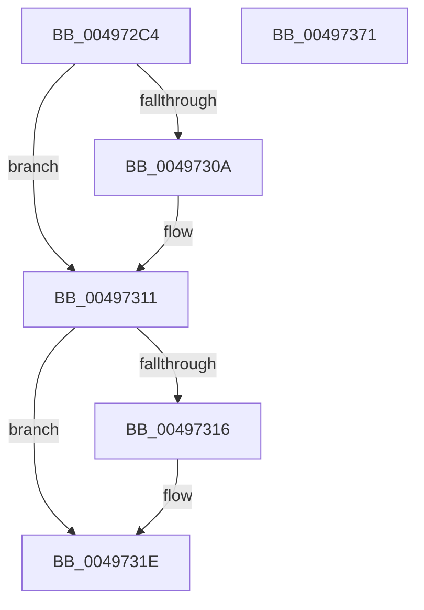

# IopMountInitializeVpb

- RVA: `0x004972C4`–`0x00497372` (길이 `174` bytes)
- VA: `0x00000001404972C4`
- 실행 섹션: `.text`
- PDB 이름 있음: `예`; PDB Function 태그: `아니요`
- unwind 정보 RVA: `0x0005E6B4`
- 디코드: `48`개 명령, `174/174` bytes 표시
- 미해석 바이트: `0` (있으면 어셈블리에 `.byte`로 보존)

> 이 문서는 커널 이미지의 기계어와 PDB 기호를 분석해 생성했습니다. 4번과 5번은 함수 원형과 자료형을 바이너리 사용 방식에서 추정한 C 해석이며 원본 소스 복구 결과는 아닙니다.

## 1. Dependencies

- 직접 호출 지점: **3**; 고유 호출 대상: **3**
- 직접 호출자로 확인된 함수: **1**
- RIP 상대 이미지 참조: **0**

### Outgoing calls
- `0x004972EE` → [KeAcquireQueuedSpinLock](../27/KeAcquireQueuedSpinLock_function_00273D80.md) (function, `0x00273D80`)
- `0x00497341` → [IopIncrementVpbRefCount](../27/IopIncrementVpbRefCount_function_00272820.md) (function, `0x00272820`)
- `0x0049734E` → [KeReleaseQueuedSpinLock](../27/KeReleaseQueuedSpinLock_function_00272540.md) (function, `0x00272540`)

### Direct callers
- [IopMountVolume](../../page/A3/IopMountVolume_function_00A329D0.md) at `0x00A32CE9`

### Static image references
- 디코드된 RIP-relative 메모리 참조가 없습니다.

## 2. Other-region calls and transfers

- 다른 실행 섹션으로 향하는 call: **0**
- 별도 외부 분기/꼬리 이동을 확인하지 못했습니다.

## 3. Assembly (complete function range)

```asm
004972C4  48 8B C4                        mov rax, rsp
004972C7  48 89 58 08                     mov qword ptr [rax + 8], rbx
004972CB  48 89 68 10                     mov qword ptr [rax + 0x10], rbp
004972CF  48 89 70 18                     mov qword ptr [rax + 0x18], rsi
004972D3  48 89 78 20                     mov qword ptr [rax + 0x20], rdi
004972D7  41 56                           push r14
004972D9  48 83 EC 20                     sub rsp, 0x20
004972DD  48 8B D9                        mov rbx, rcx
004972E0  41 8A F1                        mov sil, r9b
004972E3  B9 09 00 00 00                  mov ecx, 9
004972E8  41 8B F8                        mov edi, r8d
004972EB  48 8B EA                        mov rbp, rdx
004972EE  E8 8D CA DD FF                  call 0x140273d80
004972F3  48 8B 5B 38                     mov rbx, qword ptr [rbx + 0x38]
004972F7  44 8A F0                        mov r14b, al
004972FA  B8 01 00 00 00                  mov eax, 1
004972FF  0F B7 C8                        movzx ecx, ax
00497302  66 89 43 04                     mov word ptr [rbx + 4], ax
00497306  85 FF                           test edi, edi
00497308  74 07                           je 0x140497311
0049730A  8D 48 10                        lea ecx, [rax + 0x10]
0049730D  66 89 4B 04                     mov word ptr [rbx + 4], cx
00497311  40 84 F6                        test sil, sil
00497314  74 08                           je 0x14049731e
00497316  66 83 C9 20                     or cx, 0x20
0049731A  66 89 4B 04                     mov word ptr [rbx + 4], cx
0049731E  44 8A 45 4C                     mov r8b, byte ptr [rbp + 0x4c]
00497322  48 8B CB                        mov rcx, rbx
00497325  48 8B 53 08                     mov rdx, qword ptr [rbx + 8]
00497329  44 02 C0                        add r8b, al
0049732C  44 88 42 4C                     mov byte ptr [rdx + 0x4c], r8b
00497330  48 8B 53 08                     mov rdx, qword ptr [rbx + 8]
00497334  4C 8B 82 38 01 00 00            mov r8, qword ptr [rdx + 0x138]
0049733B  33 D2                           xor edx, edx
0049733D  49 89 58 48                     mov qword ptr [r8 + 0x48], rbx
00497341  E8 DA B4 DD FF                  call 0x140272820
00497346  41 8A D6                        mov dl, r14b
00497349  B9 09 00 00 00                  mov ecx, 9
0049734E  E8 ED B1 DD FF                  call 0x140272540
00497353  48 8B 6C 24 38                  mov rbp, qword ptr [rsp + 0x38]
00497358  48 8B C3                        mov rax, rbx
0049735B  48 8B 5C 24 30                  mov rbx, qword ptr [rsp + 0x30]
00497360  48 8B 74 24 40                  mov rsi, qword ptr [rsp + 0x40]
00497365  48 8B 7C 24 48                  mov rdi, qword ptr [rsp + 0x48]
0049736A  48 83 C4 20                     add rsp, 0x20
0049736E  41 5E                           pop r14
00497370  C3                              ret
00497371  CC                              int3
```

## 4. C-style interpretation (structured pseudocode)

```c
__int64 __fastcall IopMountInitializeVpb(__int64 a1, __int64 a2, int a3, unsigned __int8 a4)
{
    __int64 result;
    __int64 v_rsp;
    unsigned __int64 v_stack_p10;
    unsigned __int64 v_stack_p18;
    unsigned __int64 v_stack_p20;
    unsigned __int64 v_stack_p8;

    *(unsigned __int64 *)(v_rsp + 8) = v_rbx;
    *(unsigned __int64 *)(v_rsp + 16) = v_rbp;
    *(unsigned __int64 *)(v_rsp + 24) = v_rsi;
    *(unsigned __int64 *)(v_rsp + 32) = v_rdi;
    v_rsp = (v_rsp) - (32);
    result = KeAcquireQueuedSpinLock(9, a2, a3, a4);
    *(unsigned __int16 *)(*(unsigned __int64 *)(a1 + 56) + 4) = 1;
    if ((unsigned int)((unsigned int)(a3)) != 0) {
        a1 = 1 + 16;
        *(unsigned __int16 *)(*(unsigned __int64 *)(a1 + 56) + 4) = (unsigned __int16)(a1);
    }
    if (a4 != 0) {
        a1 = (unsigned __int16)((a1) | (32));
        *(unsigned __int16 *)(*(unsigned __int64 *)(a1 + 56) + 4) = (unsigned __int16)(a1);
    }
    a3 = (unsigned __int8)((*(unsigned __int8 *)(a2 + 76)) + (1));
    *(unsigned __int8 *)(*(unsigned __int64 *)(*(unsigned __int64 *)(a1 + 56) + 8) + 76) = (unsigned __int8)(a3);
    a2 = 0;
    *(unsigned __int64 *)(*(unsigned __int64 *)(*(unsigned __int64 *)(*(unsigned __int64 *)(a1 + 56) + 8) + 312) + 72) = *(unsigned __int64 *)(a1 + 56);
    result = IopIncrementVpbRefCount(*(unsigned __int64 *)(a1 + 56), a2, *(unsigned __int64 *)(*(unsigned __int64 *)(*(unsigned __int64 *)(a1 + 56) + 8) + 312), a4);
    result = KeReleaseQueuedSpinLock(9, (unsigned __int8)((unsigned __int8)(result)), *(unsigned __int64 *)(*(unsigned __int64 *)(*(unsigned __int64 *)(a1 + 56) + 8) + 312), a4);
    v_rsp = (v_rsp) + (32);
    return *(unsigned __int64 *)(a1 + 56);
}
```

## 5. (Beta) C Style

```c
int64_t IopMountInitializeVpb(void *Arg1, void *Arg2, int32_t Arg3, uint8_t Arg4)
{
    uint8_t *arg1 = (uint8_t *)Arg1;
    uint8_t *arg2 = (uint8_t *)Arg2;

    int64_t result;
    int64_t local_rsp;
    uint64_t v_stack_p10;
    uint64_t v_stack_p18;
    uint64_t v_stack_p20;
    uint64_t v_stack_p8;

    *(uint64_t *)(local_rsp + 0x8) = local_rbx;
    *(uint64_t *)(local_rsp + 0x10) = local_rbp;
    *(uint64_t *)(local_rsp + 0x18) = local_rsi;
    *(uint64_t *)(local_rsp + 0x20) = local_rdi;
    local_rsp = (local_rsp) - (32);
    result = KeAcquireQueuedSpinLock(9, Arg2, Arg3, Arg4);
    *(uint16_t *)(*(uint64_t *)(arg1 + 0x38) + 0x4) = 1;
    if ((uint32_t)((uint32_t)(Arg3)) != 0) {
        Arg1 = 1 + 16;
        *(uint16_t *)(*(uint64_t *)(arg1 + 0x38) + 0x4) = (uint16_t)(Arg1);
    }
    if (Arg4 != 0) {
        Arg1 = (uint16_t)((Arg1) | (32));
        *(uint16_t *)(*(uint64_t *)(arg1 + 0x38) + 0x4) = (uint16_t)(Arg1);
    }
    Arg3 = (uint8_t)((*(uint8_t *)(arg2 + 0x4C)) + (1));
    *(uint8_t *)(*(uint64_t *)(*(uint64_t *)(arg1 + 0x38) + 0x8) + 0x4C) = (uint8_t)(Arg3);
    Arg2 = 0;
    *(uint64_t *)(*(uint64_t *)(*(uint64_t *)(*(uint64_t *)(arg1 + 0x38) + 0x8) + 0x138) + 0x48) = *(uint64_t *)(arg1 + 0x38);
    result = IopIncrementVpbRefCount(*(uint64_t *)(arg1 + 0x38), Arg2, *(uint64_t *)(*(uint64_t *)(*(uint64_t *)(arg1 + 0x38) + 0x8) + 0x138), Arg4);
    result = KeReleaseQueuedSpinLock(9, (uint8_t)((uint8_t)(result)), *(uint64_t *)(*(uint64_t *)(*(uint64_t *)(arg1 + 0x38) + 0x8) + 0x138), Arg4);
    local_rsp = (local_rsp) + (32);
    return *(uint64_t *)(arg1 + 0x38);
}
```

### 관측된 메모리 오프셋

구조체 형식이 확인되지 않은 접근은 인자 기준의 오프셋으로만 기록했습니다.

| 기준 인자 | 오프셋 표현 | 폭 (bit) | 접근 |
|---|---:|---:|---|
| `Arg1` | `+ 0x38` | `64` | `R` |
| `Arg2` | `+ 0x4C` | `8` | `R` |

## 6. Execution-region graph

[열기: 2D/3D 그래프와 함수 탐색 컨트롤 패널](../../../control-panel.html?section=text&rva=0x004972C4&view=graph)

- 2D 그래프는 위에서 아래로 흐르고, 3D 그래프는 빈 공간을 드래그해 회전합니다. Shift+드래그는 이동, 휠은 확대·축소, 함수 노드 선택은 대상 보고서 이동입니다.

### Static fallback


