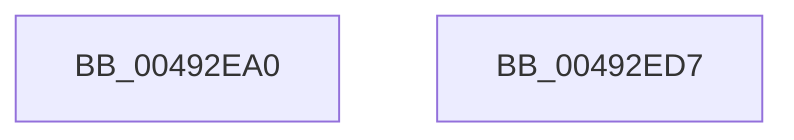

# IopQueueCopyWrite

- RVA: `0x00492EA0`–`0x00492ED8` (길이 `56` bytes)
- VA: `0x0000000140492EA0`
- 실행 섹션: `.text`
- PDB 이름 있음: `예`; PDB Function 태그: `아니요`
- unwind 정보 RVA: `0x00063458`
- 디코드: `14`개 명령, `56/56` bytes 표시
- 미해석 바이트: `0` (있으면 어셈블리에 `.byte`로 보존)

> 이 문서는 커널 이미지의 기계어와 PDB 기호를 분석해 생성했습니다. 4번과 5번은 함수 원형과 자료형을 바이너리 사용 방식에서 추정한 C 해석이며 원본 소스 복구 결과는 아닙니다.

## 1. Dependencies

- 직접 호출 지점: **1**; 고유 호출 대상: **1**
- 직접 호출자로 확인된 함수: **0**
- RIP 상대 이미지 참조: **0**

### Outgoing calls
- `0x00492ECD` → [IopSynchronousServiceTail](../../page/8E/IopSynchronousServiceTail_function_008EB440.md) (function, `0x008EB440`)

### Direct callers
- 이 함수 시작 RVA로 연결되는 직접 call은 확인되지 않았습니다. 간접 호출은 완전히 역산할 수 없습니다.

### Static image references
- 디코드된 RIP-relative 메모리 참조가 없습니다.

## 2. Other-region calls and transfers

- 다른 실행 섹션으로 향하는 call: **1**
  - `0x00492ECD` → [IopSynchronousServiceTail](../../page/8E/IopSynchronousServiceTail_function_008EB440.md) (`.text` → `PAGE`)
- 별도 외부 분기/꼬리 이동을 확인하지 못했습니다.

## 3. Assembly (complete function range)

```asm
00492EA0  48 83 EC 48                     sub rsp, 0x48
00492EA4  48 8B 11                        mov rdx, qword ptr [rcx]
00492EA7  4C 8B 41 10                     mov r8, qword ptr [rcx + 0x10]
00492EAB  48 8B 49 08                     mov rcx, qword ptr [rcx + 8]
00492EAF  C7 44 24 30 01 00 00 00         mov dword ptr [rsp + 0x30], 1
00492EB7  44 8B 4A 10                     mov r9d, dword ptr [rdx + 0x10]
00492EBB  41 C1 E9 0B                     shr r9d, 0xb
00492EBF  41 80 E1 01                     and r9b, 1
00492EC3  C6 44 24 28 00                  mov byte ptr [rsp + 0x28], 0
00492EC8  C6 44 24 20 00                  mov byte ptr [rsp + 0x20], 0
00492ECD  E8 6E 85 45 00                  call 0x1408eb440
00492ED2  48 83 C4 48                     add rsp, 0x48
00492ED6  C3                              ret
00492ED7  CC                              int3
```

## 4. C-style interpretation (structured pseudocode)

```c
__int64 __fastcall IopQueueCopyWrite(__int64 a1)
{
    __int64 result;
    __int64 v_rsp;
    unsigned int v_stack_m18;
    unsigned __int8 v_stack_m20;
    unsigned __int8 v_stack_m28;

    v_rsp = (v_rsp) - (72);
    v_stack_m18 = 1;
    a4 = (unsigned int)(((unsigned int)(*(unsigned int *)(*(unsigned __int64 *)(a1) + 16))) >> (11));
    a4 = (unsigned __int8)((a4) & (1));
    v_stack_m20 = 0;
    v_stack_m28 = 0;
    result = IopSynchronousServiceTail(*(unsigned __int64 *)(a1 + 8), *(unsigned __int64 *)(a1), *(unsigned __int64 *)(a1 + 16), a4);
    v_rsp = (v_rsp) + (72);
    return result;
}
```

## 5. (Beta) C Style

```c
int64_t IopQueueCopyWrite(void *Arg1)
{
    uint8_t *arg1 = (uint8_t *)Arg1;

    int64_t result;
    int64_t local_rsp;
    uint32_t v_stack_m18;
    uint8_t v_stack_m20;
    uint8_t v_stack_m28;

    local_rsp = (local_rsp) - (72);
    v_stack_m18 = 1;
    a4 = (uint32_t)(((uint32_t)(*(uint32_t *)(*(uint64_t *)(arg1) + 0x10))) >> (11));
    a4 = (uint8_t)((a4) & (1));
    v_stack_m20 = 0;
    v_stack_m28 = 0;
    result = IopSynchronousServiceTail(*(uint64_t *)(arg1 + 0x8), *(uint64_t *)(arg1), *(uint64_t *)(arg1 + 0x10), a4);
    local_rsp = (local_rsp) + (72);
    return result;
}
```

### 관측된 메모리 오프셋

구조체 형식이 확인되지 않은 접근은 인자 기준의 오프셋으로만 기록했습니다.

| 기준 인자 | 오프셋 표현 | 폭 (bit) | 접근 |
|---|---:|---:|---|
| `Arg1` | `+ 0x0` | `64` | `R` |
| `Arg1` | `+ 0x8` | `64` | `R` |
| `Arg1` | `+ 0x10` | `64` | `R` |

## 6. Execution-region graph

[열기: 2D/3D 그래프와 함수 탐색 컨트롤 패널](../../../control-panel.html?section=text&rva=0x00492EA0&view=graph)

- 2D 그래프는 위에서 아래로 흐르고, 3D 그래프는 빈 공간을 드래그해 회전합니다. Shift+드래그는 이동, 휠은 확대·축소, 함수 노드 선택은 대상 보고서 이동입니다.

### Static fallback


