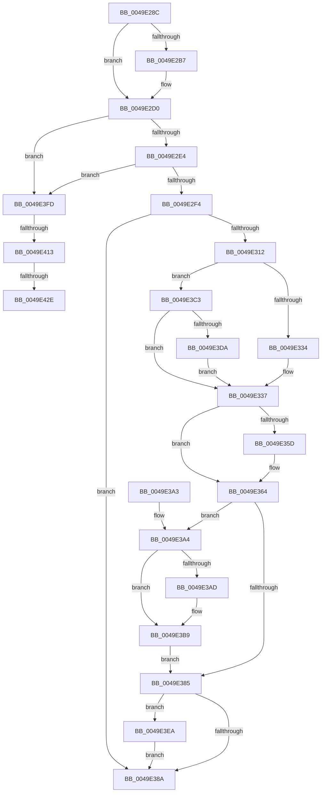

# IopQueueInvalidateBusRelationsRequest

- RVA: `0x0049E28C`–`0x0049E44C` (길이 `448` bytes)
- VA: `0x000000014049E28C`
- 실행 섹션: `.text`
- PDB 이름 있음: `예`; PDB Function 태그: `예`
- unwind 정보 RVA: `0x000A6164`
- 디코드: `111`개 명령, `448/448` bytes 표시
- 미해석 바이트: `0` (있으면 어셈블리에 `.byte`로 보존)

> 이 문서는 커널 이미지의 기계어와 PDB 기호를 분석해 생성했습니다. 4번과 5번은 함수 원형과 자료형을 바이너리 사용 방식에서 추정한 C 해석이며 원본 소스 복구 결과는 아닙니다.

## 1. Dependencies

- 직접 호출 지점: **12**; 고유 호출 대상: **9**
- 직접 호출자로 확인된 함수: **1**
- RIP 상대 이미지 참조: **6**

### Outgoing calls
- `0x0049E2CA` → [KeBugCheckEx](../4F/KeBugCheckEx_function_004FD660.md) (function, `0x004FD660`)
- `0x0049E305` → [ExAllocatePool2](../../poolcode/B8/ExAllocatePool2_function_00B820F0.md) (function, `0x00B820F0`)
- `0x0049E31A` → [ObfReferenceObjectWithTag](../21/ObfReferenceObjectWithTag_function_00210710.md) (function, `0x00210710`)
- `0x0049E33E` → [KeAcquireSpinLockAtDpcLevel](../20/KeAcquireSpinLockAtDpcLevel_function_00208430.md) (function, `0x00208430`)
- `0x0049E37C` → [KxReleaseSpinLock](../20/KxReleaseSpinLock_function_00206670.md) (function, `0x00206670`)
- `0x0049E3B4` → [KiLowerIrqlProcessIrqlFlags](../4F/KiLowerIrqlProcessIrqlFlags_function_004F5698.md) (function, `0x004F5698`)
- `0x0049E3E0` → [KiRaiseIrqlProcessIrqlFlags](../4F/KiRaiseIrqlProcessIrqlFlags_function_004F56FC.md) (function, `0x004F56FC`)
- `0x0049E3F6` → [ExQueueWorkItem](../2F/ExQueueWorkItem_function_002F9520.md) (function, `0x002F9520`)
- `0x0049E401` → [IoAddTriageDumpDataBlock](../42/IoAddTriageDumpDataBlock_function_00428374.md) (function, `0x00428374`)
- `0x0049E417` → [IoAddTriageDumpDataBlock](../42/IoAddTriageDumpDataBlock_function_00428374.md) (function, `0x00428374`)
- `0x0049E430` → [IoAddTriageDumpDataBlock](../42/IoAddTriageDumpDataBlock_function_00428374.md) (function, `0x00428374`)
- `0x0049E441` → [IoAddTriageDumpDataBlock](../42/IoAddTriageDumpDataBlock_function_00428374.md) (function, `0x00428374`)

### Direct callers
- [IoInvalidateDeviceRelations](IoInvalidateDeviceRelations_function_0049E160.md) at `0x0049E1E3`

### Static image references
- `0x0049E337` → RVA `0x00F8CE10` (`.data`; read)
- `0x0049E343` → RVA `0x00F8CE08` (`.data`; read)
- `0x0049E34A` → RVA `0x00F8CE00` (`.data`; read)
- `0x0049E375` → RVA `0x00F8CE08` (`.data`; write)
- `0x0049E3A4` → RVA `0x00FC6D20` (`ALMOSTRO`; read)
- `0x0049E3EF` → RVA `0x00F8CDE0` (`.data`; read)

## 2. Other-region calls and transfers

- 다른 실행 섹션으로 향하는 call: **1**
  - `0x0049E305` → [ExAllocatePool2](../../poolcode/B8/ExAllocatePool2_function_00B820F0.md) (`.text` → `POOLCODE`)
- call이 아닌 외부 분기/꼬리 이동: **3**
  - `0x0049E40D` → [sub_006F8228](../6F/Unknown_function_006F8228.md) (`tail-transfer`)
  - `0x0049E428` → [sub_006F8228](../6F/Unknown_function_006F8228.md) (`tail-transfer`)
  - `0x0049E447` → [sub_006F8228](../6F/Unknown_function_006F8228.md) (`tail-transfer`)

## 3. Assembly (complete function range)

```asm
0049E28C  48 89 5C 24 08                  mov qword ptr [rsp + 8], rbx
0049E291  48 89 6C 24 10                  mov qword ptr [rsp + 0x10], rbp
0049E296  48 89 74 24 18                  mov qword ptr [rsp + 0x18], rsi
0049E29B  57                              push rdi
0049E29C  41 56                           push r14
0049E29E  41 57                           push r15
0049E2A0  48 83 EC 30                     sub rsp, 0x30
0049E2A4  45 33 FF                        xor r15d, r15d
0049E2A7  44 8B F2                        mov r14d, edx
0049E2AA  48 8B D9                        mov rbx, rcx
0049E2AD  BF 02 00 00 00                  mov edi, 2
0049E2B2  48 85 C9                        test rcx, rcx
0049E2B5  75 19                           jne 0x14049e2d0
0049E2B7  45 33 C9                        xor r9d, r9d
0049E2BA  4C 89 7C 24 20                  mov qword ptr [rsp + 0x20], r15
0049E2BF  4C 8B C3                        mov r8, rbx
0049E2C2  48 8B D7                        mov rdx, rdi
0049E2C5  B9 CA 00 00 00                  mov ecx, 0xca
0049E2CA  E8 91 F3 05 00                  call 0x1404fd660
0049E2CF  CC                              int3
0049E2D0  48 8B 81 38 01 00 00            mov rax, qword ptr [rcx + 0x138]
0049E2D7  48 8B 40 28                     mov rax, qword ptr [rax + 0x28]
0049E2DB  48 85 C0                        test rax, rax
0049E2DE  0F 84 19 01 00 00               je 0x14049e3fd
0049E2E4  F7 80 8C 01 00 00 00 00 02 00   test dword ptr [rax + 0x18c], 0x20000
0049E2EE  0F 85 09 01 00 00               jne 0x14049e3fd
0049E2F4  BA 20 00 00 00                  mov edx, 0x20
0049E2F9  41 B8 50 70 69 6F               mov r8d, 0x6f697050
0049E2FF  41 8A EF                        mov bpl, r15b
0049E302  8D 4A 20                        lea ecx, [rdx + 0x20]
0049E305  E8 E6 3D 6E 00                  call 0x140b820f0
0049E30A  48 8B F0                        mov rsi, rax
0049E30D  48 85 C0                        test rax, rax
0049E310  74 78                           je 0x14049e38a
0049E312  BA 50 6E 70 65                  mov edx, 0x65706e50
0049E317  48 8B CB                        mov rcx, rbx
0049E31A  E8 F1 23 D7 FF                  call 0x140210710
0049E31F  48 89 5E 10                     mov qword ptr [rsi + 0x10], rbx
0049E323  44 89 76 18                     mov dword ptr [rsi + 0x18], r14d
0049E327  44 0F 20 C1                     mov rcx, cr8
0049E32B  40 3A CF                        cmp cl, dil
0049E32E  0F 82 8F 00 00 00               jb 0x14049e3c3
0049E334  41 8A DF                        mov bl, r15b
0049E337  48 8D 0D D2 EA AE 00            lea rcx, [rip + 0xaeead2]
0049E33E  E8 ED A0 D6 FF                  call 0x140208430
0049E343  48 8B 05 BE EA AE 00            mov rax, qword ptr [rip + 0xaeeabe]
0049E34A  4C 8D 35 AF EA AE 00            lea r14, [rip + 0xaeeaaf]
0049E351  48 8B 3D A8 EA AE 00            mov rdi, qword ptr [rip + 0xaeeaa8]
0049E358  4C 39 30                        cmp qword ptr [rax], r14
0049E35B  74 07                           je 0x14049e364
0049E35D  B9 03 00 00 00                  mov ecx, 3
0049E362  CD 29                           int 0x29
0049E364  4C 89 36                        mov qword ptr [rsi], r14
0049E367  48 8D 0D A2 EA AE 00            lea rcx, [rip + 0xaeeaa2]
0049E36E  48 89 46 08                     mov qword ptr [rsi + 8], rax
0049E372  48 89 30                        mov qword ptr [rax], rsi
0049E375  48 89 35 8C EA AE 00            mov qword ptr [rip + 0xaeea8c], rsi
0049E37C  E8 EF 82 D6 FF                  call 0x140206670
0049E381  84 DB                           test bl, bl
0049E383  75 1F                           jne 0x14049e3a4
0049E385  49 3B FE                        cmp rdi, r14
0049E388  74 60                           je 0x14049e3ea
0049E38A  48 8B 5C 24 50                  mov rbx, qword ptr [rsp + 0x50]
0049E38F  48 8B 6C 24 58                  mov rbp, qword ptr [rsp + 0x58]
0049E394  48 8B 74 24 60                  mov rsi, qword ptr [rsp + 0x60]
0049E399  48 83 C4 30                     add rsp, 0x30
0049E39D  41 5F                           pop r15
0049E39F  41 5E                           pop r14
0049E3A1  5F                              pop rdi
0049E3A2  C3                              ret
0049E3A3  CC                              int3
0049E3A4  44 39 3D 75 89 B2 00            cmp dword ptr [rip + 0xb28975], r15d
0049E3AB  74 0C                           je 0x14049e3b9
0049E3AD  44 0F 20 C1                     mov rcx, cr8
0049E3B1  40 8A D5                        mov dl, bpl
0049E3B4  E8 DF 72 05 00                  call 0x1404f5698
0049E3B9  40 0F B6 C5                     movzx eax, bpl
0049E3BD  44 0F 22 C0                     mov cr8, rax
0049E3C1  EB C2                           jmp 0x14049e385
0049E3C3  B3 01                           mov bl, 1
0049E3C5  44 0F 20 C5                     mov rbp, cr8
0049E3C9  44 0F 22 C7                     mov cr8, rdi
0049E3CD  44 39 3D 4C 89 B2 00            cmp dword ptr [rip + 0xb2894c], r15d
0049E3D4  0F 84 5D FF FF FF               je 0x14049e337
0049E3DA  40 8A D7                        mov dl, dil
0049E3DD  40 8A CD                        mov cl, bpl
0049E3E0  E8 17 73 05 00                  call 0x1404f56fc
0049E3E5  E9 4D FF FF FF                  jmp 0x14049e337
0049E3EA  BA 01 00 00 00                  mov edx, 1
0049E3EF  48 8D 0D EA E9 AE 00            lea rcx, [rip + 0xaee9ea]
0049E3F6  E8 25 B1 E5 FF                  call 0x1402f9520
0049E3FB  EB 8D                           jmp 0x14049e38a
0049E3FD  0F B7 51 02                     movzx edx, word ptr [rcx + 2]
0049E401  E8 6E 9F F8 FF                  call 0x140428374
0049E406  48 8B 4B 08                     mov rcx, qword ptr [rbx + 8]
0049E40A  48 85 C9                        test rcx, rcx
0049E40D  0F 84 15 9E 25 00               je 0x1406f8228
0049E413  0F BF 51 02                     movsx edx, word ptr [rcx + 2]
0049E417  E8 58 9F F8 FF                  call 0x140428374
0049E41C  48 8B 4B 08                     mov rcx, qword ptr [rbx + 8]
0049E420  48 83 C1 38                     add rcx, 0x38
0049E424  66 44 39 39                     cmp word ptr [rcx], r15w
0049E428  0F 84 FA 9D 25 00               je 0x1406f8228
0049E42E  8B D7                           mov edx, edi
0049E430  E8 3F 9F F8 FF                  call 0x140428374
0049E435  48 8B 4B 08                     mov rcx, qword ptr [rbx + 8]
0049E439  0F B7 51 38                     movzx edx, word ptr [rcx + 0x38]
0049E43D  48 8B 49 40                     mov rcx, qword ptr [rcx + 0x40]
0049E441  E8 2E 9F F8 FF                  call 0x140428374
0049E446  90                              nop
0049E447  E9 DC 9D 25 00                  jmp 0x1406f8228
```

## 4. C-style interpretation (structured pseudocode)

```c
__int64 __fastcall IopQueueInvalidateBusRelationsRequest(__int64 a1, int a2, __int64 a3, int a4)
{
    __int64 result;
    __int64 v_r15;
    __int64 v_rsp;
    unsigned __int64 v_stack_m28;
    unsigned __int64 v_stack_p10;
    unsigned __int64 v_stack_p18;
    unsigned __int64 v_stack_p8;

    v_stack_p8 = v_rbx;
    v_stack_p10 = v_rbp;
    v_stack_p18 = v_rsi;
    v_rsp = (v_rsp) - (48);
    v_r15 = 0;
    if (a1 == 0) {
        a4 = 0;
        v_stack_m28 = 0;
        a3 = a1;
        a2 = 2;
        a1 = 202;
        result = KeBugCheckEx(a1, a2, a3, a4);
    }
    if (*(unsigned __int64 *)(*(unsigned __int64 *)(a1 + 312) + 40) == 0) goto loc_0049E3FD;
    if (((*(unsigned int *)(*(unsigned __int64 *)(*(unsigned __int64 *)(a1 + 312) + 40) + 396)) & (0x20000ULL)) != 0) goto loc_0049E3FD;
    result = ExAllocatePool2(32 + 32, 32, (unsigned int)(0x6F697050ULL), a4);
    if (result == 0) goto loc_0049E38A;
    result = ObfReferenceObjectWithTag(a1, (unsigned int)(0x65706E50ULL), (unsigned int)(0x6F697050ULL), a4);
    *(unsigned __int64 *)(result + 16) = a1;
    *(unsigned int *)(result + 24) = (unsigned int)((unsigned int)(a2));
    if (((unsigned __int8)(v_cr8)) < 2) goto loc_0049E3C3;
loc_0049E337:
    result = KeAcquireSpinLockAtDpcLevel(v_rip + 11463378, (unsigned int)(0x65706E50ULL), (unsigned int)(0x6F697050ULL), a4);
    if ((*(unsigned __int64 *)(*(unsigned __int64 *)(v_rip + 11463358))) != (v_rip + 11463343)) {
        a1 = 3;
    }
    *(unsigned __int64 *)(result) = v_rip + 11463343;
    *(unsigned __int64 *)(result + 8) = *(unsigned __int64 *)(v_rip + 11463358);
    *(unsigned __int64 *)(*(unsigned __int64 *)(v_rip + 11463358)) = result;
    *(unsigned __int64 *)(v_rip + 11463308) = result;
    result = KxReleaseSpinLock(v_rip + 11463330, (unsigned int)(0x65706E50ULL), (unsigned int)(0x6F697050ULL), a4);
    if (0 != 0) goto loc_0049E3A4;
loc_0049E385:
    if ((*(unsigned __int64 *)(v_rip + 11463336)) == (v_rip + 11463343)) goto loc_0049E3EA;
loc_0049E38A:
    v_rsp = (v_rsp) + (48);
    return result;
loc_0049E3A4:
    if ((*(unsigned int *)(v_rip + 11700597)) != 0) {
        a1 = v_cr8;
        a2 = (unsigned __int8)(v_stack_p10);
        result = KiLowerIrqlProcessIrqlFlags(a1, a2, (unsigned int)(0x6F697050ULL), a4);
    }
    goto loc_0049E385;
loc_0049E3C3:
    if ((*(unsigned int *)(v_rip + 11700556)) == 0) goto loc_0049E337;
    result = KiRaiseIrqlProcessIrqlFlags((unsigned __int8)((unsigned __int8)(v_stack_p10)), (unsigned __int8)(*(unsigned __int64 *)(v_rip + 11463336)), (unsigned int)(0x6F697050ULL), a4);
    goto loc_0049E337;
loc_0049E3EA:
    result = ExQueueWorkItem(v_rip + 11463146, 1, (unsigned int)(0x6F697050ULL), a4);
    goto loc_0049E38A;
loc_0049E3FD:
    result = IoAddTriageDumpDataBlock(v_rip + 11463146, *(unsigned __int16 *)(v_rip + 11463146 + 2), (unsigned int)(0x6F697050ULL), a4);
    result = IoAddTriageDumpDataBlock(*(unsigned __int64 *)(1 + 8), (__int16)(*(unsigned __int16 *)(*(unsigned __int64 *)(1 + 8) + 2)), (unsigned int)(0x6F697050ULL), a4);
    a1 = (*(unsigned __int64 *)(1 + 8)) + (56);
    result = IoAddTriageDumpDataBlock(a1, (unsigned int)((unsigned int)(*(unsigned __int64 *)(v_rip + 11463336))), (unsigned int)(0x6F697050ULL), a4);
    result = IoAddTriageDumpDataBlock(*(unsigned __int64 *)(*(unsigned __int64 *)(1 + 8) + 64), *(unsigned __int16 *)(*(unsigned __int64 *)(1 + 8) + 56), (unsigned int)(0x6F697050ULL), a4);
}
```

## 5. (Beta) C Style

```c
int64_t IopQueueInvalidateBusRelationsRequest(void *Arg1, int32_t Arg2, int64_t Arg3, int32_t Arg4)
{
    uint8_t *arg1 = (uint8_t *)Arg1;

    int64_t result;
    int64_t local_r15;
    int64_t local_rsp;
    uint64_t v_stack_m28;
    uint64_t v_stack_p10;
    uint64_t v_stack_p18;
    uint64_t v_stack_p8;

    v_stack_p8 = local_rbx;
    v_stack_p10 = local_rbp;
    v_stack_p18 = local_rsi;
    local_rsp = (local_rsp) - (48);
    local_r15 = 0;
    if (Arg1 == NULL) {
        Arg4 = 0;
        v_stack_m28 = 0;
        Arg3 = Arg1;
        Arg2 = 2;
        Arg1 = 202;
        result = KeBugCheckEx(Arg1, Arg2, Arg3, Arg4);
    }
    if (*(uint64_t *)(*(uint64_t *)(arg1 + 0x138) + 0x28) == 0) goto loc_0049E3FD;
    if (((*(uint32_t *)(*(uint64_t *)(*(uint64_t *)(arg1 + 0x138) + 0x28) + 0x18C)) & (0x20000ULL)) != 0) goto loc_0049E3FD;
    result = ExAllocatePool2(32 + 32, 32, (uint32_t)(0x6F697050ULL), Arg4);
    if (result == 0) goto loc_0049E38A;
    result = ObfReferenceObjectWithTag(Arg1, (uint32_t)(0x65706E50ULL), (uint32_t)(0x6F697050ULL), Arg4);
    *(void **)(result + 0x10) = Arg1;
    *(uint32_t *)(result + 0x18) = (uint32_t)((uint32_t)(Arg2));
    if (((uint8_t)(v_cr8)) < 2) goto loc_0049E3C3;
loc_0049E337:
    result = KeAcquireSpinLockAtDpcLevel(v_rip + 11463378, (uint32_t)(0x65706E50ULL), (uint32_t)(0x6F697050ULL), Arg4);
    if ((*(uint64_t *)(*(uint64_t *)(v_rip + 0xAEEABE))) != (v_rip + 11463343)) {
        Arg1 = 3;
    }
    *(uint64_t *)(result) = v_rip + 11463343;
    *(uint64_t *)(result + 0x8) = *(uint64_t *)(v_rip + 0xAEEABE);
    *(uint64_t *)(*(uint64_t *)(v_rip + 0xAEEABE)) = result;
    *(uint64_t *)(v_rip + 0xAEEA8C) = result;
    result = KxReleaseSpinLock(v_rip + 11463330, (uint32_t)(0x65706E50ULL), (uint32_t)(0x6F697050ULL), Arg4);
    if (0 != 0) goto loc_0049E3A4;
loc_0049E385:
    if ((*(uint64_t *)(v_rip + 0xAEEAA8)) == (v_rip + 11463343)) goto loc_0049E3EA;
loc_0049E38A:
    local_rsp = (local_rsp) + (48);
    return result;
loc_0049E3A4:
    if ((*(uint32_t *)(v_rip + 0xB28975)) != 0) {
        Arg1 = v_cr8;
        Arg2 = (uint8_t)(v_stack_p10);
        result = KiLowerIrqlProcessIrqlFlags(Arg1, Arg2, (uint32_t)(0x6F697050ULL), Arg4);
    }
    goto loc_0049E385;
loc_0049E3C3:
    if ((*(uint32_t *)(v_rip + 0xB2894C)) == 0) goto loc_0049E337;
    result = KiRaiseIrqlProcessIrqlFlags((uint8_t)((uint8_t)(v_stack_p10)), (uint8_t)(*(uint64_t *)(v_rip + 0xAEEAA8)), (uint32_t)(0x6F697050ULL), Arg4);
    goto loc_0049E337;
loc_0049E3EA:
    result = ExQueueWorkItem(v_rip + 11463146, 1, (uint32_t)(0x6F697050ULL), Arg4);
    goto loc_0049E38A;
loc_0049E3FD:
    result = IoAddTriageDumpDataBlock(v_rip + 11463146, *(uint16_t *)(v_rip + 0xAEE9EA + 0x2), (uint32_t)(0x6F697050ULL), Arg4);
    result = IoAddTriageDumpDataBlock(*(uint64_t *)(1 + 0x8), (int16_t)(*(uint16_t *)(*(uint64_t *)(1 + 0x8) + 0x2)), (uint32_t)(0x6F697050ULL), Arg4);
    Arg1 = (*(uint64_t *)(1 + 0x8)) + (56);
    result = IoAddTriageDumpDataBlock(Arg1, (uint32_t)((uint32_t)(*(uint64_t *)(v_rip + 0xAEEAA8))), (uint32_t)(0x6F697050ULL), Arg4);
    result = IoAddTriageDumpDataBlock(*(uint64_t *)(*(uint64_t *)(1 + 0x8) + 0x40), *(uint16_t *)(*(uint64_t *)(1 + 0x8) + 0x38), (uint32_t)(0x6F697050ULL), Arg4);
}
```

### 관측된 메모리 오프셋

구조체 형식이 확인되지 않은 접근은 인자 기준의 오프셋으로만 기록했습니다.

| 기준 인자 | 오프셋 표현 | 폭 (bit) | 접근 |
|---|---:|---:|---|
| `Arg1` | `+ 0x8` | `64` | `R` |

## 6. Execution-region graph

[열기: 2D/3D 그래프와 함수 탐색 컨트롤 패널](../../../control-panel.html?section=text&rva=0x0049E28C&view=graph)

- 2D 그래프는 위에서 아래로 흐르고, 3D 그래프는 빈 공간을 드래그해 회전합니다. Shift+드래그는 이동, 휠은 확대·축소, 함수 노드 선택은 대상 보고서 이동입니다.

### Static fallback


