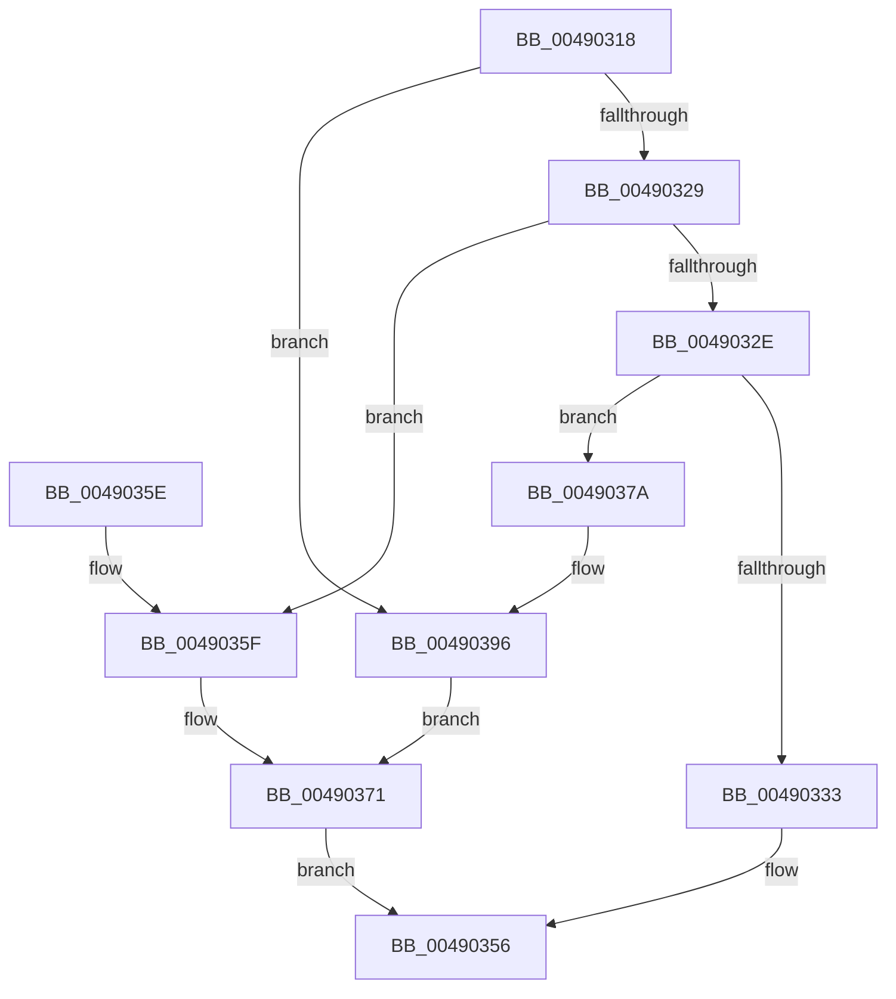

# IvtUpdateInterruptDestination

- RVA: `0x00490318`–`0x004903AB` (길이 `147` bytes)
- VA: `0x0000000140490318`
- 실행 섹션: `.text`
- PDB 이름 있음: `예`; PDB Function 태그: `아니요`
- unwind 정보 RVA: `0x0006E3E4`
- 디코드: `46`개 명령, `147/147` bytes 표시
- 미해석 바이트: `0` (있으면 어셈블리에 `.byte`로 보존)

> 이 문서는 커널 이미지의 기계어와 PDB 기호를 분석해 생성했습니다. 4번과 5번은 함수 원형과 자료형을 바이너리 사용 방식에서 추정한 C 해석이며 원본 소스 복구 결과는 아닙니다.

## 1. Dependencies

- 직접 호출 지점: **1**; 고유 호출 대상: **1**
- 직접 호출자로 확인된 함수: **1**
- RIP 상대 이미지 참조: **0**

### Outgoing calls
- `0x00490390` → [KeBugCheckEx](../4F/KeBugCheckEx_function_004FD660.md) (function, `0x004FD660`)

### Direct callers
- [IvtUpdateRemappingTableEntry](IvtUpdateRemappingTableEntry_function_00490120.md) at `0x00490203`

### Static image references
- 디코드된 RIP-relative 메모리 참조가 없습니다.

## 2. Other-region calls and transfers

- 다른 실행 섹션으로 향하는 call: **0**
- 별도 외부 분기/꼬리 이동을 확인하지 못했습니다.

## 3. Assembly (complete function range)

```asm
00490318  48 83 EC 38                     sub rsp, 0x38
0049031C  4C 8B C1                        mov r8, rcx
0049031F  4C 8B CA                        mov r9, rdx
00490322  8B 0A                           mov ecx, dword ptr [rdx]
00490324  83 E9 01                        sub ecx, 1
00490327  74 6D                           je 0x140490396
00490329  83 E9 03                        sub ecx, 3
0049032C  74 31                           je 0x14049035f
0049032E  83 F9 02                        cmp ecx, 2
00490331  75 47                           jne 0x14049037a
00490333  8B 52 08                        mov edx, dword ptr [rdx + 8]
00490336  41 8B 41 0C                     mov eax, dword ptr [r9 + 0xc]
0049033A  49 8B 08                        mov rcx, qword ptr [r8]
0049033D  C1 E2 10                        shl edx, 0x10
00490340  48 0B D0                        or rdx, rax
00490343  8B C9                           mov ecx, ecx
00490345  48 C1 E2 20                     shl rdx, 0x20
00490349  48 0B CA                        or rcx, rdx
0049034C  49 89 08                        mov qword ptr [r8], rcx
0049034F  49 8B 00                        mov rax, qword ptr [r8]
00490352  48 83 C8 04                     or rax, 4
00490356  49 89 00                        mov qword ptr [r8], rax
00490359  48 83 C4 38                     add rsp, 0x38
0049035D  C3                              ret
0049035E  CC                              int3
0049035F  8B 52 08                        mov edx, dword ptr [rdx + 8]
00490362  49 8B 08                        mov rcx, qword ptr [r8]
00490365  48 C1 E2 20                     shl rdx, 0x20
00490369  8B C9                           mov ecx, ecx
0049036B  48 0B CA                        or rcx, rdx
0049036E  49 89 08                        mov qword ptr [r8], rcx
00490371  49 8B 00                        mov rax, qword ptr [r8]
00490374  48 83 E0 FB                     and rax, 0xfffffffffffffffb
00490378  EB DC                           jmp 0x140490356
0049037A  B9 5C 00 00 00                  mov ecx, 0x5c
0049037F  4C 89 4C 24 20                  mov qword ptr [rsp + 0x20], r9
00490384  4D 8B C8                        mov r9, r8
00490387  BA 00 70 00 00                  mov edx, 0x7000
0049038C  44 8D 41 C4                     lea r8d, [rcx - 0x3c]
00490390  E8 CB D2 06 00                  call 0x1404fd660
00490395  CC                              int3
00490396  49 8B 00                        mov rax, qword ptr [r8]
00490399  48 B9 00 00 00 00 FF FF FF FF   movabs rcx, 0xffffffff00000000
004903A3  48 0B C1                        or rax, rcx
004903A6  49 89 00                        mov qword ptr [r8], rax
004903A9  EB C6                           jmp 0x140490371
```

## 4. C-style interpretation (structured pseudocode)

```c
__int64 __fastcall IvtUpdateInterruptDestination(__int64 a1, __int64 a2)
{
    __int64 result;
    __int64 v_rsp;
    unsigned __int64 v_stack_p20;

    v_rsp = (v_rsp) - (56);
    a1 = (unsigned int)(((unsigned int)(*(unsigned int *)(a2))) - (1));
    if (condition_is_equal) goto loc_00490396;
    a1 = (unsigned int)((a1) - (3));
    if (condition_is_equal) goto loc_0049035F;
    if (((unsigned int)(a1)) != 2) goto loc_0049037A;
    a2 = (unsigned int)(((unsigned int)(*(unsigned int *)(a2 + 8))) << (16));
    a2 = (a2) | ((unsigned int)(*(unsigned int *)(a2 + 12)));
    a2 = (a2) << (32);
    a1 = ((unsigned int)((unsigned int)(*(unsigned __int64 *)(a1)))) | (a2);
    *(unsigned __int64 *)(a1) = a1;
    result = (*(unsigned __int64 *)(a1)) | (4);
loc_00490356:
    *(unsigned __int64 *)(a1) = result;
    v_rsp = (v_rsp) + (56);
    return result;
loc_0049035F:
    a2 = ((unsigned int)(*(unsigned int *)(a2 + 8))) << (32);
    a1 = ((unsigned int)((unsigned int)(*(unsigned __int64 *)(a1)))) | (a2);
    *(unsigned __int64 *)(a1) = a1;
loc_00490371:
    result = (*(unsigned __int64 *)(a1)) & (-5);
    goto loc_00490356;
loc_0049037A:
    v_stack_p20 = a2;
    result = KeBugCheckEx(92, (unsigned int)(0x7000ULL), 92 - 60, a1);
loc_00490396:
    result = (*(unsigned __int64 *)(92 - 60)) | (92);
    *(unsigned __int64 *)(92 - 60) = result;
    goto loc_00490371;
}
```

## 5. (Beta) C Style

```c
int64_t IvtUpdateInterruptDestination(void *Arg1, void *Arg2)
{
    uint8_t *arg1 = (uint8_t *)Arg1;
    uint8_t *arg2 = (uint8_t *)Arg2;

    int64_t result;
    int64_t local_rsp;
    uint64_t v_stack_p20;

    local_rsp = (local_rsp) - (56);
    Arg1 = (uint32_t)(((uint32_t)(*(uint32_t *)(arg2))) - (1));
    if (condition_is_equal) goto loc_00490396;
    Arg1 = (uint32_t)((Arg1) - (3));
    if (condition_is_equal) goto loc_0049035F;
    if (((uint32_t)(Arg1)) != 2) goto loc_0049037A;
    Arg2 = (uint32_t)(((uint32_t)(*(uint32_t *)(arg2 + 0x8))) << (16));
    Arg2 = (Arg2) | ((uint32_t)(*(uint32_t *)(arg2 + 0xC)));
    Arg2 = (Arg2) << (32);
    Arg1 = ((uint32_t)((uint32_t)(*(uint64_t *)(arg1)))) | (Arg2);
    *(void **)(arg1) = Arg1;
    result = (*(uint64_t *)(arg1)) | (4);
loc_00490356:
    *(uint64_t *)(arg1) = result;
    local_rsp = (local_rsp) + (56);
    return result;
loc_0049035F:
    Arg2 = ((uint32_t)(*(uint32_t *)(arg2 + 0x8))) << (32);
    Arg1 = ((uint32_t)((uint32_t)(*(uint64_t *)(arg1)))) | (Arg2);
    *(void **)(arg1) = Arg1;
loc_00490371:
    result = (*(uint64_t *)(arg1)) & (-5);
    goto loc_00490356;
loc_0049037A:
    v_stack_p20 = Arg2;
    result = KeBugCheckEx(92, (uint32_t)(0x7000ULL), 92 - 60, Arg1);
loc_00490396:
    result = (*(uint64_t *)(92 - 0x3C)) | (92);
    *(uint64_t *)(92 - 0x3C) = result;
    goto loc_00490371;
}
```

### 관측된 메모리 오프셋

구조체 형식이 확인되지 않은 접근은 인자 기준의 오프셋으로만 기록했습니다.

| 기준 인자 | 오프셋 표현 | 폭 (bit) | 접근 |
|---|---:|---:|---|
| `Arg1` | `+ 0x0` | `64` | `R` |
| `Arg1` | `+ 0x0` | `64` | `W` |
| `Arg2` | `+ 0x0` | `32` | `R` |
| `Arg2` | `+ 0x8` | `32` | `R` |
| `Arg2` | `+ 0xC` | `32` | `R` |

## 6. Execution-region graph

[열기: 2D/3D 그래프와 함수 탐색 컨트롤 패널](../../../control-panel.html?section=text&rva=0x00490318&view=graph)

- 2D 그래프는 위에서 아래로 흐르고, 3D 그래프는 빈 공간을 드래그해 회전합니다. Shift+드래그는 이동, 휠은 확대·축소, 함수 노드 선택은 대상 보고서 이동입니다.

### Static fallback


