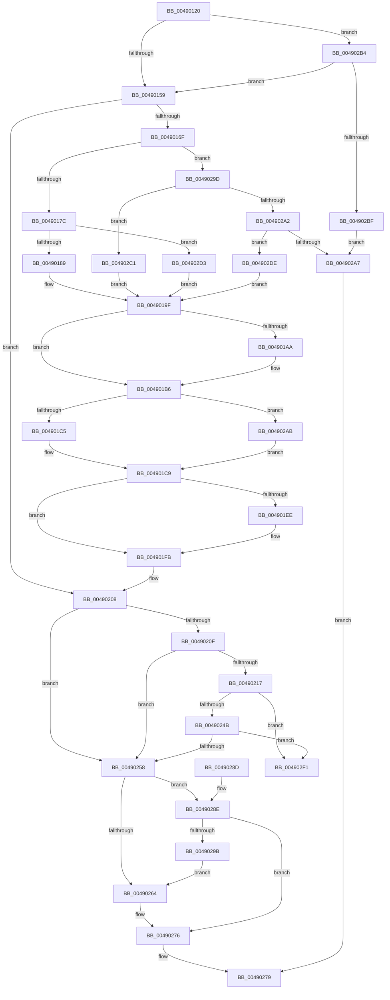

# IvtUpdateRemappingTableEntry

- RVA: `0x00490120`–`0x00490311` (길이 `497` bytes)
- VA: `0x0000000140490120`
- 실행 섹션: `.text`
- PDB 이름 있음: `예`; PDB Function 태그: `아니요`
- unwind 정보 RVA: `0x000B2B70`
- 디코드: `137`개 명령, `497/497` bytes 표시
- 미해석 바이트: `0` (있으면 어셈블리에 `.byte`로 보존)

> 이 문서는 커널 이미지의 기계어와 PDB 기호를 분석해 생성했습니다. 4번과 5번은 함수 원형과 자료형을 바이너리 사용 방식에서 추정한 C 해석이며 원본 소스 복구 결과는 아닙니다.

## 1. Dependencies

- 직접 호출 지점: **3**; 고유 호출 대상: **3**
- 직접 호출자로 확인된 함수: **0**
- RIP 상대 이미지 참조: **1**

### Outgoing calls
- `0x00490203` → [IvtUpdateInterruptDestination](IvtUpdateInterruptDestination_function_00490318.md) (function, `0x00490318`)
- `0x00490280` → [_security_check_cookie](../6A/_security_check_cookie_function_006AC640.md) (function, `0x006AC640`)
- `0x0049030B` → [KeBugCheckEx](../4F/KeBugCheckEx_function_004FD660.md) (function, `0x004FD660`)

### Direct callers
- 이 함수 시작 RVA로 연결되는 직접 call은 확인되지 않았습니다. 간접 호출은 완전히 역산할 수 없습니다.

### Static image references
- `0x0049012B` → RVA `0x00E0A740` (`.data`; read)

## 2. Other-region calls and transfers

- 다른 실행 섹션으로 향하는 call: **0**
- 별도 외부 분기/꼬리 이동을 확인하지 못했습니다.

## 3. Assembly (complete function range)

```asm
00490120  40 55                           push rbp
00490122  53                              push rbx
00490123  57                              push rdi
00490124  48 8B EC                        mov rbp, rsp
00490127  48 83 EC 60                     sub rsp, 0x60
0049012B  48 8B 05 0E A6 97 00            mov rax, qword ptr [rip + 0x97a60e]
00490132  48 33 C4                        xor rax, rsp
00490135  48 89 45 F0                     mov qword ptr [rbp - 0x10], rax
00490139  41 8B D8                        mov ebx, r8d
0049013C  44 8A D2                        mov r10b, dl
0049013F  48 C1 E3 04                     shl rbx, 4
00490143  4D 8D 41 0C                     lea r8, [r9 + 0xc]
00490147  48 03 99 20 01 00 00            add rbx, qword ptr [rcx + 0x120]
0049014E  48 8B 03                        mov rax, qword ptr [rbx]
00490151  A8 01                           test al, 1
00490153  0F 84 5B 01 00 00               je 0x1404902b4
00490159  41 8B 10                        mov edx, dword ptr [r8]
0049015C  33 FF                           xor edi, edi
0049015E  48 89 7D D0                     mov qword ptr [rbp - 0x30], rdi
00490162  48 89 7D D8                     mov qword ptr [rbp - 0x28], rdi
00490166  F6 C2 10                        test dl, 0x10
00490169  0F 84 99 00 00 00               je 0x140490208
0049016F  41 8B 49 14                     mov ecx, dword ptr [r9 + 0x14]
00490173  83 E9 01                        sub ecx, 1
00490176  0F 85 21 01 00 00               jne 0x14049029d
0049017C  48 8B 45 D0                     mov rax, qword ptr [rbp - 0x30]
00490180  F6 C2 02                        test dl, 2
00490183  0F 84 4A 01 00 00               je 0x1404902d3
00490189  48 25 3F FF FF FF               and rax, 0xffffffffffffff3f
0049018F  48 83 C8 20                     or rax, 0x20
00490193  48 89 45 D0                     mov qword ptr [rbp - 0x30], rax
00490197  48 8B 45 D0                     mov rax, qword ptr [rbp - 0x30]
0049019B  48 83 C8 08                     or rax, 8
0049019F  48 89 45 D0                     mov qword ptr [rbp - 0x30], rax
004901A3  41 8B 00                        mov eax, dword ptr [r8]
004901A6  A8 10                           test al, 0x10
004901A8  74 0C                           je 0x1404901b6
004901AA  48 8B 45 D0                     mov rax, qword ptr [rbp - 0x30]
004901AE  48 83 C8 01                     or rax, 1
004901B2  48 89 45 D0                     mov qword ptr [rbp - 0x30], rax
004901B6  41 83 79 08 01                  cmp dword ptr [r9 + 8], 1
004901BB  48 8B 45 D0                     mov rax, qword ptr [rbp - 0x30]
004901BF  0F 85 E6 00 00 00               jne 0x1404902ab
004901C5  48 83 E0 EF                     and rax, 0xffffffffffffffef
004901C9  41 8B 49 30                     mov ecx, dword ptr [r9 + 0x30]
004901CD  48 89 45 D0                     mov qword ptr [rbp - 0x30], rax
004901D1  48 8B 45 D0                     mov rax, qword ptr [rbp - 0x30]
004901D5  48 C1 E1 10                     shl rcx, 0x10
004901D9  48 33 C1                        xor rax, rcx
004901DC  48 25 FF FF 00 FF               and rax, 0xffffffffff00ffff
004901E2  48 33 C1                        xor rax, rcx
004901E5  48 89 45 D0                     mov qword ptr [rbp - 0x30], rax
004901E9  45 84 D2                        test r10b, r10b
004901EC  74 0D                           je 0x1404901fb
004901EE  48 8B 45 D0                     mov rax, qword ptr [rbp - 0x30]
004901F2  48 0F BA E8 08                  bts rax, 8
004901F7  48 89 45 D0                     mov qword ptr [rbp - 0x30], rax
004901FB  49 8D 51 18                     lea rdx, [r9 + 0x18]
004901FF  48 8D 4D D0                     lea rcx, [rbp - 0x30]
00490203  E8 10 01 00 00                  call 0x140490318
00490208  48 8B 03                        mov rax, qword ptr [rbx]
0049020B  A8 01                           test al, 1
0049020D  74 49                           je 0x140490258
0049020F  48 8B 45 D0                     mov rax, qword ptr [rbp - 0x30]
00490213  A8 01                           test al, 1
00490215  74 41                           je 0x140490258
00490217  48 8B 0B                        mov rcx, qword ptr [rbx]
0049021A  48 8B 45 D0                     mov rax, qword ptr [rbp - 0x30]
0049021E  48 33 C8                        xor rcx, rax
00490221  48 89 4D E0                     mov qword ptr [rbp - 0x20], rcx
00490225  48 8B 4B 08                     mov rcx, qword ptr [rbx + 8]
00490229  48 8B 45 D8                     mov rax, qword ptr [rbp - 0x28]
0049022D  48 33 C8                        xor rcx, rax
00490230  48 89 4D E8                     mov qword ptr [rbp - 0x18], rcx
00490234  48 8B 4D E0                     mov rcx, qword ptr [rbp - 0x20]
00490238  8B C9                           mov ecx, ecx
0049023A  48 89 4D E0                     mov qword ptr [rbp - 0x20], rcx
0049023E  48 8B 45 E0                     mov rax, qword ptr [rbp - 0x20]
00490242  48 85 C0                        test rax, rax
00490245  0F 85 A6 00 00 00               jne 0x1404902f1
0049024B  48 8B 45 E8                     mov rax, qword ptr [rbp - 0x18]
0049024F  48 85 C0                        test rax, rax
00490252  0F 85 99 00 00 00               jne 0x1404902f1
00490258  48 8B 0B                        mov rcx, qword ptr [rbx]
0049025B  48 8B 45 D0                     mov rax, qword ptr [rbp - 0x30]
0049025F  48 3B C8                        cmp rcx, rax
00490262  74 2A                           je 0x14049028e
00490264  48 8B 45 D8                     mov rax, qword ptr [rbp - 0x28]
00490268  40 B7 01                        mov dil, 1
0049026B  48 89 43 08                     mov qword ptr [rbx + 8], rax
0049026F  48 8B 45 D0                     mov rax, qword ptr [rbp - 0x30]
00490273  48 89 03                        mov qword ptr [rbx], rax
00490276  40 8A C7                        mov al, dil
00490279  48 8B 4D F0                     mov rcx, qword ptr [rbp - 0x10]
0049027D  48 33 CC                        xor rcx, rsp
00490280  E8 BB C3 21 00                  call 0x1406ac640
00490285  48 83 C4 60                     add rsp, 0x60
00490289  5F                              pop rdi
0049028A  5B                              pop rbx
0049028B  5D                              pop rbp
0049028C  C3                              ret
0049028D  CC                              int3
0049028E  48 8B 4B 08                     mov rcx, qword ptr [rbx + 8]
00490292  48 8B 45 D8                     mov rax, qword ptr [rbp - 0x28]
00490296  48 3B C8                        cmp rcx, rax
00490299  74 DB                           je 0x140490276
0049029B  EB C7                           jmp 0x140490264
0049029D  83 E9 01                        sub ecx, 1
004902A0  74 1F                           je 0x1404902c1
004902A2  83 F9 01                        cmp ecx, 1
004902A5  74 37                           je 0x1404902de
004902A7  32 C0                           xor al, al
004902A9  EB CE                           jmp 0x140490279
004902AB  48 83 C8 10                     or rax, 0x10
004902AF  E9 15 FF FF FF                  jmp 0x1404901c9
004902B4  41 8B 00                        mov eax, dword ptr [r8]
004902B7  A8 10                           test al, 0x10
004902B9  0F 85 9A FE FF FF               jne 0x140490159
004902BF  EB E6                           jmp 0x1404902a7
004902C1  48 8B 45 D0                     mov rax, qword ptr [rbp - 0x30]
004902C5  48 83 E0 9F                     and rax, 0xffffffffffffff9f
004902C9  48 0F BA E8 07                  bts rax, 7
004902CE  E9 CC FE FF FF                  jmp 0x14049019f
004902D3  48 25 1F FF FF FF               and rax, 0xffffffffffffff1f
004902D9  E9 C1 FE FF FF                  jmp 0x14049019f
004902DE  48 8B 45 D0                     mov rax, qword ptr [rbp - 0x30]
004902E2  48 25 5F FF FF FF               and rax, 0xffffffffffffff5f
004902E8  48 83 C8 40                     or rax, 0x40
004902EC  E9 AE FE FF FF                  jmp 0x14049019f
004902F1  B9 5C 00 00 00                  mov ecx, 0x5c
004902F6  48 8D 45 E0                     lea rax, [rbp - 0x20]
004902FA  4C 8B CB                        mov r9, rbx
004902FD  48 89 44 24 20                  mov qword ptr [rsp + 0x20], rax
00490302  BA 00 70 00 00                  mov edx, 0x7000
00490307  44 8D 41 C4                     lea r8d, [rcx - 0x3c]
0049030B  E8 50 D3 06 00                  call 0x1404fd660
00490310  CC                              int3
```

## 4. C-style interpretation (structured pseudocode)

```c
__int64 __fastcall IvtUpdateRemappingTableEntry(__int64 a1, unsigned __int8 a2, int a3, __int64 a4)
{
    __int64 result;
    __int64 v_rbx;
    __int64 v_rdi;
    __int64 v_rsp;
    unsigned __int64 v_stack_m28;
    unsigned __int64 v_stack_m30;
    unsigned __int64 v_stack_m38;
    unsigned __int64 v_stack_m40;
    unsigned __int64 v_stack_m48;
    unsigned __int64 v_stack_p20;

    v_rsp = (v_rsp) - (96);
    result = (*(unsigned __int64 *)(v_rip + 9938446)) ^ (v_rsp);
    v_stack_m28 = result;
    v_rbx = ((unsigned int)(a3)) << (4);
    v_rbx = (v_rbx) + (*(unsigned __int64 *)(a1 + 288));
    if ((((unsigned __int8)(*(unsigned __int64 *)(v_rbx))) & (1)) == 0) goto loc_004902B4;
loc_00490159:
    v_rdi = 0;
    v_stack_m48 = 0;
    v_stack_m40 = 0;
    if ((((unsigned __int8)((unsigned int)(*(unsigned int *)(a4 + 12)))) & (16)) == 0) goto loc_00490208;
    a1 = (unsigned int)(((unsigned int)(*(unsigned int *)(a4 + 20))) - (1));
    if (condition_is_not_equal) goto loc_0049029D;
    if ((((unsigned __int8)((unsigned int)(*(unsigned int *)(a4 + 12)))) & (2)) == 0) goto loc_004902D3;
    result = (v_stack_m48) & (-193);
    result = (result) | (32);
    v_stack_m48 = result;
    result = (v_stack_m48) | (8);
loc_0049019F:
    v_stack_m48 = result;
    result = (unsigned int)(*(unsigned int *)(a4 + 12));
    if ((((unsigned __int8)((unsigned int)(*(unsigned int *)(a4 + 12)))) & (16)) != 0) {
        result = v_stack_m48;
        result = (result) | (1);
        v_stack_m48 = result;
    }
    if ((*(unsigned int *)(a4 + 8)) != 1) goto loc_004902AB;
    result = (v_stack_m48) & (-17);
loc_004901C9:
    v_stack_m48 = result;
    a1 = ((unsigned int)(*(unsigned int *)(a4 + 48))) << (16);
    result = (v_stack_m48) ^ (a1);
    result = (result) & (0xFFFFFFFFFF00FFFFULL);
    result = (result) ^ (a1);
    v_stack_m48 = result;
    if (a2 != 0) {
        result = v_stack_m48;
        v_stack_m48 = result;
    }
    result = IvtUpdateInterruptDestination(v_stack_m48, a4 + 24, a4 + 12, a4);
loc_00490208:
    if ((((unsigned __int8)(*(unsigned __int64 *)(v_rbx))) & (1)) == 0) goto loc_00490258;
    if ((((unsigned __int8)(v_stack_m48)) & (1)) == 0) goto loc_00490258;
    a1 = (*(unsigned __int64 *)(v_rbx)) ^ (v_stack_m48);
    v_stack_m38 = a1;
    a1 = (*(unsigned __int64 *)(v_rbx + 8)) ^ (v_stack_m40);
    v_stack_m30 = a1;
    v_stack_m38 = (unsigned int)((unsigned int)(v_stack_m38));
    if (v_stack_m38 != 0) goto loc_004902F1;
    if (v_stack_m30 != 0) goto loc_004902F1;
loc_00490258:
    if ((*(unsigned __int64 *)(v_rbx)) == v_stack_m48) goto loc_0049028E;
loc_00490264:
    *(unsigned __int64 *)(v_rbx + 8) = v_stack_m40;
    *(unsigned __int64 *)(v_rbx) = v_stack_m48;
loc_00490276:
loc_00490279:
    a1 = (v_stack_m28) ^ (v_rsp);
    result = _security_check_cookie(a1, a4 + 24, a4 + 12, a4);
    v_rsp = (v_rsp) + (96);
    return result;
loc_0049028E:
    if ((*(unsigned __int64 *)(v_rbx + 8)) == v_stack_m40) goto loc_00490276;
    goto loc_00490264;
loc_0049029D:
    a1 = (unsigned int)((*(unsigned __int64 *)(v_rbx + 8)) - (1));
    if (condition_is_equal) goto loc_004902C1;
    if (((unsigned int)(a1)) == 1) goto loc_004902DE;
loc_004902A7:
    result = 0;
    goto loc_00490279;
loc_004902AB:
    result = (result) | (16);
    goto loc_004901C9;
loc_004902B4:
    if ((((unsigned __int8)((unsigned int)(*(unsigned int *)(a4 + 12)))) & (16)) != 0) goto loc_00490159;
    goto loc_004902A7;
loc_004902C1:
    result = (v_stack_m48) & (-97);
    goto loc_0049019F;
loc_004902D3:
    result = (result) & (-225);
    goto loc_0049019F;
loc_004902DE:
    result = (v_stack_m48) & (-161);
    result = (result) | (64);
    goto loc_0049019F;
loc_004902F1:
    v_stack_p20 = v_stack_m38;
    result = KeBugCheckEx(92, (unsigned int)(0x7000ULL), 92 - 60, v_rbx);
    return result;
}
```

## 5. (Beta) C Style

```c
int64_t IvtUpdateRemappingTableEntry(void *Arg1, uint8_t Arg2, int32_t Arg3, void *Arg4)
{
    uint8_t *arg1 = (uint8_t *)Arg1;
    uint8_t *arg4 = (uint8_t *)Arg4;

    int64_t result;
    int64_t local_rbx;
    int64_t local_rdi;
    int64_t local_rsp;
    uint64_t v_stack_m28;
    uint64_t v_stack_m30;
    uint64_t v_stack_m38;
    uint64_t v_stack_m40;
    uint64_t v_stack_m48;
    uint64_t v_stack_p20;

    local_rsp = (local_rsp) - (96);
    result = (*(uint64_t *)(v_rip + 0x97A60E)) ^ (local_rsp);
    v_stack_m28 = result;
    local_rbx = ((uint32_t)(Arg3)) << (4);
    local_rbx = (local_rbx) + (*(uint64_t *)(arg1 + 0x120));
    if ((((uint8_t)(*(uint64_t *)(local_rbx))) & (1)) == 0) goto loc_004902B4;
loc_00490159:
    local_rdi = 0;
    v_stack_m48 = 0;
    v_stack_m40 = 0;
    if ((((uint8_t)((uint32_t)(*(uint32_t *)(arg4 + 0xC)))) & (16)) == 0) goto loc_00490208;
    Arg1 = (uint32_t)(((uint32_t)(*(uint32_t *)(arg4 + 0x14))) - (1));
    if (condition_is_not_equal) goto loc_0049029D;
    if ((((uint8_t)((uint32_t)(*(uint32_t *)(arg4 + 0xC)))) & (2)) == 0) goto loc_004902D3;
    result = (v_stack_m48) & (-193);
    result = (result) | (32);
    v_stack_m48 = result;
    result = (v_stack_m48) | (8);
loc_0049019F:
    v_stack_m48 = result;
    result = (uint32_t)(*(uint32_t *)(arg4 + 0xC));
    if ((((uint8_t)((uint32_t)(*(uint32_t *)(arg4 + 0xC)))) & (16)) != 0) {
        result = v_stack_m48;
        result = (result) | (1);
        v_stack_m48 = result;
    }
    if ((*(uint32_t *)(arg4 + 0x8)) != 1) goto loc_004902AB;
    result = (v_stack_m48) & (-17);
loc_004901C9:
    v_stack_m48 = result;
    Arg1 = ((uint32_t)(*(uint32_t *)(arg4 + 0x30))) << (16);
    result = (v_stack_m48) ^ (Arg1);
    result = (result) & (0xFFFFFFFFFF00FFFFULL);
    result = (result) ^ (Arg1);
    v_stack_m48 = result;
    if (Arg2 != 0) {
        result = v_stack_m48;
        v_stack_m48 = result;
    }
    result = IvtUpdateInterruptDestination(v_stack_m48, Arg4 + 24, Arg4 + 12, Arg4);
loc_00490208:
    if ((((uint8_t)(*(uint64_t *)(local_rbx))) & (1)) == 0) goto loc_00490258;
    if ((((uint8_t)(v_stack_m48)) & (1)) == 0) goto loc_00490258;
    Arg1 = (*(uint64_t *)(local_rbx)) ^ (v_stack_m48);
    v_stack_m38 = Arg1;
    Arg1 = (*(uint64_t *)(local_rbx + 0x8)) ^ (v_stack_m40);
    v_stack_m30 = Arg1;
    v_stack_m38 = (uint32_t)((uint32_t)(v_stack_m38));
    if (v_stack_m38 != 0) goto loc_004902F1;
    if (v_stack_m30 != 0) goto loc_004902F1;
loc_00490258:
    if ((*(uint64_t *)(local_rbx)) == v_stack_m48) goto loc_0049028E;
loc_00490264:
    *(uint64_t *)(local_rbx + 0x8) = v_stack_m40;
    *(uint64_t *)(local_rbx) = v_stack_m48;
loc_00490276:
loc_00490279:
    Arg1 = (v_stack_m28) ^ (local_rsp);
    result = _security_check_cookie(Arg1, Arg4 + 24, Arg4 + 12, Arg4);
    local_rsp = (local_rsp) + (96);
    return result;
loc_0049028E:
    if ((*(uint64_t *)(local_rbx + 0x8)) == v_stack_m40) goto loc_00490276;
    goto loc_00490264;
loc_0049029D:
    Arg1 = (uint32_t)((*(uint64_t *)(local_rbx + 0x8)) - (1));
    if (condition_is_equal) goto loc_004902C1;
    if (((uint32_t)(Arg1)) == 1) goto loc_004902DE;
loc_004902A7:
    result = 0;
    goto loc_00490279;
loc_004902AB:
    result = (result) | (16);
    goto loc_004901C9;
loc_004902B4:
    if ((((uint8_t)((uint32_t)(*(uint32_t *)(arg4 + 0xC)))) & (16)) != 0) goto loc_00490159;
    goto loc_004902A7;
loc_004902C1:
    result = (v_stack_m48) & (-97);
    goto loc_0049019F;
loc_004902D3:
    result = (result) & (-225);
    goto loc_0049019F;
loc_004902DE:
    result = (v_stack_m48) & (-161);
    result = (result) | (64);
    goto loc_0049019F;
loc_004902F1:
    v_stack_p20 = v_stack_m38;
    result = KeBugCheckEx(92, (uint32_t)(0x7000ULL), 92 - 60, local_rbx);
    return result;
}
```

### 관측된 메모리 오프셋

구조체 형식이 확인되지 않은 접근은 인자 기준의 오프셋으로만 기록했습니다.

| 기준 인자 | 오프셋 표현 | 폭 (bit) | 접근 |
|---|---:|---:|---|
| `Arg1` | `+ 0x120` | `64` | `R` |
| `Arg4` | `+ 0x0` | `32` | `R` |
| `Arg4` | `+ 0x8` | `32` | `R` |
| `Arg4` | `+ 0xC` | `64` | `R` |
| `Arg4` | `+ 0x14` | `32` | `R` |
| `Arg4` | `+ 0x18` | `64` | `R` |
| `Arg4` | `+ 0x30` | `32` | `R` |

## 6. Execution-region graph

[열기: 2D/3D 그래프와 함수 탐색 컨트롤 패널](../../../control-panel.html?section=text&rva=0x00490120&view=graph)

- 2D 그래프는 위에서 아래로 흐르고, 3D 그래프는 빈 공간을 드래그해 회전합니다. Shift+드래그는 이동, 휠은 확대·축소, 함수 노드 선택은 대상 보고서 이동입니다.

### Static fallback


