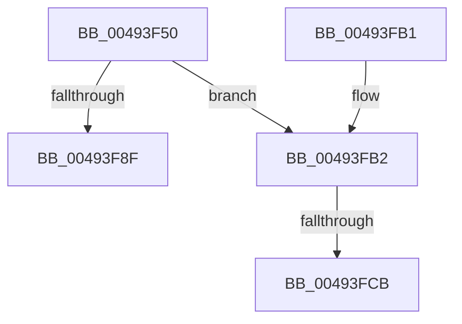

# KeAllocateInterrupt

- RVA: `0x00493F50`–`0x00493FD5` (길이 `133` bytes)
- VA: `0x0000000140493F50`
- 실행 섹션: `.text`
- PDB 이름 있음: `예`; PDB Function 태그: `예`
- unwind 정보 RVA: `0x00071D88`
- 디코드: `32`개 명령, `133/133` bytes 표시
- 미해석 바이트: `0` (있으면 어셈블리에 `.byte`로 보존)

> 이 문서는 커널 이미지의 기계어와 PDB 기호를 분석해 생성했습니다. 4번과 5번은 함수 원형과 자료형을 바이너리 사용 방식에서 추정한 C 해석이며 원본 소스 복구 결과는 아닙니다.

## 1. Dependencies

- 직접 호출 지점: **2**; 고유 호출 대상: **2**
- 직접 호출자로 확인된 함수: **1**
- RIP 상대 이미지 참조: **0**

### Outgoing calls
- `0x00493F85` → [ExpInterlockedPopEntrySList](../6B/ExpInterlockedPopEntrySList_function_006BA570.md) (function, `0x006BA570`)
- `0x00493FBA` → [MmAllocateIndependentPages](../../page/AA/MmAllocateIndependentPages_function_00AA0CE0.md) (function, `0x00AA0CE0`)

### Direct callers
- [IopConnectInterrupt](../../page/90/IopConnectInterrupt_function_00900B40.md) at `0x00900E9C`

### Static image references
- 디코드된 RIP-relative 메모리 참조가 없습니다.

## 2. Other-region calls and transfers

- 다른 실행 섹션으로 향하는 call: **1**
  - `0x00493FBA` → [MmAllocateIndependentPages](../../page/AA/MmAllocateIndependentPages_function_00AA0CE0.md) (`.text` → `PAGE`)
- call이 아닌 외부 분기/꼬리 이동: **2**
  - `0x00493FC5` → [sub_006F731E + 0x1D](../6F/Unknown_function_006F731E.md) (`tail-transfer`)
  - `0x00493FD0` → [sub_006F731E](../6F/Unknown_function_006F731E.md) (`tail-transfer`)

## 3. Assembly (complete function range)

```asm
00493F50  48 8B C4                        mov rax, rsp
00493F53  48 89 58 08                     mov qword ptr [rax + 8], rbx
00493F57  48 89 68 10                     mov qword ptr [rax + 0x10], rbp
00493F5B  48 89 70 18                     mov qword ptr [rax + 0x18], rsi
00493F5F  48 89 78 20                     mov qword ptr [rax + 0x20], rdi
00493F63  41 56                           push r14
00493F65  48 83 EC 20                     sub rsp, 0x20
00493F69  48 8B 81 C0 00 00 00            mov rax, qword ptr [rcx + 0xc0]
00493F70  48 8D A9 00 38 00 00            lea rbp, [rcx + 0x3800]
00493F77  48 8B F9                        mov rdi, rcx
00493F7A  44 0F B7 B0 8A 00 00 00         movzx r14d, word ptr [rax + 0x8a]
00493F82  48 8B CD                        mov rcx, rbp
00493F85  E8 E6 65 22 00                  call 0x1406ba570
00493F8A  48 85 C0                        test rax, rax
00493F8D  74 23                           je 0x140493fb2
00493F8F  48 89 B8 20 01 00 00            mov qword ptr [rax + 0x120], rdi
00493F96  48 8B 5C 24 30                  mov rbx, qword ptr [rsp + 0x30]
00493F9B  48 8B 6C 24 38                  mov rbp, qword ptr [rsp + 0x38]
00493FA0  48 8B 74 24 40                  mov rsi, qword ptr [rsp + 0x40]
00493FA5  48 8B 7C 24 48                  mov rdi, qword ptr [rsp + 0x48]
00493FAA  48 83 C4 20                     add rsp, 0x20
00493FAE  41 5E                           pop r14
00493FB0  C3                              ret
00493FB1  CC                              int3
00493FB2  41 8B D6                        mov edx, r14d
00493FB5  B9 00 10 00 00                  mov ecx, 0x1000
00493FBA  E8 21 CD 60 00                  call 0x140aa0ce0
00493FBF  48 8B D8                        mov rbx, rax
00493FC2  48 85 C0                        test rax, rax
00493FC5  0F 84 70 33 26 00               je 0x1406f733b
00493FCB  BE 0C 00 00 00                  mov esi, 0xc
00493FD0  E9 49 33 26 00                  jmp 0x1406f731e
```

## 4. C-style interpretation (structured pseudocode)

```c
__int64 __fastcall KeAllocateInterrupt(__int64 a1)
{
    __int64 result;
    __int64 v_rsp;
    unsigned __int64 v_stack_p10;
    unsigned __int64 v_stack_p18;
    unsigned __int64 v_stack_p20;
    unsigned __int64 v_stack_p8;

    *(unsigned __int64 *)(v_rsp + 8) = v_rbx;
    *(unsigned __int64 *)(v_rsp + 16) = v_rbp;
    *(unsigned __int64 *)(v_rsp + 24) = v_rsi;
    *(unsigned __int64 *)(v_rsp + 32) = v_rdi;
    v_rsp = (v_rsp) - (32);
    result = ExpInterlockedPopEntrySList(a1 + 14336, a2, a3, a4);
    if (result == 0) goto loc_00493FB2;
    *(unsigned __int64 *)(result + 288) = a1;
    v_rsp = (v_rsp) + (32);
    return result;
loc_00493FB2:
    result = MmAllocateIndependentPages((unsigned int)(0x1000ULL), (unsigned int)((unsigned int)(*(unsigned __int16 *)(*(unsigned __int64 *)(a1 + 192) + 138))), a3, a4);
}
```

## 5. (Beta) C Style

```c
int64_t KeAllocateInterrupt(void *Arg1)
{
    uint8_t *arg1 = (uint8_t *)Arg1;

    int64_t result;
    int64_t local_rsp;
    uint64_t v_stack_p10;
    uint64_t v_stack_p18;
    uint64_t v_stack_p20;
    uint64_t v_stack_p8;

    *(uint64_t *)(local_rsp + 0x8) = local_rbx;
    *(uint64_t *)(local_rsp + 0x10) = local_rbp;
    *(uint64_t *)(local_rsp + 0x18) = local_rsi;
    *(uint64_t *)(local_rsp + 0x20) = local_rdi;
    local_rsp = (local_rsp) - (32);
    result = ExpInterlockedPopEntrySList(Arg1 + 14336, a2, a3, a4);
    if (result == 0) goto loc_00493FB2;
    *(void **)(result + 0x120) = Arg1;
    local_rsp = (local_rsp) + (32);
    return result;
loc_00493FB2:
    result = MmAllocateIndependentPages((uint32_t)(0x1000ULL), (uint32_t)((uint32_t)(*(uint16_t *)(*(uint64_t *)(arg1 + 0xC0) + 0x8A))), a3, a4);
}
```

### 관측된 메모리 오프셋

구조체 형식이 확인되지 않은 접근은 인자 기준의 오프셋으로만 기록했습니다.

| 기준 인자 | 오프셋 표현 | 폭 (bit) | 접근 |
|---|---:|---:|---|
| `Arg1` | `+ 0xC0` | `64` | `R` |
| `Arg1` | `+ 0x3800` | `64` | `R` |

## 6. Execution-region graph

[열기: 2D/3D 그래프와 함수 탐색 컨트롤 패널](../../../control-panel.html?section=text&rva=0x00493F50&view=graph)

- 2D 그래프는 위에서 아래로 흐르고, 3D 그래프는 빈 공간을 드래그해 회전합니다. Shift+드래그는 이동, 휠은 확대·축소, 함수 노드 선택은 대상 보고서 이동입니다.

### Static fallback


