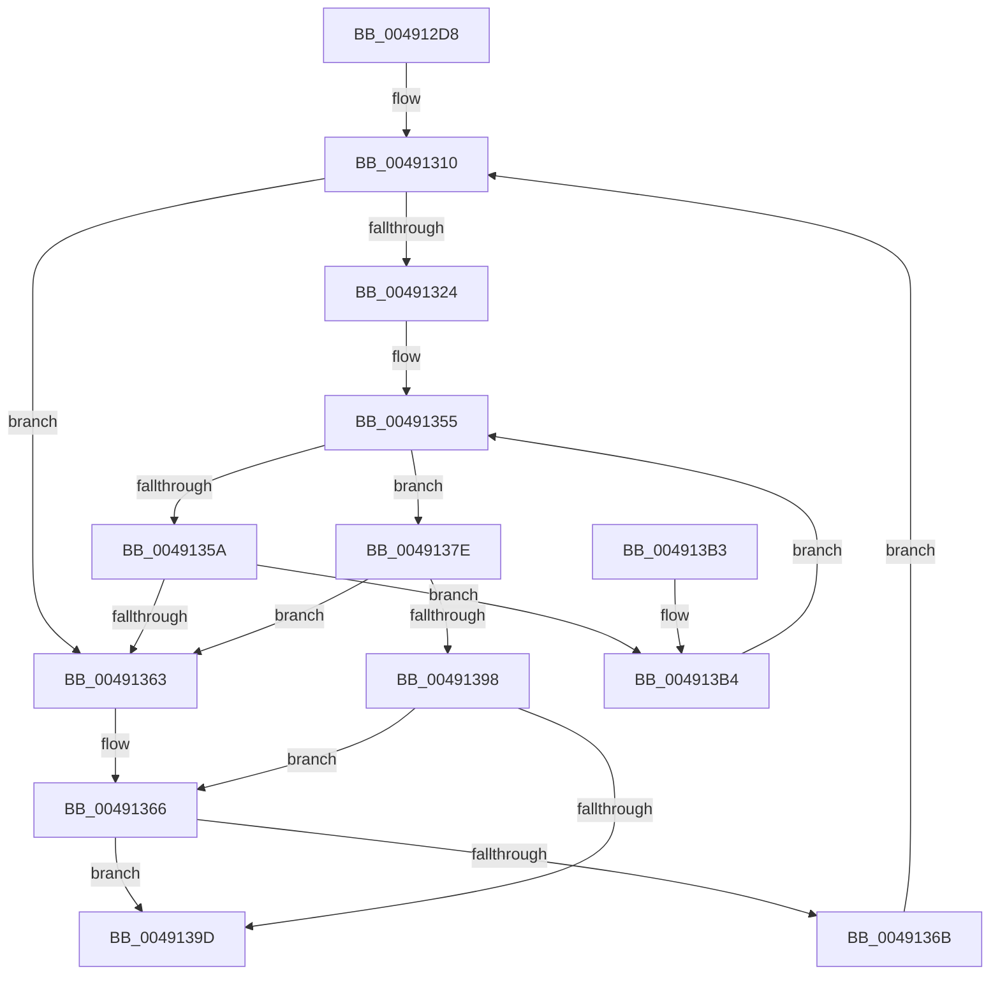

# KeFindNextSetRightGroupMask

- RVA: `0x004912D8`–`0x004913BC` (길이 `228` bytes)
- VA: `0x00000001404912D8`
- 실행 섹션: `.text`
- PDB 이름 있음: `예`; PDB Function 태그: `아니요`
- unwind 정보 RVA: `0x000B2CC0`
- 디코드: `72`개 명령, `228/228` bytes 표시
- 미해석 바이트: `0` (있으면 어셈블리에 `.byte`로 보존)

> 이 문서는 커널 이미지의 기계어와 PDB 기호를 분석해 생성했습니다. 4번과 5번은 함수 원형과 자료형을 바이너리 사용 방식에서 추정한 C 해석이며 원본 소스 복구 결과는 아닙니다.

## 1. Dependencies

- 직접 호출 지점: **0**; 고유 호출 대상: **0**
- 직접 호출자로 확인된 함수: **1**
- RIP 상대 이미지 참조: **0**

### Outgoing calls
- 직접 디코드된 call 명령이 없습니다.

### Direct callers
- [KeSelectGroupFromNode](KeSelectGroupFromNode_function_00491270.md) at `0x004912AE`

### Static image references
- 디코드된 RIP-relative 메모리 참조가 없습니다.

## 2. Other-region calls and transfers

- 다른 실행 섹션으로 향하는 call: **0**
- 별도 외부 분기/꼬리 이동을 확인하지 못했습니다.

## 3. Assembly (complete function range)

```asm
004912D8  48 89 5C 24 08                  mov qword ptr [rsp + 8], rbx
004912DD  48 89 6C 24 18                  mov qword ptr [rsp + 0x18], rbp
004912E2  56                              push rsi
004912E3  57                              push rdi
004912E4  41 56                           push r14
004912E6  48 83 EC 10                     sub rsp, 0x10
004912EA  0F B7 DA                        movzx ebx, dx
004912ED  49 8B F0                        mov rsi, r8
004912F0  48 C7 04 24 20 00 00 00         mov qword ptr [rsp], 0x20
004912F8  4C 8B F1                        mov r14, rcx
004912FB  4C 8B 1C 24                     mov r11, qword ptr [rsp]
004912FF  49 3B DB                        cmp rbx, r11
00491302  4D 1B D2                        sbb r10, r10
00491305  4C 23 D3                        and r10, rbx
00491308  4D 8D 4B FF                     lea r9, [r11 - 1]
0049130C  48 83 CD FF                     or rbp, 0xffffffffffffffff
00491310  83 64 24 38 00                  and dword ptr [rsp + 0x38], 0
00491315  49 8B C1                        mov rax, r9
00491318  49 2B C2                        sub rax, r10
0049131B  48 FF C0                        inc rax
0049131E  48 83 F8 01                     cmp rax, 1
00491322  72 3F                           jb 0x140491363
00491324  49 8B C1                        mov rax, r9
00491327  41 8A CA                        mov cl, r10b
0049132A  48 C1 E8 06                     shr rax, 6
0049132E  80 E1 3F                        and cl, 0x3f
00491331  41 B8 01 00 00 00               mov r8d, 1
00491337  49 D3 E0                        shl r8, cl
0049133A  49 FF C8                        dec r8
0049133D  49 8D 3C C6                     lea rdi, [r14 + rax*8]
00491341  49 8B C2                        mov rax, r10
00491344  48 C1 E8 06                     shr rax, 6
00491348  49 8D 14 C6                     lea rdx, [r14 + rax*8]
0049134C  48 8B 02                        mov rax, qword ptr [rdx]
0049134F  48 F7 D0                        not rax
00491352  4C 0B C0                        or r8, rax
00491355  4C 3B C5                        cmp r8, rbp
00491358  75 24                           jne 0x14049137e
0049135A  48 83 C2 08                     add rdx, 8
0049135E  48 3B D7                        cmp rdx, rdi
00491361  76 51                           jbe 0x1404913b4
00491363  48 8B D5                        mov rdx, rbp
00491366  4D 85 D2                        test r10, r10
00491369  74 32                           je 0x14049139d
0049136B  4C 8D 4B 01                     lea r9, [rbx + 1]
0049136F  4D 3B CB                        cmp r9, r11
00491372  4D 0F 47 CB                     cmova r9, r11
00491376  49 FF C9                        dec r9
00491379  45 33 D2                        xor r10d, r10d
0049137C  EB 92                           jmp 0x140491310
0049137E  49 2B D6                        sub rdx, r14
00491381  49 F7 D0                        not r8
00491384  48 C1 FA 03                     sar rdx, 3
00491388  49 0F BC C0                     bsf rax, r8
0049138C  48 C1 E2 06                     shl rdx, 6
00491390  48 03 D0                        add rdx, rax
00491393  49 3B D1                        cmp rdx, r9
00491396  77 CB                           ja 0x140491363
00491398  48 3B D5                        cmp rdx, rbp
0049139B  74 C9                           je 0x140491366
0049139D  48 8B 5C 24 30                  mov rbx, qword ptr [rsp + 0x30]
004913A2  48 8B 6C 24 40                  mov rbp, qword ptr [rsp + 0x40]
004913A7  66 89 16                        mov word ptr [rsi], dx
004913AA  48 83 C4 10                     add rsp, 0x10
004913AE  41 5E                           pop r14
004913B0  5F                              pop rdi
004913B1  5E                              pop rsi
004913B2  C3                              ret
004913B3  CC                              int3
004913B4  4C 8B 02                        mov r8, qword ptr [rdx]
004913B7  49 F7 D0                        not r8
004913BA  EB 99                           jmp 0x140491355
```

## 4. C-style interpretation (structured pseudocode)

```c
__int64 __fastcall KeFindNextSetRightGroupMask(__int64 a1, unsigned __int16 a2, __int64 a3)
{
    __int64 result;
    __int64 v_r10;
    __int64 v_rbp;
    __int64 v_rsp;
    unsigned __int64 v_stack_m28;
    unsigned int v_stack_p10;
    unsigned __int64 v_stack_p18;
    unsigned __int64 v_stack_p8;

    v_stack_p8 = v_rbx;
    v_stack_p18 = v_rbp;
    v_rsp = (v_rsp) - (16);
    v_stack_m28 = 32;
    v_r10 = (v_r10) & (a2);
    v_rbp = (v_rbp) | (-1);
loc_00491310:
    result = (v_stack_m28 - 1) - (v_r10);
    result = (result) + 1;
    if (result < 1) goto loc_00491363;
    result = (v_stack_m28 - 1) >> (6);
    a1 = (unsigned __int8)(((unsigned __int8)(v_r10)) & (63));
    a3 = (1) << ((unsigned __int8)(a1));
    a3 = (a3) - 1;
    result = (v_r10) >> (6);
    result = ~(*(unsigned __int64 *)(a1 + result * 8));
    a3 = (a3) | (result);
loc_00491355:
    if (a3 != v_rbp) goto loc_0049137E;
    a2 = (a1 + result * 8) + (8);
    if (a2 <= (a1 + result * 8)) goto loc_004913B4;
loc_00491363:
loc_00491366:
    if (v_r10 == 0) goto loc_0049139D;
    a4 = a2 + 1;
    if ((a2 + 1) > v_stack_m28) { a4 = v_stack_m28; }
    a4 = (a4) - 1;
    v_r10 = 0;
    goto loc_00491310;
loc_0049137E:
    a2 = (v_rbp) - (a1);
    a3 = ~(a3);
    a2 = (a2) >> (3);
    a2 = (a2) << (6);
    a2 = (a2) + (result);
    if (a2 > a4) goto loc_00491363;
    if (a2 == v_rbp) goto loc_00491366;
loc_0049139D:
    *(unsigned __int16 *)(a3) = a2;
    v_rsp = (v_rsp) + (16);
    return result;
loc_004913B4:
    a3 = ~(*(unsigned __int64 *)(a2));
    goto loc_00491355;
}
```

## 5. (Beta) C Style

```c
int64_t KeFindNextSetRightGroupMask(void *Arg1, uint16_t Arg2, void *Arg3)
{
    uint8_t *arg1 = (uint8_t *)Arg1;
    uint8_t *arg3 = (uint8_t *)Arg3;

    int64_t result;
    int64_t local_r10;
    int64_t local_rbp;
    int64_t local_rsp;
    uint64_t v_stack_m28;
    uint32_t v_stack_p10;
    uint64_t v_stack_p18;
    uint64_t v_stack_p8;

    v_stack_p8 = local_rbx;
    v_stack_p18 = local_rbp;
    local_rsp = (local_rsp) - (16);
    v_stack_m28 = 32;
    local_r10 = (local_r10) & (Arg2);
    local_rbp = (local_rbp) | (-1);
loc_00491310:
    result = (v_stack_m28 - 1) - (local_r10);
    result = (result) + 1;
    if (result < 1) goto loc_00491363;
    result = (v_stack_m28 - 1) >> (6);
    Arg1 = (uint8_t)(((uint8_t)(local_r10)) & (63));
    Arg3 = (1) << ((uint8_t)(Arg1));
    Arg3 = (Arg3) - 1;
    result = (local_r10) >> (6);
    result = ~(*(uint64_t *)(arg1 + result * 8));
    Arg3 = (Arg3) | (result);
loc_00491355:
    if (Arg3 != local_rbp) goto loc_0049137E;
    Arg2 = (Arg1 + result * 8) + (8);
    if (Arg2 <= (Arg1 + result * 8)) goto loc_004913B4;
loc_00491363:
loc_00491366:
    if (local_r10 == 0) goto loc_0049139D;
    a4 = Arg2 + 1;
    if ((Arg2 + 1) > v_stack_m28) { a4 = v_stack_m28; }
    a4 = (a4) - 1;
    local_r10 = 0;
    goto loc_00491310;
loc_0049137E:
    Arg2 = (local_rbp) - (Arg1);
    Arg3 = ~(Arg3);
    Arg2 = (Arg2) >> (3);
    Arg2 = (Arg2) << (6);
    Arg2 = (Arg2) + (result);
    if (Arg2 > a4) goto loc_00491363;
    if (Arg2 == local_rbp) goto loc_00491366;
loc_0049139D:
    *(uint16_t *)(arg3) = Arg2;
    local_rsp = (local_rsp) + (16);
    return result;
loc_004913B4:
    Arg3 = ~(*(uint64_t *)(Arg2));
    goto loc_00491355;
}
```

### 관측된 메모리 오프셋

구조체 형식이 확인되지 않은 접근은 인자 기준의 오프셋으로만 기록했습니다.

| 기준 인자 | 오프셋 표현 | 폭 (bit) | 접근 |
|---|---:|---:|---|
| `Arg1` | `+ 0x0` | `64` | `R` |
| `Arg1` | `+ 0x0 + rax*8` | `64` | `R` |
| `Arg3` | `+ 0x0` | `16` | `W` |

## 6. Execution-region graph

[열기: 2D/3D 그래프와 함수 탐색 컨트롤 패널](../../../control-panel.html?section=text&rva=0x004912D8&view=graph)

- 2D 그래프는 위에서 아래로 흐르고, 3D 그래프는 빈 공간을 드래그해 회전합니다. Shift+드래그는 이동, 휠은 확대·축소, 함수 노드 선택은 대상 보고서 이동입니다.

### Static fallback


