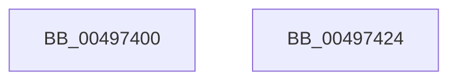

# KeInitializeAffinityEx

- RVA: `0x00497400`–`0x00497425` (길이 `37` bytes)
- VA: `0x0000000140497400`
- 실행 섹션: `.text`
- PDB 이름 있음: `예`; PDB Function 태그: `아니요`
- unwind 정보 RVA: `0x0005C788`
- 디코드: `10`개 명령, `37/37` bytes 표시
- 미해석 바이트: `0` (있으면 어셈블리에 `.byte`로 보존)

> 이 문서는 커널 이미지의 기계어와 PDB 기호를 분석해 생성했습니다. 4번과 5번은 함수 원형과 자료형을 바이너리 사용 방식에서 추정한 C 해석이며 원본 소스 복구 결과는 아닙니다.

## 1. Dependencies

- 직접 호출 지점: **1**; 고유 호출 대상: **1**
- 직접 호출자로 확인된 함수: **0**
- RIP 상대 이미지 참조: **0**

### Outgoing calls
- `0x0049741A` → [memset](../6C/memset_function_006C6C40.md) (function, `0x006C6C40`)

### Direct callers
- 이 함수 시작 RVA로 연결되는 직접 call은 확인되지 않았습니다. 간접 호출은 완전히 역산할 수 없습니다.

### Static image references
- 디코드된 RIP-relative 메모리 참조가 없습니다.

## 2. Other-region calls and transfers

- 다른 실행 섹션으로 향하는 call: **0**
- 별도 외부 분기/꼬리 이동을 확인하지 못했습니다.

## 3. Assembly (complete function range)

```asm
00497400  48 83 EC 28                     sub rsp, 0x28
00497404  83 61 04 00                     and dword ptr [rcx + 4], 0
00497408  33 D2                           xor edx, edx
0049740A  C7 01 01 00 14 00               mov dword ptr [rcx], 0x140001
00497410  41 B8 A0 00 00 00               mov r8d, 0xa0
00497416  48 83 C1 08                     add rcx, 8
0049741A  E8 21 F8 22 00                  call 0x1406c6c40
0049741F  48 83 C4 28                     add rsp, 0x28
00497423  C3                              ret
00497424  CC                              int3
```

## 4. C-style interpretation (structured pseudocode)

```c
__int64 __fastcall KeInitializeAffinityEx(__int64 a1, int a2)
{
    __int64 result;
    __int64 v_rsp;

    v_rsp = (v_rsp) - (40);
    a2 = 0;
    *(unsigned int *)(a1) = 0x140001ULL;
    a1 = (a1) + (8);
    result = memset(a1, a2, 160, a4);
    v_rsp = (v_rsp) + (40);
    return result;
}
```

## 5. (Beta) C Style

```c
int64_t KeInitializeAffinityEx(void *Affinity, int32_t Arg2)
{
    uint8_t *affinity = (uint8_t *)Affinity;

    int64_t result;
    int64_t local_rsp;

    local_rsp = (local_rsp) - (40);
    Arg2 = 0;
    *(uint32_t *)(affinity) = 0x140001ULL;
    Affinity = (Affinity) + (8);
    result = memset(Affinity, Arg2, 160, a4);
    local_rsp = (local_rsp) + (40);
    return result;
}
```

### 관측된 메모리 오프셋

구조체 형식이 확인되지 않은 접근은 인자 기준의 오프셋으로만 기록했습니다.

| 기준 인자 | 오프셋 표현 | 폭 (bit) | 접근 |
|---|---:|---:|---|
| `Affinity` | `+ 0x0` | `32` | `W` |
| `Affinity` | `+ 0x4` | `32` | `R/W` |

## 6. Execution-region graph

[열기: 2D/3D 그래프와 함수 탐색 컨트롤 패널](../../../control-panel.html?section=text&rva=0x00497400&view=graph)

- 2D 그래프는 위에서 아래로 흐르고, 3D 그래프는 빈 공간을 드래그해 회전합니다. Shift+드래그는 이동, 휠은 확대·축소, 함수 노드 선택은 대상 보고서 이동입니다.

### Static fallback


