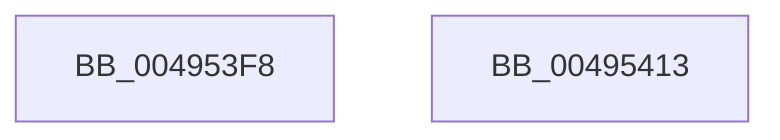

# KeInitializeGate

- RVA: `0x004953F8`–`0x00495414` (길이 `28` bytes)
- VA: `0x00000001404953F8`
- 실행 섹션: `.text`
- PDB 이름 있음: `예`; PDB Function 태그: `아니요`
- unwind 정보 RVA: `0x000DB714`
- 디코드: `9`개 명령, `28/28` bytes 표시
- 미해석 바이트: `0` (있으면 어셈블리에 `.byte`로 보존)

> 이 문서는 커널 이미지의 기계어와 PDB 기호를 분석해 생성했습니다. 4번과 5번은 함수 원형과 자료형을 바이너리 사용 방식에서 추정한 C 해석이며 원본 소스 복구 결과는 아닙니다.

## 1. Dependencies

- 직접 호출 지점: **0**; 고유 호출 대상: **0**
- 직접 호출자로 확인된 함수: **8**
- RIP 상대 이미지 참조: **0**

### Outgoing calls
- 직접 디코드된 call 명령이 없습니다.

### Direct callers
- [KeRcuSynchronize](../../page/74/KeRcuSynchronize_function_00746450.md) at `0x00746489`
- [KeSrcuSynchronize](../../page/74/KeSrcuSynchronize_function_00747230.md) at `0x00747250`
- [PspDereferenceSessionFinal](../../page/78/PspDereferenceSessionFinal_function_00788F5C.md) at `0x00788FA8`
- [MmScrubMemory](../../page/80/MmScrubMemory_function_0080EFA0.md) at `0x0080F049`
- [NtSetInformationProcess](../../page/AE/NtSetInformationProcess_function_00AE5370.md) at `0x00AE5763`
- [KiInitializeProcessor](../../pagelk/B6/KiInitializeProcessor_function_00B66A0C.md) at `0x00B66A47`
- [sub_00BE60B0](../../initkdbg/BE/Unknown_function_00BE60B0.md) at `0x00BE657B`
- [sub_00BEFF8C](../../init/BE/Unknown_function_00BEFF8C.md) at `0x00BF053F`

### Static image references
- 디코드된 RIP-relative 메모리 참조가 없습니다.

## 2. Other-region calls and transfers

- 다른 실행 섹션으로 향하는 call: **0**
- 별도 외부 분기/꼬리 이동을 확인하지 못했습니다.

## 3. Assembly (complete function range)

```asm
004953F8  0F B6 C2                        movzx eax, dl
004953FB  89 41 04                        mov dword ptr [rcx + 4], eax
004953FE  48 8D 41 08                     lea rax, [rcx + 8]
00495402  66 C7 01 07 01                  mov word ptr [rcx], 0x107
00495407  C6 41 02 06                     mov byte ptr [rcx + 2], 6
0049540B  48 89 40 08                     mov qword ptr [rax + 8], rax
0049540F  48 89 00                        mov qword ptr [rax], rax
00495412  C3                              ret
00495413  CC                              int3
```

## 4. C-style interpretation (structured pseudocode)

```c
__int64 __fastcall KeInitializeGate(__int64 a1, unsigned __int8 a2)
{
    *(unsigned int *)(a1 + 4) = a2;
    *(unsigned __int16 *)(a1) = 263;
    *(unsigned __int8 *)(a1 + 2) = 6;
    *(unsigned __int64 *)(a1 + 8 + 8) = a1 + 8;
    *(unsigned __int64 *)(a1 + 8) = a1 + 8;
    return a1 + 8;
}
```

## 5. (Beta) C Style

```c
void *KeInitializeGate(void *Gate, uint8_t Arg2)
{
    uint8_t *gate = (uint8_t *)Gate;

    *(uint32_t *)(gate + 0x4) = Arg2;
    *(uint16_t *)(gate) = 263;
    *(uint8_t *)(gate + 0x2) = 6;
    *(void **)(gate + 0x8 + 0x8) = Gate + 8;
    *(void **)(gate + 0x8) = Gate + 8;
    return Gate + 8;
}
```

### 관측된 메모리 오프셋

구조체 형식이 확인되지 않은 접근은 인자 기준의 오프셋으로만 기록했습니다.

| 기준 인자 | 오프셋 표현 | 폭 (bit) | 접근 |
|---|---:|---:|---|
| `Gate` | `+ 0x0` | `16` | `W` |
| `Gate` | `+ 0x0` | `64` | `W` |
| `Gate` | `+ 0x2` | `8` | `W` |
| `Gate` | `+ 0x4` | `32` | `W` |
| `Gate` | `+ 0x8` | `64` | `R` |
| `Gate` | `+ 0x8` | `64` | `W` |

## 6. Execution-region graph

[열기: 2D/3D 그래프와 함수 탐색 컨트롤 패널](../../../control-panel.html?section=text&rva=0x004953F8&view=graph)

- 2D 그래프는 위에서 아래로 흐르고, 3D 그래프는 빈 공간을 드래그해 회전합니다. Shift+드래그는 이동, 휠은 확대·축소, 함수 노드 선택은 대상 보고서 이동입니다.

### Static fallback


