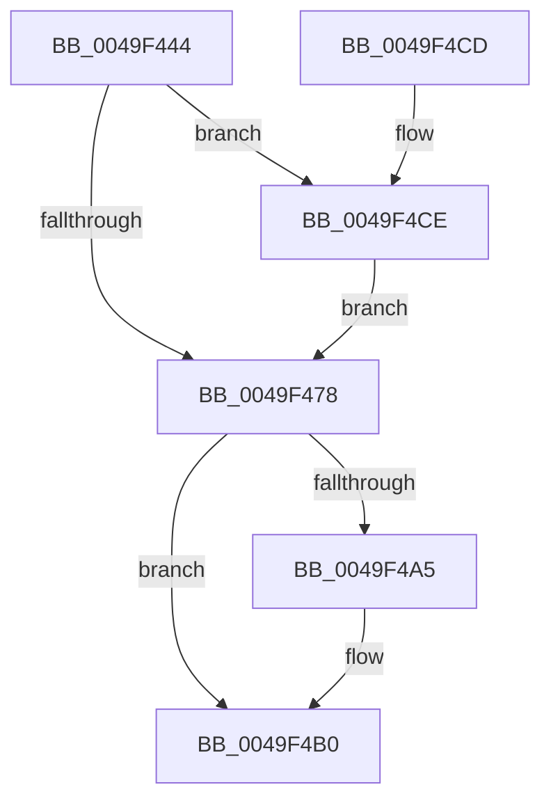

# KeQueryBootTimeValues

- RVA: `0x0049F444`–`0x0049F4D7` (길이 `147` bytes)
- VA: `0x000000014049F444`
- 실행 섹션: `.text`
- PDB 이름 있음: `예`; PDB Function 태그: `아니요`
- unwind 정보 RVA: `0x000A7C70`
- 디코드: `37`개 명령, `147/147` bytes 표시
- 미해석 바이트: `0` (있으면 어셈블리에 `.byte`로 보존)

> 이 문서는 커널 이미지의 기계어와 PDB 기호를 분석해 생성했습니다. 4번과 5번은 함수 원형과 자료형을 바이너리 사용 방식에서 추정한 C 해석이며 원본 소스 복구 결과는 아닙니다.

## 1. Dependencies

- 직접 호출 지점: **2**; 고유 호출 대상: **2**
- 직접 호출자로 확인된 함수: **5**
- RIP 상대 이미지 참조: **3**

### Outgoing calls
- `0x0049F4AB` → [KiLowerIrqlProcessIrqlFlags](../4F/KiLowerIrqlProcessIrqlFlags_function_004F5698.md) (function, `0x004F5698`)
- `0x0049F4D0` → [KiRaiseIrqlProcessIrqlFlags](../4F/KiRaiseIrqlProcessIrqlFlags_function_004F56FC.md) (function, `0x004F56FC`)

### Direct callers
- [PipUpdateDeviceProducts](../5A/PipUpdateDeviceProducts_function_005A46C0.md) at `0x005A484D`
- [ExpQuerySystemInformation](../../page/A5/ExpQuerySystemInformation_function_00A57858.md) at `0x00A57E61`
- [PipHardwareConfigInit](../../init/C3/PipHardwareConfigInit_function_00C30D24.md) at `0x00C31029`
- [EtwpFixBootSystemTime](../../init/C4/EtwpFixBootSystemTime_function_00C4DAF8.md) at `0x00C4DB2C`
- [EtwpInitializeBootTimeStamps](../../init/C4/EtwpInitializeBootTimeStamps_function_00C4E23C.md) at `0x00C4E279`

### Static image references
- `0x0049F46F` → RVA `0x00FC6D20` (`ALMOSTRO`; read)
- `0x0049F488` → RVA `0x00FC6E28` (`ALMOSTRO`; read)
- `0x0049F492` → RVA `0x00FC7068` (`ALMOSTRO`; read)

## 2. Other-region calls and transfers

- 다른 실행 섹션으로 향하는 call: **0**
- 별도 외부 분기/꼬리 이동을 확인하지 못했습니다.

## 3. Assembly (complete function range)

```asm
0049F444  48 89 5C 24 08                  mov qword ptr [rsp + 8], rbx
0049F449  48 89 74 24 10                  mov qword ptr [rsp + 0x10], rsi
0049F44E  48 89 7C 24 18                  mov qword ptr [rsp + 0x18], rdi
0049F453  41 56                           push r14
0049F455  48 83 EC 20                     sub rsp, 0x20
0049F459  49 8B F8                        mov rdi, r8
0049F45C  48 8B F2                        mov rsi, rdx
0049F45F  4C 8B F1                        mov r14, rcx
0049F462  44 0F 20 C3                     mov rbx, cr8
0049F466  BA 02 00 00 00                  mov edx, 2
0049F46B  44 0F 22 C2                     mov cr8, rdx
0049F46F  83 3D AA 78 B2 00 00            cmp dword ptr [rip + 0xb278aa], 0
0049F476  75 56                           jne 0x14049f4ce
0049F478  48 B8 14 00 00 00 80 F7 FF FF   movabs rax, 0xfffff78000000014
0049F482  48 8B 00                        mov rax, qword ptr [rax]
0049F485  49 89 06                        mov qword ptr [r14], rax
0049F488  48 8B 05 99 79 B2 00            mov rax, qword ptr [rip + 0xb27999]
0049F48F  48 89 06                        mov qword ptr [rsi], rax
0049F492  48 8B 05 CF 7B B2 00            mov rax, qword ptr [rip + 0xb27bcf]
0049F499  48 89 07                        mov qword ptr [rdi], rax
0049F49C  83 3D 7D 78 B2 00 00            cmp dword ptr [rip + 0xb2787d], 0
0049F4A3  74 0B                           je 0x14049f4b0
0049F4A5  44 0F 20 C1                     mov rcx, cr8
0049F4A9  8A D3                           mov dl, bl
0049F4AB  E8 E8 61 05 00                  call 0x1404f5698
0049F4B0  0F B6 C3                        movzx eax, bl
0049F4B3  44 0F 22 C0                     mov cr8, rax
0049F4B7  48 8B 5C 24 30                  mov rbx, qword ptr [rsp + 0x30]
0049F4BC  48 8B 74 24 38                  mov rsi, qword ptr [rsp + 0x38]
0049F4C1  48 8B 7C 24 40                  mov rdi, qword ptr [rsp + 0x40]
0049F4C6  48 83 C4 20                     add rsp, 0x20
0049F4CA  41 5E                           pop r14
0049F4CC  C3                              ret
0049F4CD  CC                              int3
0049F4CE  8A CB                           mov cl, bl
0049F4D0  E8 27 62 05 00                  call 0x1404f56fc
0049F4D5  EB A1                           jmp 0x14049f478
```

## 4. C-style interpretation (structured pseudocode)

```c
__int64 __fastcall KeQueryBootTimeValues(__int64 a1, __int64 a2, __int64 a3)
{
    __int64 result;
    __int64 v_rsp;
    unsigned __int64 v_stack_p10;
    unsigned __int64 v_stack_p18;
    unsigned __int64 v_stack_p8;

    v_stack_p8 = v_rbx;
    v_stack_p10 = v_rsi;
    v_stack_p18 = v_rdi;
    v_rsp = (v_rsp) - (32);
    if ((*(unsigned int *)(v_rip + 11696298)) != 0) goto loc_0049F4CE;
loc_0049F478:
    *(unsigned __int64 *)(a1) = *(unsigned __int64 *)(result);
    *(unsigned __int64 *)(a2) = *(unsigned __int64 *)(v_rip + 11696537);
    *(unsigned __int64 *)(a3) = *(unsigned __int64 *)(v_rip + 11697103);
    result = *(unsigned __int64 *)(v_rip + 11697103);
    if ((*(unsigned int *)(v_rip + 11696253)) != 0) {
        a1 = 2;
        a2 = (unsigned __int8)(v_cr8);
        result = KiLowerIrqlProcessIrqlFlags(a1, a2, a3, a4);
    }
    v_rsp = (v_rsp) + (32);
    return (unsigned __int8)(v_cr8);
loc_0049F4CE:
    result = KiRaiseIrqlProcessIrqlFlags((unsigned __int8)(v_stack_p8), a2, a3, a4);
    goto loc_0049F478;
}
```

## 5. (Beta) C Style

```c
int64_t KeQueryBootTimeValues(void *Arg1, void *Arg2, void *Arg3)
{
    uint8_t *arg1 = (uint8_t *)Arg1;
    uint8_t *arg2 = (uint8_t *)Arg2;
    uint8_t *arg3 = (uint8_t *)Arg3;

    int64_t result;
    int64_t local_rsp;
    uint64_t v_stack_p10;
    uint64_t v_stack_p18;
    uint64_t v_stack_p8;

    v_stack_p8 = local_rbx;
    v_stack_p10 = local_rsi;
    v_stack_p18 = local_rdi;
    local_rsp = (local_rsp) - (32);
    if ((*(uint32_t *)(v_rip + 0xB278AA)) != 0) goto loc_0049F4CE;
loc_0049F478:
    *(uint64_t *)(arg1) = *(uint64_t *)(result);
    *(uint64_t *)(arg2) = *(uint64_t *)(v_rip + 0xB27999);
    *(uint64_t *)(arg3) = *(uint64_t *)(v_rip + 0xB27BCF);
    result = *(uint64_t *)(v_rip + 0xB27BCF);
    if ((*(uint32_t *)(v_rip + 0xB2787D)) != 0) {
        Arg1 = 2;
        Arg2 = (uint8_t)(v_cr8);
        result = KiLowerIrqlProcessIrqlFlags(Arg1, Arg2, Arg3, a4);
    }
    local_rsp = (local_rsp) + (32);
    return (uint8_t)(v_cr8);
loc_0049F4CE:
    result = KiRaiseIrqlProcessIrqlFlags((uint8_t)(v_stack_p8), Arg2, Arg3, a4);
    goto loc_0049F478;
}
```

### 관측된 메모리 오프셋

구조체 형식이 확인되지 않은 접근은 인자 기준의 오프셋으로만 기록했습니다.

| 기준 인자 | 오프셋 표현 | 폭 (bit) | 접근 |
|---|---:|---:|---|
| `Arg1` | `+ 0x0` | `64` | `W` |
| `Arg2` | `+ 0x0` | `64` | `W` |
| `Arg3` | `+ 0x0` | `64` | `W` |

## 6. Execution-region graph

[열기: 2D/3D 그래프와 함수 탐색 컨트롤 패널](../../../control-panel.html?section=text&rva=0x0049F444&view=graph)

- 2D 그래프는 위에서 아래로 흐르고, 3D 그래프는 빈 공간을 드래그해 회전합니다. Shift+드래그는 이동, 휠은 확대·축소, 함수 노드 선택은 대상 보고서 이동입니다.

### Static fallback


