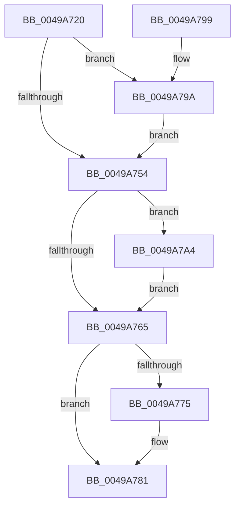

# KeQueryOwnerMutant

- RVA: `0x0049A720`–`0x0049A7B1` (길이 `145` bytes)
- VA: `0x000000014049A720`
- 실행 섹션: `.text`
- PDB 이름 있음: `예`; PDB Function 태그: `아니요`
- unwind 정보 RVA: `0x0005FD80`
- 디코드: `38`개 명령, `145/145` bytes 표시
- 미해석 바이트: `0` (있으면 어셈블리에 `.byte`로 보존)

> 이 문서는 커널 이미지의 기계어와 PDB 기호를 분석해 생성했습니다. 4번과 5번은 함수 원형과 자료형을 바이너리 사용 방식에서 추정한 C 해석이며 원본 소스 복구 결과는 아닙니다.

## 1. Dependencies

- 직접 호출 지점: **3**; 고유 호출 대상: **3**
- 직접 호출자로 확인된 함수: **1**
- RIP 상대 이미지 참조: **1**

### Outgoing calls
- `0x0049A757` → [KiAcquireKobjectLockSafe](../25/KiAcquireKobjectLockSafe_function_00251C90.md) (function, `0x00251C90`)
- `0x0049A77C` → [KiLowerIrqlProcessIrqlFlags](../4F/KiLowerIrqlProcessIrqlFlags_function_004F5698.md) (function, `0x004F5698`)
- `0x0049A79D` → [KiRaiseIrqlProcessIrqlFlags](../4F/KiRaiseIrqlProcessIrqlFlags_function_004F56FC.md) (function, `0x004F56FC`)

### Direct callers
- [NtQueryMutant](../../page/A4/NtQueryMutant_function_00A458D0.md) at `0x00A45A1A`

### Static image references
- `0x0049A74B` → RVA `0x00FC6D20` (`ALMOSTRO`; read)

## 2. Other-region calls and transfers

- 다른 실행 섹션으로 향하는 call: **0**
- 별도 외부 분기/꼬리 이동을 확인하지 못했습니다.

## 3. Assembly (complete function range)

```asm
0049A720  48 89 5C 24 08                  mov qword ptr [rsp + 8], rbx
0049A725  48 89 74 24 10                  mov qword ptr [rsp + 0x10], rsi
0049A72A  57                              push rdi
0049A72B  48 83 EC 20                     sub rsp, 0x20
0049A72F  48 83 22 00                     and qword ptr [rdx], 0
0049A733  48 8B F2                        mov rsi, rdx
0049A736  48 83 62 08 00                  and qword ptr [rdx + 8], 0
0049A73B  48 8B D9                        mov rbx, rcx
0049A73E  44 0F 20 C7                     mov rdi, cr8
0049A742  BA 02 00 00 00                  mov edx, 2
0049A747  44 0F 22 C2                     mov cr8, rdx
0049A74B  83 3D CE C5 B2 00 00            cmp dword ptr [rip + 0xb2c5ce], 0
0049A752  75 46                           jne 0x14049a79a
0049A754  48 8B CB                        mov rcx, rbx
0049A757  E8 34 75 DB FF                  call 0x140251c90
0049A75C  48 8B 43 28                     mov rax, qword ptr [rbx + 0x28]
0049A760  48 85 C0                        test rax, rax
0049A763  75 3F                           jne 0x14049a7a4
0049A765  F0 81 23 7F FF FF FF            lock and dword ptr [rbx], 0xffffff7f
0049A76C  83 3D AD C5 B2 00 00            cmp dword ptr [rip + 0xb2c5ad], 0
0049A773  74 0C                           je 0x14049a781
0049A775  44 0F 20 C1                     mov rcx, cr8
0049A779  40 8A D7                        mov dl, dil
0049A77C  E8 17 AF 05 00                  call 0x1404f5698
0049A781  40 0F B6 C7                     movzx eax, dil
0049A785  44 0F 22 C0                     mov cr8, rax
0049A789  48 8B 5C 24 30                  mov rbx, qword ptr [rsp + 0x30]
0049A78E  48 8B 74 24 38                  mov rsi, qword ptr [rsp + 0x38]
0049A793  48 83 C4 20                     add rsp, 0x20
0049A797  5F                              pop rdi
0049A798  C3                              ret
0049A799  CC                              int3
0049A79A  40 8A CF                        mov cl, dil
0049A79D  E8 5A AF 05 00                  call 0x1404f56fc
0049A7A2  EB B0                           jmp 0x14049a754
0049A7A4  0F 10 80 08 05 00 00            movups xmm0, xmmword ptr [rax + 0x508]
0049A7AB  F3 0F 7F 06                     movdqu xmmword ptr [rsi], xmm0
0049A7AF  EB B4                           jmp 0x14049a765
```

## 4. C-style interpretation (structured pseudocode)

```c
__int64 __fastcall KeQueryOwnerMutant(__int64 a1, __int64 a2)
{
    __int64 result;
    __int64 v_rsp;
    unsigned __int64 v_stack_p10;
    unsigned __int64 v_stack_p8;

    v_stack_p8 = v_rbx;
    v_stack_p10 = v_rsi;
    v_rsp = (v_rsp) - (32);
    if ((*(unsigned int *)(v_rip + 11716046)) != 0) goto loc_0049A79A;
loc_0049A754:
    result = KiAcquireKobjectLockSafe(a1, 2, a3, a4);
    if (*(unsigned __int64 *)(a1 + 40) != 0) goto loc_0049A7A4;
loc_0049A765:
    result = *(unsigned __int64 *)(a1 + 40);
    if ((*(unsigned int *)(v_rip + 11716013)) != 0) {
        a1 = 2;
        a2 = (unsigned __int8)(v_cr8);
        result = KiLowerIrqlProcessIrqlFlags(a1, a2, a3, a4);
    }
    v_rsp = (v_rsp) + (32);
    return (unsigned __int8)(v_cr8);
loc_0049A79A:
    result = KiRaiseIrqlProcessIrqlFlags((unsigned __int8)(v_cr8), a2, a3, a4);
    goto loc_0049A754;
loc_0049A7A4:
    *(unsigned __int64 *)(v_stack_p10) = v_xmm0;
    goto loc_0049A765;
}
```

## 5. (Beta) C Style

```c
int64_t KeQueryOwnerMutant(void *Arg1, void *Arg2)
{
    uint8_t *arg1 = (uint8_t *)Arg1;
    uint8_t *arg2 = (uint8_t *)Arg2;

    int64_t result;
    int64_t local_rsp;
    uint64_t v_stack_p10;
    uint64_t v_stack_p8;

    v_stack_p8 = local_rbx;
    v_stack_p10 = local_rsi;
    local_rsp = (local_rsp) - (32);
    if ((*(uint32_t *)(v_rip + 0xB2C5CE)) != 0) goto loc_0049A79A;
loc_0049A754:
    result = KiAcquireKobjectLockSafe(Arg1, 2, a3, a4);
    if (*(uint64_t *)(arg1 + 0x28) != 0) goto loc_0049A7A4;
loc_0049A765:
    result = *(uint64_t *)(arg1 + 0x28);
    if ((*(uint32_t *)(v_rip + 0xB2C5AD)) != 0) {
        Arg1 = 2;
        Arg2 = (uint8_t)(v_cr8);
        result = KiLowerIrqlProcessIrqlFlags(Arg1, Arg2, a3, a4);
    }
    local_rsp = (local_rsp) + (32);
    return (uint8_t)(v_cr8);
loc_0049A79A:
    result = KiRaiseIrqlProcessIrqlFlags((uint8_t)(v_cr8), Arg2, a3, a4);
    goto loc_0049A754;
loc_0049A7A4:
    *(uint64_t *)(v_stack_p10) = v_xmm0;
    goto loc_0049A765;
}
```

### 관측된 메모리 오프셋

구조체 형식이 확인되지 않은 접근은 인자 기준의 오프셋으로만 기록했습니다.

| 기준 인자 | 오프셋 표현 | 폭 (bit) | 접근 |
|---|---:|---:|---|
| `Arg1` | `+ 0x0` | `32` | `R/W` |
| `Arg1` | `+ 0x28` | `64` | `R` |
| `Arg2` | `+ 0x0` | `64` | `R/W` |
| `Arg2` | `+ 0x0` | `128` | `W` |
| `Arg2` | `+ 0x8` | `64` | `R/W` |

## 6. Execution-region graph

[열기: 2D/3D 그래프와 함수 탐색 컨트롤 패널](../../../control-panel.html?section=text&rva=0x0049A720&view=graph)

- 2D 그래프는 위에서 아래로 흐르고, 3D 그래프는 빈 공간을 드래그해 회전합니다. Shift+드래그는 이동, 휠은 확대·축소, 함수 노드 선택은 대상 보고서 이동입니다.

### Static fallback


