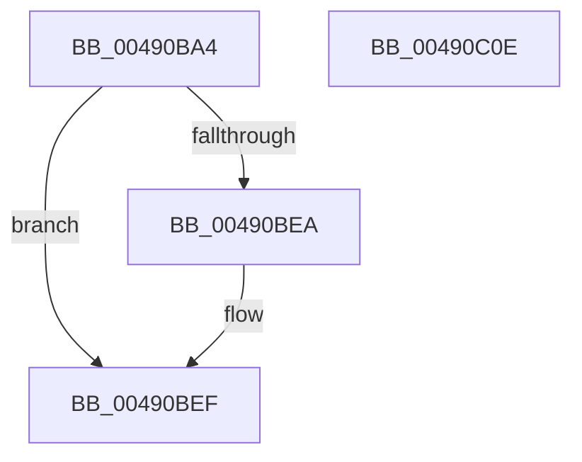

# KeQueryPrimaryGroupAffinityProcess

- RVA: `0x00490BA4`–`0x00490C0F` (길이 `107` bytes)
- VA: `0x0000000140490BA4`
- 실행 섹션: `.text`
- PDB 이름 있음: `예`; PDB Function 태그: `아니요`
- unwind 정보 RVA: `0x000A9ACC`
- 디코드: `30`개 명령, `107/107` bytes 표시
- 미해석 바이트: `0` (있으면 어셈블리에 `.byte`로 보존)

> 이 문서는 커널 이미지의 기계어와 PDB 기호를 분석해 생성했습니다. 4번과 5번은 함수 원형과 자료형을 바이너리 사용 방식에서 추정한 C 해석이며 원본 소스 복구 결과는 아닙니다.

## 1. Dependencies

- 직접 호출 지점: **2**; 고유 호출 대상: **2**
- 직접 호출자로 확인된 함수: **1**
- RIP 상대 이미지 참조: **0**

### Outgoing calls
- `0x00490BCA` → [KiAcquireProcessLockShared](../2C/KiAcquireProcessLockShared_function_002CF9A0.md) (function, `0x002CF9A0`)
- `0x00490BF9` → [KiReleaseProcessLockShared](../2C/KiReleaseProcessLockShared_function_002CE7FC.md) (function, `0x002CE7FC`)

### Direct callers
- [PspWritePebAffinityInfoAttached](../../page/A5/PspWritePebAffinityInfoAttached_function_00A50848.md) at `0x00A508AC`
- [PspWritePebAffinityInfoAttached](../../page/A5/PspWritePebAffinityInfoAttached_function_00A50848.md) at `0x00A5090C`

### Static image references
- 디코드된 RIP-relative 메모리 참조가 없습니다.

## 2. Other-region calls and transfers

- 다른 실행 섹션으로 향하는 call: **0**
- 별도 외부 분기/꼬리 이동을 확인하지 못했습니다.

## 3. Assembly (complete function range)

```asm
00490BA4  48 8B C4                        mov rax, rsp
00490BA7  48 89 58 10                     mov qword ptr [rax + 0x10], rbx
00490BAB  48 89 70 18                     mov qword ptr [rax + 0x18], rsi
00490BAF  57                              push rdi
00490BB0  48 83 EC 20                     sub rsp, 0x20
00490BB4  0F 57 C0                        xorps xmm0, xmm0
00490BB7  48 8B F2                        mov rsi, rdx
00490BBA  0F 11 02                        movups xmmword ptr [rdx], xmm0
00490BBD  33 FF                           xor edi, edi
00490BBF  48 8D 50 08                     lea rdx, [rax + 8]
00490BC3  48 8B D9                        mov rbx, rcx
00490BC6  40 88 78 08                     mov byte ptr [rax + 8], dil
00490BCA  E8 D1 ED E3 FF                  call 0x1402cf9a0
00490BCF  0F B7 83 A0 01 00 00            movzx eax, word ptr [rbx + 0x1a0]
00490BD6  66 89 46 08                     mov word ptr [rsi + 8], ax
00490BDA  48 8B 4B 50                     mov rcx, qword ptr [rbx + 0x50]
00490BDE  0F B7 83 A0 01 00 00            movzx eax, word ptr [rbx + 0x1a0]
00490BE5  66 3B 01                        cmp ax, word ptr [rcx]
00490BE8  73 05                           jae 0x140490bef
00490BEA  48 8B 7C C1 08                  mov rdi, qword ptr [rcx + rax*8 + 8]
00490BEF  8A 54 24 30                     mov dl, byte ptr [rsp + 0x30]
00490BF3  48 8B CB                        mov rcx, rbx
00490BF6  48 89 3E                        mov qword ptr [rsi], rdi
00490BF9  E8 FE DB E3 FF                  call 0x1402ce7fc
00490BFE  48 8B 5C 24 38                  mov rbx, qword ptr [rsp + 0x38]
00490C03  48 8B 74 24 40                  mov rsi, qword ptr [rsp + 0x40]
00490C08  48 83 C4 20                     add rsp, 0x20
00490C0C  5F                              pop rdi
00490C0D  C3                              ret
00490C0E  CC                              int3
```

## 4. C-style interpretation (structured pseudocode)

```c
__int64 __fastcall KeQueryPrimaryGroupAffinityProcess(__int64 a1, __int64 a2)
{
    __int64 result;
    __int64 v_rdi;
    __int64 v_rsp;
    unsigned __int64 v_stack_p10;
    unsigned __int64 v_stack_p18;
    unsigned __int8 v_stack_p8;

    *(unsigned __int64 *)(v_rsp + 16) = v_rbx;
    *(unsigned __int64 *)(v_rsp + 24) = v_rsi;
    v_rsp = (v_rsp) - (32);
    *(unsigned __int64 *)(a2) = v_xmm0;
    v_rdi = 0;
    *(unsigned __int8 *)(v_rsp + 8) = 0;
    result = KiAcquireProcessLockShared(a1, v_rsp + 8, a3, a4);
    *(unsigned __int16 *)(a2 + 8) = (unsigned __int16)(*(unsigned __int16 *)(a1 + 416));
    if (((unsigned __int16)(*(unsigned __int16 *)(a1 + 416))) < (*(unsigned __int16 *)(*(unsigned __int64 *)(a1 + 80)))) {
        v_rdi = *(unsigned __int64 *)(*(unsigned __int64 *)(a1 + 80) + *(unsigned __int16 *)(a1 + 416) * 8 + 8);
    }
    *(unsigned __int64 *)(a2) = v_rdi;
    result = KiReleaseProcessLockShared(a1, v_stack_p8, a3, a4);
    v_rsp = (v_rsp) + (32);
    return result;
}
```

## 5. (Beta) C Style

```c
int64_t KeQueryPrimaryGroupAffinityProcess(void *Arg1, void *Arg2)
{
    uint8_t *arg1 = (uint8_t *)Arg1;
    uint8_t *arg2 = (uint8_t *)Arg2;

    int64_t result;
    int64_t local_rdi;
    int64_t local_rsp;
    uint64_t v_stack_p10;
    uint64_t v_stack_p18;
    uint8_t v_stack_p8;

    *(uint64_t *)(local_rsp + 0x10) = local_rbx;
    *(uint64_t *)(local_rsp + 0x18) = local_rsi;
    local_rsp = (local_rsp) - (32);
    *(uint64_t *)(arg2) = v_xmm0;
    local_rdi = 0;
    *(uint8_t *)(local_rsp + 0x8) = 0;
    result = KiAcquireProcessLockShared(Arg1, local_rsp + 8, a3, a4);
    *(uint16_t *)(arg2 + 0x8) = (uint16_t)(*(uint16_t *)(arg1 + 0x1A0));
    if (((uint16_t)(*(uint16_t *)(arg1 + 0x1A0))) < (*(uint16_t *)(*(uint64_t *)(arg1 + 0x50)))) {
        local_rdi = *(uint64_t *)(*(uint64_t *)(arg1 + 0x50) + *(uint16_t *)(arg1 + 0x1A0) * 8 + 0x8);
    }
    *(uint64_t *)(arg2) = local_rdi;
    result = KiReleaseProcessLockShared(Arg1, v_stack_p8, a3, a4);
    local_rsp = (local_rsp) + (32);
    return result;
}
```

### 관측된 메모리 오프셋

구조체 형식이 확인되지 않은 접근은 인자 기준의 오프셋으로만 기록했습니다.

| 기준 인자 | 오프셋 표현 | 폭 (bit) | 접근 |
|---|---:|---:|---|
| `Arg1` | `+ 0x50` | `64` | `R` |
| `Arg1` | `+ 0x1A0` | `16` | `R` |
| `Arg2` | `+ 0x0` | `64` | `W` |
| `Arg2` | `+ 0x0` | `128` | `R` |
| `Arg2` | `+ 0x8` | `16` | `W` |

## 6. Execution-region graph

[열기: 2D/3D 그래프와 함수 탐색 컨트롤 패널](../../../control-panel.html?section=text&rva=0x00490BA4&view=graph)

- 2D 그래프는 위에서 아래로 흐르고, 3D 그래프는 빈 공간을 드래그해 회전합니다. Shift+드래그는 이동, 휠은 확대·축소, 함수 노드 선택은 대상 보고서 이동입니다.

### Static fallback


