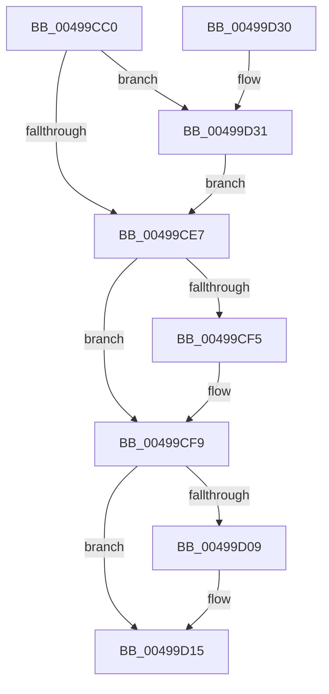

# KeQueryTimerDueTime

- RVA: `0x00499CC0`–`0x00499D3B` (길이 `123` bytes)
- VA: `0x0000000140499CC0`
- 실행 섹션: `.text`
- PDB 이름 있음: `예`; PDB Function 태그: `아니요`
- unwind 정보 RVA: `0x0005C748`
- 디코드: `34`개 명령, `123/123` bytes 표시
- 미해석 바이트: `0` (있으면 어셈블리에 `.byte`로 보존)

> 이 문서는 커널 이미지의 기계어와 PDB 기호를 분석해 생성했습니다. 4번과 5번은 함수 원형과 자료형을 바이너리 사용 방식에서 추정한 C 해석이며 원본 소스 복구 결과는 아닙니다.

## 1. Dependencies

- 직접 호출 지점: **3**; 고유 호출 대상: **3**
- 직접 호출자로 확인된 함수: **4**
- RIP 상대 이미지 참조: **1**

### Outgoing calls
- `0x00499CEA` → [KiAcquireKobjectLockSafe](../25/KiAcquireKobjectLockSafe_function_00251C90.md) (function, `0x00251C90`)
- `0x00499D10` → [KiLowerIrqlProcessIrqlFlags](../4F/KiLowerIrqlProcessIrqlFlags_function_004F5698.md) (function, `0x004F5698`)
- `0x00499D34` → [KiRaiseIrqlProcessIrqlFlags](../4F/KiRaiseIrqlProcessIrqlFlags_function_004F56FC.md) (function, `0x004F56FC`)

### Direct callers
- [ExGetWakeTimerList](../4C/ExGetWakeTimerList_function_004CB964.md) at `0x004CBADB`
- [KiGetNextTimerExpirationDueTime](../5B/KiGetNextTimerExpirationDueTime_function_005BCF60.md) at `0x005BD037`
- [NtQueryTimer](../../page/A6/NtQueryTimer_function_00A62390.md) at `0x00A62476`
- [ExGetNextWakeTime](../../pagelk/B7/ExGetNextWakeTime_function_00B7E018.md) at `0x00B7E0EA`

### Static image references
- `0x00499CDF` → RVA `0x00FC6D20` (`ALMOSTRO`; read)

## 2. Other-region calls and transfers

- 다른 실행 섹션으로 향하는 call: **0**
- 별도 외부 분기/꼬리 이동을 확인하지 못했습니다.

## 3. Assembly (complete function range)

```asm
00499CC0  48 89 5C 24 08                  mov qword ptr [rsp + 8], rbx
00499CC5  48 89 74 24 10                  mov qword ptr [rsp + 0x10], rsi
00499CCA  57                              push rdi
00499CCB  48 83 EC 20                     sub rsp, 0x20
00499CCF  48 8B D9                        mov rbx, rcx
00499CD2  33 F6                           xor esi, esi
00499CD4  44 0F 20 C7                     mov rdi, cr8
00499CD8  8D 56 02                        lea edx, [rsi + 2]
00499CDB  44 0F 22 C2                     mov cr8, rdx
00499CDF  39 35 3B D0 B2 00               cmp dword ptr [rip + 0xb2d03b], esi
00499CE5  75 4A                           jne 0x140499d31
00499CE7  48 8B CB                        mov rcx, rbx
00499CEA  E8 A1 7F DB FF                  call 0x140251c90
00499CEF  F6 43 03 40                     test byte ptr [rbx + 3], 0x40
00499CF3  74 04                           je 0x140499cf9
00499CF5  48 8B 73 18                     mov rsi, qword ptr [rbx + 0x18]
00499CF9  F0 81 23 7F FF FF FF            lock and dword ptr [rbx], 0xffffff7f
00499D00  83 3D 19 D0 B2 00 00            cmp dword ptr [rip + 0xb2d019], 0
00499D07  74 0C                           je 0x140499d15
00499D09  44 0F 20 C1                     mov rcx, cr8
00499D0D  40 8A D7                        mov dl, dil
00499D10  E8 83 B9 05 00                  call 0x1404f5698
00499D15  40 0F B6 CF                     movzx ecx, dil
00499D19  44 0F 22 C1                     mov cr8, rcx
00499D1D  48 8B 5C 24 30                  mov rbx, qword ptr [rsp + 0x30]
00499D22  48 8B C6                        mov rax, rsi
00499D25  48 8B 74 24 38                  mov rsi, qword ptr [rsp + 0x38]
00499D2A  48 83 C4 20                     add rsp, 0x20
00499D2E  5F                              pop rdi
00499D2F  C3                              ret
00499D30  CC                              int3
00499D31  40 8A CF                        mov cl, dil
00499D34  E8 C3 B9 05 00                  call 0x1404f56fc
00499D39  EB AC                           jmp 0x140499ce7
```

## 4. C-style interpretation (structured pseudocode)

```c
__int64 __fastcall KeQueryTimerDueTime(__int64 a1)
{
    __int64 result;
    __int64 v_rsi;
    __int64 v_rsp;
    unsigned __int64 v_stack_p10;
    unsigned __int64 v_stack_p8;

    v_stack_p8 = v_rbx;
    v_stack_p10 = v_rsi;
    v_rsp = (v_rsp) - (32);
    v_rsi = 0;
    if ((*(unsigned int *)(v_rip + 11718715)) != 0) goto loc_00499D31;
loc_00499CE7:
    result = KiAcquireKobjectLockSafe(a1, v_rsi + 2, a3, a4);
    if (((*(unsigned __int8 *)(a1 + 3)) & (64)) != 0) {
        v_rsi = *(unsigned __int64 *)(a1 + 24);
    }
    if ((*(unsigned int *)(v_rip + 11718681)) != 0) {
        a1 = v_rsi + 2;
        a2 = (unsigned __int8)(v_cr8);
        result = KiLowerIrqlProcessIrqlFlags(a1, a2, a3, a4);
    }
    v_rsp = (v_rsp) + (32);
    return v_rsi;
loc_00499D31:
    result = KiRaiseIrqlProcessIrqlFlags((unsigned __int8)(v_cr8), a2, a3, a4);
    goto loc_00499CE7;
}
```

## 5. (Beta) C Style

```c
int64_t KeQueryTimerDueTime(void *Arg1)
{
    uint8_t *arg1 = (uint8_t *)Arg1;

    int64_t result;
    int64_t local_rsi;
    int64_t local_rsp;
    uint64_t v_stack_p10;
    uint64_t v_stack_p8;

    v_stack_p8 = local_rbx;
    v_stack_p10 = local_rsi;
    local_rsp = (local_rsp) - (32);
    local_rsi = 0;
    if ((*(uint32_t *)(v_rip + 0xB2D03B)) != 0) goto loc_00499D31;
loc_00499CE7:
    result = KiAcquireKobjectLockSafe(Arg1, local_rsi + 2, a3, a4);
    if (((*(uint8_t *)(arg1 + 0x3)) & (64)) != 0) {
        local_rsi = *(uint64_t *)(arg1 + 0x18);
    }
    if ((*(uint32_t *)(v_rip + 0xB2D019)) != 0) {
        Arg1 = local_rsi + 2;
        a2 = (uint8_t)(v_cr8);
        result = KiLowerIrqlProcessIrqlFlags(Arg1, a2, a3, a4);
    }
    local_rsp = (local_rsp) + (32);
    return local_rsi;
loc_00499D31:
    result = KiRaiseIrqlProcessIrqlFlags((uint8_t)(v_cr8), a2, a3, a4);
    goto loc_00499CE7;
}
```

### 관측된 메모리 오프셋

구조체 형식이 확인되지 않은 접근은 인자 기준의 오프셋으로만 기록했습니다.

| 기준 인자 | 오프셋 표현 | 폭 (bit) | 접근 |
|---|---:|---:|---|
| `Arg1` | `+ 0x0` | `32` | `R/W` |
| `Arg1` | `+ 0x3` | `8` | `R` |
| `Arg1` | `+ 0x18` | `64` | `R` |

## 6. Execution-region graph

[열기: 2D/3D 그래프와 함수 탐색 컨트롤 패널](../../../control-panel.html?section=text&rva=0x00499CC0&view=graph)

- 2D 그래프는 위에서 아래로 흐르고, 3D 그래프는 빈 공간을 드래그해 회전합니다. Shift+드래그는 이동, 휠은 확대·축소, 함수 노드 선택은 대상 보고서 이동입니다.

### Static fallback


