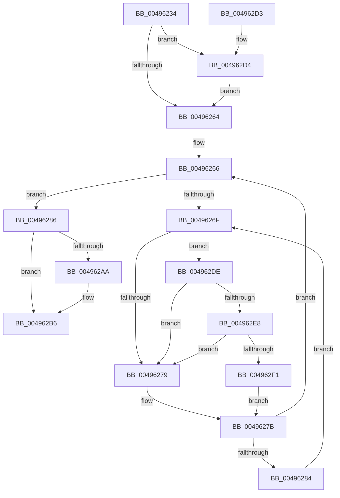

# KeQueryUserAffinityThread

- RVA: `0x00496234`–`0x004962FA` (길이 `198` bytes)
- VA: `0x0000000140496234`
- 실행 섹션: `.text`
- PDB 이름 있음: `예`; PDB Function 태그: `아니요`
- unwind 정보 RVA: `0x000B3AA8`
- 디코드: `54`개 명령, `198/198` bytes 표시
- 미해석 바이트: `0` (있으면 어셈블리에 `.byte`로 보존)

> 이 문서는 커널 이미지의 기계어와 PDB 기호를 분석해 생성했습니다. 4번과 5번은 함수 원형과 자료형을 바이너리 사용 방식에서 추정한 C 해석이며 원본 소스 복구 결과는 아닙니다.

## 1. Dependencies

- 직접 호출 지점: **5**; 고유 호출 대상: **5**
- 직접 호출자로 확인된 함수: **1**
- RIP 상대 이미지 참조: **3**

### Outgoing calls
- `0x00496294` → [KiCopyAffinityEx](../2C/KiCopyAffinityEx_function_002CE860.md) (function, `0x002CE860`)
- `0x004962B1` → [KiLowerIrqlProcessIrqlFlags](../4F/KiLowerIrqlProcessIrqlFlags_function_004F5698.md) (function, `0x004F5698`)
- `0x004962D7` → [KiRaiseIrqlProcessIrqlFlags](../4F/KiRaiseIrqlProcessIrqlFlags_function_004F56FC.md) (function, `0x004F56FC`)
- `0x004962E8` → [KiCheckVpBackingLongSpinWaitHypercall](../30/KiCheckVpBackingLongSpinWaitHypercall_function_0030F490.md) (function, `0x0030F490`)
- `0x004962F3` → [HvlNotifyLongSpinWait](../30/HvlNotifyLongSpinWait_function_0030F460.md) (function, `0x0030F460`)

### Direct callers
- [NtQueryInformationThread](../../page/AE/NtQueryInformationThread_function_00AE3760.md) at `0x00AE3BA1`

### Static image references
- `0x0049625B` → RVA `0x00FC6D20` (`ALMOSTRO`; read)
- `0x00496271` → RVA `0x00FC52AC` (`ALMOSTRO`; reference)
- `0x004962DE` → RVA `0x00FC6AB8` (`ALMOSTRO`; read)

## 2. Other-region calls and transfers

- 다른 실행 섹션으로 향하는 call: **0**
- 별도 외부 분기/꼬리 이동을 확인하지 못했습니다.

## 3. Assembly (complete function range)

```asm
00496234  48 89 5C 24 08                  mov qword ptr [rsp + 8], rbx
00496239  48 89 6C 24 10                  mov qword ptr [rsp + 0x10], rbp
0049623E  48 89 74 24 18                  mov qword ptr [rsp + 0x18], rsi
00496243  57                              push rdi
00496244  48 83 EC 20                     sub rsp, 0x20
00496248  48 8B EA                        mov rbp, rdx
0049624B  48 8B F9                        mov rdi, rcx
0049624E  44 0F 20 C6                     mov rsi, cr8
00496252  BA 02 00 00 00                  mov edx, 2
00496257  44 0F 22 C2                     mov cr8, rdx
0049625B  83 3D BE 0A B3 00 00            cmp dword ptr [rip + 0xb30abe], 0
00496262  75 70                           jne 0x1404962d4
00496264  33 DB                           xor ebx, ebx
00496266  F0 48 0F BA 6F 40 00            lock bts qword ptr [rdi + 0x40], 0
0049626D  73 17                           jae 0x140496286
0049626F  FF C3                           inc ebx
00496271  85 1D 35 F0 B2 00               test dword ptr [rip + 0xb2f035], ebx
00496277  74 65                           je 0x1404962de
00496279  F3 90                           pause
0049627B  48 8B 47 40                     mov rax, qword ptr [rdi + 0x40]
0049627F  48 85 C0                        test rax, rax
00496282  74 E2                           je 0x140496266
00496284  EB E9                           jmp 0x14049626f
00496286  4C 8B 87 28 02 00 00            mov r8, qword ptr [rdi + 0x228]
0049628D  48 8B CD                        mov rcx, rbp
00496290  0F B7 55 02                     movzx edx, word ptr [rbp + 2]
00496294  E8 C7 85 E3 FF                  call 0x1402ce860
00496299  48 C7 47 40 00 00 00 00         mov qword ptr [rdi + 0x40], 0
004962A1  83 3D 78 0A B3 00 00            cmp dword ptr [rip + 0xb30a78], 0
004962A8  74 0C                           je 0x1404962b6
004962AA  44 0F 20 C1                     mov rcx, cr8
004962AE  40 8A D6                        mov dl, sil
004962B1  E8 E2 F3 05 00                  call 0x1404f5698
004962B6  40 0F B6 C6                     movzx eax, sil
004962BA  44 0F 22 C0                     mov cr8, rax
004962BE  48 8B 5C 24 30                  mov rbx, qword ptr [rsp + 0x30]
004962C3  48 8B 6C 24 38                  mov rbp, qword ptr [rsp + 0x38]
004962C8  48 8B 74 24 40                  mov rsi, qword ptr [rsp + 0x40]
004962CD  48 83 C4 20                     add rsp, 0x20
004962D1  5F                              pop rdi
004962D2  C3                              ret
004962D3  CC                              int3
004962D4  40 8A CE                        mov cl, sil
004962D7  E8 20 F4 05 00                  call 0x1404f56fc
004962DC  EB 86                           jmp 0x140496264
004962DE  8B 05 D4 07 B3 00               mov eax, dword ptr [rip + 0xb307d4]
004962E4  A8 40                           test al, 0x40
004962E6  74 91                           je 0x140496279
004962E8  E8 A3 91 E7 FF                  call 0x14030f490
004962ED  84 C0                           test al, al
004962EF  74 88                           je 0x140496279
004962F1  8B CB                           mov ecx, ebx
004962F3  E8 68 91 E7 FF                  call 0x14030f460
004962F8  EB 81                           jmp 0x14049627b
```

## 4. C-style interpretation (structured pseudocode)

```c
__int64 __fastcall KeQueryUserAffinityThread(__int64 a1, __int64 a2)
{
    __int64 result;
    __int64 v_rbx;
    __int64 v_rsp;
    unsigned __int64 v_stack_p10;
    unsigned __int64 v_stack_p18;
    unsigned __int64 v_stack_p8;

    v_stack_p8 = v_rbx;
    v_stack_p10 = v_rbp;
    v_stack_p18 = v_rsi;
    v_rsp = (v_rsp) - (32);
    if ((*(unsigned int *)(v_rip + 11733694)) != 0) goto loc_004962D4;
loc_00496264:
    v_rbx = 0;
loc_00496266:
    if (condition_is_above_or_equal) goto loc_00496286;
loc_0049626F:
    v_rbx = (unsigned int)((v_rbx) + 1);
    if (((*(unsigned int *)(v_rip + 11726901)) & ((unsigned int)(v_rbx))) == 0) goto loc_004962DE;
loc_00496279:
loc_0049627B:
    if (*(unsigned __int64 *)(a1 + 64) == 0) goto loc_00496266;
    goto loc_0049626F;
loc_00496286:
    result = KiCopyAffinityEx(a2, *(unsigned __int16 *)(a2 + 2), *(unsigned __int64 *)(a1 + 552), a4);
    *(unsigned __int64 *)(a1 + 64) = 0;
    if ((*(unsigned int *)(v_rip + 11733624)) != 0) {
        a1 = 2;
        a2 = (unsigned __int8)(v_cr8);
        result = KiLowerIrqlProcessIrqlFlags(a1, a2, *(unsigned __int64 *)(a1 + 552), a4);
    }
    v_rsp = (v_rsp) + (32);
    return (unsigned __int8)(v_cr8);
loc_004962D4:
    result = KiRaiseIrqlProcessIrqlFlags((unsigned __int8)(v_stack_p18), a2, *(unsigned __int64 *)(a1 + 552), a4);
    goto loc_00496264;
loc_004962DE:
    if ((((unsigned __int8)((unsigned int)(*(unsigned int *)(v_rip + 11732948)))) & (64)) == 0) goto loc_00496279;
    result = KiCheckVpBackingLongSpinWaitHypercall((unsigned __int8)(v_stack_p18), a2, *(unsigned __int64 *)(a1 + 552), a4);
    if ((unsigned __int8)(result) == 0) goto loc_00496279;
    result = HvlNotifyLongSpinWait((unsigned int)((unsigned int)(v_stack_p8)), a2, *(unsigned __int64 *)(a1 + 552), a4);
    goto loc_0049627B;
}
```

## 5. (Beta) C Style

```c
int64_t KeQueryUserAffinityThread(void *Arg1, void *Arg2)
{
    uint8_t *arg1 = (uint8_t *)Arg1;
    uint8_t *arg2 = (uint8_t *)Arg2;

    int64_t result;
    int64_t local_rbx;
    int64_t local_rsp;
    uint64_t v_stack_p10;
    uint64_t v_stack_p18;
    uint64_t v_stack_p8;

    v_stack_p8 = local_rbx;
    v_stack_p10 = local_rbp;
    v_stack_p18 = local_rsi;
    local_rsp = (local_rsp) - (32);
    if ((*(uint32_t *)(v_rip + 0xB30ABE)) != 0) goto loc_004962D4;
loc_00496264:
    local_rbx = 0;
loc_00496266:
    if (condition_is_above_or_equal) goto loc_00496286;
loc_0049626F:
    local_rbx = (uint32_t)((local_rbx) + 1);
    if (((*(uint32_t *)(v_rip + 0xB2F035)) & ((uint32_t)(local_rbx))) == 0) goto loc_004962DE;
loc_00496279:
loc_0049627B:
    if (*(uint64_t *)(arg1 + 0x40) == 0) goto loc_00496266;
    goto loc_0049626F;
loc_00496286:
    result = KiCopyAffinityEx(Arg2, *(uint16_t *)(arg2 + 0x2), *(uint64_t *)(arg1 + 0x228), a4);
    *(uint64_t *)(arg1 + 0x40) = 0;
    if ((*(uint32_t *)(v_rip + 0xB30A78)) != 0) {
        Arg1 = 2;
        Arg2 = (uint8_t)(v_cr8);
        result = KiLowerIrqlProcessIrqlFlags(Arg1, Arg2, *(uint64_t *)(arg1 + 0x228), a4);
    }
    local_rsp = (local_rsp) + (32);
    return (uint8_t)(v_cr8);
loc_004962D4:
    result = KiRaiseIrqlProcessIrqlFlags((uint8_t)(v_stack_p18), Arg2, *(uint64_t *)(arg1 + 0x228), a4);
    goto loc_00496264;
loc_004962DE:
    if ((((uint8_t)((uint32_t)(*(uint32_t *)(v_rip + 0xB307D4)))) & (64)) == 0) goto loc_00496279;
    result = KiCheckVpBackingLongSpinWaitHypercall((uint8_t)(v_stack_p18), Arg2, *(uint64_t *)(arg1 + 0x228), a4);
    if ((uint8_t)(result) == 0) goto loc_00496279;
    result = HvlNotifyLongSpinWait((uint32_t)((uint32_t)(v_stack_p8)), Arg2, *(uint64_t *)(arg1 + 0x228), a4);
    goto loc_0049627B;
}
```

### 관측된 메모리 오프셋

구조체 형식이 확인되지 않은 접근은 인자 기준의 오프셋으로만 기록했습니다.

| 기준 인자 | 오프셋 표현 | 폭 (bit) | 접근 |
|---|---:|---:|---|
| `Arg1` | `+ 0x40` | `64` | `R` |
| `Arg1` | `+ 0x40` | `64` | `R/W` |
| `Arg1` | `+ 0x40` | `64` | `W` |
| `Arg1` | `+ 0x228` | `64` | `R` |
| `Arg2` | `+ 0x2` | `16` | `R` |

## 6. Execution-region graph

[열기: 2D/3D 그래프와 함수 탐색 컨트롤 패널](../../../control-panel.html?section=text&rva=0x00496234&view=graph)

- 2D 그래프는 위에서 아래로 흐르고, 3D 그래프는 빈 공간을 드래그해 회전합니다. Shift+드래그는 이동, 휠은 확대·축소, 함수 노드 선택은 대상 보고서 이동입니다.

### Static fallback


