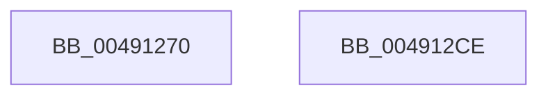

# KeSelectGroupFromNode

- RVA: `0x00491270`–`0x004912CF` (길이 `95` bytes)
- VA: `0x0000000140491270`
- 실행 섹션: `.text`
- PDB 이름 있음: `예`; PDB Function 태그: `아니요`
- unwind 정보 RVA: `0x000A5A24`
- 디코드: `25`개 명령, `95/95` bytes 표시
- 미해석 바이트: `0` (있으면 어셈블리에 `.byte`로 보존)

> 이 문서는 커널 이미지의 기계어와 PDB 기호를 분석해 생성했습니다. 4번과 5번은 함수 원형과 자료형을 바이너리 사용 방식에서 추정한 C 해석이며 원본 소스 복구 결과는 아닙니다.

## 1. Dependencies

- 직접 호출 지점: **2**; 고유 호출 대상: **2**
- 직접 호출자로 확인된 함수: **1**
- RIP 상대 이미지 참조: **1**

### Outgoing calls
- `0x004912AE` → [KeFindNextSetRightGroupMask](KeFindNextSetRightGroupMask_function_004912D8.md) (function, `0x004912D8`)
- `0x004912C3` → [_security_check_cookie](../6A/_security_check_cookie_function_006AC640.md) (function, `0x006AC640`)

### Direct callers
- [PspAllocateProcess](../../page/A1/PspAllocateProcess_function_00A13B3C.md) at `0x00A14E0A`
- [PspAllocateProcess](../../page/A1/PspAllocateProcess_function_00A13B3C.md) at `0x00A14E6D`

### Static image references
- `0x00491276` → RVA `0x00E0A740` (`.data`; read)

## 2. Other-region calls and transfers

- 다른 실행 섹션으로 향하는 call: **0**
- 별도 외부 분기/꼬리 이동을 확인하지 못했습니다.

## 3. Assembly (complete function range)

```asm
00491270  40 53                           push rbx
00491272  48 83 EC 40                     sub rsp, 0x40
00491276  48 8B 05 C3 94 97 00            mov rax, qword ptr [rip + 0x9794c3]
0049127D  48 33 C4                        xor rax, rsp
00491280  48 89 44 24 38                  mov qword ptr [rsp + 0x38], rax
00491285  0F B6 51 0B                     movzx edx, byte ptr [rcx + 0xb]
00491289  4C 8D 44 24 20                  lea r8, [rsp + 0x20]
0049128E  0F 10 41 10                     movups xmm0, xmmword ptr [rcx + 0x10]
00491292  66 FF C2                        inc dx
00491295  48 8B D9                        mov rbx, rcx
00491298  33 C0                           xor eax, eax
0049129A  48 8D 4C 24 28                  lea rcx, [rsp + 0x28]
0049129F  66 83 E2 7F                     and dx, 0x7f
004912A3  66 89 44 24 20                  mov word ptr [rsp + 0x20], ax
004912A8  F3 0F 7F 44 24 28               movdqu xmmword ptr [rsp + 0x28], xmm0
004912AE  E8 25 00 00 00                  call 0x1404912d8
004912B3  0F B7 44 24 20                  movzx eax, word ptr [rsp + 0x20]
004912B8  88 43 0B                        mov byte ptr [rbx + 0xb], al
004912BB  48 8B 4C 24 38                  mov rcx, qword ptr [rsp + 0x38]
004912C0  48 33 CC                        xor rcx, rsp
004912C3  E8 78 B3 21 00                  call 0x1406ac640
004912C8  48 83 C4 40                     add rsp, 0x40
004912CC  5B                              pop rbx
004912CD  C3                              ret
004912CE  CC                              int3
```

## 4. C-style interpretation (structured pseudocode)

```c
__int64 __fastcall KeSelectGroupFromNode(__int64 a1)
{
    __int64 result;
    __int64 v_rsp;
    unsigned __int64 v_stack_m10;
    unsigned __int64 v_stack_m20;
    unsigned __int64 v_stack_m28;

    v_rsp = (v_rsp) - (64);
    result = (*(unsigned __int64 *)(v_rip + 9934019)) ^ (v_rsp);
    v_stack_m10 = result;
    a2 = (unsigned __int16)((*(unsigned __int8 *)(a1 + 11)) + 1);
    result = 0;
    a2 = (unsigned __int16)((a2) & (127));
    v_stack_m28 = 0;
    v_stack_m20 = v_xmm0;
    result = KeFindNextSetRightGroupMask(v_stack_m20, a2, v_stack_m28, a4);
    *(unsigned __int8 *)(a1 + 11) = (unsigned __int8)(v_stack_m28);
    a1 = (v_stack_m10) ^ (v_rsp);
    result = _security_check_cookie(a1, a2, v_stack_m28, a4);
    v_rsp = (v_rsp) + (64);
    return result;
}
```

## 5. (Beta) C Style

```c
int64_t KeSelectGroupFromNode(void *Arg1)
{
    uint8_t *arg1 = (uint8_t *)Arg1;

    int64_t result;
    int64_t local_rsp;
    uint64_t v_stack_m10;
    uint64_t v_stack_m20;
    uint64_t v_stack_m28;

    local_rsp = (local_rsp) - (64);
    result = (*(uint64_t *)(v_rip + 0x9794C3)) ^ (local_rsp);
    v_stack_m10 = result;
    a2 = (uint16_t)((*(uint8_t *)(arg1 + 0xB)) + 1);
    result = 0;
    a2 = (uint16_t)((a2) & (127));
    v_stack_m28 = 0;
    v_stack_m20 = v_xmm0;
    result = KeFindNextSetRightGroupMask(v_stack_m20, a2, v_stack_m28, a4);
    *(uint8_t *)(arg1 + 0xB) = (uint8_t)(v_stack_m28);
    Arg1 = (v_stack_m10) ^ (local_rsp);
    result = _security_check_cookie(Arg1, a2, v_stack_m28, a4);
    local_rsp = (local_rsp) + (64);
    return result;
}
```

### 관측된 메모리 오프셋

구조체 형식이 확인되지 않은 접근은 인자 기준의 오프셋으로만 기록했습니다.

| 기준 인자 | 오프셋 표현 | 폭 (bit) | 접근 |
|---|---:|---:|---|
| `Arg1` | `+ 0xB` | `8` | `R` |
| `Arg1` | `+ 0xB` | `8` | `W` |
| `Arg1` | `+ 0x10` | `128` | `R` |

## 6. Execution-region graph

[열기: 2D/3D 그래프와 함수 탐색 컨트롤 패널](../../../control-panel.html?section=text&rva=0x00491270&view=graph)

- 2D 그래프는 위에서 아래로 흐르고, 3D 그래프는 빈 공간을 드래그해 회전합니다. Shift+드래그는 이동, 휠은 확대·축소, 함수 노드 선택은 대상 보고서 이동입니다.

### Static fallback


