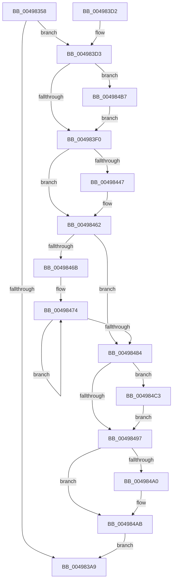

# KeSynchronizeAddressPolicy

- RVA: `0x00498358`–`0x004984ED` (길이 `405` bytes)
- VA: `0x0000000140498358`
- 실행 섹션: `.text`
- PDB 이름 있음: `예`; PDB Function 태그: `아니요`
- unwind 정보 RVA: `0x000B40E4`
- 디코드: `102`개 명령, `405/405` bytes 표시
- 미해석 바이트: `0` (있으면 어셈블리에 `.byte`로 보존)

> 이 문서는 커널 이미지의 기계어와 PDB 기호를 분석해 생성했습니다. 4번과 5번은 함수 원형과 자료형을 바이너리 사용 방식에서 추정한 C 해석이며 원본 소스 복구 결과는 아닙니다.

## 1. Dependencies

- 직접 호출 지점: **9**; 고유 호출 대상: **8**
- 직접 호출자로 확인된 함수: **1**
- RIP 상대 이미지 참조: **4**

### Outgoing calls
- `0x00498395` → [memset](../6C/memset_function_006C6C40.md) (function, `0x006C6C40`)
- `0x004983B0` → [_security_check_cookie](../6A/_security_check_cookie_function_006AC640.md) (function, `0x006AC640`)
- `0x0049840F` → [memset](../6C/memset_function_006C6C40.md) (function, `0x006C6C40`)
- `0x00498425` → [KiCopyAffinityEx](../2C/KiCopyAffinityEx_function_002CE860.md) (function, `0x002CE860`)
- `0x0049848E` → [KiSynchronizeAddressPolicyTarget](KiSynchronizeAddressPolicyTarget_function_00498500.md) (function, `0x00498500`)
- `0x004984A6` → [KiLowerIrqlProcessIrqlFlags](../4F/KiLowerIrqlProcessIrqlFlags_function_004F5698.md) (function, `0x004F5698`)
- `0x004984B9` → [KiRaiseIrqlProcessIrqlFlags](../4F/KiRaiseIrqlProcessIrqlFlags_function_004F56FC.md) (function, `0x004F56FC`)
- `0x004984DE` → [KiIpiSendPacket](../47/KiIpiSendPacket_function_004711DC.md) (function, `0x004711DC`)
- `0x004984E6` → [KiIpiStallOnPacketTargetsPrcb](../2C/KiIpiStallOnPacketTargetsPrcb_function_002CE670.md) (function, `0x002CE670`)

### Direct callers
- [PspDisablePrimaryTokenExchange](../../page/8D/PspDisablePrimaryTokenExchange_function_008D5C10.md) at `0x008D5D1C`

### Static image references
- `0x00498377` → RVA `0x00E0A740` (`.data`; read)
- `0x004983E3` → RVA `0x00FC6D20` (`ALMOSTRO`; read)
- `0x0049842D` → RVA `0x00F231B0` (`.data`; read)
- `0x004984C8` → RVA `0x00498500` (`KiSynchronizeAddressPolicyTarget`; read)

## 2. Other-region calls and transfers

- 다른 실행 섹션으로 향하는 call: **0**
- 별도 외부 분기/꼬리 이동을 확인하지 못했습니다.

## 3. Assembly (complete function range)

```asm
00498358  48 8B C4                        mov rax, rsp
0049835B  48 89 58 10                     mov qword ptr [rax + 0x10], rbx
0049835F  48 89 70 18                     mov qword ptr [rax + 0x18], rsi
00498363  48 89 78 20                     mov qword ptr [rax + 0x20], rdi
00498367  55                              push rbp
00498368  41 56                           push r14
0049836A  41 57                           push r15
0049836C  48 8D 68 98                     lea rbp, [rax - 0x68]
00498370  48 81 EC 50 01 00 00            sub rsp, 0x150
00498377  48 8B 05 C2 23 97 00            mov rax, qword ptr [rip + 0x9723c2]
0049837E  48 33 C4                        xor rax, rsp
00498381  48 89 45 40                     mov qword ptr [rbp + 0x40], rax
00498385  48 8B F9                        mov rdi, rcx
00498388  33 D2                           xor edx, edx
0049838A  48 8D 4C 24 38                  lea rcx, [rsp + 0x38]
0049838F  41 B8 00 01 00 00               mov r8d, 0x100
00498395  E8 A6 E8 22 00                  call 0x1406c6c40
0049839A  41 BF 01 00 00 00               mov r15d, 1
004983A0  44 38 BF 60 01 00 00            cmp byte ptr [rdi + 0x160], r15b
004983A7  74 2A                           je 0x1404983d3
004983A9  48 8B 4D 40                     mov rcx, qword ptr [rbp + 0x40]
004983AD  48 33 CC                        xor rcx, rsp
004983B0  E8 8B 42 21 00                  call 0x1406ac640
004983B5  4C 8D 9C 24 50 01 00 00         lea r11, [rsp + 0x150]
004983BD  49 8B 5B 28                     mov rbx, qword ptr [r11 + 0x28]
004983C1  49 8B 73 30                     mov rsi, qword ptr [r11 + 0x30]
004983C5  49 8B 7B 38                     mov rdi, qword ptr [r11 + 0x38]
004983C9  49 8B E3                        mov rsp, r11
004983CC  41 5F                           pop r15
004983CE  41 5E                           pop r14
004983D0  5D                              pop rbp
004983D1  C3                              ret
004983D2  CC                              int3
004983D3  44 0F 20 C3                     mov rbx, cr8
004983D7  BA 0C 00 00 00                  mov edx, 0xc
004983DC  44 0F 22 C2                     mov cr8, rdx
004983E0  45 33 F6                        xor r14d, r14d
004983E3  44 39 35 36 E9 B2 00            cmp dword ptr [rip + 0xb2e936], r14d
004983EA  0F 85 C7 00 00 00               jne 0x1404984b7
004983F0  65 48 8B 34 25 20 00 00 00      mov rsi, qword ptr gs:[0x20]
004983F9  48 8D 4C 24 38                  lea rcx, [rsp + 0x38]
004983FE  33 D2                           xor edx, edx
00498400  48 C7 44 24 30 01 00 20 00      mov qword ptr [rsp + 0x30], 0x200001
00498409  41 B8 00 01 00 00               mov r8d, 0x100
0049840F  E8 2C E8 22 00                  call 0x1406c6c40
00498414  4C 8B 87 80 00 00 00            mov r8, qword ptr [rdi + 0x80]
0049841B  48 8D 4C 24 30                  lea rcx, [rsp + 0x30]
00498420  0F B7 54 24 32                  movzx edx, word ptr [rsp + 0x32]
00498425  E8 36 64 E3 FF                  call 0x1402ce860
0049842A  8B 4E 24                        mov ecx, dword ptr [rsi + 0x24]
0049842D  48 8B 05 7C AD A8 00            mov rax, qword ptr [rip + 0xa8ad7c]
00498434  0F B7 54 24 30                  movzx edx, word ptr [rsp + 0x30]
00498439  44 8B 04 88                     mov r8d, dword ptr [rax + rcx*4]
0049843D  41 8B C8                        mov ecx, r8d
00498440  C1 E9 06                        shr ecx, 6
00498443  3B D1                           cmp edx, ecx
00498445  76 1B                           jbe 0x140498462
00498447  8B D1                           mov edx, ecx
00498449  41 8B C8                        mov ecx, r8d
0049844C  83 E1 3F                        and ecx, 0x3f
0049844F  48 8B 44 D4 38                  mov rax, qword ptr [rsp + rdx*8 + 0x38]
00498454  48 0F B3 C8                     btr rax, rcx
00498458  48 89 44 D4 38                  mov qword ptr [rsp + rdx*8 + 0x38], rax
0049845D  0F B7 54 24 30                  movzx edx, word ptr [rsp + 0x30]
00498462  41 8B FE                        mov edi, r14d
00498465  66 44 3B F2                     cmp r14w, dx
00498469  73 19                           jae 0x140498484
0049846B  48 8D 4C 24 38                  lea rcx, [rsp + 0x38]
00498470  44 0F B7 C2                     movzx r8d, dx
00498474  F3 48 0F B8 01                  popcnt rax, qword ptr [rcx]
00498479  03 F8                           add edi, eax
0049847B  48 8D 49 08                     lea rcx, [rcx + 8]
0049847F  4D 2B C7                        sub r8, r15
00498482  75 F0                           jne 0x140498474
00498484  45 33 C9                        xor r9d, r9d
00498487  45 33 C0                        xor r8d, r8d
0049848A  33 D2                           xor edx, edx
0049848C  33 C9                           xor ecx, ecx
0049848E  E8 6D 00 00 00                  call 0x140498500
00498493  85 FF                           test edi, edi
00498495  75 2C                           jne 0x1404984c3
00498497  44 39 35 82 E8 B2 00            cmp dword ptr [rip + 0xb2e882], r14d
0049849E  74 0B                           je 0x1404984ab
004984A0  44 0F 20 C1                     mov rcx, cr8
004984A4  8A D3                           mov dl, bl
004984A6  E8 ED D1 05 00                  call 0x1404f5698
004984AB  0F B6 C3                        movzx eax, bl
004984AE  44 0F 22 C0                     mov cr8, rax
004984B2  E9 F2 FE FF FF                  jmp 0x1404983a9
004984B7  8A CB                           mov cl, bl
004984B9  E8 3E D2 05 00                  call 0x1404f56fc
004984BE  E9 2D FF FF FF                  jmp 0x1404983f0
004984C3  4C 89 74 24 28                  mov qword ptr [rsp + 0x28], r14
004984C8  4C 8D 05 31 00 00 00            lea r8, [rip + 0x31]
004984CF  4D 8B CF                        mov r9, r15
004984D2  4C 89 74 24 20                  mov qword ptr [rsp + 0x20], r14
004984D7  48 8D 54 24 30                  lea rdx, [rsp + 0x30]
004984DC  33 C9                           xor ecx, ecx
004984DE  E8 F9 8C FD FF                  call 0x1404711dc
004984E3  48 8B D6                        mov rdx, rsi
004984E6  E8 85 61 E3 FF                  call 0x1402ce670
004984EB  EB AA                           jmp 0x140498497
```

## 4. C-style interpretation (structured pseudocode)

```c
__int64 __fastcall KeSynchronizeAddressPolicy(__int64 a1, int a2, __int64 a3, int a4)
{
    __int64 result;
    __int64 v_r14;
    __int64 v_rdi;
    __int64 v_rsp;
    unsigned __int64 v_stack_m118;
    unsigned __int16 v_stack_m11E;
    unsigned __int64 v_stack_m120;
    unsigned __int64 v_stack_m128;
    unsigned __int64 v_stack_m130;
    unsigned __int64 v_stack_m18;

    *(unsigned __int64 *)(v_rsp + 16) = v_rbx;
    *(unsigned __int64 *)(v_rsp + 24) = v_rsi;
    *(unsigned __int64 *)(v_rsp + 32) = v_rdi;
    v_rsp = (v_rsp) - (336);
    result = (*(unsigned __int64 *)(v_rip + 9905090)) ^ (v_rsp);
    *(unsigned __int64 *)(v_rsp - 104 + 64) = result;
    a2 = 0;
    result = memset(v_stack_m130, a2, 256, a4);
    if ((*(unsigned __int8 *)(a1 + 352)) == 1) goto loc_004983D3;
loc_004983A9:
    a1 = (*(unsigned __int64 *)(v_rsp - 104 + 64)) ^ (v_rsp);
    result = _security_check_cookie(a1, a2, 256, a4);
    return result;
loc_004983D3:
    v_r14 = 0;
    if ((*(unsigned int *)(v_rip + 11725110)) != 0) goto loc_004984B7;
loc_004983F0:
    a2 = 0;
    v_stack_m120 = 0x200001ULL;
    result = memset(v_stack_m118, a2, 256, a4);
    result = KiCopyAffinityEx(v_stack_m120, v_stack_m11E, *(unsigned __int64 *)(*(unsigned __int64 *)(v_stack_m18 + 56) + 128), a4);
    a1 = (unsigned int)(((unsigned int)((unsigned int)((unsigned int)(*(unsigned int *)(*(unsigned __int64 *)(v_rip + 11054460) + (unsigned int)(*(unsigned int *)(*(unsigned __int64 *)(gs_base + (0 + 32)) + 36)) * 4))))) >> (6));
    result = *(unsigned __int64 *)(v_rip + 11054460);
    if (((unsigned int)(v_stack_m120)) >= = ((unsigned int)(a1))) {
        a2 = (unsigned int)(a1);
        a1 = (unsigned int)((unsigned int)(*(unsigned int *)(*(unsigned __int64 *)(v_rip + 11054460) + (unsigned int)(*(unsigned int *)(*(unsigned __int64 *)(gs_base + (0 + 32)) + 36)) * 4)));
        a1 = (unsigned int)((a1) & (63));
        result = *(unsigned __int64 *)(v_stack_m18 + a2 * 8 + 56);
        *(unsigned __int64 *)(v_stack_m18 + a2 * 8 + 56) = result;
        a2 = v_stack_m120;
    }
    if (0 >= ((unsigned __int16)(a2))) goto loc_00498484;
loc_00498474:
    v_rdi = (unsigned int)((0) + ((unsigned int)(result)));
    a3 = ((unsigned __int16)(a2)) - (1);
    if (condition_is_not_equal) goto loc_00498474;
loc_00498484:
    a4 = 0;
    a3 = 0;
    a2 = 0;
    a1 = 0;
    result = KiSynchronizeAddressPolicyTarget(a1, a2, a3, a4);
    if ((unsigned int)(v_rdi) != 0) goto loc_004984C3;
loc_00498497:
    if ((*(unsigned int *)(v_rip + 11724930)) != 0) {
        a1 = 12;
        a2 = (unsigned __int8)(v_cr8);
        result = KiLowerIrqlProcessIrqlFlags(a1, a2, a3, a4);
    }
    goto loc_004983A9;
loc_004984B7:
    result = KiRaiseIrqlProcessIrqlFlags((unsigned __int8)(v_cr8), a2, a3, a4);
    goto loc_004983F0;
loc_004984C3:
    v_stack_m128 = 0;
    v_stack_m130 = 0;
    a1 = 0;
    result = KiIpiSendPacket(a1, v_stack_m120, v_rip + 49, 1);
    result = KiIpiStallOnPacketTargetsPrcb(a1, *(unsigned __int64 *)(gs_base + (0 + 32)), v_rip + 49, 1);
    goto loc_00498497;
}
```

## 5. (Beta) C Style

```c
int64_t KeSynchronizeAddressPolicy(void *Arg1, int32_t Arg2, int64_t Arg3, int32_t Arg4)
{
    uint8_t *arg1 = (uint8_t *)Arg1;

    int64_t result;
    int64_t local_r14;
    int64_t local_rdi;
    int64_t local_rsp;
    uint64_t v_stack_m118;
    uint16_t v_stack_m11E;
    uint64_t v_stack_m120;
    uint64_t v_stack_m128;
    uint64_t v_stack_m130;
    uint64_t v_stack_m18;

    *(uint64_t *)(local_rsp + 0x10) = local_rbx;
    *(uint64_t *)(local_rsp + 0x18) = local_rsi;
    *(uint64_t *)(local_rsp + 0x20) = local_rdi;
    local_rsp = (local_rsp) - (336);
    result = (*(uint64_t *)(v_rip + 0x9723C2)) ^ (local_rsp);
    *(uint64_t *)(local_rsp - 0x68 + 0x40) = result;
    Arg2 = 0;
    result = memset(v_stack_m130, Arg2, 256, Arg4);
    if ((*(uint8_t *)(arg1 + 0x160)) == 1) goto loc_004983D3;
loc_004983A9:
    Arg1 = (*(uint64_t *)(local_rsp - 0x68 + 0x40)) ^ (local_rsp);
    result = _security_check_cookie(Arg1, Arg2, 256, Arg4);
    return result;
loc_004983D3:
    local_r14 = 0;
    if ((*(uint32_t *)(v_rip + 0xB2E936)) != 0) goto loc_004984B7;
loc_004983F0:
    Arg2 = 0;
    v_stack_m120 = 0x200001ULL;
    result = memset(v_stack_m118, Arg2, 256, Arg4);
    result = KiCopyAffinityEx(v_stack_m120, v_stack_m11E, *(uint64_t *)(*(uint64_t *)(v_stack_m18 + 0x38) + 0x80), Arg4);
    Arg1 = (uint32_t)(((uint32_t)((uint32_t)((uint32_t)(*(uint32_t *)(*(uint64_t *)(v_rip + 0xA8AD7C) + (uint32_t)(*(uint32_t *)(*(uint64_t *)(gs_base + (0 + 0x20)) + 0x24)) * 4))))) >> (6));
    result = *(uint64_t *)(v_rip + 0xA8AD7C);
    if (((uint32_t)(v_stack_m120)) >= = ((uint32_t)(Arg1))) {
        Arg2 = (uint32_t)(Arg1);
        Arg1 = (uint32_t)((uint32_t)(*(uint32_t *)(*(uint64_t *)(v_rip + 0xA8AD7C) + (uint32_t)(*(uint32_t *)(*(uint64_t *)(gs_base + (0 + 0x20)) + 0x24)) * 4)));
        Arg1 = (uint32_t)((Arg1) & (63));
        result = *(uint64_t *)(v_stack_m18 + Arg2 * 8 + 0x38);
        *(uint64_t *)(v_stack_m18 + Arg2 * 8 + 0x38) = result;
        Arg2 = v_stack_m120;
    }
    if (0 >= ((uint16_t)(Arg2))) goto loc_00498484;
loc_00498474:
    local_rdi = (uint32_t)((0) + ((uint32_t)(result)));
    Arg3 = ((uint16_t)(Arg2)) - (1);
    if (condition_is_not_equal) goto loc_00498474;
loc_00498484:
    Arg4 = 0;
    Arg3 = 0;
    Arg2 = 0;
    Arg1 = 0;
    result = KiSynchronizeAddressPolicyTarget(Arg1, Arg2, Arg3, Arg4);
    if ((uint32_t)(local_rdi) != 0) goto loc_004984C3;
loc_00498497:
    if ((*(uint32_t *)(v_rip + 0xB2E882)) != 0) {
        Arg1 = 12;
        Arg2 = (uint8_t)(v_cr8);
        result = KiLowerIrqlProcessIrqlFlags(Arg1, Arg2, Arg3, Arg4);
    }
    goto loc_004983A9;
loc_004984B7:
    result = KiRaiseIrqlProcessIrqlFlags((uint8_t)(v_cr8), Arg2, Arg3, Arg4);
    goto loc_004983F0;
loc_004984C3:
    v_stack_m128 = 0;
    v_stack_m130 = 0;
    Arg1 = 0;
    result = KiIpiSendPacket(Arg1, v_stack_m120, v_rip + 49, 1);
    result = KiIpiStallOnPacketTargetsPrcb(Arg1, *(uint64_t *)(gs_base + (0 + 0x20)), v_rip + 49, 1);
    goto loc_00498497;
}
```

### 관측된 메모리 오프셋

구조체 형식이 확인되지 않은 접근은 인자 기준의 오프셋으로만 기록했습니다.

| 기준 인자 | 오프셋 표현 | 폭 (bit) | 접근 |
|---|---:|---:|---|
| `Arg1` | `+ 0x80` | `64` | `R` |
| `Arg1` | `+ 0x160` | `8` | `R` |

## 6. Execution-region graph

[열기: 2D/3D 그래프와 함수 탐색 컨트롤 패널](../../../control-panel.html?section=text&rva=0x00498358&view=graph)

- 2D 그래프는 위에서 아래로 흐르고, 3D 그래프는 빈 공간을 드래그해 회전합니다. Shift+드래그는 이동, 휠은 확대·축소, 함수 노드 선택은 대상 보고서 이동입니다.

### Static fallback


