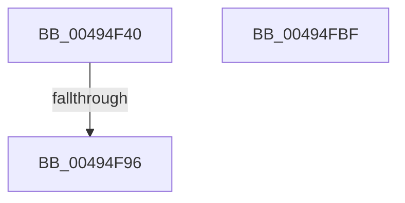

# KiBalanceSetManagerDeferredRoutine

- RVA: `0x00494F40`–`0x00494FC0` (길이 `128` bytes)
- VA: `0x0000000140494F40`
- 실행 섹션: `.text`
- PDB 이름 있음: `예`; PDB Function 태그: `예`
- unwind 정보 RVA: `0x000B3550`
- 디코드: `33`개 명령, `128/128` bytes 표시
- 미해석 바이트: `0` (있으면 어셈블리에 `.byte`로 보존)

> 이 문서는 커널 이미지의 기계어와 PDB 기호를 분석해 생성했습니다. 4번과 5번은 함수 원형과 자료형을 바이너리 사용 방식에서 추정한 C 해석이며 원본 소스 복구 결과는 아닙니다.

## 1. Dependencies

- 직접 호출 지점: **2**; 고유 호출 대상: **2**
- 직접 호출자로 확인된 함수: **0**
- RIP 상대 이미지 참조: **0**

### Outgoing calls
- `0x00494F7D` → [memset](../6C/memset_function_006C6C40.md) (function, `0x006C6C40`)
- `0x00494FA0` → [KeSetEvent](../33/KeSetEvent_function_0033F310.md) (function, `0x0033F310`)

### Direct callers
- 이 함수 시작 RVA로 연결되는 직접 call은 확인되지 않았습니다. 간접 호출은 완전히 역산할 수 없습니다.

### Static image references
- 디코드된 RIP-relative 메모리 참조가 없습니다.

## 2. Other-region calls and transfers

- 다른 실행 섹션으로 향하는 call: **0**
- call이 아닌 외부 분기/꼬리 이동: **1**
  - `0x00494F90` → [sub_006F74B4](../6F/Unknown_function_006F74B4.md) (`tail-transfer`)

## 3. Assembly (complete function range)

```asm
00494F40  48 8B C4                        mov rax, rsp
00494F43  48 89 58 08                     mov qword ptr [rax + 8], rbx
00494F47  48 89 70 18                     mov qword ptr [rax + 0x18], rsi
00494F4B  48 89 78 20                     mov qword ptr [rax + 0x20], rdi
00494F4F  48 89 50 10                     mov qword ptr [rax + 0x10], rdx
00494F53  41 56                           push r14
00494F55  48 81 EC 50 01 00 00            sub rsp, 0x150
00494F5C  48 89 A4 24 40 01 00 00         mov qword ptr [rsp + 0x140], rsp
00494F64  4D 8B F1                        mov r14, r9
00494F67  49 8B F0                        mov rsi, r8
00494F6A  48 8B DA                        mov rbx, rdx
00494F6D  48 8B F9                        mov rdi, rcx
00494F70  33 D2                           xor edx, edx
00494F72  44 8D 42 5F                     lea r8d, [rdx + 0x5f]
00494F76  48 8D 88 38 FF FF FF            lea rcx, [rax - 0xc8]
00494F7D  E8 BE 1C 23 00                  call 0x1406c6c40
00494F82  48 8B C3                        mov rax, rbx
00494F85  48 C1 F8 2F                     sar rax, 0x2f
00494F89  48 FF C0                        inc rax
00494F8C  48 83 F8 01                     cmp rax, 1
00494F90  0F 87 1E 25 26 00               ja 0x1406f74b4
00494F96  45 33 C0                        xor r8d, r8d
00494F99  41 8D 50 0A                     lea edx, [r8 + 0xa]
00494F9D  48 8B CB                        mov rcx, rbx
00494FA0  E8 6B A3 EA FF                  call 0x14033f310
00494FA5  4C 8D 9C 24 50 01 00 00         lea r11, [rsp + 0x150]
00494FAD  49 8B 5B 10                     mov rbx, qword ptr [r11 + 0x10]
00494FB1  49 8B 73 20                     mov rsi, qword ptr [r11 + 0x20]
00494FB5  49 8B 7B 28                     mov rdi, qword ptr [r11 + 0x28]
00494FB9  49 8B E3                        mov rsp, r11
00494FBC  41 5E                           pop r14
00494FBE  C3                              ret
00494FBF  CC                              int3
```

## 4. C-style interpretation (structured pseudocode)

```c
__int64 __fastcall KiBalanceSetManagerDeferredRoutine(__int64 a1, __int64 a2, __int64 a3, __int64 a4)
{
    __int64 result;
    __int64 v_rsp;
    unsigned __int64 v_stack_m18;
    unsigned __int64 v_stack_m8;

    *(unsigned __int64 *)(v_rsp + 8) = v_rbx;
    *(unsigned __int64 *)(v_rsp + 24) = v_rsi;
    *(unsigned __int64 *)(v_rsp + 32) = v_rdi;
    *(unsigned __int64 *)(v_rsp + 16) = a2;
    v_rsp = (v_rsp) - (336);
    v_stack_m18 = v_rsp;
    a2 = 0;
    result = memset(v_rsp - 200, a2, a2 + 95, a4);
    result = (0) >> (47);
    result = (result) + 1;
    a3 = 0;
    result = KeSetEvent(0, a3 + 10, a3, a4);
    return result;
}
```

## 5. (Beta) C Style

```c
int64_t KiBalanceSetManagerDeferredRoutine(int64_t Arg1, int64_t Arg2, int64_t Arg3, int64_t Arg4)
{
    int64_t result;
    int64_t local_rsp;
    uint64_t v_stack_m18;
    uint64_t v_stack_m8;

    *(uint64_t *)(local_rsp + 0x8) = local_rbx;
    *(uint64_t *)(local_rsp + 0x18) = local_rsi;
    *(uint64_t *)(local_rsp + 0x20) = local_rdi;
    *(uint64_t *)(local_rsp + 0x10) = Arg2;
    local_rsp = (local_rsp) - (336);
    v_stack_m18 = local_rsp;
    Arg2 = 0;
    result = memset(local_rsp - 200, Arg2, Arg2 + 95, Arg4);
    result = (0) >> (47);
    result = (result) + 1;
    Arg3 = 0;
    result = KeSetEvent(0, Arg3 + 10, Arg3, Arg4);
    return result;
}
```

## 6. Execution-region graph

[열기: 2D/3D 그래프와 함수 탐색 컨트롤 패널](../../../control-panel.html?section=text&rva=0x00494F40&view=graph)

- 2D 그래프는 위에서 아래로 흐르고, 3D 그래프는 빈 공간을 드래그해 회전합니다. Shift+드래그는 이동, 휠은 확대·축소, 함수 노드 선택은 대상 보고서 이동입니다.

### Static fallback


