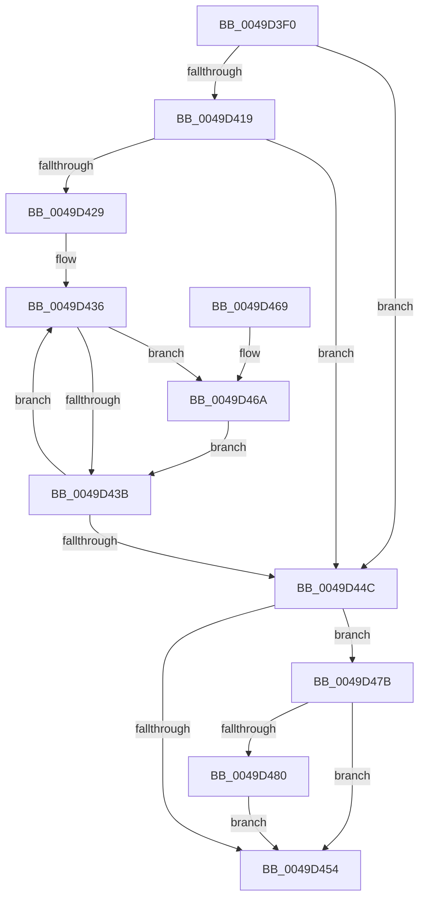

# KiBeginCounterAccumulation

- RVA: `0x0049D3F0`–`0x0049D497` (길이 `167` bytes)
- VA: `0x000000014049D3F0`
- 실행 섹션: `.text`
- PDB 이름 있음: `예`; PDB Function 태그: `아니요`
- unwind 정보 RVA: `0x000B4F34`
- 디코드: `48`개 명령, `167/167` bytes 표시
- 미해석 바이트: `0` (있으면 어셈블리에 `.byte`로 보존)

> 이 문서는 커널 이미지의 기계어와 PDB 기호를 분석해 생성했습니다. 4번과 5번은 함수 원형과 자료형을 바이너리 사용 방식에서 추정한 C 해석이며 원본 소스 복구 결과는 아닙니다.

## 1. Dependencies

- 직접 호출 지점: **0**; 고유 호출 대상: **0**
- 직접 호출자로 확인된 함수: **4**
- RIP 상대 이미지 참조: **2**

### Outgoing calls
- 직접 디코드된 call 명령이 없습니다.

### Direct callers
- [sub_0030A776](../30/Unknown_function_0030A776.md) at `0x0030A829`
- [sub_003FAD78](../3F/Unknown_function_003FAD78.md) at `0x003FAD88`
- [KiEndDebugAccumulation](../4F/KiEndDebugAccumulation_function_004F5370.md) at `0x004F5466`
- [KeEnableProfiling](../../page/AC/KeEnableProfiling_function_00ACED24.md) at `0x00ACEDC1`

### Static image references
- `0x0049D419` → RVA `0x00E66908` (`.data`; read)
- `0x0049D429` → RVA `0x00F10E80` (`.data`; read)

## 2. Other-region calls and transfers

- 다른 실행 섹션으로 향하는 call: **0**
- 별도 외부 분기/꼬리 이동을 확인하지 못했습니다.

## 3. Assembly (complete function range)

```asm
0049D3F0  48 8B C4                        mov rax, rsp
0049D3F3  48 89 58 08                     mov qword ptr [rax + 8], rbx
0049D3F7  48 89 68 10                     mov qword ptr [rax + 0x10], rbp
0049D3FB  48 89 70 18                     mov qword ptr [rax + 0x18], rsi
0049D3FF  48 89 78 20                     mov qword ptr [rax + 0x20], rdi
0049D403  4C 8B 81 68 01 00 00            mov r8, qword ptr [rcx + 0x168]
0049D40A  40 8A EA                        mov bpl, dl
0049D40D  48 8B D9                        mov rbx, rcx
0049D410  49 8B 78 20                     mov rdi, qword ptr [r8 + 0x20]
0049D414  48 85 FF                        test rdi, rdi
0049D417  74 33                           je 0x14049d44c
0049D419  8B 05 E9 94 9C 00               mov eax, dword ptr [rip + 0x9c94e9]
0049D41F  41 B9 01 00 00 00               mov r9d, 1
0049D425  85 C0                           test eax, eax
0049D427  74 23                           je 0x14049d44c
0049D429  4C 8D 15 50 3A A7 00            lea r10, [rip + 0xa73a50]
0049D430  8B F0                           mov esi, eax
0049D432  4D 8D 58 30                     lea r11, [r8 + 0x30]
0049D436  49 85 F9                        test r9, rdi
0049D439  75 2F                           jne 0x14049d46a
0049D43B  4D 03 C9                        add r9, r9
0049D43E  49 83 C3 18                     add r11, 0x18
0049D442  49 83 C2 04                     add r10, 4
0049D446  48 83 EE 01                     sub rsi, 1
0049D44A  75 EA                           jne 0x14049d436
0049D44C  41 8B 40 10                     mov eax, dword ptr [r8 + 0x10]
0049D450  A8 01                           test al, 1
0049D452  75 27                           jne 0x14049d47b
0049D454  48 8B 5C 24 08                  mov rbx, qword ptr [rsp + 8]
0049D459  48 8B 6C 24 10                  mov rbp, qword ptr [rsp + 0x10]
0049D45E  48 8B 74 24 18                  mov rsi, qword ptr [rsp + 0x18]
0049D463  48 8B 7C 24 20                  mov rdi, qword ptr [rsp + 0x20]
0049D468  C3                              ret
0049D469  CC                              int3
0049D46A  41 8B 0A                        mov ecx, dword ptr [r10]
0049D46D  0F 33                           rdpmc
0049D46F  48 C1 E2 20                     shl rdx, 0x20
0049D473  48 0B C2                        or rax, rdx
0049D476  49 89 03                        mov qword ptr [r11], rax
0049D479  EB C0                           jmp 0x14049d43b
0049D47B  40 84 ED                        test bpl, bpl
0049D47E  74 D4                           je 0x14049d454
0049D480  41 FF 40 14                     inc dword ptr [r8 + 0x14]
0049D484  0F B6 83 83 02 00 00            movzx eax, byte ptr [rbx + 0x283]
0049D48B  49 8B 08                        mov rcx, qword ptr [r8]
0049D48E  48 0F AB C1                     bts rcx, rax
0049D492  49 89 08                        mov qword ptr [r8], rcx
0049D495  EB BD                           jmp 0x14049d454
```

## 4. C-style interpretation (structured pseudocode)

```c
__int64 __fastcall KiBeginCounterAccumulation(__int64 a1, __int64 a2)
{
    __int64 result;
    __int64 v_r10;
    __int64 v_r11;
    __int64 v_rsi;
    unsigned __int64 v_stack_p10;
    unsigned __int64 v_stack_p18;
    unsigned __int64 v_stack_p20;
    unsigned __int64 v_stack_p8;

    *(unsigned __int64 *)(v_rsp + 8) = v_rbx;
    *(unsigned __int64 *)(v_rsp + 16) = v_rbp;
    *(unsigned __int64 *)(v_rsp + 24) = v_rsi;
    *(unsigned __int64 *)(v_rsp + 32) = v_rdi;
    if (*(unsigned __int64 *)(*(unsigned __int64 *)(a1 + 360) + 32) == 0) goto loc_0049D44C;
    if ((unsigned int)((unsigned int)(*(unsigned int *)(v_rip + 10261737))) == 0) goto loc_0049D44C;
loc_0049D436:
    if (((1) & (*(unsigned __int64 *)(*(unsigned __int64 *)(a1 + 360) + 32))) != 0) goto loc_0049D46A;
loc_0049D43B:
    a4 = (1) + (1);
    v_r11 = (*(unsigned __int64 *)(a1 + 360) + 48) + (24);
    v_r10 = (v_rip + 10959440) + (4);
    v_rsi = ((unsigned int)((unsigned int)((unsigned int)(*(unsigned int *)(v_rip + 10261737))))) - (1);
    if (condition_is_not_equal) goto loc_0049D436;
loc_0049D44C:
    if ((((unsigned __int8)((unsigned int)(*(unsigned int *)(*(unsigned __int64 *)(a1 + 360) + 16)))) & (1)) != 0) goto loc_0049D47B;
loc_0049D454:
    return (unsigned int)(*(unsigned int *)(*(unsigned __int64 *)(a1 + 360) + 16));
loc_0049D46A:
    a2 = (a2) << (32);
    result = ((unsigned int)(*(unsigned int *)(*(unsigned __int64 *)(a1 + 360) + 16))) | (a2);
    *(unsigned __int64 *)(v_r11) = result;
    goto loc_0049D43B;
loc_0049D47B:
    if ((unsigned __int8)(v_stack_p10) == 0) goto loc_0049D454;
    *(unsigned __int64 *)(*(unsigned __int64 *)(a1 + 360)) = *(unsigned __int64 *)(*(unsigned __int64 *)(a1 + 360));
    goto loc_0049D454;
}
```

## 5. (Beta) C Style

```c
int64_t KiBeginCounterAccumulation(void *Arg1, int64_t Arg2)
{
    uint8_t *arg1 = (uint8_t *)Arg1;

    int64_t result;
    int64_t local_r10;
    int64_t local_r11;
    int64_t local_rsi;
    uint64_t v_stack_p10;
    uint64_t v_stack_p18;
    uint64_t v_stack_p20;
    uint64_t v_stack_p8;

    *(uint64_t *)(local_rsp + 0x8) = local_rbx;
    *(uint64_t *)(local_rsp + 0x10) = local_rbp;
    *(uint64_t *)(local_rsp + 0x18) = local_rsi;
    *(uint64_t *)(local_rsp + 0x20) = local_rdi;
    if (*(uint64_t *)(*(uint64_t *)(arg1 + 0x168) + 0x20) == 0) goto loc_0049D44C;
    if ((uint32_t)((uint32_t)(*(uint32_t *)(v_rip + 0x9C94E9))) == 0) goto loc_0049D44C;
loc_0049D436:
    if (((1) & (*(uint64_t *)(*(uint64_t *)(arg1 + 0x168) + 0x20))) != 0) goto loc_0049D46A;
loc_0049D43B:
    a4 = (1) + (1);
    local_r11 = (*(uint64_t *)(arg1 + 0x168) + 48) + (24);
    local_r10 = (v_rip + 10959440) + (4);
    local_rsi = ((uint32_t)((uint32_t)((uint32_t)(*(uint32_t *)(v_rip + 0x9C94E9))))) - (1);
    if (condition_is_not_equal) goto loc_0049D436;
loc_0049D44C:
    if ((((uint8_t)((uint32_t)(*(uint32_t *)(*(uint64_t *)(arg1 + 0x168) + 0x10)))) & (1)) != 0) goto loc_0049D47B;
loc_0049D454:
    return (uint32_t)(*(uint32_t *)(*(uint64_t *)(arg1 + 0x168) + 0x10));
loc_0049D46A:
    Arg2 = (Arg2) << (32);
    result = ((uint32_t)(*(uint32_t *)(*(uint64_t *)(arg1 + 0x168) + 0x10))) | (Arg2);
    *(uint64_t *)(local_r11) = result;
    goto loc_0049D43B;
loc_0049D47B:
    if ((uint8_t)(v_stack_p10) == 0) goto loc_0049D454;
    *(uint64_t *)(*(uint64_t *)(arg1 + 0x168)) = *(uint64_t *)(*(uint64_t *)(arg1 + 0x168));
    goto loc_0049D454;
}
```

### 관측된 메모리 오프셋

구조체 형식이 확인되지 않은 접근은 인자 기준의 오프셋으로만 기록했습니다.

| 기준 인자 | 오프셋 표현 | 폭 (bit) | 접근 |
|---|---:|---:|---|
| `Arg1` | `+ 0x168` | `64` | `R` |
| `Arg1` | `+ 0x283` | `8` | `R` |

## 6. Execution-region graph

[열기: 2D/3D 그래프와 함수 탐색 컨트롤 패널](../../../control-panel.html?section=text&rva=0x0049D3F0&view=graph)

- 2D 그래프는 위에서 아래로 흐르고, 3D 그래프는 빈 공간을 드래그해 회전합니다. Shift+드래그는 이동, 휠은 확대·축소, 함수 노드 선택은 대상 보고서 이동입니다.

### Static fallback


