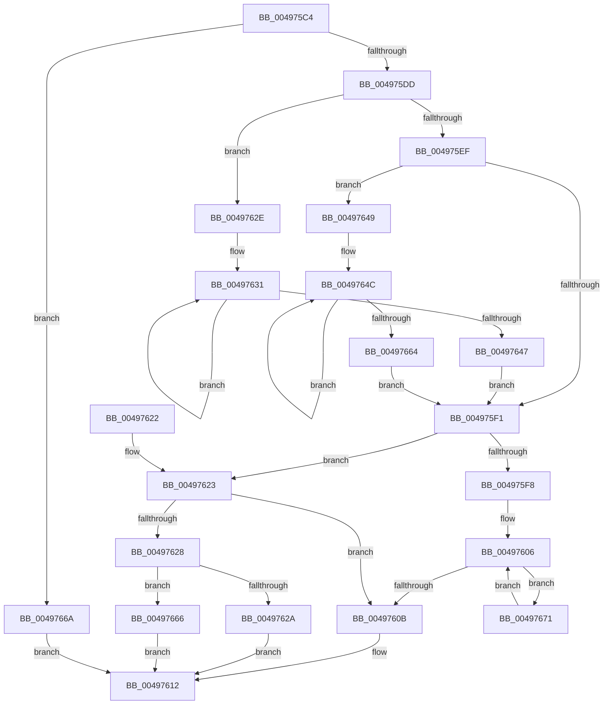

# KiGetComparisonRanks

- RVA: `0x004975C4`–`0x0049768A` (길이 `198` bytes)
- VA: `0x00000001404975C4`
- 실행 섹션: `.text`
- PDB 이름 있음: `예`; PDB Function 태그: `아니요`
- unwind 정보 RVA: `0x000B3E20`
- 디코드: `61`개 명령, `198/198` bytes 표시
- 미해석 바이트: `0` (있으면 어셈블리에 `.byte`로 보존)

> 이 문서는 커널 이미지의 기계어와 PDB 기호를 분석해 생성했습니다. 4번과 5번은 함수 원형과 자료형을 바이너리 사용 방식에서 추정한 C 해석이며 원본 소스 복구 결과는 아닙니다.

## 1. Dependencies

- 직접 호출 지점: **0**; 고유 호출 대상: **0**
- 직접 호출자로 확인된 함수: **1**
- RIP 상대 이미지 참조: **0**

### Outgoing calls
- 직접 디코드된 call 명령이 없습니다.

### Direct callers
- [sub_0021D7F8](../21/Unknown_function_0021D7F8.md) at `0x0021E53F`

### Static image references
- 디코드된 RIP-relative 메모리 참조가 없습니다.

## 2. Other-region calls and transfers

- 다른 실행 섹션으로 향하는 call: **0**
- 별도 외부 분기/꼬리 이동을 확인하지 못했습니다.

## 3. Assembly (complete function range)

```asm
004975C4  48 89 5C 24 08                  mov qword ptr [rsp + 8], rbx
004975C9  48 89 7C 24 10                  mov qword ptr [rsp + 0x10], rdi
004975CE  49 8B F9                        mov rdi, r9
004975D1  4C 8B D1                        mov r10, rcx
004975D4  48 3B CA                        cmp rcx, rdx
004975D7  0F 84 8D 00 00 00               je 0x14049766a
004975DD  41 8A 5A 72                     mov bl, byte ptr [r10 + 0x72]
004975E1  45 32 C9                        xor r9b, r9b
004975E4  44 8A 5A 72                     mov r11b, byte ptr [rdx + 0x72]
004975E8  33 C9                           xor ecx, ecx
004975EA  41 3A DB                        cmp bl, r11b
004975ED  72 3F                           jb 0x14049762e
004975EF  77 58                           ja 0x140497649
004975F1  8B C1                           mov eax, ecx
004975F3  4C 3B D2                        cmp r10, rdx
004975F6  74 2B                           je 0x140497623
004975F8  49 8B 82 A0 01 00 00            mov rax, qword ptr [r10 + 0x1a0]
004975FF  48 8B 8A A0 01 00 00            mov rcx, qword ptr [rdx + 0x1a0]
00497606  48 3B C1                        cmp rax, rcx
00497609  75 66                           jne 0x140497671
0049760B  8B 4A 7C                        mov ecx, dword ptr [rdx + 0x7c]
0049760E  41 8B 42 7C                     mov eax, dword ptr [r10 + 0x7c]
00497612  41 89 00                        mov dword ptr [r8], eax
00497615  89 0F                           mov dword ptr [rdi], ecx
00497617  48 8B 5C 24 08                  mov rbx, qword ptr [rsp + 8]
0049761C  48 8B 7C 24 10                  mov rdi, qword ptr [rsp + 0x10]
00497621  C3                              ret
00497622  CC                              int3
00497623  45 84 C9                        test r9b, r9b
00497626  74 E3                           je 0x14049760b
00497628  7F 3C                           jg 0x140497666
0049762A  33 C0                           xor eax, eax
0049762C  EB E4                           jmp 0x140497612
0049762E  41 B1 FF                        mov r9b, 0xff
00497631  8B 42 7C                        mov eax, dword ptr [rdx + 0x7c]
00497634  3B C1                           cmp eax, ecx
00497636  48 8B 92 A0 01 00 00            mov rdx, qword ptr [rdx + 0x1a0]
0049763D  0F 46 C1                        cmovbe eax, ecx
00497640  8B C8                           mov ecx, eax
00497642  3A 5A 72                        cmp bl, byte ptr [rdx + 0x72]
00497645  72 EA                           jb 0x140497631
00497647  EB A8                           jmp 0x1404975f1
00497649  41 B1 01                        mov r9b, 1
0049764C  41 8B 42 7C                     mov eax, dword ptr [r10 + 0x7c]
00497650  3B C1                           cmp eax, ecx
00497652  4D 8B 92 A0 01 00 00            mov r10, qword ptr [r10 + 0x1a0]
00497659  0F 46 C1                        cmovbe eax, ecx
0049765C  8B C8                           mov ecx, eax
0049765E  45 38 5A 72                     cmp byte ptr [r10 + 0x72], r11b
00497662  77 E8                           ja 0x14049764c
00497664  EB 8B                           jmp 0x1404975f1
00497666  33 C9                           xor ecx, ecx
00497668  EB A8                           jmp 0x140497612
0049766A  8B 49 7C                        mov ecx, dword ptr [rcx + 0x7c]
0049766D  8B C1                           mov eax, ecx
0049766F  EB A1                           jmp 0x140497612
00497671  4C 8B D0                        mov r10, rax
00497674  48 8B D1                        mov rdx, rcx
00497677  48 8B 80 A0 01 00 00            mov rax, qword ptr [rax + 0x1a0]
0049767E  48 8B 89 A0 01 00 00            mov rcx, qword ptr [rcx + 0x1a0]
00497685  E9 7C FF FF FF                  jmp 0x140497606
```

## 4. C-style interpretation (structured pseudocode)

```c
__int64 __fastcall KiGetComparisonRanks(__int64 a1, __int64 a2, __int64 a3, __int64 a4)
{
    __int64 result;
    unsigned __int64 v_stack_p10;
    unsigned __int64 v_stack_p8;

    v_stack_p8 = v_rbx;
    v_stack_p10 = v_rdi;
    if (a1 == a2) goto loc_0049766A;
    a4 = 0;
    a1 = 0;
    if (((unsigned __int8)(*(unsigned __int8 *)(a1 + 114))) < ((unsigned __int8)(*(unsigned __int8 *)(a2 + 114)))) goto loc_0049762E;
    if (((unsigned __int8)(*(unsigned __int8 *)(a1 + 114))) > ((unsigned __int8)(*(unsigned __int8 *)(a2 + 114)))) goto loc_00497649;
loc_004975F1:
    if (0 == a2) goto loc_00497623;
loc_00497606:
    if ((*(unsigned __int64 *)(a1 + 416)) != (*(unsigned __int64 *)(a2 + 416))) goto loc_00497671;
loc_0049760B:
loc_00497612:
    *(unsigned int *)(a3) = (unsigned int)((unsigned int)(*(unsigned int *)(a1 + 124)));
    *(unsigned int *)(a4) = (unsigned int)((unsigned int)(*(unsigned int *)(a2 + 124)));
    return (unsigned int)(*(unsigned int *)(a1 + 124));
loc_00497623:
    if (0 == 0) goto loc_0049760B;
    if (condition_is_greater) goto loc_00497666;
    result = 0;
    goto loc_00497612;
loc_0049762E:
loc_00497631:
    result = (unsigned int)(*(unsigned int *)(a2 + 124));
    if (((unsigned int)((unsigned int)(*(unsigned int *)(a2 + 124)))) <= ((unsigned int)((unsigned int)(*(unsigned int *)(a2 + 124))))) { result = (unsigned int)((unsigned int)(*(unsigned int *)(a2 + 124))); }
    if (((unsigned __int8)(v_stack_p8)) < (*(unsigned __int8 *)(*(unsigned __int64 *)(a2 + 416) + 114))) goto loc_00497631;
    goto loc_004975F1;
loc_00497649:
loc_0049764C:
    result = (unsigned int)(*(unsigned int *)(a1 + 124));
    if (((unsigned int)((unsigned int)(*(unsigned int *)(a1 + 124)))) <= ((unsigned int)((unsigned int)((unsigned int)(result))))) { result = (unsigned int)((unsigned int)((unsigned int)(result))); }
    if ((*(unsigned __int8 *)(*(unsigned __int64 *)(a1 + 416) + 114)) > ((unsigned __int8)(*(unsigned __int8 *)(a2 + 114)))) goto loc_0049764C;
    goto loc_004975F1;
loc_00497666:
    a1 = 0;
    goto loc_00497612;
loc_0049766A:
    goto loc_00497612;
loc_00497671:
    goto loc_00497606;
}
```

## 5. (Beta) C Style

```c
int64_t KiGetComparisonRanks(void *Arg1, void *Arg2, void *Arg3, void *Arg4)
{
    uint8_t *arg1 = (uint8_t *)Arg1;
    uint8_t *arg2 = (uint8_t *)Arg2;
    uint8_t *arg3 = (uint8_t *)Arg3;
    uint8_t *arg4 = (uint8_t *)Arg4;

    int64_t result;
    uint64_t v_stack_p10;
    uint64_t v_stack_p8;

    v_stack_p8 = local_rbx;
    v_stack_p10 = local_rdi;
    if (Arg1 == Arg2) goto loc_0049766A;
    Arg4 = 0;
    Arg1 = 0;
    if (((uint8_t)(*(uint8_t *)(arg1 + 0x72))) < ((uint8_t)(*(uint8_t *)(arg2 + 0x72)))) goto loc_0049762E;
    if (((uint8_t)(*(uint8_t *)(arg1 + 0x72))) > ((uint8_t)(*(uint8_t *)(arg2 + 0x72)))) goto loc_00497649;
loc_004975F1:
    if (0 == Arg2) goto loc_00497623;
loc_00497606:
    if ((*(uint64_t *)(arg1 + 0x1A0)) != (*(uint64_t *)(arg2 + 0x1A0))) goto loc_00497671;
loc_0049760B:
loc_00497612:
    *(uint32_t *)(arg3) = (uint32_t)((uint32_t)(*(uint32_t *)(arg1 + 0x7C)));
    *(uint32_t *)(arg4) = (uint32_t)((uint32_t)(*(uint32_t *)(arg2 + 0x7C)));
    return (uint32_t)(*(uint32_t *)(arg1 + 0x7C));
loc_00497623:
    if (0 == 0) goto loc_0049760B;
    if (condition_is_greater) goto loc_00497666;
    result = 0;
    goto loc_00497612;
loc_0049762E:
loc_00497631:
    result = (uint32_t)(*(uint32_t *)(arg2 + 0x7C));
    if (((uint32_t)((uint32_t)(*(uint32_t *)(arg2 + 0x7C)))) <= ((uint32_t)((uint32_t)(*(uint32_t *)(arg2 + 0x7C))))) { result = (uint32_t)((uint32_t)(*(uint32_t *)(arg2 + 0x7C))); }
    if (((uint8_t)(v_stack_p8)) < (*(uint8_t *)(*(uint64_t *)(arg2 + 0x1A0) + 0x72))) goto loc_00497631;
    goto loc_004975F1;
loc_00497649:
loc_0049764C:
    result = (uint32_t)(*(uint32_t *)(arg1 + 0x7C));
    if (((uint32_t)((uint32_t)(*(uint32_t *)(arg1 + 0x7C)))) <= ((uint32_t)((uint32_t)((uint32_t)(result))))) { result = (uint32_t)((uint32_t)((uint32_t)(result))); }
    if ((*(uint8_t *)(*(uint64_t *)(arg1 + 0x1A0) + 0x72)) > ((uint8_t)(*(uint8_t *)(arg2 + 0x72)))) goto loc_0049764C;
    goto loc_004975F1;
loc_00497666:
    Arg1 = 0;
    goto loc_00497612;
loc_0049766A:
    goto loc_00497612;
loc_00497671:
    goto loc_00497606;
}
```

### 관측된 메모리 오프셋

구조체 형식이 확인되지 않은 접근은 인자 기준의 오프셋으로만 기록했습니다.

| 기준 인자 | 오프셋 표현 | 폭 (bit) | 접근 |
|---|---:|---:|---|
| `Arg1` | `+ 0x72` | `8` | `R` |
| `Arg2` | `+ 0x72` | `8` | `R` |
| `Arg3` | `+ 0x0` | `32` | `W` |
| `Arg4` | `+ 0x0` | `32` | `W` |

## 6. Execution-region graph

[열기: 2D/3D 그래프와 함수 탐색 컨트롤 패널](../../../control-panel.html?section=text&rva=0x004975C4&view=graph)

- 2D 그래프는 위에서 아래로 흐르고, 3D 그래프는 빈 공간을 드래그해 회전합니다. Shift+드래그는 이동, 휠은 확대·축소, 함수 노드 선택은 대상 보고서 이동입니다.

### Static fallback


