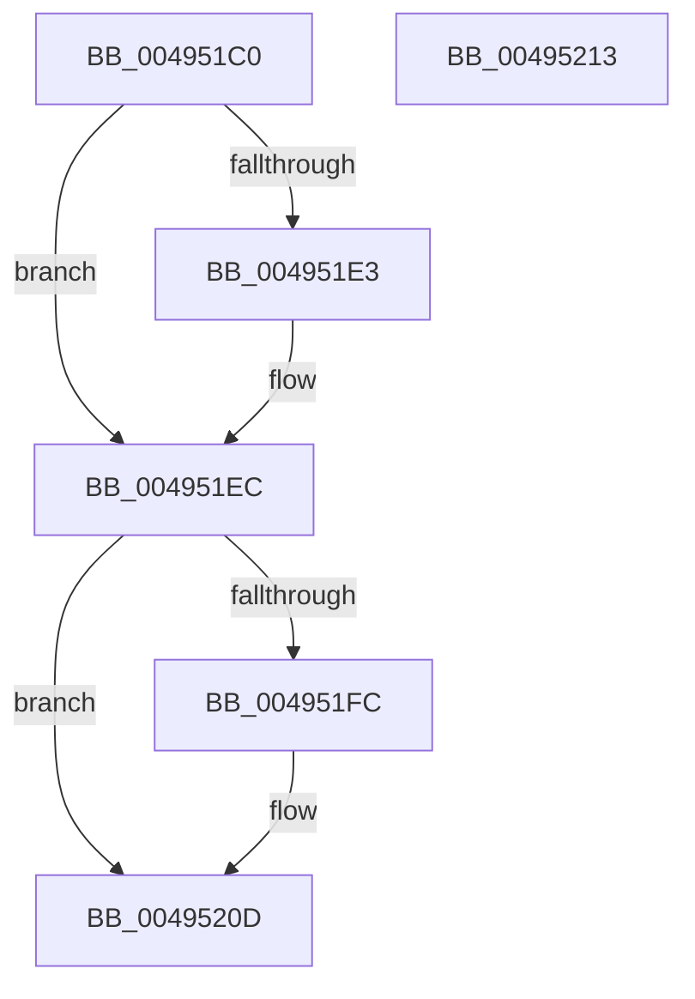

# KiIdealProcessorRebalancerTimerCallback

- RVA: `0x004951C0`–`0x00495214` (길이 `84` bytes)
- VA: `0x00000001404951C0`
- 실행 섹션: `.text`
- PDB 이름 있음: `예`; PDB Function 태그: `아니요`
- unwind 정보 RVA: `0x0005CF00`
- 디코드: `21`개 명령, `84/84` bytes 표시
- 미해석 바이트: `0` (있으면 어셈블리에 `.byte`로 보존)

> 이 문서는 커널 이미지의 기계어와 PDB 기호를 분석해 생성했습니다. 4번과 5번은 함수 원형과 자료형을 바이너리 사용 방식에서 추정한 C 해석이며 원본 소스 복구 결과는 아닙니다.

## 1. Dependencies

- 직접 호출 지점: **3**; 고유 호출 대상: **3**
- 직접 호출자로 확인된 함수: **0**
- RIP 상대 이미지 참조: **5**

### Outgoing calls
- `0x004951CF` → [KeAcquireSpinLockAtDpcLevel](../20/KeAcquireSpinLockAtDpcLevel_function_00208430.md) (function, `0x00208430`)
- `0x004951F3` → [KxReleaseSpinLock](../20/KxReleaseSpinLock_function_00206670.md) (function, `0x00206670`)
- `0x00495208` → [ExQueueWorkItem](../2F/ExQueueWorkItem_function_002F9520.md) (function, `0x002F9520`)

### Direct callers
- 이 함수 시작 RVA로 연결되는 직접 call은 확인되지 않았습니다. 간접 호출은 완전히 역산할 수 없습니다.

### Static image references
- `0x004951C6` → RVA `0x00E170A8` (`.data`; read)
- `0x004951D4` → RVA `0x00E170B1` (`.data`; read/write)
- `0x004951DB` → RVA `0x00E170B0` (`.data`; read)
- `0x004951E3` → RVA `0x00E170B0` (`.data`; write)
- `0x00495201` → RVA `0x00E17088` (`.data`; read)

## 2. Other-region calls and transfers

- 다른 실행 섹션으로 향하는 call: **0**
- 별도 외부 분기/꼬리 이동을 확인하지 못했습니다.

## 3. Assembly (complete function range)

```asm
004951C0  40 53                           push rbx
004951C2  48 83 EC 20                     sub rsp, 0x20
004951C6  48 8D 0D DB 1E 98 00            lea rcx, [rip + 0x981edb]
004951CD  32 DB                           xor bl, bl
004951CF  E8 5C 32 D7 FF                  call 0x140208430
004951D4  80 0D D6 1E 98 00 01            or byte ptr [rip + 0x981ed6], 1
004951DB  38 1D CF 1E 98 00               cmp byte ptr [rip + 0x981ecf], bl
004951E1  75 09                           jne 0x1404951ec
004951E3  C6 05 C6 1E 98 00 01            mov byte ptr [rip + 0x981ec6], 1
004951EA  B3 01                           mov bl, 1
004951EC  48 8D 0D B5 1E 98 00            lea rcx, [rip + 0x981eb5]
004951F3  E8 78 14 D7 FF                  call 0x140206670
004951F8  84 DB                           test bl, bl
004951FA  74 11                           je 0x14049520d
004951FC  BA 30 00 00 00                  mov edx, 0x30
00495201  48 8D 0D 80 1E 98 00            lea rcx, [rip + 0x981e80]
00495208  E8 13 43 E6 FF                  call 0x1402f9520
0049520D  48 83 C4 20                     add rsp, 0x20
00495211  5B                              pop rbx
00495212  C3                              ret
00495213  CC                              int3
```

## 4. C-style interpretation (structured pseudocode)

```c
__int64 __fastcall KiIdealProcessorRebalancerTimerCallback(void)
{
    __int64 result;
    __int64 v_rbx;
    __int64 v_rsp;

    v_rsp = (v_rsp) - (32);
    v_rbx = 0;
    result = KeAcquireSpinLockAtDpcLevel(v_rip + 9969371, a2, a3, a4);
    if ((*(unsigned __int8 *)(v_rip + 9969359)) == 0) {
        *(unsigned __int8 *)(v_rip + 9969350) = 1;
        v_rbx = 1;
    }
    result = KxReleaseSpinLock(v_rip + 9969333, a2, a3, a4);
    if ((unsigned __int8)(v_rbx) != 0) {
        a2 = 48;
        a1 = v_rip + 9969280;
        result = ExQueueWorkItem(a1, a2, a3, a4);
    }
    v_rsp = (v_rsp) + (32);
    return result;
}
```

## 5. (Beta) C Style

```c
void KiIdealProcessorRebalancerTimerCallback(void)
{
    int64_t result;
    int64_t local_rbx;
    int64_t local_rsp;

    local_rsp = (local_rsp) - (32);
    local_rbx = 0;
    result = KeAcquireSpinLockAtDpcLevel(v_rip + 9969371, a2, a3, a4);
    if ((*(uint8_t *)(v_rip + 0x981ECF)) == 0) {
        *(uint8_t *)(v_rip + 0x981EC6) = 1;
        local_rbx = 1;
    }
    result = KxReleaseSpinLock(v_rip + 9969333, a2, a3, a4);
    if ((uint8_t)(local_rbx) != 0) {
        a2 = 48;
        a1 = v_rip + 9969280;
        result = ExQueueWorkItem(a1, a2, a3, a4);
    }
    local_rsp = (local_rsp) + (32);
    return result;
}
```

## 6. Execution-region graph

[열기: 2D/3D 그래프와 함수 탐색 컨트롤 패널](../../../control-panel.html?section=text&rva=0x004951C0&view=graph)

- 2D 그래프는 위에서 아래로 흐르고, 3D 그래프는 빈 공간을 드래그해 회전합니다. Shift+드래그는 이동, 휠은 확대·축소, 함수 노드 선택은 대상 보고서 이동입니다.

### Static fallback


