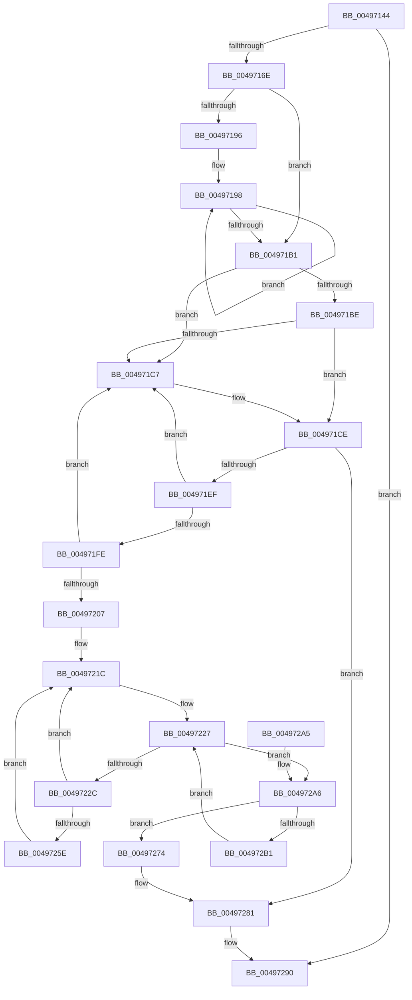

# KiIntSteerDisable

- RVA: `0x00497144`–`0x004972BE` (길이 `378` bytes)
- VA: `0x0000000140497144`
- 실행 섹션: `.text`
- PDB 이름 있음: `예`; PDB Function 태그: `아니요`
- unwind 정보 RVA: `0x000B3CE8`
- 디코드: `99`개 명령, `378/378` bytes 표시
- 미해석 바이트: `0` (있으면 어셈블리에 `.byte`로 보존)

> 이 문서는 커널 이미지의 기계어와 PDB 기호를 분석해 생성했습니다. 4번과 5번은 함수 원형과 자료형을 바이너리 사용 방식에서 추정한 C 해석이며 원본 소스 복구 결과는 아닙니다.

## 1. Dependencies

- 직접 호출 지점: **6**; 고유 호출 대상: **5**
- 직접 호출자로 확인된 함수: **1**
- RIP 상대 이미지 참조: **4**

### Outgoing calls
- `0x00497178` → [KiIntSteerLogState](../2D/KiIntSteerLogState_function_002D57BC.md) (function, `0x002D57BC`)
- `0x00497184` → [KeAcquireSpinLockRaiseToDpc](../20/KeAcquireSpinLockRaiseToDpc_function_00208470.md) (function, `0x00208470`)
- `0x004971DD` → [ExFreePoolWithTag](../../poolcode/B8/ExFreePoolWithTag_function_00B82870.md) (function, `0x00B82870`)
- `0x00497250` → [KeGetPrcb](../2D/KeGetPrcb_function_002D85D0.md) (function, `0x002D85D0`)
- `0x0049727C` → [ExFreePoolWithTag](../../poolcode/B8/ExFreePoolWithTag_function_00B82870.md) (function, `0x00B82870`)
- `0x0049728B` → [KeReleaseSpinLock](../39/KeReleaseSpinLock_function_00392BA0.md) (function, `0x00392BA0`)

### Direct callers
- [KeDisconnectInterrupt](../2D/KeDisconnectInterrupt_function_002D3588.md) at `0x002D35CB`

### Static image references
- `0x0049716E` → RVA `0x0001A938` (`.rdata`; read)
- `0x0049717D` → RVA `0x00F10CF0` (`.data`; read)
- `0x004971EF` → RVA `0x00F10D40` (`.data`; read/write)
- `0x00497246` → RVA `0x00F231B8` (`.data`; read)

## 2. Other-region calls and transfers

- 다른 실행 섹션으로 향하는 call: **2**
  - `0x004971DD` → [ExFreePoolWithTag](../../poolcode/B8/ExFreePoolWithTag_function_00B82870.md) (`.text` → `POOLCODE`)
  - `0x0049727C` → [ExFreePoolWithTag](../../poolcode/B8/ExFreePoolWithTag_function_00B82870.md) (`.text` → `POOLCODE`)
- 별도 외부 분기/꼬리 이동을 확인하지 못했습니다.

## 3. Assembly (complete function range)

```asm
00497144  48 89 5C 24 10                  mov qword ptr [rsp + 0x10], rbx
00497149  48 89 6C 24 18                  mov qword ptr [rsp + 0x18], rbp
0049714E  56                              push rsi
0049714F  57                              push rdi
00497150  41 56                           push r14
00497152  48 83 EC 20                     sub rsp, 0x20
00497156  48 8B 01                        mov rax, qword ptr [rcx]
00497159  48 8B F9                        mov rdi, rcx
0049715C  8B F2                           mov esi, edx
0049715E  48 8B 98 A8 00 00 00            mov rbx, qword ptr [rax + 0xa8]
00497165  48 85 DB                        test rbx, rbx
00497168  0F 84 22 01 00 00               je 0x140497290
0049716E  48 8D 15 C3 37 B8 FF            lea rdx, [rip - 0x47c83d]
00497175  48 8B CB                        mov rcx, rbx
00497178  E8 3F E6 E3 FF                  call 0x1402d57bc
0049717D  48 8D 0D 6C 9B A7 00            lea rcx, [rip + 0xa79b6c]
00497184  E8 E7 12 D7 FF                  call 0x140208470
00497189  40 8A E8                        mov bpl, al
0049718C  41 BE 01 00 00 00               mov r14d, 1
00497192  85 F6                           test esi, esi
00497194  74 1B                           je 0x1404971b1
00497196  8B D6                           mov edx, esi
00497198  48 8B 0F                        mov rcx, qword ptr [rdi]
0049719B  F0 83 61 68 FB                  lock and dword ptr [rcx + 0x68], 0xfffffffb
004971A0  48 83 A1 A8 00 00 00 00         and qword ptr [rcx + 0xa8], 0
004971A8  48 8D 7F 08                     lea rdi, [rdi + 8]
004971AC  49 2B D6                        sub rdx, r14
004971AF  75 E7                           jne 0x140497198
004971B1  48 8B 0B                        mov rcx, qword ptr [rbx]
004971B4  48 8B 7B 10                     mov rdi, qword ptr [rbx + 0x10]
004971B8  48 39 59 08                     cmp qword ptr [rcx + 8], rbx
004971BC  75 09                           jne 0x1404971c7
004971BE  48 8B 43 08                     mov rax, qword ptr [rbx + 8]
004971C2  48 39 18                        cmp qword ptr [rax], rbx
004971C5  74 07                           je 0x1404971ce
004971C7  B9 03 00 00 00                  mov ecx, 3
004971CC  CD 29                           int 0x29
004971CE  48 89 08                        mov qword ptr [rax], rcx
004971D1  BA 49 54 72 6B                  mov edx, 0x6b725449
004971D6  48 89 41 08                     mov qword ptr [rcx + 8], rax
004971DA  48 8B CB                        mov rcx, rbx
004971DD  E8 8E B6 6E 00                  call 0x140b82870
004971E2  48 8D 47 10                     lea rax, [rdi + 0x10]
004971E6  48 39 00                        cmp qword ptr [rax], rax
004971E9  0F 85 92 00 00 00               jne 0x140497281
004971EF  FF 0D 4B 9B A7 00               dec dword ptr [rip + 0xa79b4b]
004971F5  48 8B 0F                        mov rcx, qword ptr [rdi]
004971F8  48 39 79 08                     cmp qword ptr [rcx + 8], rdi
004971FC  75 C9                           jne 0x1404971c7
004971FE  48 8B 47 08                     mov rax, qword ptr [rdi + 8]
00497202  48 39 38                        cmp qword ptr [rax], rdi
00497205  75 C0                           jne 0x1404971c7
00497207  48 89 08                        mov qword ptr [rax], rcx
0049720A  48 89 41 08                     mov qword ptr [rcx + 8], rax
0049720E  0F B7 9F A8 00 00 00            movzx ebx, word ptr [rdi + 0xa8]
00497215  48 8B B7 A0 00 00 00            mov rsi, qword ptr [rdi + 0xa0]
0049721C  83 64 24 40 00                  and dword ptr [rsp + 0x40], 0
00497221  0F B7 CB                        movzx ecx, bx
00497224  41 03 CE                        add ecx, r14d
00497227  48 85 F6                        test rsi, rsi
0049722A  74 7A                           je 0x1404972a6
0049722C  48 0F BC D6                     bsf rdx, rsi
00497230  0F B7 CB                        movzx ecx, bx
00497233  0F B6 C2                        movzx eax, dl
00497236  48 0F B3 C6                     btr rsi, rax
0049723A  C1 E1 06                        shl ecx, 6
0049723D  0F B6 C2                        movzx eax, dl
00497240  03 C8                           add ecx, eax
00497242  89 54 24 40                     mov dword ptr [rsp + 0x40], edx
00497246  48 8B 05 6B BF A8 00            mov rax, qword ptr [rip + 0xa8bf6b]
0049724D  8B 0C 88                        mov ecx, dword ptr [rax + rcx*4]
00497250  E8 7B 13 E4 FF                  call 0x1402d85d0
00497255  83 80 98 2D 00 00 FF            add dword ptr [rax + 0x2d98], -1
0049725C  75 BE                           jne 0x14049721c
0049725E  0F B6 88 D1 00 00 00            movzx ecx, byte ptr [rax + 0xd1]
00497265  48 8B 80 C0 00 00 00            mov rax, qword ptr [rax + 0xc0]
0049726C  F0 48 0F AB 48 70               lock bts qword ptr [rax + 0x70], rcx
00497272  EB A8                           jmp 0x14049721c
00497274  BA 49 54 72 6B                  mov edx, 0x6b725449
00497279  48 8B CF                        mov rcx, rdi
0049727C  E8 EF B5 6E 00                  call 0x140b82870
00497281  40 8A D5                        mov dl, bpl
00497284  48 8D 0D 65 9A A7 00            lea rcx, [rip + 0xa79a65]
0049728B  E8 10 B9 EF FF                  call 0x140392ba0
00497290  48 8B 5C 24 48                  mov rbx, qword ptr [rsp + 0x48]
00497295  33 C0                           xor eax, eax
00497297  48 8B 6C 24 50                  mov rbp, qword ptr [rsp + 0x50]
0049729C  48 83 C4 20                     add rsp, 0x20
004972A0  41 5E                           pop r14
004972A2  5F                              pop rdi
004972A3  5E                              pop rsi
004972A4  C3                              ret
004972A5  CC                              int3
004972A6  66 41 03 DE                     add bx, r14w
004972AA  0F B7 DB                        movzx ebx, bx
004972AD  3B D9                           cmp ebx, ecx
004972AF  73 C3                           jae 0x140497274
004972B1  48 8B 34 DD 08 00 00 00         mov rsi, qword ptr [rbx*8 + 8]
004972B9  E9 69 FF FF FF                  jmp 0x140497227
```

## 4. C-style interpretation (structured pseudocode)

```c
__int64 __fastcall KiIntSteerDisable(__int64 a1, int a2)
{
    __int64 result;
    __int64 v_rbx;
    __int64 v_rsp;
    unsigned __int64 v_stack_p10;
    unsigned __int64 v_stack_p18;
    unsigned int v_stack_p8;

    v_stack_p10 = v_rbx;
    v_stack_p18 = v_rbp;
    v_rsp = (v_rsp) - (32);
    if (*(unsigned __int64 *)(*(unsigned __int64 *)(a1) + 168) == 0) goto loc_00497290;
    result = KiIntSteerLogState(*(unsigned __int64 *)(*(unsigned __int64 *)(a1) + 168), v_rip - 4704317, a3, a4);
    result = KeAcquireSpinLockRaiseToDpc(v_rip + 10984300, v_rip - 4704317, a3, a4);
    if ((unsigned int)((unsigned int)(a2)) == 0) goto loc_004971B1;
loc_00497198:
    a2 = ((unsigned int)((unsigned int)((unsigned int)(a2)))) - (1);
    if (condition_is_not_equal) goto loc_00497198;
loc_004971B1:
    if ((*(unsigned __int64 *)(*(unsigned __int64 *)(*(unsigned __int64 *)(*(unsigned __int64 *)(a1) + 168)) + 8)) != (*(unsigned __int64 *)(*(unsigned __int64 *)(a1) + 168))) goto loc_004971C7;
    if ((*(unsigned __int64 *)(*(unsigned __int64 *)(*(unsigned __int64 *)(*(unsigned __int64 *)(a1) + 168) + 8))) != (*(unsigned __int64 *)(*(unsigned __int64 *)(a1) + 168))) {
        a1 = 3;
    }
    *(unsigned __int64 *)(*(unsigned __int64 *)(*(unsigned __int64 *)(*(unsigned __int64 *)(a1) + 168) + 8)) = a1;
    *(unsigned __int64 *)(a1 + 8) = *(unsigned __int64 *)(*(unsigned __int64 *)(*(unsigned __int64 *)(a1) + 168) + 8);
    result = ExFreePoolWithTag(*(unsigned __int64 *)(*(unsigned __int64 *)(a1) + 168), (unsigned int)(0x6B725449ULL), a3, a4);
    if ((*(unsigned __int64 *)(*(unsigned __int64 *)(*(unsigned __int64 *)(*(unsigned __int64 *)(a1) + 168) + 16) + 16)) != (*(unsigned __int64 *)(*(unsigned __int64 *)(*(unsigned __int64 *)(a1) + 168) + 16) + 16)) goto loc_00497281;
    if ((*(unsigned __int64 *)(*(unsigned __int64 *)(*(unsigned __int64 *)(*(unsigned __int64 *)(*(unsigned __int64 *)(a1) + 168) + 16)) + 8)) != (*(unsigned __int64 *)(*(unsigned __int64 *)(*(unsigned __int64 *)(a1) + 168) + 16))) goto loc_004971C7;
    if ((*(unsigned __int64 *)(*(unsigned __int64 *)(*(unsigned __int64 *)(*(unsigned __int64 *)(*(unsigned __int64 *)(a1) + 168) + 16) + 8))) != (*(unsigned __int64 *)(*(unsigned __int64 *)(*(unsigned __int64 *)(a1) + 168) + 16))) goto loc_004971C7;
    *(unsigned __int64 *)(*(unsigned __int64 *)(*(unsigned __int64 *)(*(unsigned __int64 *)(*(unsigned __int64 *)(a1) + 168) + 16) + 8)) = *(unsigned __int64 *)(*(unsigned __int64 *)(*(unsigned __int64 *)(*(unsigned __int64 *)(a1) + 168) + 16));
    *(unsigned __int64 *)(*(unsigned __int64 *)(*(unsigned __int64 *)(*(unsigned __int64 *)(*(unsigned __int64 *)(a1) + 168) + 16)) + 8) = *(unsigned __int64 *)(*(unsigned __int64 *)(*(unsigned __int64 *)(*(unsigned __int64 *)(a1) + 168) + 16) + 8);
loc_0049721C:
    a1 = (unsigned int)(((unsigned __int16)(*(unsigned __int16 *)(*(unsigned __int64 *)(*(unsigned __int64 *)(*(unsigned __int64 *)(a1) + 168) + 16) + 168))) + (1));
loc_00497227:
    if (*(unsigned __int64 *)(*(unsigned __int64 *)(*(unsigned __int64 *)(*(unsigned __int64 *)(a1) + 168) + 16) + 160) == 0) goto loc_004972A6;
    a1 = (unsigned int)(((unsigned __int16)(*(unsigned __int16 *)(*(unsigned __int64 *)(*(unsigned __int64 *)(*(unsigned __int64 *)(a1) + 168) + 16) + 168))) << (6));
    a1 = (unsigned int)((a1) + ((unsigned int)((unsigned __int8)((unsigned int)(0x6B725449ULL)))));
    v_stack_p8 = (unsigned int)((unsigned int)(0x6B725449ULL));
    result = KeGetPrcb((unsigned int)(*(unsigned int *)(*(unsigned __int64 *)(v_rip + 11059051) + a1 * 4)), (unsigned int)(0x6B725449ULL), a3, a4);
    if (condition_is_not_equal) goto loc_0049721C;
    goto loc_0049721C;
loc_00497274:
    result = ExFreePoolWithTag(*(unsigned __int64 *)(*(unsigned __int64 *)(*(unsigned __int64 *)(a1) + 168) + 16), (unsigned int)(0x6B725449ULL), a3, a4);
loc_00497281:
    result = KeReleaseSpinLock(v_rip + 10984037, (unsigned __int8)((unsigned __int8)(result)), a3, a4);
loc_00497290:
    result = 0;
    v_rsp = (v_rsp) + (32);
    return result;
loc_004972A6:
    v_rbx = (unsigned __int16)((v_stack_p10) + (1));
    if (((unsigned int)((unsigned __int16)(v_rbx))) >= ((unsigned int)(v_rip + 10984037))) goto loc_00497274;
    goto loc_00497227;
}
```

## 5. (Beta) C Style

```c
int64_t KiIntSteerDisable(void *Arg1, int32_t Arg2)
{
    uint8_t *arg1 = (uint8_t *)Arg1;

    int64_t result;
    int64_t local_rbx;
    int64_t local_rsp;
    uint64_t v_stack_p10;
    uint64_t v_stack_p18;
    uint32_t v_stack_p8;

    v_stack_p10 = local_rbx;
    v_stack_p18 = local_rbp;
    local_rsp = (local_rsp) - (32);
    if (*(uint64_t *)(*(uint64_t *)(arg1) + 0xA8) == 0) goto loc_00497290;
    result = KiIntSteerLogState(*(uint64_t *)(*(uint64_t *)(arg1) + 0xA8), v_rip - 4704317, a3, a4);
    result = KeAcquireSpinLockRaiseToDpc(v_rip + 10984300, v_rip - 4704317, a3, a4);
    if ((uint32_t)((uint32_t)(Arg2)) == 0) goto loc_004971B1;
loc_00497198:
    Arg2 = ((uint32_t)((uint32_t)((uint32_t)(Arg2)))) - (1);
    if (condition_is_not_equal) goto loc_00497198;
loc_004971B1:
    if ((*(uint64_t *)(*(uint64_t *)(*(uint64_t *)(*(uint64_t *)(arg1) + 0xA8)) + 0x8)) != (*(uint64_t *)(*(uint64_t *)(arg1) + 0xA8))) goto loc_004971C7;
    if ((*(uint64_t *)(*(uint64_t *)(*(uint64_t *)(*(uint64_t *)(arg1) + 0xA8) + 0x8))) != (*(uint64_t *)(*(uint64_t *)(arg1) + 0xA8))) {
        Arg1 = 3;
    }
    *(void **)(*(uint64_t *)(*(uint64_t *)(*(uint64_t *)(arg1) + 0xA8) + 0x8)) = Arg1;
    *(uint64_t *)(arg1 + 0x8) = *(uint64_t *)(*(uint64_t *)(*(uint64_t *)(arg1) + 0xA8) + 0x8);
    result = ExFreePoolWithTag(*(uint64_t *)(*(uint64_t *)(arg1) + 0xA8), (uint32_t)(0x6B725449ULL), a3, a4);
    if ((*(uint64_t *)(*(uint64_t *)(*(uint64_t *)(*(uint64_t *)(arg1) + 0xA8) + 0x10) + 0x10)) != (*(uint64_t *)(*(uint64_t *)(*(uint64_t *)(arg1) + 0xA8) + 0x10) + 16)) goto loc_00497281;
    if ((*(uint64_t *)(*(uint64_t *)(*(uint64_t *)(*(uint64_t *)(*(uint64_t *)(arg1) + 0xA8) + 0x10)) + 0x8)) != (*(uint64_t *)(*(uint64_t *)(*(uint64_t *)(arg1) + 0xA8) + 0x10))) goto loc_004971C7;
    if ((*(uint64_t *)(*(uint64_t *)(*(uint64_t *)(*(uint64_t *)(*(uint64_t *)(arg1) + 0xA8) + 0x10) + 0x8))) != (*(uint64_t *)(*(uint64_t *)(*(uint64_t *)(arg1) + 0xA8) + 0x10))) goto loc_004971C7;
    *(uint64_t *)(*(uint64_t *)(*(uint64_t *)(*(uint64_t *)(*(uint64_t *)(arg1) + 0xA8) + 0x10) + 0x8)) = *(uint64_t *)(*(uint64_t *)(*(uint64_t *)(*(uint64_t *)(arg1) + 0xA8) + 0x10));
    *(uint64_t *)(*(uint64_t *)(*(uint64_t *)(*(uint64_t *)(*(uint64_t *)(arg1) + 0xA8) + 0x10)) + 0x8) = *(uint64_t *)(*(uint64_t *)(*(uint64_t *)(*(uint64_t *)(arg1) + 0xA8) + 0x10) + 0x8);
loc_0049721C:
    Arg1 = (uint32_t)(((uint16_t)(*(uint16_t *)(*(uint64_t *)(*(uint64_t *)(*(uint64_t *)(arg1) + 0xA8) + 0x10) + 0xA8))) + (1));
loc_00497227:
    if (*(uint64_t *)(*(uint64_t *)(*(uint64_t *)(*(uint64_t *)(arg1) + 0xA8) + 0x10) + 0xA0) == 0) goto loc_004972A6;
    Arg1 = (uint32_t)(((uint16_t)(*(uint16_t *)(*(uint64_t *)(*(uint64_t *)(*(uint64_t *)(arg1) + 0xA8) + 0x10) + 0xA8))) << (6));
    Arg1 = (uint32_t)((Arg1) + ((uint32_t)((uint8_t)((uint32_t)(0x6B725449ULL)))));
    v_stack_p8 = (uint32_t)((uint32_t)(0x6B725449ULL));
    result = KeGetPrcb((uint32_t)(*(uint32_t *)(*(uint64_t *)(v_rip + 0xA8BF6B) + arg1 * 4)), (uint32_t)(0x6B725449ULL), a3, a4);
    if (condition_is_not_equal) goto loc_0049721C;
    goto loc_0049721C;
loc_00497274:
    result = ExFreePoolWithTag(*(uint64_t *)(*(uint64_t *)(*(uint64_t *)(arg1) + 0xA8) + 0x10), (uint32_t)(0x6B725449ULL), a3, a4);
loc_00497281:
    result = KeReleaseSpinLock(v_rip + 10984037, (uint8_t)((uint8_t)(result)), a3, a4);
loc_00497290:
    result = 0;
    local_rsp = (local_rsp) + (32);
    return result;
loc_004972A6:
    local_rbx = (uint16_t)((v_stack_p10) + (1));
    if (((uint32_t)((uint16_t)(local_rbx))) >= ((uint32_t)(v_rip + 10984037))) goto loc_00497274;
    goto loc_00497227;
}
```

### 관측된 메모리 오프셋

구조체 형식이 확인되지 않은 접근은 인자 기준의 오프셋으로만 기록했습니다.

| 기준 인자 | 오프셋 표현 | 폭 (bit) | 접근 |
|---|---:|---:|---|
| `Arg1` | `+ 0x0` | `64` | `R` |
| `Arg1` | `+ 0x8` | `64` | `R` |

## 6. Execution-region graph

[열기: 2D/3D 그래프와 함수 탐색 컨트롤 패널](../../../control-panel.html?section=text&rva=0x00497144&view=graph)

- 2D 그래프는 위에서 아래로 흐르고, 3D 그래프는 빈 공간을 드래그해 회전합니다. Shift+드래그는 이동, 휠은 확대·축소, 함수 노드 선택은 대상 보고서 이동입니다.

### Static fallback


