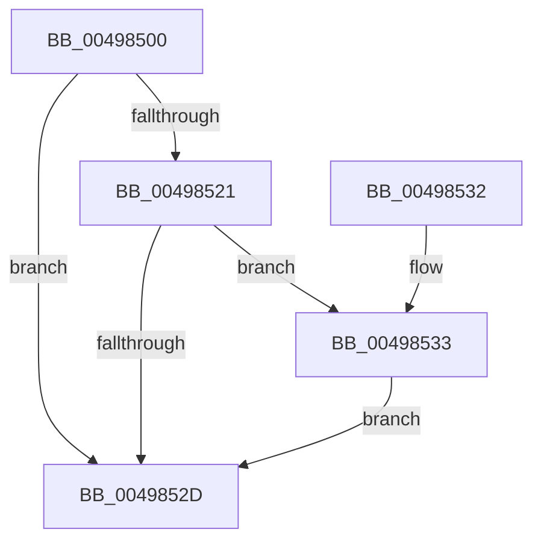

# KiSynchronizeAddressPolicyTarget

- RVA: `0x00498500`–`0x0049853A` (길이 `58` bytes)
- VA: `0x0000000140498500`
- 실행 섹션: `.text`
- PDB 이름 있음: `예`; PDB Function 태그: `아니요`
- unwind 정보 RVA: `0x0005CEE8`
- 디코드: `14`개 명령, `58/58` bytes 표시
- 미해석 바이트: `0` (있으면 어셈블리에 `.byte`로 보존)

> 이 문서는 커널 이미지의 기계어와 PDB 기호를 분석해 생성했습니다. 4번과 5번은 함수 원형과 자료형을 바이너리 사용 방식에서 추정한 C 해석이며 원본 소스 복구 결과는 아닙니다.

## 1. Dependencies

- 직접 호출 지점: **1**; 고유 호출 대상: **1**
- 직접 호출자로 확인된 함수: **1**
- RIP 상대 이미지 참조: **0**

### Outgoing calls
- `0x00498533` → [KiSetAddressPolicy](../21/KiSetAddressPolicy_function_002178A0.md) (function, `0x002178A0`)

### Direct callers
- [KeSynchronizeAddressPolicy](KeSynchronizeAddressPolicy_function_00498358.md) at `0x0049848E`

### Static image references
- 디코드된 RIP-relative 메모리 참조가 없습니다.

## 2. Other-region calls and transfers

- 다른 실행 섹션으로 향하는 call: **0**
- 별도 외부 분기/꼬리 이동을 확인하지 못했습니다.

## 3. Assembly (complete function range)

```asm
00498500  48 83 EC 28                     sub rsp, 0x28
00498504  65 48 8B 04 25 88 01 00 00      mov rax, qword ptr gs:[0x188]
0049850D  B9 01 00 00 00                  mov ecx, 1
00498512  48 8B 90 B8 00 00 00            mov rdx, qword ptr [rax + 0xb8]
00498519  38 8A 60 01 00 00               cmp byte ptr [rdx + 0x160], cl
0049851F  75 0C                           jne 0x14049852d
00498521  65 8B 04 25 18 B0 00 00         mov eax, dword ptr gs:[0xb018]
00498529  A8 02                           test al, 2
0049852B  74 06                           je 0x140498533
0049852D  48 83 C4 28                     add rsp, 0x28
00498531  C3                              ret
00498532  CC                              int3
00498533  E8 68 F3 D7 FF                  call 0x1402178a0
00498538  EB F3                           jmp 0x14049852d
```

## 4. C-style interpretation (structured pseudocode)

```c
__int64 __fastcall KiSynchronizeAddressPolicyTarget(void)
{
    __int64 result;
    __int64 v_rsp;

    v_rsp = (v_rsp) - (40);
    if ((*(unsigned __int8 *)(*(unsigned __int64 *)(*(unsigned __int64 *)(gs_base + (0 + 392)) + 184) + 352)) != 1) goto loc_0049852D;
    if ((((unsigned __int8)((unsigned int)(*(unsigned int *)(gs_base + (0 + 45080))))) & (2)) == 0) goto loc_00498533;
loc_0049852D:
    v_rsp = (v_rsp) + (40);
    return (unsigned int)(*(unsigned int *)(gs_base + (0 + 45080)));
loc_00498533:
    result = KiSetAddressPolicy(1, *(unsigned __int64 *)(*(unsigned __int64 *)(gs_base + (0 + 392)) + 184), a3, a4);
    goto loc_0049852D;
}
```

## 5. (Beta) C Style

```c
void KiSynchronizeAddressPolicyTarget(void)
{
    int64_t result;
    int64_t local_rsp;

    local_rsp = (local_rsp) - (40);
    if ((*(uint8_t *)(*(uint64_t *)(*(uint64_t *)(gs_base + (0 + 0x188)) + 0xB8) + 0x160)) != 1) goto loc_0049852D;
    if ((((uint8_t)((uint32_t)(*(uint32_t *)(gs_base + (0 + 0xB018))))) & (2)) == 0) goto loc_00498533;
loc_0049852D:
    local_rsp = (local_rsp) + (40);
    return (uint32_t)(*(uint32_t *)(gs_base + (0 + 0xB018)));
loc_00498533:
    result = KiSetAddressPolicy(1, *(uint64_t *)(*(uint64_t *)(gs_base + (0 + 0x188)) + 0xB8), a3, a4);
    goto loc_0049852D;
}
```

## 6. Execution-region graph

[열기: 2D/3D 그래프와 함수 탐색 컨트롤 패널](../../../control-panel.html?section=text&rva=0x00498500&view=graph)

- 2D 그래프는 위에서 아래로 흐르고, 3D 그래프는 빈 공간을 드래그해 회전합니다. Shift+드래그는 이동, 휠은 확대·축소, 함수 노드 선택은 대상 보고서 이동입니다.

### Static fallback


