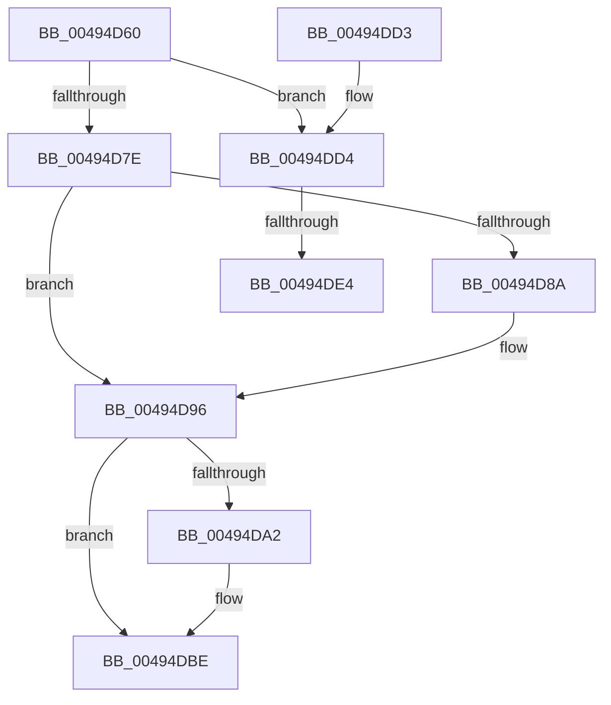

# KiSynchronizeStibpPairingTarget

- RVA: `0x00494D60`–`0x00494DF5` (길이 `149` bytes)
- VA: `0x0000000140494D60`
- 실행 섹션: `.text`
- PDB 이름 있음: `예`; PDB Function 태그: `예`
- unwind 정보 RVA: `0x000DB714`
- 디코드: `30`개 명령, `149/149` bytes 표시
- 미해석 바이트: `0` (있으면 어셈블리에 `.byte`로 보존)

> 이 문서는 커널 이미지의 기계어와 PDB 기호를 분석해 생성했습니다. 4번과 5번은 함수 원형과 자료형을 바이너리 사용 방식에서 추정한 C 해석이며 원본 소스 복구 결과는 아닙니다.

## 1. Dependencies

- 직접 호출 지점: **0**; 고유 호출 대상: **0**
- 직접 호출자로 확인된 함수: **0**
- RIP 상대 이미지 참조: **1**

### Outgoing calls
- 직접 디코드된 call 명령이 없습니다.

### Direct callers
- 이 함수 시작 RVA로 연결되는 직접 call은 확인되지 않았습니다. 간접 호출은 완전히 역산할 수 없습니다.

### Static image references
- `0x00494D69` → RVA `0x00FC6B48` (`ALMOSTRO`; read)

## 2. Other-region calls and transfers

- 다른 실행 섹션으로 향하는 call: **0**
- call이 아닌 외부 분기/꼬리 이동: **2**
  - `0x00494DDE` → `0x006F74A0` (`tail-transfer`)
  - `0x00494DF0` → `0x006F74A0` (`tail-transfer`)

## 3. Assembly (complete function range)

```asm
00494D60  65 4C 8B 04 25 20 00 00 00      mov r8, qword ptr gs:[0x20]
00494D69  48 8B 05 D8 1D B3 00            mov rax, qword ptr [rip + 0xb31dd8]
00494D70  48 0F BA E0 29                  bt rax, 0x29
00494D75  4D 8B 88 B0 2D 00 00            mov r9, qword ptr [r8 + 0x2db0]
00494D7C  72 56                           jb 0x140494dd4
00494D7E  41 0F B7 80 E8 06 00 00         movzx eax, word ptr [r8 + 0x6e8]
00494D86  A8 03                           test al, 3
00494D88  75 0C                           jne 0x140494d96
00494D8A  66 83 C8 02                     or ax, 2
00494D8E  66 41 89 80 E8 06 00 00         mov word ptr [r8 + 0x6e8], ax
00494D96  41 0F B7 80 E6 06 00 00         movzx eax, word ptr [r8 + 0x6e6]
00494D9E  A8 03                           test al, 3
00494DA0  75 1C                           jne 0x140494dbe
00494DA2  66 83 C8 02                     or ax, 2
00494DA6  B9 48 00 00 00                  mov ecx, 0x48
00494DAB  0F B7 D0                        movzx edx, ax
00494DAE  66 41 89 90 E6 06 00 00         mov word ptr [r8 + 0x6e6], dx
00494DB6  8B C2                           mov eax, edx
00494DB8  48 C1 EA 20                     shr rdx, 0x20
00494DBC  0F 30                           wrmsr
00494DBE  66 F0 41 83 A1 E0 06 00 00 EE   lock and word ptr [r9 + 0x6e0], 0xffee
00494DC8  66 F0 41 83 88 E0 06 00 00 02   lock or word ptr [r8 + 0x6e0], 2
00494DD2  C3                              ret
00494DD3  CC                              int3
00494DD4  41 0F B7 80 E2 06 00 00         movzx eax, word ptr [r8 + 0x6e2]
00494DDC  A8 03                           test al, 3
00494DDE  0F 85 BC 26 26 00               jne 0x1406f74a0
00494DE4  66 83 C8 02                     or ax, 2
00494DE8  66 41 89 80 E2 06 00 00         mov word ptr [r8 + 0x6e2], ax
00494DF0  E9 AB 26 26 00                  jmp 0x1406f74a0
```

## 4. C-style interpretation (structured pseudocode)

```c
__int64 __fastcall KiSynchronizeStibpPairingTarget(void)
{
    __int64 result;

    if (condition_is_below) goto loc_00494DD4;
    result = *(unsigned __int16 *)(*(unsigned __int64 *)(gs_base + (0 + 32)) + 1768);
    if ((((unsigned __int8)(*(unsigned __int16 *)(*(unsigned __int64 *)(gs_base + (0 + 32)) + 1768))) & (3)) == 0) {
        result = (unsigned __int16)((*(unsigned __int16 *)(*(unsigned __int64 *)(gs_base + (0 + 32)) + 1768)) | (2));
        *(unsigned __int16 *)(*(unsigned __int64 *)(gs_base + (0 + 32)) + 1768) = (unsigned __int16)(result);
    }
    result = *(unsigned __int16 *)(*(unsigned __int64 *)(gs_base + (0 + 32)) + 1766);
    if ((((unsigned __int8)(*(unsigned __int16 *)(*(unsigned __int64 *)(gs_base + (0 + 32)) + 1766))) & (3)) == 0) {
        result = (unsigned __int16)((*(unsigned __int16 *)(*(unsigned __int64 *)(gs_base + (0 + 32)) + 1766)) | (2));
        a1 = 72;
        a2 = (unsigned __int16)(result);
        *(unsigned __int16 *)(*(unsigned __int64 *)(gs_base + (0 + 32)) + 1766) = (unsigned __int16)(a2);
        result = (unsigned int)(a2);
        a2 = (a2) >> (32);
    }
    return result;
loc_00494DD4:
    result = (unsigned __int16)((*(unsigned __int16 *)(*(unsigned __int64 *)(gs_base + (0 + 32)) + 1762)) | (2));
    *(unsigned __int16 *)(*(unsigned __int64 *)(gs_base + (0 + 32)) + 1762) = (unsigned __int16)(result);
}
```

## 5. (Beta) C Style

```c
void KiSynchronizeStibpPairingTarget(void)
{
    int64_t result;

    if (condition_is_below) goto loc_00494DD4;
    result = *(uint16_t *)(*(uint64_t *)(gs_base + (0 + 0x20)) + 0x6E8);
    if ((((uint8_t)(*(uint16_t *)(*(uint64_t *)(gs_base + (0 + 0x20)) + 0x6E8))) & (3)) == 0) {
        result = (uint16_t)((*(uint16_t *)(*(uint64_t *)(gs_base + (0 + 0x20)) + 0x6E8)) | (2));
        *(uint16_t *)(*(uint64_t *)(gs_base + (0 + 0x20)) + 0x6E8) = (uint16_t)(result);
    }
    result = *(uint16_t *)(*(uint64_t *)(gs_base + (0 + 0x20)) + 0x6E6);
    if ((((uint8_t)(*(uint16_t *)(*(uint64_t *)(gs_base + (0 + 0x20)) + 0x6E6))) & (3)) == 0) {
        result = (uint16_t)((*(uint16_t *)(*(uint64_t *)(gs_base + (0 + 0x20)) + 0x6E6)) | (2));
        a1 = 72;
        a2 = (uint16_t)(result);
        *(uint16_t *)(*(uint64_t *)(gs_base + (0 + 0x20)) + 0x6E6) = (uint16_t)(a2);
        result = (uint32_t)(a2);
        a2 = (a2) >> (32);
    }
    return result;
loc_00494DD4:
    result = (uint16_t)((*(uint16_t *)(*(uint64_t *)(gs_base + (0 + 0x20)) + 0x6E2)) | (2));
    *(uint16_t *)(*(uint64_t *)(gs_base + (0 + 0x20)) + 0x6E2) = (uint16_t)(result);
}
```

## 6. Execution-region graph

[열기: 2D/3D 그래프와 함수 탐색 컨트롤 패널](../../../control-panel.html?section=text&rva=0x00494D60&view=graph)

- 2D 그래프는 위에서 아래로 흐르고, 3D 그래프는 빈 공간을 드래그해 회전합니다. Shift+드래그는 이동, 휠은 확대·축소, 함수 노드 선택은 대상 보고서 이동입니다.

### Static fallback


