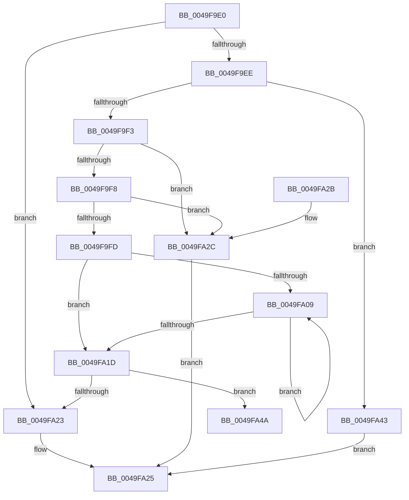

# KseHookMemcpy_s

- RVA: `0x0049F9E0`–`0x0049FA52` (길이 `114` bytes)
- VA: `0x000000014049F9E0`
- 실행 섹션: `.text`
- PDB 이름 있음: `예`; PDB Function 태그: `예`
- unwind 정보 RVA: `0x000ABEFC`
- 디코드: `40`개 명령, `114/114` bytes 표시
- 미해석 바이트: `0` (있으면 어셈블리에 `.byte`로 보존)

> 이 문서는 커널 이미지의 기계어와 PDB 기호를 분석해 생성했습니다. 4번과 5번은 함수 원형과 자료형을 바이너리 사용 방식에서 추정한 C 해석이며 원본 소스 복구 결과는 아닙니다.

## 1. Dependencies

- 직접 호출 지점: **1**; 고유 호출 대상: **1**
- 직접 호출자로 확인된 함수: **0**
- RIP 상대 이미지 참조: **0**

### Outgoing calls
- `0x0049FA31` → [memset](../6C/memset_function_006C6C40.md) (function, `0x006C6C40`)

### Direct callers
- 이 함수 시작 RVA로 연결되는 직접 call은 확인되지 않았습니다. 간접 호출은 완전히 역산할 수 없습니다.

### Static image references
- 디코드된 RIP-relative 메모리 참조가 없습니다.

## 2. Other-region calls and transfers

- 다른 실행 섹션으로 향하는 call: **0**
- call이 아닌 외부 분기/꼬리 이동: **1**
  - `0x0049FA4D` → [sub_006F83EC](../6F/Unknown_function_006F83EC.md) (`tail-transfer`)

## 3. Assembly (complete function range)

```asm
0049F9E0  40 53                           push rbx
0049F9E2  48 83 EC 20                     sub rsp, 0x20
0049F9E6  49 8B D8                        mov rbx, r8
0049F9E9  4D 85 C9                        test r9, r9
0049F9EC  74 35                           je 0x14049fa23
0049F9EE  48 85 C9                        test rcx, rcx
0049F9F1  74 50                           je 0x14049fa43
0049F9F3  48 85 DB                        test rbx, rbx
0049F9F6  74 34                           je 0x14049fa2c
0049F9F8  49 3B D1                        cmp rdx, r9
0049F9FB  72 2F                           jb 0x14049fa2c
0049F9FD  49 8B D1                        mov rdx, r9
0049FA00  48 C1 EA 03                     shr rdx, 3
0049FA04  48 85 D2                        test rdx, rdx
0049FA07  74 14                           je 0x14049fa1d
0049FA09  48 8B 03                        mov rax, qword ptr [rbx]
0049FA0C  48 83 C3 08                     add rbx, 8
0049FA10  48 89 01                        mov qword ptr [rcx], rax
0049FA13  48 83 C1 08                     add rcx, 8
0049FA17  48 83 EA 01                     sub rdx, 1
0049FA1B  75 EC                           jne 0x14049fa09
0049FA1D  41 83 E1 07                     and r9d, 7
0049FA21  77 27                           ja 0x14049fa4a
0049FA23  33 C0                           xor eax, eax
0049FA25  48 83 C4 20                     add rsp, 0x20
0049FA29  5B                              pop rbx
0049FA2A  C3                              ret
0049FA2B  CC                              int3
0049FA2C  4C 8B C2                        mov r8, rdx
0049FA2F  33 D2                           xor edx, edx
0049FA31  E8 0A 72 22 00                  call 0x1406c6c40
0049FA36  48 F7 DB                        neg rbx
0049FA39  1B C0                           sbb eax, eax
0049FA3B  83 E0 0C                        and eax, 0xc
0049FA3E  83 C0 16                        add eax, 0x16
0049FA41  EB E2                           jmp 0x14049fa25
0049FA43  B8 16 00 00 00                  mov eax, 0x16
0049FA48  EB DB                           jmp 0x14049fa25
0049FA4A  48 2B CB                        sub rcx, rbx
0049FA4D  E9 9A 89 25 00                  jmp 0x1406f83ec
```

## 4. C-style interpretation (structured pseudocode)

```c
__int64 __fastcall KseHookMemcpy_s(__int64 a1, __int64 a2, __int64 a3, __int64 a4)
{
    __int64 result;
    __int64 v_rbx;
    __int64 v_rsp;

    v_rsp = (v_rsp) - (32);
    if (a4 == 0) goto loc_0049FA23;
    if (a1 == 0) goto loc_0049FA43;
    if (a3 == 0) goto loc_0049FA2C;
    if (a2 < a4) goto loc_0049FA2C;
    a2 = (a4) >> (3);
    if (a2 == 0) goto loc_0049FA1D;
loc_0049FA09:
    v_rbx = (a3) + (8);
    *(unsigned __int64 *)(a1) = *(unsigned __int64 *)(a3);
    a1 = (a1) + (8);
    a2 = (a2) - (1);
    if (condition_is_not_equal) goto loc_0049FA09;
loc_0049FA1D:
    a4 = (unsigned int)((a4) & (7));
    if (condition_is_above) goto loc_0049FA4A;
loc_0049FA23:
    result = 0;
loc_0049FA25:
    v_rsp = (v_rsp) + (32);
    return result;
loc_0049FA2C:
    a2 = 0;
    result = memset(a1, a2, a2, a4);
    v_rbx = -(v_rbx);
    result = (unsigned int)((result) & (12));
    result = (unsigned int)((result) + (22));
    goto loc_0049FA25;
loc_0049FA43:
    goto loc_0049FA25;
loc_0049FA4A:
    a1 = (a1) - (v_rbx);
}
```

## 5. (Beta) C Style

```c
int64_t KseHookMemcpy_s(int64_t Arg1, int64_t Arg2, int64_t Arg3, int64_t Arg4)
{
    int64_t result;
    int64_t local_rbx;
    int64_t local_rsp;

    local_rsp = (local_rsp) - (32);
    if (Arg4 == 0) goto loc_0049FA23;
    if (Arg1 == 0) goto loc_0049FA43;
    if (Arg3 == 0) goto loc_0049FA2C;
    if (Arg2 < Arg4) goto loc_0049FA2C;
    Arg2 = (Arg4) >> (3);
    if (Arg2 == 0) goto loc_0049FA1D;
loc_0049FA09:
    local_rbx = (Arg3) + (8);
    *(uint64_t *)(Arg1) = *(uint64_t *)(Arg3);
    Arg1 = (Arg1) + (8);
    Arg2 = (Arg2) - (1);
    if (condition_is_not_equal) goto loc_0049FA09;
loc_0049FA1D:
    Arg4 = (uint32_t)((Arg4) & (7));
    if (condition_is_above) goto loc_0049FA4A;
loc_0049FA23:
    result = 0;
loc_0049FA25:
    local_rsp = (local_rsp) + (32);
    return result;
loc_0049FA2C:
    Arg2 = 0;
    result = memset(Arg1, Arg2, Arg2, Arg4);
    local_rbx = -(local_rbx);
    result = (uint32_t)((result) & (12));
    result = (uint32_t)((result) + (22));
    goto loc_0049FA25;
loc_0049FA43:
    goto loc_0049FA25;
loc_0049FA4A:
    Arg1 = (Arg1) - (local_rbx);
}
```

## 6. Execution-region graph

[열기: 2D/3D 그래프와 함수 탐색 컨트롤 패널](../../../control-panel.html?section=text&rva=0x0049F9E0&view=graph)

- 2D 그래프는 위에서 아래로 흐르고, 3D 그래프는 빈 공간을 드래그해 회전합니다. Shift+드래그는 이동, 휠은 확대·축소, 함수 노드 선택은 대상 보고서 이동입니다.

### Static fallback


