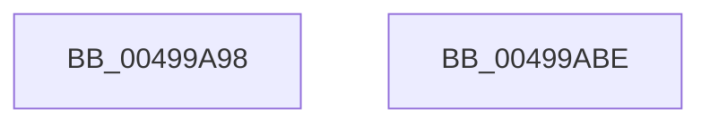

# KsepLogError

- RVA: `0x00499A98`–`0x00499ABF` (길이 `39` bytes)
- VA: `0x0000000140499A98`
- 실행 섹션: `.text`
- PDB 이름 있음: `예`; PDB Function 태그: `아니요`
- unwind 정보 RVA: `0x000B4534`
- 디코드: `12`개 명령, `39/39` bytes 표시
- 미해석 바이트: `0` (있으면 어셈블리에 `.byte`로 보존)

> 이 문서는 커널 이미지의 기계어와 PDB 기호를 분석해 생성했습니다. 4번과 5번은 함수 원형과 자료형을 바이너리 사용 방식에서 추정한 C 해석이며 원본 소스 복구 결과는 아닙니다.

## 1. Dependencies

- 직접 호출 지점: **1**; 고유 호출 대상: **1**
- 직접 호출자로 확인된 함수: **17**
- RIP 상대 이미지 참조: **0**

### Outgoing calls
- `0x00499AB4` → [KsepLogEtwMessage](KsepLogEtwMessage_function_00499AC8.md) (function, `0x00499AC8`)

### Direct callers
- [KseKPSOHookDriverTargeted](../5C/KseKPSOHookDriverTargeted_function_005CD540.md) at `0x005CD5C7`
- [KseRegisterShimEx](../../page/74/KseRegisterShimEx_function_007494D0.md) at `0x007495B0`
- [KseRegisterShimEx](../../page/74/KseRegisterShimEx_function_007494D0.md) at `0x007496DB`
- [KseUnregisterShim](../../page/74/KseUnregisterShim_function_00749800.md) at `0x0074993E`
- [KseUnregisterShim](../../page/74/KseUnregisterShim_function_00749800.md) at `0x00749A41`
- [KsepApplyShimsToDriver](../../page/74/KsepApplyShimsToDriver_function_00749C84.md) at `0x00749E6B`
- [KsepApplyShimsToDriver](../../page/74/KsepApplyShimsToDriver_function_00749C84.md) at `0x00749ED6`
- [KsepResolveApplicableShimsForDriver](../../page/74/KsepResolveApplicableShimsForDriver_function_0074A168.md) at `0x0074A303`
- [KsepResolveApplicableShimsForDriver](../../page/74/KsepResolveApplicableShimsForDriver_function_0074A168.md) at `0x0074A414`
- [KsepDeletePatchSdb](../../page/74/KsepDeletePatchSdb_function_0074A738.md) at `0x0074A7D8`
- [KsepSdbBootInitialize](../../page/74/KsepSdbBootInitialize_function_0074A7EC.md) at `0x0074A86B`
- [KsepSdbBootInitialize](../../page/74/KsepSdbBootInitialize_function_0074A7EC.md) at `0x0074A8E0`
- [KsepSdbMapToMemory](../../page/95/KsepSdbMapToMemory_function_0095B81C.md) at `0x0095BA3C`
- [KsepSdbMapToMemory](../../page/95/KsepSdbMapToMemory_function_0095B81C.md) at `0x0095BA8B`
- [KsepSdbMapToMemory](../../page/95/KsepSdbMapToMemory_function_0095B81C.md) at `0x0095BAE3`
- [KsepShimDatabaseTime](../../page/A7/KsepShimDatabaseTime_function_00A79684.md) at `0x00A797C9`
- [sub_00B27116](../../page/B2/Unknown_function_00B27116.md) at `0x00B2728C`
- [sub_00B27116](../../page/B2/Unknown_function_00B27116.md) at `0x00B27388`
- [sub_00B27464](../../page/B2/Unknown_function_00B27464.md) at `0x00B274FE`
- [sub_00B27548](../../page/B2/Unknown_function_00B27548.md) at `0x00B27551`
- [KseInitialize](../../init/C3/KseInitialize_function_00C3B5AC.md) at `0x00C3B7C5`
- [KseInitialize](../../init/C3/KseInitialize_function_00C3B5AC.md) at `0x00C3B823`
- [KseInitialize](../../init/C3/KseInitialize_function_00C3B5AC.md) at `0x00C3B881`
- [KseInitialize](../../init/C3/KseInitialize_function_00C3B5AC.md) at `0x00C3B8DF`
- [KseInitialize](../../init/C3/KseInitialize_function_00C3B5AC.md) at `0x00C3B93D`
- [KseInitialize](../../init/C3/KseInitialize_function_00C3B5AC.md) at `0x00C3B99B`
- [KseInitialize](../../init/C3/KseInitialize_function_00C3B5AC.md) at `0x00C3B9F9`
- [KseInitialize](../../init/C3/KseInitialize_function_00C3B5AC.md) at `0x00C3BAF6`
- [KseInitialize](../../init/C3/KseInitialize_function_00C3B5AC.md) at `0x00C3BB38`
- [KsepMatchInitMachineInfo](../../init/C3/KsepMatchInitMachineInfo_function_00C3BFBC.md) at `0x00C3C022`
- [KsepMatchInitMachineInfo](../../init/C3/KsepMatchInitMachineInfo_function_00C3BFBC.md) at `0x00C3C076`
- [KsepMatchInitMachineInfo](../../init/C3/KsepMatchInitMachineInfo_function_00C3BFBC.md) at `0x00C3C0CA`
- [KseShimDatabaseBootInitialize](../../init/C3/KseShimDatabaseBootInitialize_function_00C3C124.md) at `0x00C3C2CC`
- [KsepEngineReadFlags](../../init/C3/KsepEngineReadFlags_function_00C3C310.md) at `0x00C3C4DE`
- [KsepEngineReadFlags](../../init/C3/KsepEngineReadFlags_function_00C3C310.md) at `0x00C3C563`
- [KseVersionLieInitialize](../../init/C3/KseVersionLieInitialize_function_00C3C64C.md) at `0x00C3C6B3`
- [KseVersionLieInitialize](../../init/C3/KseVersionLieInitialize_function_00C3C64C.md) at `0x00C3C70B`
- [KseVersionLieInitialize](../../init/C3/KseVersionLieInitialize_function_00C3C64C.md) at `0x00C3C763`

### Static image references
- 디코드된 RIP-relative 메모리 참조가 없습니다.

## 2. Other-region calls and transfers

- 다른 실행 섹션으로 향하는 call: **0**
- 별도 외부 분기/꼬리 이동을 확인하지 못했습니다.

## 3. Assembly (complete function range)

```asm
00499A98  48 8B C4                        mov rax, rsp
00499A9B  48 89 50 10                     mov qword ptr [rax + 0x10], rdx
00499A9F  4C 89 40 18                     mov qword ptr [rax + 0x18], r8
00499AA3  4C 89 48 20                     mov qword ptr [rax + 0x20], r9
00499AA7  48 83 EC 38                     sub rsp, 0x38
00499AAB  4C 8B C2                        mov r8, rdx
00499AAE  4C 8D 48 18                     lea r9, [rax + 0x18]
00499AB2  33 D2                           xor edx, edx
00499AB4  E8 0F 00 00 00                  call 0x140499ac8
00499AB9  48 83 C4 38                     add rsp, 0x38
00499ABD  C3                              ret
00499ABE  CC                              int3
```

## 4. C-style interpretation (structured pseudocode)

```c
__int64 __fastcall KsepLogError(__int64 a1, __int64 a2, __int64 a3, __int64 a4)
{
    __int64 result;
    __int64 v_rsp;

    *(unsigned __int64 *)(v_rsp + 16) = a2;
    *(unsigned __int64 *)(v_rsp + 24) = a3;
    *(unsigned __int64 *)(v_rsp + 32) = a4;
    v_rsp = (v_rsp) - (56);
    a2 = 0;
    result = KsepLogEtwMessage(a1, a2, a2, v_rsp + 24);
    v_rsp = (v_rsp) + (56);
    return result;
}
```

## 5. (Beta) C Style

```c
int64_t KsepLogError(int64_t Arg1, int64_t Arg2, int64_t Arg3, int64_t Arg4)
{
    int64_t result;
    int64_t local_rsp;

    *(uint64_t *)(local_rsp + 0x10) = Arg2;
    *(uint64_t *)(local_rsp + 0x18) = Arg3;
    *(uint64_t *)(local_rsp + 0x20) = Arg4;
    local_rsp = (local_rsp) - (56);
    Arg2 = 0;
    result = KsepLogEtwMessage(Arg1, Arg2, Arg2, local_rsp + 24);
    local_rsp = (local_rsp) + (56);
    return result;
}
```

## 6. Execution-region graph

[열기: 2D/3D 그래프와 함수 탐색 컨트롤 패널](../../../control-panel.html?section=text&rva=0x00499A98&view=graph)

- 2D 그래프는 위에서 아래로 흐르고, 3D 그래프는 빈 공간을 드래그해 회전합니다. Shift+드래그는 이동, 휠은 확대·축소, 함수 노드 선택은 대상 보고서 이동입니다.

### Static fallback


