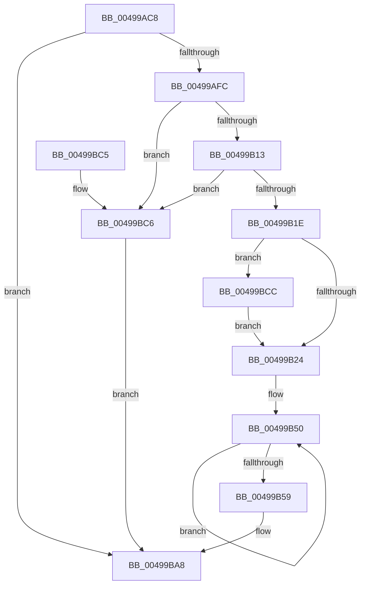

# KsepLogEtwMessage

- RVA: `0x00499AC8`–`0x00499BD5` (길이 `269` bytes)
- VA: `0x0000000140499AC8`
- 실행 섹션: `.text`
- PDB 이름 있음: `예`; PDB Function 태그: `아니요`
- unwind 정보 RVA: `0x000B4540`
- 디코드: `58`개 명령, `269/269` bytes 표시
- 미해석 바이트: `0` (있으면 어셈블리에 `.byte`로 보존)

> 이 문서는 커널 이미지의 기계어와 PDB 기호를 분석해 생성했습니다. 4번과 5번은 함수 원형과 자료형을 바이너리 사용 방식에서 추정한 C 해석이며 원본 소스 복구 결과는 아닙니다.

## 1. Dependencies

- 직접 호출 지점: **3**; 고유 호출 대상: **3**
- 직접 호출자로 확인된 함수: **2**
- RIP 상대 이미지 참조: **4**

### Outgoing calls
- `0x00499B06` → [vsnprintf](../4F/vsnprintf_function_004FF050.md) (function, `0x004FF050`)
- `0x00499BA3` → [EtwWriteEx](../25/EtwWriteEx_function_0025F0D0.md) (function, `0x0025F0D0`)
- `0x00499BAF` → [_security_check_cookie](../6A/_security_check_cookie_function_006AC640.md) (function, `0x006AC640`)

### Direct callers
- [KsepLogInfo](KsepLogInfo_function_00499A68.md) at `0x00499A87`
- [KsepLogError](KsepLogError_function_00499A98.md) at `0x00499AB4`

### Static image references
- `0x00499ADE` → RVA `0x00E0A740` (`.data`; read)
- `0x00499AEC` → RVA `0x00E66CE0` (`.data`; read)
- `0x00499B5E` → RVA `0x0001AB48` (`.rdata`; read)
- `0x00499B74` → RVA `0x0001AB58` (`.rdata`; read)

## 2. Other-region calls and transfers

- 다른 실행 섹션으로 향하는 call: **0**
- 별도 외부 분기/꼬리 이동을 확인하지 못했습니다.

## 3. Assembly (complete function range)

```asm
00499AC8  48 89 5C 24 10                  mov qword ptr [rsp + 0x10], rbx
00499ACD  89 4C 24 08                     mov dword ptr [rsp + 8], ecx
00499AD1  55                              push rbp
00499AD2  48 8D 6C 24 90                  lea rbp, [rsp - 0x70]
00499AD7  48 81 EC 70 01 00 00            sub rsp, 0x170
00499ADE  48 8B 05 5B 0C 97 00            mov rax, qword ptr [rip + 0x970c5b]
00499AE5  48 33 C4                        xor rax, rsp
00499AE8  48 89 45 60                     mov qword ptr [rbp + 0x60], rax
00499AEC  48 83 3D EC D1 9C 00 00         cmp qword ptr [rip + 0x9cd1ec], 0
00499AF4  8B DA                           mov ebx, edx
00499AF6  0F 84 AC 00 00 00               je 0x140499ba8
00499AFC  BA FF 00 00 00                  mov edx, 0xff
00499B01  48 8D 4C 24 60                  lea rcx, [rsp + 0x60]
00499B06  E8 45 55 06 00                  call 0x1404ff050
00499B0B  85 C0                           test eax, eax
00499B0D  0F 88 B3 00 00 00               js 0x140499bc6
00499B13  3D FF 00 00 00                  cmp eax, 0xff
00499B18  0F 87 A8 00 00 00               ja 0x140499bc6
00499B1E  0F 84 A8 00 00 00               je 0x140499bcc
00499B24  83 64 24 4C 00                  and dword ptr [rsp + 0x4c], 0
00499B29  48 8D 85 80 00 00 00            lea rax, [rbp + 0x80]
00499B30  48 89 44 24 40                  mov qword ptr [rsp + 0x40], rax
00499B35  48 8D 4C 24 60                  lea rcx, [rsp + 0x60]
00499B3A  48 8D 44 24 60                  lea rax, [rsp + 0x60]
00499B3F  C7 44 24 48 04 00 00 00         mov dword ptr [rsp + 0x48], 4
00499B47  48 89 44 24 50                  mov qword ptr [rsp + 0x50], rax
00499B4C  48 83 C8 FF                     or rax, 0xffffffffffffffff
00499B50  48 FF C0                        inc rax
00499B53  80 3C 01 00                     cmp byte ptr [rcx + rax], 0
00499B57  75 F7                           jne 0x140499b50
00499B59  83 64 24 5C 00                  and dword ptr [rsp + 0x5c], 0
00499B5E  48 8D 15 E3 0F B8 FF            lea rdx, [rip - 0x47f01d]
00499B65  48 8B 0D 74 D1 9C 00            mov rcx, qword ptr [rip + 0x9cd174]
00499B6C  FF C0                           inc eax
00499B6E  89 44 24 58                     mov dword ptr [rsp + 0x58], eax
00499B72  85 DB                           test ebx, ebx
00499B74  48 8D 05 DD 0F B8 FF            lea rax, [rip - 0x47f023]
00499B7B  48 0F 45 D0                     cmovne rdx, rax
00499B7F  48 8D 44 24 40                  lea rax, [rsp + 0x40]
00499B84  48 89 44 24 38                  mov qword ptr [rsp + 0x38], rax
00499B89  45 33 C9                        xor r9d, r9d
00499B8C  C7 44 24 30 02 00 00 00         mov dword ptr [rsp + 0x30], 2
00499B94  45 33 C0                        xor r8d, r8d
00499B97  48 83 64 24 28 00               and qword ptr [rsp + 0x28], 0
00499B9D  48 83 64 24 20 00               and qword ptr [rsp + 0x20], 0
00499BA3  E8 28 55 DC FF                  call 0x14025f0d0
00499BA8  48 8B 4D 60                     mov rcx, qword ptr [rbp + 0x60]
00499BAC  48 33 CC                        xor rcx, rsp
00499BAF  E8 8C 2A 21 00                  call 0x1406ac640
00499BB4  48 8B 9C 24 88 01 00 00         mov rbx, qword ptr [rsp + 0x188]
00499BBC  48 81 C4 70 01 00 00            add rsp, 0x170
00499BC3  5D                              pop rbp
00499BC4  C3                              ret
00499BC5  CC                              int3
00499BC6  C6 45 5F 00                     mov byte ptr [rbp + 0x5f], 0
00499BCA  EB DC                           jmp 0x140499ba8
00499BCC  C6 45 5F 00                     mov byte ptr [rbp + 0x5f], 0
00499BD0  E9 4F FF FF FF                  jmp 0x140499b24
```

## 4. C-style interpretation (structured pseudocode)

```c
__int64 __fastcall KsepLogEtwMessage(int a1, int a2, int a3, int a4)
{
    __int64 result;
    __int64 v_rsp;
    unsigned __int64 v_stack_m118;
    unsigned int v_stack_m11C;
    unsigned int v_stack_m120;
    unsigned __int64 v_stack_m128;
    unsigned int v_stack_m12C;
    unsigned int v_stack_m130;
    unsigned __int64 v_stack_m138;
    unsigned __int64 v_stack_m140;
    unsigned int v_stack_m148;
    unsigned __int64 v_stack_m150;
    unsigned __int64 v_stack_m158;
    unsigned __int64 v_stack_m18;
    unsigned __int8 v_stack_m19;
    unsigned __int64 v_stack_m78;
    unsigned __int64 v_stack_p10;
    unsigned int v_stack_p8;

    v_stack_p10 = v_rbx;
    v_stack_p8 = a1;
    v_rsp = (v_rsp) - (368);
    result = (*(unsigned __int64 *)(v_rip + 9899099)) ^ (v_rsp);
    v_stack_m18 = result;
    if ((*(unsigned __int64 *)(v_rip + 10277356)) == 0) goto loc_00499BA8;
    result = vsnprintf(v_stack_m118, 255, a3, a4);
    if (sign_flag) goto loc_00499BC6;
    if (((unsigned int)(result)) > 255) goto loc_00499BC6;
    if (((unsigned int)(result)) == 255) goto loc_00499BCC;
loc_00499B24:
    v_stack_m138 = v_stack_p8;
    v_stack_m130 = 4;
    v_stack_m128 = v_stack_m118;
    result = (v_stack_m118) | (-1);
loc_00499B50:
    result = (result) + 1;
    if ((*(unsigned __int8 *)(v_stack_m118 + result * 1)) != 0) goto loc_00499B50;
    result = (unsigned int)((result) + 1);
    v_stack_m120 = (unsigned int)(result);
    a2 = v_rip - 4714525;
    if ((unsigned int)((unsigned int)(a2)) != 0) { a2 = v_rip - 4714531; }
    v_stack_m140 = v_stack_m138;
    a4 = 0;
    v_stack_m148 = 2;
    a3 = 0;
    result = EtwWriteEx(*(unsigned __int64 *)(v_rip + 10277236), a2, a3, a4);
loc_00499BA8:
    a1 = (v_stack_m18) ^ (v_rsp);
    result = _security_check_cookie(a1, a2, a3, a4);
    v_rsp = (v_rsp) + (368);
    return result;
loc_00499BC6:
    v_stack_m19 = 0;
    goto loc_00499BA8;
loc_00499BCC:
    v_stack_m19 = 0;
    goto loc_00499B24;
}
```

## 5. (Beta) C Style

```c
int64_t KsepLogEtwMessage(int32_t Arg1, int32_t Arg2, int32_t Arg3, int32_t Arg4)
{
    int64_t result;
    int64_t local_rsp;
    uint64_t v_stack_m118;
    uint32_t v_stack_m11C;
    uint32_t v_stack_m120;
    uint64_t v_stack_m128;
    uint32_t v_stack_m12C;
    uint32_t v_stack_m130;
    uint64_t v_stack_m138;
    uint64_t v_stack_m140;
    uint32_t v_stack_m148;
    uint64_t v_stack_m150;
    uint64_t v_stack_m158;
    uint64_t v_stack_m18;
    uint8_t v_stack_m19;
    uint64_t v_stack_m78;
    uint64_t v_stack_p10;
    uint32_t v_stack_p8;

    v_stack_p10 = local_rbx;
    v_stack_p8 = Arg1;
    local_rsp = (local_rsp) - (368);
    result = (*(uint64_t *)(v_rip + 0x970C5B)) ^ (local_rsp);
    v_stack_m18 = result;
    if ((*(uint64_t *)(v_rip + 0x9CD1EC)) == 0) goto loc_00499BA8;
    result = vsnprintf(v_stack_m118, 255, Arg3, Arg4);
    if (sign_flag) goto loc_00499BC6;
    if (((uint32_t)(result)) > 255) goto loc_00499BC6;
    if (((uint32_t)(result)) == 255) goto loc_00499BCC;
loc_00499B24:
    v_stack_m138 = v_stack_p8;
    v_stack_m130 = 4;
    v_stack_m128 = v_stack_m118;
    result = (v_stack_m118) | (-1);
loc_00499B50:
    result = (result) + 1;
    if ((*(uint8_t *)(v_stack_m118 + result * 1)) != 0) goto loc_00499B50;
    result = (uint32_t)((result) + 1);
    v_stack_m120 = (uint32_t)(result);
    Arg2 = v_rip - 4714525;
    if ((uint32_t)((uint32_t)(Arg2)) != 0) { Arg2 = v_rip - 4714531; }
    v_stack_m140 = v_stack_m138;
    Arg4 = 0;
    v_stack_m148 = 2;
    Arg3 = 0;
    result = EtwWriteEx(*(uint64_t *)(v_rip + 0x9CD174), Arg2, Arg3, Arg4);
loc_00499BA8:
    Arg1 = (v_stack_m18) ^ (local_rsp);
    result = _security_check_cookie(Arg1, Arg2, Arg3, Arg4);
    local_rsp = (local_rsp) + (368);
    return result;
loc_00499BC6:
    v_stack_m19 = 0;
    goto loc_00499BA8;
loc_00499BCC:
    v_stack_m19 = 0;
    goto loc_00499B24;
}
```

## 6. Execution-region graph

[열기: 2D/3D 그래프와 함수 탐색 컨트롤 패널](../../../control-panel.html?section=text&rva=0x00499AC8&view=graph)

- 2D 그래프는 위에서 아래로 흐르고, 3D 그래프는 빈 공간을 드래그해 회전합니다. Shift+드래그는 이동, 휠은 확대·축소, 함수 노드 선택은 대상 보고서 이동입니다.

### Static fallback


