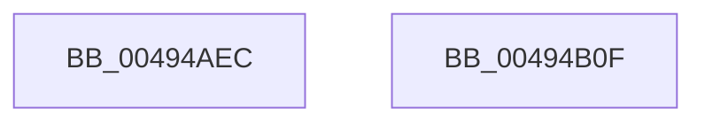

# MI_SET_PTE_SHADOW_STACK

- RVA: `0x00494AEC`–`0x00494B10` (길이 `36` bytes)
- VA: `0x0000000140494AEC`
- 실행 섹션: `.text`
- PDB 이름 있음: `예`; PDB Function 태그: `아니요`
- unwind 정보 RVA: `0x0005CF00`
- 디코드: `12`개 명령, `36/36` bytes 표시
- 미해석 바이트: `0` (있으면 어셈블리에 `.byte`로 보존)

> 이 문서는 커널 이미지의 기계어와 PDB 기호를 분석해 생성했습니다. 4번과 5번은 함수 원형과 자료형을 바이너리 사용 방식에서 추정한 C 해석이며 원본 소스 복구 결과는 아닙니다.

## 1. Dependencies

- 직접 호출 지점: **2**; 고유 호출 대상: **2**
- 직접 호출자로 확인된 함수: **2**
- RIP 상대 이미지 참조: **0**

### Outgoing calls
- `0x00494AF5` → [MI_READ_PTE_LOCK_FREE](../28/MI_READ_PTE_LOCK_FREE_function_002828A0.md) (function, `0x002828A0`)
- `0x00494B04` → [MiWriteValidPteNewProtection](../28/MiWriteValidPteNewProtection_function_00281810.md) (function, `0x00281810`)

### Direct callers
- [MiRevertValidPte](../2C/MiRevertValidPte_function_002C5160.md) at `0x002C53EB`
- [MiInitializeShadowPageTable](../../page/80/MiInitializeShadowPageTable_function_0080778C.md) at `0x00807906`

### Static image references
- 디코드된 RIP-relative 메모리 참조가 없습니다.

## 2. Other-region calls and transfers

- 다른 실행 섹션으로 향하는 call: **0**
- 별도 외부 분기/꼬리 이동을 확인하지 못했습니다.

## 3. Assembly (complete function range)

```asm
00494AEC  40 53                           push rbx
00494AEE  48 83 EC 20                     sub rsp, 0x20
00494AF2  48 8B D9                        mov rbx, rcx
00494AF5  E8 A6 DD DE FF                  call 0x1402828a0
00494AFA  48 83 C8 40                     or rax, 0x40
00494AFE  48 8B CB                        mov rcx, rbx
00494B01  48 8B D0                        mov rdx, rax
00494B04  E8 07 CD DE FF                  call 0x140281810
00494B09  48 83 C4 20                     add rsp, 0x20
00494B0D  5B                              pop rbx
00494B0E  C3                              ret
00494B0F  CC                              int3
```

## 4. C-style interpretation (structured pseudocode)

```c
__int64 __fastcall MI_SET_PTE_SHADOW_STACK(__int64 a1)
{
    __int64 result;
    __int64 v_rsp;

    v_rsp = (v_rsp) - (32);
    result = MI_READ_PTE_LOCK_FREE(a1, a2, a3, a4);
    result = (result) | (64);
    result = MiWriteValidPteNewProtection(a1, result, a3, a4);
    v_rsp = (v_rsp) + (32);
    return result;
}
```

## 5. (Beta) C Style

```c
int64_t MI_SET_PTE_SHADOW_STACK(int64_t Arg1)
{
    int64_t result;
    int64_t local_rsp;

    local_rsp = (local_rsp) - (32);
    result = MI_READ_PTE_LOCK_FREE(Arg1, a2, a3, a4);
    result = (result) | (64);
    result = MiWriteValidPteNewProtection(Arg1, result, a3, a4);
    local_rsp = (local_rsp) + (32);
    return result;
}
```

## 6. Execution-region graph

[열기: 2D/3D 그래프와 함수 탐색 컨트롤 패널](../../../control-panel.html?section=text&rva=0x00494AEC&view=graph)

- 2D 그래프는 위에서 아래로 흐르고, 3D 그래프는 빈 공간을 드래그해 회전합니다. Shift+드래그는 이동, 휠은 확대·축소, 함수 노드 선택은 대상 보고서 이동입니다.

### Static fallback


