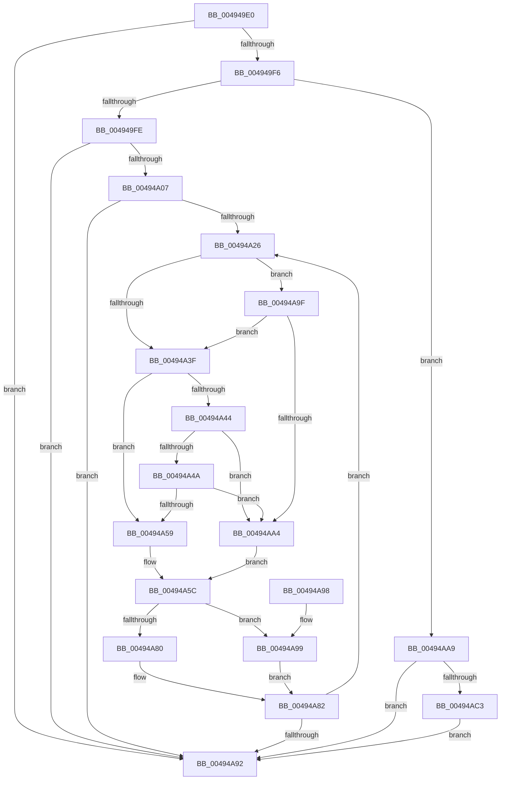

# McGenControlCallbackV2

- RVA: `0x004949E0`–`0x00494AE3` (길이 `259` bytes)
- VA: `0x00000001404949E0`
- 실행 섹션: `.text`
- PDB 이름 있음: `예`; PDB Function 태그: `아니요`
- unwind 정보 RVA: `0x00079E08`
- 디코드: `81`개 명령, `259/259` bytes 표시
- 미해석 바이트: `0` (있으면 어셈블리에 `.byte`로 보존)

> 이 문서는 커널 이미지의 기계어와 PDB 기호를 분석해 생성했습니다. 4번과 5번은 함수 원형과 자료형을 바이너리 사용 방식에서 추정한 C 해석이며 원본 소스 복구 결과는 아닙니다.

## 1. Dependencies

- 직접 호출 지점: **1**; 고유 호출 대상: **1**
- 직접 호출자로 확인된 함수: **0**
- RIP 상대 이미지 참조: **0**

### Outgoing calls
- `0x00494ADC` → [memset](../6C/memset_function_006C6C40.md) (function, `0x006C6C40`)

### Direct callers
- 이 함수 시작 RVA로 연결되는 직접 call은 확인되지 않았습니다. 간접 호출은 완전히 역산할 수 없습니다.

### Static image references
- 디코드된 RIP-relative 메모리 참조가 없습니다.

## 2. Other-region calls and transfers

- 다른 실행 섹션으로 향하는 call: **0**
- 별도 외부 분기/꼬리 이동을 확인하지 못했습니다.

## 3. Assembly (complete function range)

```asm
004949E0  40 53                           push rbx
004949E2  48 83 EC 20                     sub rsp, 0x20
004949E6  4C 8B 54 24 60                  mov r10, qword ptr [rsp + 0x60]
004949EB  33 DB                           xor ebx, ebx
004949ED  4D 85 D2                        test r10, r10
004949F0  0F 84 9C 00 00 00               je 0x140494a92
004949F6  85 D2                           test edx, edx
004949F8  0F 84 AB 00 00 00               je 0x140494aa9
004949FE  83 FA 01                        cmp edx, 1
00494A01  0F 85 8B 00 00 00               jne 0x140494a92
00494A07  48 8B 44 24 50                  mov rax, qword ptr [rsp + 0x50]
00494A0C  45 88 42 28                     mov byte ptr [r10 + 0x28], r8b
00494A10  44 8B C3                        mov r8d, ebx
00494A13  49 89 42 18                     mov qword ptr [r10 + 0x18], rax
00494A17  4D 89 4A 10                     mov qword ptr [r10 + 0x10], r9
00494A1B  41 89 52 24                     mov dword ptr [r10 + 0x24], edx
00494A1F  66 41 3B 5A 2A                  cmp bx, word ptr [r10 + 0x2a]
00494A24  73 6C                           jae 0x140494a92
00494A26  49 8B 42 38                     mov rax, qword ptr [r10 + 0x38]
00494A2A  45 8A 4A 28                     mov r9b, byte ptr [r10 + 0x28]
00494A2E  41 8B C8                        mov ecx, r8d
00494A31  48 8B 14 C8                     mov rdx, qword ptr [rax + rcx*8]
00494A35  49 8B 42 40                     mov rax, qword ptr [r10 + 0x40]
00494A39  44 38 0C 01                     cmp byte ptr [rcx + rax], r9b
00494A3D  77 60                           ja 0x140494a9f
00494A3F  48 85 D2                        test rdx, rdx
00494A42  74 15                           je 0x140494a59
00494A44  49 85 52 10                     test qword ptr [r10 + 0x10], rdx
00494A48  74 5A                           je 0x140494aa4
00494A4A  49 8B 4A 18                     mov rcx, qword ptr [r10 + 0x18]
00494A4E  48 8B C1                        mov rax, rcx
00494A51  48 23 C2                        and rax, rdx
00494A54  48 3B C1                        cmp rax, rcx
00494A57  75 4B                           jne 0x140494aa4
00494A59  41 B1 01                        mov r9b, 1
00494A5C  49 8B 42 30                     mov rax, qword ptr [r10 + 0x30]
00494A60  41 8B C8                        mov ecx, r8d
00494A63  83 E1 1F                        and ecx, 0x1f
00494A66  BA 01 00 00 00                  mov edx, 1
00494A6B  D3 E2                           shl edx, cl
00494A6D  41 8B C8                        mov ecx, r8d
00494A70  48 C1 E9 05                     shr rcx, 5
00494A74  4C 8D 1C 88                     lea r11, [rax + rcx*4]
00494A78  41 8B 03                        mov eax, dword ptr [r11]
00494A7B  45 84 C9                        test r9b, r9b
00494A7E  74 19                           je 0x140494a99
00494A80  0B D0                           or edx, eax
00494A82  41 89 13                        mov dword ptr [r11], edx
00494A85  41 FF C0                        inc r8d
00494A88  41 0F B7 42 2A                  movzx eax, word ptr [r10 + 0x2a]
00494A8D  44 3B C0                        cmp r8d, eax
00494A90  72 94                           jb 0x140494a26
00494A92  48 83 C4 20                     add rsp, 0x20
00494A96  5B                              pop rbx
00494A97  C3                              ret
00494A98  CC                              int3
00494A99  F7 D2                           not edx
00494A9B  23 D0                           and edx, eax
00494A9D  EB E3                           jmp 0x140494a82
00494A9F  45 84 C9                        test r9b, r9b
00494AA2  74 9B                           je 0x140494a3f
00494AA4  44 8A CB                        mov r9b, bl
00494AA7  EB B3                           jmp 0x140494a5c
00494AA9  41 0F B7 42 2A                  movzx eax, word ptr [r10 + 0x2a]
00494AAE  41 89 5A 24                     mov dword ptr [r10 + 0x24], ebx
00494AB2  41 88 5A 28                     mov byte ptr [r10 + 0x28], bl
00494AB6  49 89 5A 10                     mov qword ptr [r10 + 0x10], rbx
00494ABA  49 89 5A 18                     mov qword ptr [r10 + 0x18], rbx
00494ABE  66 85 C0                        test ax, ax
00494AC1  74 CF                           je 0x140494a92
00494AC3  FF C8                           dec eax
00494AC5  B9 20 00 00 00                  mov ecx, 0x20
00494ACA  99                              cdq
00494ACB  F7 F9                           idiv ecx
00494ACD  49 8B 4A 30                     mov rcx, qword ptr [r10 + 0x30]
00494AD1  33 D2                           xor edx, edx
00494AD3  FF C0                           inc eax
00494AD5  4C 63 C0                        movsxd r8, eax
00494AD8  49 C1 E0 02                     shl r8, 2
00494ADC  E8 5F 21 23 00                  call 0x1406c6c40
00494AE1  EB AF                           jmp 0x140494a92
```

## 4. C-style interpretation (structured pseudocode)

```c
__int64 __fastcall McGenControlCallbackV2(__int64 a1, int a2, unsigned __int8 a3, __int64 a4, __int64 a5, __int64 a6, __int64 a7)
{
    __int64 result;
    __int64 v_rbx;
    __int64 v_rsp;

    v_rsp = (v_rsp) - (32);
    v_rbx = 0;
    if (a7 == 0) goto loc_00494A92;
    if (a2 == 0) goto loc_00494AA9;
    if (a2 != 1) goto loc_00494A92;
    *(unsigned __int8 *)(a7 + 40) = a3;
    *(unsigned __int64 *)(a7 + 24) = a5;
    *(unsigned __int64 *)(a7 + 16) = a4;
    *(unsigned int *)(a7 + 36) = a2;
    if (0 >= (*(unsigned __int16 *)(a7 + 42))) goto loc_00494A92;
loc_00494A26:
    if ((*(unsigned __int8 *)(0 + *(unsigned __int64 *)(a7 + 64) * 1)) > ((unsigned __int8)(*(unsigned __int8 *)(a7 + 40)))) goto loc_00494A9F;
loc_00494A3F:
    if (*(unsigned __int64 *)(*(unsigned __int64 *)(a7 + 56) + 0 * 8) == 0) goto loc_00494A59;
    if (((*(unsigned __int64 *)(a7 + 16)) & (*(unsigned __int64 *)(*(unsigned __int64 *)(a7 + 56) + 0 * 8))) == 0) goto loc_00494AA4;
    result = (*(unsigned __int64 *)(a7 + 24)) & (*(unsigned __int64 *)(*(unsigned __int64 *)(a7 + 56) + 0 * 8));
    if (result != (*(unsigned __int64 *)(a7 + 24))) goto loc_00494AA4;
loc_00494A59:
loc_00494A5C:
    a1 = (unsigned int)((0) & (31));
    a2 = (unsigned int)((1) << ((unsigned __int8)(a1)));
    a1 = (0) >> (5);
    if (1 == 0) goto loc_00494A99;
    a2 = (unsigned int)((a2) | ((unsigned int)((unsigned int)(*(unsigned int *)(*(unsigned __int64 *)(a7 + 48) + a1 * 4)))));
loc_00494A82:
    *(unsigned int *)(*(unsigned __int64 *)(a7 + 48) + a1 * 4) = a2;
    a3 = (unsigned int)((0) + 1);
    if (a3 < ((unsigned int)(*(unsigned __int16 *)(a7 + 42)))) goto loc_00494A26;
loc_00494A92:
    v_rsp = (v_rsp) + (32);
    return *(unsigned __int16 *)(a7 + 42);
loc_00494A99:
    a2 = (unsigned int)(~(a2));
    a2 = (unsigned int)((a2) & ((unsigned int)(*(unsigned __int16 *)(a7 + 42))));
    goto loc_00494A82;
loc_00494A9F:
    if (1 == 0) goto loc_00494A3F;
loc_00494AA4:
    goto loc_00494A5C;
loc_00494AA9:
    *(unsigned int *)(a7 + 36) = 0;
    *(unsigned __int8 *)(a7 + 40) = 0;
    *(unsigned __int64 *)(a7 + 16) = 0;
    *(unsigned __int64 *)(a7 + 24) = 0;
    if ((unsigned __int16)(*(unsigned __int16 *)(a7 + 42)) == 0) goto loc_00494A92;
    result = (unsigned int)((*(unsigned __int16 *)(a7 + 42)) - 1);
    a2 = 0;
    result = (unsigned int)((result) + 1);
    a3 = ((int)((unsigned int)(result))) << (2);
    result = memset(*(unsigned __int64 *)(a7 + 48), a2, a3, 0);
    goto loc_00494A92;
}
```

## 5. (Beta) C Style

```c
int64_t McGenControlCallbackV2(int64_t Arg1, int32_t Arg2, uint8_t Arg3, int64_t Arg4, int64_t Arg5, uint64_t Arg6, int64_t Arg7)
{
    int64_t result;
    int64_t local_rbx;
    int64_t local_rsp;

    local_rsp = (local_rsp) - (32);
    local_rbx = 0;
    if (Arg7 == 0) goto loc_00494A92;
    if (Arg2 == 0) goto loc_00494AA9;
    if (Arg2 != 1) goto loc_00494A92;
    *(uint8_t *)(Arg7 + 0x28) = Arg3;
    *(uint64_t *)(Arg7 + 0x18) = Arg5;
    *(uint64_t *)(Arg7 + 0x10) = Arg4;
    *(uint32_t *)(Arg7 + 0x24) = Arg2;
    if (0 >= (*(uint16_t *)(Arg7 + 0x2A))) goto loc_00494A92;
loc_00494A26:
    if ((*(uint8_t *)(0 + *(uint64_t *)(Arg7 + 0x40) * 1)) > ((uint8_t)(*(uint8_t *)(Arg7 + 0x28)))) goto loc_00494A9F;
loc_00494A3F:
    if (*(uint64_t *)(*(uint64_t *)(Arg7 + 0x38) + 0x0 * 8) == 0) goto loc_00494A59;
    if (((*(uint64_t *)(Arg7 + 0x10)) & (*(uint64_t *)(*(uint64_t *)(Arg7 + 0x38) + 0x0 * 8))) == 0) goto loc_00494AA4;
    result = (*(uint64_t *)(Arg7 + 0x18)) & (*(uint64_t *)(*(uint64_t *)(Arg7 + 0x38) + 0x0 * 8));
    if (result != (*(uint64_t *)(Arg7 + 0x18))) goto loc_00494AA4;
loc_00494A59:
loc_00494A5C:
    Arg1 = (uint32_t)((0) & (31));
    Arg2 = (uint32_t)((1) << ((uint8_t)(Arg1)));
    Arg1 = (0) >> (5);
    if (1 == 0) goto loc_00494A99;
    Arg2 = (uint32_t)((Arg2) | ((uint32_t)((uint32_t)(*(uint32_t *)(*(uint64_t *)(Arg7 + 0x30) + Arg1 * 4)))));
loc_00494A82:
    *(uint32_t *)(*(uint64_t *)(Arg7 + 0x30) + Arg1 * 4) = Arg2;
    Arg3 = (uint32_t)((0) + 1);
    if (Arg3 < ((uint32_t)(*(uint16_t *)(Arg7 + 0x2A)))) goto loc_00494A26;
loc_00494A92:
    local_rsp = (local_rsp) + (32);
    return *(uint16_t *)(Arg7 + 0x2A);
loc_00494A99:
    Arg2 = (uint32_t)(~(Arg2));
    Arg2 = (uint32_t)((Arg2) & ((uint32_t)(*(uint16_t *)(Arg7 + 0x2A))));
    goto loc_00494A82;
loc_00494A9F:
    if (1 == 0) goto loc_00494A3F;
loc_00494AA4:
    goto loc_00494A5C;
loc_00494AA9:
    *(uint32_t *)(Arg7 + 0x24) = 0;
    *(uint8_t *)(Arg7 + 0x28) = 0;
    *(uint64_t *)(Arg7 + 0x10) = 0;
    *(uint64_t *)(Arg7 + 0x18) = 0;
    if ((uint16_t)(*(uint16_t *)(Arg7 + 0x2A)) == 0) goto loc_00494A92;
    result = (uint32_t)((*(uint16_t *)(Arg7 + 0x2A)) - 1);
    Arg2 = 0;
    result = (uint32_t)((result) + 1);
    Arg3 = ((int32_t)((uint32_t)(result))) << (2);
    result = memset(*(uint64_t *)(Arg7 + 0x30), Arg2, Arg3, 0);
    goto loc_00494A92;
}
```

## 6. Execution-region graph

[열기: 2D/3D 그래프와 함수 탐색 컨트롤 패널](../../../control-panel.html?section=text&rva=0x004949E0&view=graph)

- 2D 그래프는 위에서 아래로 흐르고, 3D 그래프는 빈 공간을 드래그해 회전합니다. Shift+드래그는 이동, 휠은 확대·축소, 함수 노드 선택은 대상 보고서 이동입니다.

### Static fallback


