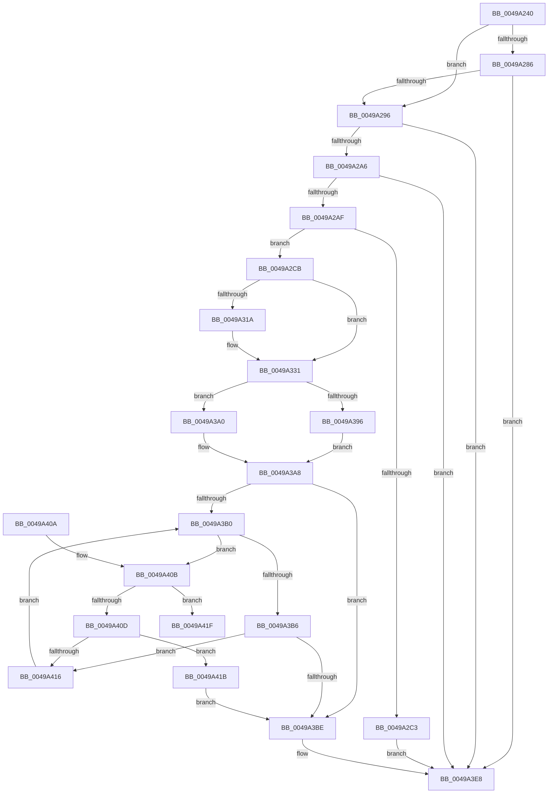

# MiAddMdlTracker

- RVA: `0x0049A240`–`0x0049A43E` (길이 `510` bytes)
- VA: `0x000000014049A240`
- 실행 섹션: `.text`
- PDB 이름 있음: `예`; PDB Function 태그: `아니요`
- unwind 정보 RVA: `0x000B4738`
- 디코드: `131`개 명령, `510/510` bytes 표시
- 미해석 바이트: `0` (있으면 어셈블리에 `.byte`로 보존)

> 이 문서는 커널 이미지의 기계어와 PDB 기호를 분석해 생성했습니다. 4번과 5번은 함수 원형과 자료형을 바이너리 사용 방식에서 추정한 C 해석이며 원본 소스 복구 결과는 아닙니다.

## 1. Dependencies

- 직접 호출 지점: **10**; 고유 호출 대상: **10**
- 직접 호출자로 확인된 함수: **4**
- RIP 상대 이미지 참조: **2**

### Outgoing calls
- `0x0049A276` → [memset](../6C/memset_function_006C6C40.md) (function, `0x006C6C40`)
- `0x0049A2B6` → [ExAllocateFromNPagedLookasideList](../38/ExAllocateFromNPagedLookasideList_function_0038E6C0.md) (function, `0x0038E6C0`)
- `0x0049A2FF` → [wyhash](../26/wyhash_function_00269FE4.md) (function, `0x00269FE4`)
- `0x0049A311` → [MiCaptureStackTraceEx](../69/MiCaptureStackTraceEx_function_0069709C.md) (function, `0x0069709C`)
- `0x0049A31A` → [MiGetInstructionPointer](../67/MiGetInstructionPointer_function_00670E88.md) (function, `0x00670E88`)
- `0x0049A399` → [ExAcquireSpinLockExclusiveAtDpcLevel](../24/ExAcquireSpinLockExclusiveAtDpcLevel_function_00248E80.md) (function, `0x00248E80`)
- `0x0049A3A0` → [ExAcquireSpinLockExclusive](../24/ExAcquireSpinLockExclusive_function_00248690.md) (function, `0x00248690`)
- `0x0049A3CE` → [RtlAvlInsertNodeEx](../26/RtlAvlInsertNodeEx_function_00265790.md) (function, `0x00265790`)
- `0x0049A3E3` → [MiReleaseSpinLockExclusive](../24/MiReleaseSpinLockExclusive_function_002482C0.md) (function, `0x002482C0`)
- `0x0049A438` → [KeBugCheckEx](../4F/KeBugCheckEx_function_004FD660.md) (function, `0x004FD660`)

### Direct callers
- [MiProbeAndLockPages](../23/MiProbeAndLockPages_function_0023B4F0.md) at `0x0023B641`
- [MmProbeAndLockPages](../23/MmProbeAndLockPages_function_0023B990.md) at `0x0023BA87`
- [MiProbeAndLockComplete](MiProbeAndLockComplete_function_0049A18C.md) at `0x0049A1EB`
- [MiSwitchToTransition](../4C/MiSwitchToTransition_function_004C0F5C.md) at `0x004C16E9`

### Static image references
- `0x0049A286` → RVA `0x00FC6AB0` (`ALMOSTRO`; read)
- `0x0049A2AF` → RVA `0x00E35D80` (`.data`; read)

## 2. Other-region calls and transfers

- 다른 실행 섹션으로 향하는 call: **0**
- 별도 외부 분기/꼬리 이동을 확인하지 못했습니다.

## 3. Assembly (complete function range)

```asm
0049A240  48 8B C4                        mov rax, rsp
0049A243  48 89 58 08                     mov qword ptr [rax + 8], rbx
0049A247  48 89 68 10                     mov qword ptr [rax + 0x10], rbp
0049A24B  48 89 70 18                     mov qword ptr [rax + 0x18], rsi
0049A24F  48 89 78 20                     mov qword ptr [rax + 0x20], rdi
0049A253  41 54                           push r12
0049A255  41 56                           push r14
0049A257  41 57                           push r15
0049A259  48 81 EC D0 00 00 00            sub rsp, 0xd0
0049A260  45 8B F8                        mov r15d, r8d
0049A263  4C 8B E2                        mov r12, rdx
0049A266  4C 8B F1                        mov r14, rcx
0049A269  33 D2                           xor edx, edx
0049A26B  41 B8 A0 00 00 00               mov r8d, 0xa0
0049A271  48 8D 4C 24 30                  lea rcx, [rsp + 0x30]
0049A276  E8 C5 C9 22 00                  call 0x1406c6c40
0049A27B  49 8B 6E 10                     mov rbp, qword ptr [r14 + 0x10]
0049A27F  33 DB                           xor ebx, ebx
0049A281  48 85 ED                        test rbp, rbp
0049A284  75 10                           jne 0x14049a296
0049A286  48 8B 2D 23 C8 B2 00            mov rbp, qword ptr [rip + 0xb2c823]
0049A28D  48 85 ED                        test rbp, rbp
0049A290  0F 84 52 01 00 00               je 0x14049a3e8
0049A296  48 8B BD 98 03 00 00            mov rdi, qword ptr [rbp + 0x398]
0049A29D  48 85 FF                        test rdi, rdi
0049A2A0  0F 84 42 01 00 00               je 0x14049a3e8
0049A2A6  39 5F 1C                        cmp dword ptr [rdi + 0x1c], ebx
0049A2A9  0F 84 39 01 00 00               je 0x14049a3e8
0049A2AF  48 8D 0D CA BA 99 00            lea rcx, [rip + 0x99baca]
0049A2B6  E8 05 44 EF FF                  call 0x14038e6c0
0049A2BB  48 8B F0                        mov rsi, rax
0049A2BE  48 85 C0                        test rax, rax
0049A2C1  75 08                           jne 0x14049a2cb
0049A2C3  89 5F 1C                        mov dword ptr [rdi + 0x1c], ebx
0049A2C6  E9 1D 01 00 00                  jmp 0x14049a3e8
0049A2CB  4C 89 70 18                     mov qword ptr [rax + 0x18], r14
0049A2CF  49 8D 4E 30                     lea rcx, [r14 + 0x30]
0049A2D3  4C 89 60 28                     mov qword ptr [rax + 0x28], r12
0049A2D7  4A 8D 14 E5 00 00 00 00         lea rdx, [r12*8]
0049A2DF  49 8B 46 20                     mov rax, qword ptr [r14 + 0x20]
0049A2E3  45 33 C0                        xor r8d, r8d
0049A2E6  48 89 46 20                     mov qword ptr [rsi + 0x20], rax
0049A2EA  41 8B 46 2C                     mov eax, dword ptr [r14 + 0x2c]
0049A2EE  89 46 30                        mov dword ptr [rsi + 0x30], eax
0049A2F1  41 8B 46 28                     mov eax, dword ptr [r14 + 0x28]
0049A2F5  89 46 34                        mov dword ptr [rsi + 0x34], eax
0049A2F8  48 8B 01                        mov rax, qword ptr [rcx]
0049A2FB  48 89 46 40                     mov qword ptr [rsi + 0x40], rax
0049A2FF  E8 E0 FC DC FF                  call 0x140269fe4
0049A304  BA 0E 00 00 00                  mov edx, 0xe
0049A309  89 46 3C                        mov dword ptr [rsi + 0x3c], eax
0049A30C  48 8D 4C 24 30                  lea rcx, [rsp + 0x30]
0049A311  E8 86 CD 1F 00                  call 0x14069709c
0049A316  85 C0                           test eax, eax
0049A318  75 17                           jne 0x14049a331
0049A31A  E8 69 6B 1D 00                  call 0x140670e88
0049A31F  48 89 44 24 30                  mov qword ptr [rsp + 0x30], rax
0049A324  48 8B 84 24 E8 00 00 00         mov rax, qword ptr [rsp + 0xe8]
0049A32C  48 89 44 24 38                  mov qword ptr [rsp + 0x38], rax
0049A331  0F 28 44 24 30                  movaps xmm0, xmmword ptr [rsp + 0x30]
0049A336  0F 11 46 48                     movups xmmword ptr [rsi + 0x48], xmm0
0049A33A  0F 28 4C 24 40                  movaps xmm1, xmmword ptr [rsp + 0x40]
0049A33F  0F 11 4E 58                     movups xmmword ptr [rsi + 0x58], xmm1
0049A343  0F 28 44 24 50                  movaps xmm0, xmmword ptr [rsp + 0x50]
0049A348  0F 11 46 68                     movups xmmword ptr [rsi + 0x68], xmm0
0049A34C  0F 28 4C 24 60                  movaps xmm1, xmmword ptr [rsp + 0x60]
0049A351  0F 11 4E 78                     movups xmmword ptr [rsi + 0x78], xmm1
0049A355  0F 28 44 24 70                  movaps xmm0, xmmword ptr [rsp + 0x70]
0049A35A  0F 11 86 88 00 00 00            movups xmmword ptr [rsi + 0x88], xmm0
0049A361  0F 28 8C 24 80 00 00 00         movaps xmm1, xmmword ptr [rsp + 0x80]
0049A369  0F 11 8E 98 00 00 00            movups xmmword ptr [rsi + 0x98], xmm1
0049A370  0F 28 84 24 90 00 00 00         movaps xmm0, xmmword ptr [rsp + 0x90]
0049A378  0F 11 86 A8 00 00 00            movups xmmword ptr [rsi + 0xa8], xmm0
0049A37F  44 89 7E 38                     mov dword ptr [rsi + 0x38], r15d
0049A383  48 89 AE B8 00 00 00            mov qword ptr [rsi + 0xb8], rbp
0049A38A  44 0F 20 C0                     mov rax, cr8
0049A38E  48 8D 4F 18                     lea rcx, [rdi + 0x18]
0049A392  3C 02                           cmp al, 2
0049A394  75 0A                           jne 0x14049a3a0
0049A396  40 B5 11                        mov bpl, 0x11
0049A399  E8 E2 EA DA FF                  call 0x140248e80
0049A39E  EB 08                           jmp 0x14049a3a8
0049A3A0  E8 EB E2 DA FF                  call 0x140248690
0049A3A5  40 8A E8                        mov bpl, al
0049A3A8  48 8B 17                        mov rdx, qword ptr [rdi]
0049A3AB  48 85 D2                        test rdx, rdx
0049A3AE  74 0E                           je 0x14049a3be
0049A3B0  4C 3B 72 18                     cmp r14, qword ptr [rdx + 0x18]
0049A3B4  73 55                           jae 0x14049a40b
0049A3B6  48 8B 02                        mov rax, qword ptr [rdx]
0049A3B9  48 85 C0                        test rax, rax
0049A3BC  75 58                           jne 0x14049a416
0049A3BE  4C 8D 77 10                     lea r14, [rdi + 0x10]
0049A3C2  4C 8B CE                        mov r9, rsi
0049A3C5  44 8A C3                        mov r8b, bl
0049A3C8  48 8B CF                        mov rcx, rdi
0049A3CB  4D 8B FE                        mov r15, r14
0049A3CE  E8 BD B3 DC FF                  call 0x140265790
0049A3D3  49 8B 0E                        mov rcx, qword ptr [r14]
0049A3D6  40 8A D5                        mov dl, bpl
0049A3D9  49 03 CC                        add rcx, r12
0049A3DC  49 89 0E                        mov qword ptr [r14], rcx
0049A3DF  48 8D 4F 18                     lea rcx, [rdi + 0x18]
0049A3E3  E8 D8 DE DA FF                  call 0x1402482c0
0049A3E8  4C 8D 9C 24 D0 00 00 00         lea r11, [rsp + 0xd0]
0049A3F0  49 8B 5B 20                     mov rbx, qword ptr [r11 + 0x20]
0049A3F4  49 8B 6B 28                     mov rbp, qword ptr [r11 + 0x28]
0049A3F8  49 8B 73 30                     mov rsi, qword ptr [r11 + 0x30]
0049A3FC  49 8B 7B 38                     mov rdi, qword ptr [r11 + 0x38]
0049A400  49 8B E3                        mov rsp, r11
0049A403  41 5F                           pop r15
0049A405  41 5E                           pop r14
0049A407  41 5C                           pop r12
0049A409  C3                              ret
0049A40A  CC                              int3
0049A40B  76 12                           jbe 0x14049a41f
0049A40D  48 8B 42 08                     mov rax, qword ptr [rdx + 8]
0049A411  48 85 C0                        test rax, rax
0049A414  74 05                           je 0x14049a41b
0049A416  48 8B D0                        mov rdx, rax
0049A419  EB 95                           jmp 0x14049a3b0
0049A41B  B3 01                           mov bl, 1
0049A41D  EB 9F                           jmp 0x14049a3be
0049A41F  48 8B 47 10                     mov rax, qword ptr [rdi + 0x10]
0049A423  4C 8B C2                        mov r8, rdx
0049A426  BA 01 00 00 00                  mov edx, 1
0049A42B  48 89 44 24 20                  mov qword ptr [rsp + 0x20], rax
0049A430  4D 8B CE                        mov r9, r14
0049A433  B9 D9 00 00 00                  mov ecx, 0xd9
0049A438  E8 23 32 06 00                  call 0x1404fd660
0049A43D  CC                              int3
```

## 4. C-style interpretation (structured pseudocode)

```c
__int64 __fastcall MiAddMdlTracker(__int64 a1, __int64 a2, int a3)
{
    __int64 result;
    __int64 v_rbx;
    __int64 v_rsp;
    unsigned __int64 v_stack_m18;
    unsigned __int64 v_stack_m58;
    unsigned __int64 v_stack_m68;
    unsigned __int64 v_stack_m78;
    unsigned __int64 v_stack_m88;
    unsigned __int64 v_stack_m98;
    unsigned __int64 v_stack_mA8;
    unsigned __int64 v_stack_mB0;
    unsigned __int64 v_stack_mB8;
    unsigned __int64 v_stack_p0;

    *(unsigned __int64 *)(v_rsp + 8) = v_rbx;
    *(unsigned __int64 *)(v_rsp + 16) = v_rbp;
    *(unsigned __int64 *)(v_rsp + 24) = v_rsi;
    *(unsigned __int64 *)(v_rsp + 32) = v_rdi;
    v_rsp = (v_rsp) - (208);
    a2 = 0;
    result = memset(v_stack_mB8, a2, 160, a4);
    v_rbx = 0;
    if (*(unsigned __int64 *)(a1 + 16) != 0) goto loc_0049A296;
    if (*(unsigned __int64 *)(v_rip + 11716643) == 0) goto loc_0049A3E8;
loc_0049A296:
    if (*(unsigned __int64 *)(*(unsigned __int64 *)(v_rip + 11716643) + 920) == 0) goto loc_0049A3E8;
    if ((*(unsigned int *)(*(unsigned __int64 *)(*(unsigned __int64 *)(v_rip + 11716643) + 920) + 28)) == 0) goto loc_0049A3E8;
    result = ExAllocateFromNPagedLookasideList(v_rip + 10074826, a2, 160, a4);
    if (result != 0) goto loc_0049A2CB;
    *(unsigned int *)(*(unsigned __int64 *)(*(unsigned __int64 *)(v_rip + 11716643) + 920) + 28) = 0;
    goto loc_0049A3E8;
loc_0049A2CB:
    *(unsigned __int64 *)(result + 24) = a1;
    *(unsigned __int64 *)(result + 40) = 0;
    a3 = 0;
    *(unsigned __int64 *)(result + 32) = *(unsigned __int64 *)(a1 + 32);
    *(unsigned int *)(result + 48) = (unsigned int)((unsigned int)(*(unsigned int *)(a1 + 44)));
    *(unsigned int *)(result + 52) = (unsigned int)((unsigned int)(*(unsigned int *)(a1 + 40)));
    *(unsigned __int64 *)(result + 64) = *(unsigned __int64 *)(a1 + 48);
    result = wyhash(a1 + 48, a2 * 8, a3, a4);
    *(unsigned int *)(result + 60) = (unsigned int)(result);
    result = MiCaptureStackTraceEx(v_stack_mB8, 14, a3, a4);
    if ((unsigned int)(result) == 0) {
        result = MiGetInstructionPointer(v_stack_mB8, 14, a3, a4);
        v_stack_mB8 = result;
        result = v_stack_p0;
        v_stack_mB0 = result;
    }
    *(unsigned __int64 *)(result + 72) = v_xmm0;
    *(unsigned __int64 *)(result + 88) = v_xmm1;
    *(unsigned __int64 *)(result + 104) = v_xmm0;
    *(unsigned __int64 *)(result + 120) = v_xmm1;
    *(unsigned __int64 *)(result + 136) = v_xmm0;
    *(unsigned __int64 *)(result + 152) = v_xmm1;
    *(unsigned __int64 *)(result + 168) = v_xmm0;
    *(unsigned int *)(result + 56) = (unsigned int)((unsigned int)(a3));
    *(unsigned __int64 *)(result + 184) = *(unsigned __int64 *)(v_rip + 11716643);
    if (((unsigned __int8)(v_cr8)) != 2) goto loc_0049A3A0;
    result = ExAcquireSpinLockExclusiveAtDpcLevel(*(unsigned __int64 *)(*(unsigned __int64 *)(v_rip + 11716643) + 920) + 24, 14, a3, a4);
    goto loc_0049A3A8;
loc_0049A3A0:
    result = ExAcquireSpinLockExclusive(*(unsigned __int64 *)(*(unsigned __int64 *)(v_rip + 11716643) + 920) + 24, 14, a3, a4);
loc_0049A3A8:
    if (*(unsigned __int64 *)(*(unsigned __int64 *)(*(unsigned __int64 *)(v_rip + 11716643) + 920)) == 0) goto loc_0049A3BE;
loc_0049A3B0:
    if (a1 >= (*(unsigned __int64 *)(*(unsigned __int64 *)(*(unsigned __int64 *)(*(unsigned __int64 *)(v_rip + 11716643) + 920)) + 24))) goto loc_0049A40B;
    if (*(unsigned __int64 *)(*(unsigned __int64 *)(*(unsigned __int64 *)(*(unsigned __int64 *)(v_rip + 11716643) + 920))) != 0) goto loc_0049A416;
loc_0049A3BE:
    result = RtlAvlInsertNodeEx(*(unsigned __int64 *)(*(unsigned __int64 *)(v_rip + 11716643) + 920), *(unsigned __int64 *)(*(unsigned __int64 *)(*(unsigned __int64 *)(v_rip + 11716643) + 920)), 0, result);
    a1 = (*(unsigned __int64 *)(*(unsigned __int64 *)(*(unsigned __int64 *)(v_rip + 11716643) + 920) + 16)) + (0);
    *(unsigned __int64 *)(*(unsigned __int64 *)(*(unsigned __int64 *)(v_rip + 11716643) + 920) + 16) = a1;
    result = MiReleaseSpinLockExclusive(*(unsigned __int64 *)(*(unsigned __int64 *)(v_rip + 11716643) + 920) + 24, (unsigned __int8)((unsigned __int8)(result)), 0, result);
loc_0049A3E8:
    return result;
loc_0049A40B:
    if (condition_is_below_or_equal) goto loc_0049A41F;
    if (*(unsigned __int64 *)((unsigned __int8)((unsigned __int8)(result)) + 8) == 0) goto loc_0049A41B;
loc_0049A416:
    goto loc_0049A3B0;
loc_0049A41B:
    goto loc_0049A3BE;
loc_0049A41F:
    v_stack_mB0 = *(unsigned __int64 *)(*(unsigned __int64 *)(v_stack_m18 + 56) + 16);
    result = KeBugCheckEx(217, 1, *(unsigned __int64 *)((unsigned __int8)((unsigned __int8)(result)) + 8), *(unsigned __int64 *)(*(unsigned __int64 *)(v_rip + 11716643) + 920) + 16);
    return result;
}
```

## 5. (Beta) C Style

```c
int64_t MiAddMdlTracker(void *Arg1, int64_t Arg2, int32_t Arg3)
{
    uint8_t *arg1 = (uint8_t *)Arg1;

    int64_t result;
    int64_t local_rbx;
    int64_t local_rsp;
    uint64_t v_stack_m18;
    uint64_t v_stack_m58;
    uint64_t v_stack_m68;
    uint64_t v_stack_m78;
    uint64_t v_stack_m88;
    uint64_t v_stack_m98;
    uint64_t v_stack_mA8;
    uint64_t v_stack_mB0;
    uint64_t v_stack_mB8;
    uint64_t v_stack_p0;

    *(uint64_t *)(local_rsp + 0x8) = local_rbx;
    *(uint64_t *)(local_rsp + 0x10) = local_rbp;
    *(uint64_t *)(local_rsp + 0x18) = local_rsi;
    *(uint64_t *)(local_rsp + 0x20) = local_rdi;
    local_rsp = (local_rsp) - (208);
    Arg2 = 0;
    result = memset(v_stack_mB8, Arg2, 160, a4);
    local_rbx = 0;
    if (*(uint64_t *)(arg1 + 0x10) != 0) goto loc_0049A296;
    if (*(uint64_t *)(v_rip + 0xB2C823) == 0) goto loc_0049A3E8;
loc_0049A296:
    if (*(uint64_t *)(*(uint64_t *)(v_rip + 0xB2C823) + 0x398) == 0) goto loc_0049A3E8;
    if ((*(uint32_t *)(*(uint64_t *)(*(uint64_t *)(v_rip + 0xB2C823) + 0x398) + 0x1C)) == 0) goto loc_0049A3E8;
    result = ExAllocateFromNPagedLookasideList(v_rip + 10074826, Arg2, 160, a4);
    if (result != 0) goto loc_0049A2CB;
    *(uint32_t *)(*(uint64_t *)(*(uint64_t *)(v_rip + 0xB2C823) + 0x398) + 0x1C) = 0;
    goto loc_0049A3E8;
loc_0049A2CB:
    *(void **)(result + 0x18) = Arg1;
    *(uint64_t *)(result + 0x28) = 0;
    Arg3 = 0;
    *(uint64_t *)(result + 0x20) = *(uint64_t *)(arg1 + 0x20);
    *(uint32_t *)(result + 0x30) = (uint32_t)((uint32_t)(*(uint32_t *)(arg1 + 0x2C)));
    *(uint32_t *)(result + 0x34) = (uint32_t)((uint32_t)(*(uint32_t *)(arg1 + 0x28)));
    *(uint64_t *)(result + 0x40) = *(uint64_t *)(arg1 + 0x30);
    result = wyhash(Arg1 + 48, Arg2 * 8, Arg3, a4);
    *(uint32_t *)(result + 0x3C) = (uint32_t)(result);
    result = MiCaptureStackTraceEx(v_stack_mB8, 14, Arg3, a4);
    if ((uint32_t)(result) == 0) {
        result = MiGetInstructionPointer(v_stack_mB8, 14, Arg3, a4);
        v_stack_mB8 = result;
        result = v_stack_p0;
        v_stack_mB0 = result;
    }
    *(uint64_t *)(result + 0x48) = v_xmm0;
    *(uint64_t *)(result + 0x58) = v_xmm1;
    *(uint64_t *)(result + 0x68) = v_xmm0;
    *(uint64_t *)(result + 0x78) = v_xmm1;
    *(uint64_t *)(result + 0x88) = v_xmm0;
    *(uint64_t *)(result + 0x98) = v_xmm1;
    *(uint64_t *)(result + 0xA8) = v_xmm0;
    *(uint32_t *)(result + 0x38) = (uint32_t)((uint32_t)(Arg3));
    *(uint64_t *)(result + 0xB8) = *(uint64_t *)(v_rip + 0xB2C823);
    if (((uint8_t)(v_cr8)) != 2) goto loc_0049A3A0;
    result = ExAcquireSpinLockExclusiveAtDpcLevel(*(uint64_t *)(*(uint64_t *)(v_rip + 0xB2C823) + 0x398) + 24, 14, Arg3, a4);
    goto loc_0049A3A8;
loc_0049A3A0:
    result = ExAcquireSpinLockExclusive(*(uint64_t *)(*(uint64_t *)(v_rip + 0xB2C823) + 0x398) + 24, 14, Arg3, a4);
loc_0049A3A8:
    if (*(uint64_t *)(*(uint64_t *)(*(uint64_t *)(v_rip + 0xB2C823) + 0x398)) == 0) goto loc_0049A3BE;
loc_0049A3B0:
    if (Arg1 >= (*(uint64_t *)(*(uint64_t *)(*(uint64_t *)(*(uint64_t *)(v_rip + 0xB2C823) + 0x398)) + 0x18))) goto loc_0049A40B;
    if (*(uint64_t *)(*(uint64_t *)(*(uint64_t *)(*(uint64_t *)(v_rip + 0xB2C823) + 0x398))) != 0) goto loc_0049A416;
loc_0049A3BE:
    result = RtlAvlInsertNodeEx(*(uint64_t *)(*(uint64_t *)(v_rip + 0xB2C823) + 0x398), *(uint64_t *)(*(uint64_t *)(*(uint64_t *)(v_rip + 0xB2C823) + 0x398)), 0, result);
    Arg1 = (*(uint64_t *)(*(uint64_t *)(*(uint64_t *)(v_rip + 0xB2C823) + 0x398) + 0x10)) + (0);
    *(void **)(*(uint64_t *)(*(uint64_t *)(v_rip + 0xB2C823) + 0x398) + 0x10) = Arg1;
    result = MiReleaseSpinLockExclusive(*(uint64_t *)(*(uint64_t *)(v_rip + 0xB2C823) + 0x398) + 24, (uint8_t)((uint8_t)(result)), 0, result);
loc_0049A3E8:
    return result;
loc_0049A40B:
    if (condition_is_below_or_equal) goto loc_0049A41F;
    if (*(uint64_t *)((uint8_t)((uint8_t)(result)) + 0x8) == 0) goto loc_0049A41B;
loc_0049A416:
    goto loc_0049A3B0;
loc_0049A41B:
    goto loc_0049A3BE;
loc_0049A41F:
    v_stack_mB0 = *(uint64_t *)(*(uint64_t *)(v_stack_m18 + 0x38) + 0x10);
    result = KeBugCheckEx(217, 1, *(uint64_t *)((uint8_t)((uint8_t)(result)) + 0x8), *(uint64_t *)(*(uint64_t *)(v_rip + 0xB2C823) + 0x398) + 16);
    return result;
}
```

### 관측된 메모리 오프셋

구조체 형식이 확인되지 않은 접근은 인자 기준의 오프셋으로만 기록했습니다.

| 기준 인자 | 오프셋 표현 | 폭 (bit) | 접근 |
|---|---:|---:|---|
| `Arg1` | `+ 0x0` | `64` | `R` |
| `Arg1` | `+ 0x10` | `64` | `R` |
| `Arg1` | `+ 0x20` | `64` | `R` |
| `Arg1` | `+ 0x28` | `32` | `R` |
| `Arg1` | `+ 0x2C` | `32` | `R` |
| `Arg1` | `+ 0x30` | `64` | `R` |

## 6. Execution-region graph

[열기: 2D/3D 그래프와 함수 탐색 컨트롤 패널](../../../control-panel.html?section=text&rva=0x0049A240&view=graph)

- 2D 그래프는 위에서 아래로 흐르고, 3D 그래프는 빈 공간을 드래그해 회전합니다. Shift+드래그는 이동, 휠은 확대·축소, 함수 노드 선택은 대상 보고서 이동입니다.

### Static fallback


