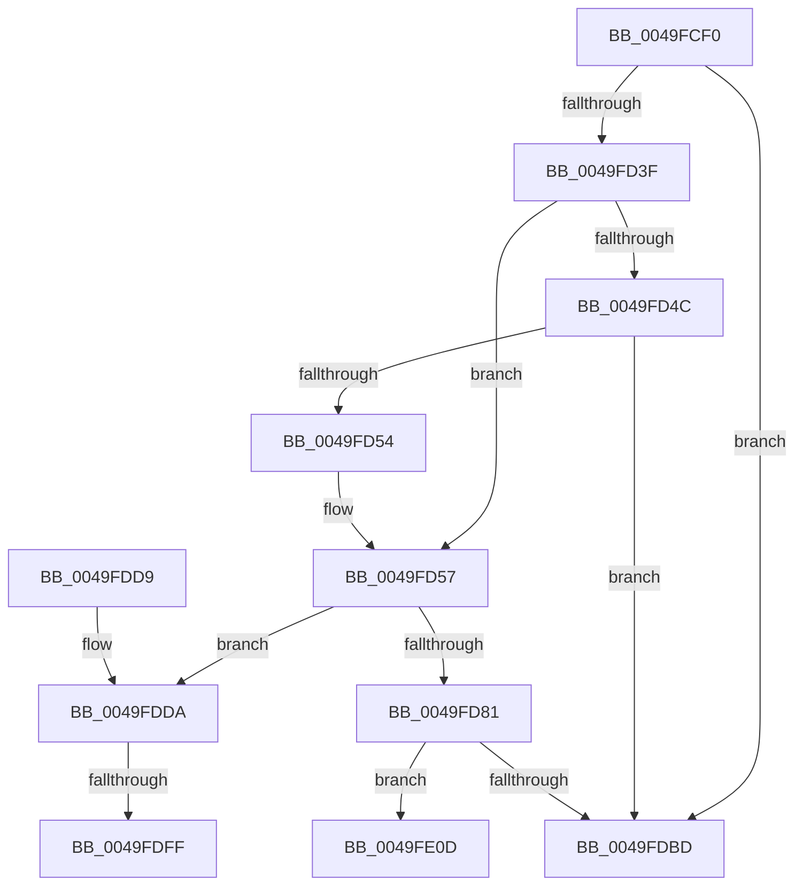

# MiCheckMdlSlabFragmentation

- RVA: `0x0049FCF0`–`0x0049FE1E` (길이 `302` bytes)
- VA: `0x000000014049FCF0`
- 실행 섹션: `.text`
- PDB 이름 있음: `예`; PDB Function 태그: `예`
- unwind 정보 RVA: `0x000B5684`
- 디코드: `80`개 명령, `302/302` bytes 표시
- 미해석 바이트: `0` (있으면 어셈블리에 `.byte`로 보존)

> 이 문서는 커널 이미지의 기계어와 PDB 기호를 분석해 생성했습니다. 4번과 5번은 함수 원형과 자료형을 바이너리 사용 방식에서 추정한 C 해석이며 원본 소스 복구 결과는 아닙니다.

## 1. Dependencies

- 직접 호출 지점: **0**; 고유 호출 대상: **0**
- 직접 호출자로 확인된 함수: **2**
- RIP 상대 이미지 참조: **1**

### Outgoing calls
- 직접 디코드된 call 명령이 없습니다.

### Direct callers
- [MiFreeUnusedSlabPages](../2D/MiFreeUnusedSlabPages_function_002DAE48.md) at `0x002DAED2`
- [MiDemoteSlabEntriesDpc](../44/MiDemoteSlabEntriesDpc_function_0044C3C0.md) at `0x0044C6AD`

### Static image references
- `0x0049FD15` → RVA `0x00011C60` (`.rdata`; read)

## 2. Other-region calls and transfers

- 다른 실행 섹션으로 향하는 call: **0**
- call이 아닌 외부 분기/꼬리 이동: **3**
  - `0x0049FDF9` → [sub_006F8400](../6F/Unknown_function_006F8400.md) (`tail-transfer`)
  - `0x0049FE08` → [sub_006F8400 + 0x28](../6F/Unknown_function_006F8400.md) (`tail-transfer`)
  - `0x0049FE19` → [sub_006F8400 + 0x63](../6F/Unknown_function_006F8400.md) (`tail-transfer`)

## 3. Assembly (complete function range)

```asm
0049FCF0  48 89 5C 24 10                  mov qword ptr [rsp + 0x10], rbx
0049FCF5  48 89 6C 24 18                  mov qword ptr [rsp + 0x18], rbp
0049FCFA  48 89 74 24 20                  mov qword ptr [rsp + 0x20], rsi
0049FCFF  57                              push rdi
0049FD00  41 56                           push r14
0049FD02  41 57                           push r15
0049FD04  48 83 EC 20                     sub rsp, 0x20
0049FD08  8B 81 88 00 00 00               mov eax, dword ptr [rcx + 0x88]
0049FD0E  48 8B D9                        mov rbx, rcx
0049FD11  48 C1 E8 04                     shr rax, 4
0049FD15  48 8D 0D 44 1F B7 FF            lea rcx, [rip - 0x48e0bc]
0049FD1C  83 E0 03                        and eax, 3
0049FD1F  45 33 D2                        xor r10d, r10d
0049FD22  8B EA                           mov ebp, edx
0049FD24  44 89 54 24 40                  mov dword ptr [rsp + 0x40], r10d
0049FD29  41 BB 00 5E D0 B2               mov r11d, 0xb2d05e00
0049FD2F  8B 04 C1                        mov eax, dword ptr [rcx + rax*8]
0049FD32  48 8B 4B 78                     mov rcx, qword ptr [rbx + 0x78]
0049FD36  48 0F AF C8                     imul rcx, rax
0049FD3A  48 85 C9                        test rcx, rcx
0049FD3D  74 7E                           je 0x14049fdbd
0049FD3F  48 8B 7B 60                     mov rdi, qword ptr [rbx + 0x60]
0049FD43  48 8B 53 68                     mov rdx, qword ptr [rbx + 0x68]
0049FD47  48 85 D2                        test rdx, rdx
0049FD4A  74 0B                           je 0x14049fd57
0049FD4C  48 03 C2                        add rax, rdx
0049FD4F  48 3B F8                        cmp rdi, rax
0049FD52  72 69                           jb 0x14049fdbd
0049FD54  48 2B FA                        sub rdi, rdx
0049FD57  48 8B 73 18                     mov rsi, qword ptr [rbx + 0x18]
0049FD5B  49 BF CD CC CC CC CC CC CC CC   movabs r15, 0xcccccccccccccccd
0049FD65  49 8B C7                        mov rax, r15
0049FD68  41 B8 0A 00 00 00               mov r8d, 0xa
0049FD6E  4C 8B 8E 00 49 00 00            mov r9, qword ptr [rsi + 0x4900]
0049FD75  49 F7 E1                        mul r9
0049FD78  48 C1 EA 03                     shr rdx, 3
0049FD7C  48 3B FA                        cmp rdi, rdx
0049FD7F  73 59                           jae 0x14049fdda
0049FD81  33 D2                           xor edx, edx
0049FD83  48 6B C7 64                     imul rax, rdi, 0x64
0049FD87  48 F7 F1                        div rcx
0049FD8A  4C 8B C8                        mov r9, rax
0049FD8D  48 B8 77 BE 9F 1A 2F DD 24 06   movabs rax, 0x624dd2f1a9fbe77
0049FD97  48 F7 E1                        mul rcx
0049FD9A  41 8B C0                        mov eax, r8d
0049FD9D  48 2B CA                        sub rcx, rdx
0049FDA0  48 D1 E9                        shr rcx, 1
0049FDA3  48 03 CA                        add rcx, rdx
0049FDA6  48 C1 E9 0F                     shr rcx, 0xf
0049FDAA  48 2B C1                        sub rax, rcx
0049FDAD  48 8D 0C 80                     lea rcx, [rax + rax*4]
0049FDB1  49 3B C8                        cmp rcx, r8
0049FDB4  49 0F 4C C8                     cmovl rcx, r8
0049FDB8  4C 3B C9                        cmp r9, rcx
0049FDBB  77 50                           ja 0x14049fe0d
0049FDBD  48 8B 5C 24 48                  mov rbx, qword ptr [rsp + 0x48]
0049FDC2  41 8B C2                        mov eax, r10d
0049FDC5  48 8B 6C 24 50                  mov rbp, qword ptr [rsp + 0x50]
0049FDCA  48 8B 74 24 58                  mov rsi, qword ptr [rsp + 0x58]
0049FDCF  48 83 C4 20                     add rsp, 0x20
0049FDD3  41 5F                           pop r15
0049FDD5  41 5E                           pop r14
0049FDD7  5F                              pop rdi
0049FDD8  C3                              ret
0049FDD9  CC                              int3
0049FDDA  48 8B B6 50 48 00 00            mov rsi, qword ptr [rsi + 0x4850]
0049FDE1  49 8B C7                        mov rax, r15
0049FDE4  48 F7 E6                        mul rsi
0049FDE7  44 88 44 24 40                  mov byte ptr [rsp + 0x40], r8b
0049FDEC  41 BE 00 A3 E1 11               mov r14d, 0x11e1a300
0049FDF2  48 C1 EA 03                     shr rdx, 3
0049FDF6  4C 3B CA                        cmp r9, rdx
0049FDF9  0F 87 01 86 25 00               ja 0x1406f8400
0049FDFF  41 BB 00 E1 F5 05               mov r11d, 0x5f5e100
0049FE05  41 B0 0B                        mov r8b, 0xb
0049FE08  E9 1B 86 25 00                  jmp 0x1406f8428
0049FE0D  41 B0 64                        mov r8b, 0x64
0049FE10  44 88 4C 24 42                  mov byte ptr [rsp + 0x42], r9b
0049FE15  88 4C 24 43                     mov byte ptr [rsp + 0x43], cl
0049FE19  E9 45 86 25 00                  jmp 0x1406f8463
```

## 4. C-style interpretation (structured pseudocode)

```c
__int64 __fastcall MiCheckMdlSlabFragmentation(__int64 a1, int a2)
{
    __int64 result;
    __int64 v_r10;
    __int64 v_rdi;
    __int64 v_rsp;
    unsigned __int64 v_stack_p10;
    unsigned __int64 v_stack_p18;
    unsigned __int64 v_stack_p20;
    unsigned __int8 v_stack_p40;
    unsigned __int8 v_stack_p42;
    unsigned __int8 v_stack_p43;
    unsigned int v_stack_p8;

    v_stack_p10 = v_rbx;
    v_stack_p18 = v_rbp;
    v_stack_p20 = v_rsi;
    v_rsp = (v_rsp) - (32);
    result = ((unsigned int)(*(unsigned int *)(a1 + 136))) >> (4);
    result = (unsigned int)((result) & (3));
    v_r10 = 0;
    v_stack_p8 = 0;
    a1 = (*(unsigned __int64 *)(a1 + 120)) * ((unsigned int)(*(unsigned int *)(v_rip - 4776124 + result * 8)));
    if (a1 == 0) goto loc_0049FDBD;
    if (*(unsigned __int64 *)(a1 + 104) == 0) goto loc_0049FD57;
    result = ((unsigned int)(*(unsigned int *)(v_rip - 4776124 + result * 8))) + (*(unsigned __int64 *)(a1 + 104));
    if ((*(unsigned __int64 *)(a1 + 96)) < result) goto loc_0049FDBD;
    v_rdi = (*(unsigned __int64 *)(a1 + 96)) - (*(unsigned __int64 *)(a1 + 104));
loc_0049FD57:
    a2 = (*(unsigned __int64 *)(a1 + 104)) >> (3);
    if (v_rdi >= a2) goto loc_0049FDDA;
    a2 = 0;
    result = (v_r15) * (v_rdi);
    a1 = (a1) - (0);
    a1 = (a1) >> (1);
    a1 = (a1) + (0);
    a1 = (a1) >> (15);
    result = (10) - (a1);
    a1 = result + result * 4;
    if ((result + result * 4) < 10) { a1 = 10; }
    if (result > a1) goto loc_0049FE0D;
loc_0049FDBD:
    v_rsp = (v_rsp) + (32);
    return 0;
loc_0049FDDA:
    v_stack_p40 = 10;
    a2 = (a2) >> (3);
loc_0049FE0D:
    v_stack_p42 = (unsigned __int8)(result);
    v_stack_p43 = (unsigned __int8)(a1);
}
```

## 5. (Beta) C Style

```c
int64_t MiCheckMdlSlabFragmentation(void *Arg1, int32_t Arg2)
{
    uint8_t *arg1 = (uint8_t *)Arg1;

    int64_t result;
    int64_t local_r10;
    int64_t local_rdi;
    int64_t local_rsp;
    uint64_t v_stack_p10;
    uint64_t v_stack_p18;
    uint64_t v_stack_p20;
    uint8_t v_stack_p40;
    uint8_t v_stack_p42;
    uint8_t v_stack_p43;
    uint32_t v_stack_p8;

    v_stack_p10 = local_rbx;
    v_stack_p18 = local_rbp;
    v_stack_p20 = local_rsi;
    local_rsp = (local_rsp) - (32);
    result = ((uint32_t)(*(uint32_t *)(arg1 + 0x88))) >> (4);
    result = (uint32_t)((result) & (3));
    local_r10 = 0;
    v_stack_p8 = 0;
    Arg1 = (*(uint64_t *)(arg1 + 0x78)) * ((uint32_t)(*(uint32_t *)(v_rip - 0x48E0BC + result * 8)));
    if (Arg1 == NULL) goto loc_0049FDBD;
    if (*(uint64_t *)(arg1 + 0x68) == 0) goto loc_0049FD57;
    result = ((uint32_t)(*(uint32_t *)(v_rip - 0x48E0BC + result * 8))) + (*(uint64_t *)(arg1 + 0x68));
    if ((*(uint64_t *)(arg1 + 0x60)) < result) goto loc_0049FDBD;
    local_rdi = (*(uint64_t *)(arg1 + 0x60)) - (*(uint64_t *)(arg1 + 0x68));
loc_0049FD57:
    Arg2 = (*(uint64_t *)(arg1 + 0x68)) >> (3);
    if (local_rdi >= Arg2) goto loc_0049FDDA;
    Arg2 = 0;
    result = (local_r15) * (local_rdi);
    Arg1 = (Arg1) - (0);
    Arg1 = (Arg1) >> (1);
    Arg1 = (Arg1) + (0);
    Arg1 = (Arg1) >> (15);
    result = (10) - (Arg1);
    Arg1 = result + result * 4;
    if ((result + result * 4) < 10) { Arg1 = 10; }
    if (result > Arg1) goto loc_0049FE0D;
loc_0049FDBD:
    local_rsp = (local_rsp) + (32);
    return 0;
loc_0049FDDA:
    v_stack_p40 = 10;
    Arg2 = (Arg2) >> (3);
loc_0049FE0D:
    v_stack_p42 = (uint8_t)(result);
    v_stack_p43 = (uint8_t)(Arg1);
}
```

### 관측된 메모리 오프셋

구조체 형식이 확인되지 않은 접근은 인자 기준의 오프셋으로만 기록했습니다.

| 기준 인자 | 오프셋 표현 | 폭 (bit) | 접근 |
|---|---:|---:|---|
| `Arg1` | `+ 0x18` | `64` | `R` |
| `Arg1` | `+ 0x60` | `64` | `R` |
| `Arg1` | `+ 0x68` | `64` | `R` |
| `Arg1` | `+ 0x78` | `64` | `R` |
| `Arg1` | `+ 0x88` | `32` | `R` |

## 6. Execution-region graph

[열기: 2D/3D 그래프와 함수 탐색 컨트롤 패널](../../../control-panel.html?section=text&rva=0x0049FCF0&view=graph)

- 2D 그래프는 위에서 아래로 흐르고, 3D 그래프는 빈 공간을 드래그해 회전합니다. Shift+드래그는 이동, 휠은 확대·축소, 함수 노드 선택은 대상 보고서 이동입니다.

### Static fallback


