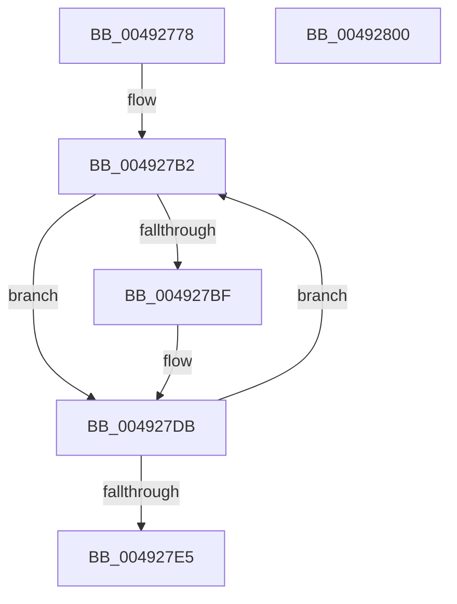

# MiCleanCfg

- RVA: `0x00492778`–`0x00492801` (길이 `137` bytes)
- VA: `0x0000000140492778`
- 실행 섹션: `.text`
- PDB 이름 있음: `예`; PDB Function 태그: `아니요`
- unwind 정보 RVA: `0x0005E6B4`
- 디코드: `32`개 명령, `137/137` bytes 표시
- 미해석 바이트: `0` (있으면 어셈블리에 `.byte`로 보존)

> 이 문서는 커널 이미지의 기계어와 PDB 기호를 분석해 생성했습니다. 4번과 5번은 함수 원형과 자료형을 바이너리 사용 방식에서 추정한 C 해석이며 원본 소스 복구 결과는 아닙니다.

## 1. Dependencies

- 직접 호출 지점: **2**; 고유 호출 대상: **2**
- 직접 호출자로 확인된 함수: **1**
- RIP 상대 이미지 참조: **0**

### Outgoing calls
- `0x004927C5` → [MiLockVadShared](../31/MiLockVadShared_function_00316DE0.md) (function, `0x00316DE0`)
- `0x004927CD` → [MiUnlockAndDereferenceVadShared](../2A/MiUnlockAndDereferenceVadShared_function_002AEF10.md) (function, `0x002AEF10`)

### Direct callers
- [MmCleanProcessAddressSpace](../../page/A1/MmCleanProcessAddressSpace_function_00A17EC0.md) at `0x00A1804F`

### Static image references
- 디코드된 RIP-relative 메모리 참조가 없습니다.

## 2. Other-region calls and transfers

- 다른 실행 섹션으로 향하는 call: **0**
- 별도 외부 분기/꼬리 이동을 확인하지 못했습니다.

## 3. Assembly (complete function range)

```asm
00492778  48 8B C4                        mov rax, rsp
0049277B  48 89 58 08                     mov qword ptr [rax + 8], rbx
0049277F  48 89 68 10                     mov qword ptr [rax + 0x10], rbp
00492783  48 89 70 18                     mov qword ptr [rax + 0x18], rsi
00492787  48 89 78 20                     mov qword ptr [rax + 0x20], rdi
0049278B  41 56                           push r14
0049278D  48 83 EC 20                     sub rsp, 0x20
00492791  65 4C 8B 34 25 88 01 00 00      mov r14, qword ptr gs:[0x188]
0049279A  BB A0 01 00 00                  mov ebx, 0x1a0
0049279F  BE 02 00 00 00                  mov esi, 2
004927A4  49 8B 86 B8 00 00 00            mov rax, qword ptr [r14 + 0xb8]
004927AB  48 8B B8 10 04 00 00            mov rdi, qword ptr [rax + 0x410]
004927B2  48 8B AC 3B 10 03 00 00         mov rbp, qword ptr [rbx + rdi + 0x310]
004927BA  48 85 ED                        test rbp, rbp
004927BD  74 1C                           je 0x1404927db
004927BF  48 8B D5                        mov rdx, rbp
004927C2  49 8B CE                        mov rcx, r14
004927C5  E8 16 46 E8 FF                  call 0x140316de0
004927CA  48 8B CD                        mov rcx, rbp
004927CD  E8 3E C7 E1 FF                  call 0x1402aef10
004927D2  48 83 A4 3B 10 03 00 00 00      and qword ptr [rbx + rdi + 0x310], 0
004927DB  48 83 C3 20                     add rbx, 0x20
004927DF  48 83 EE 01                     sub rsi, 1
004927E3  75 CD                           jne 0x1404927b2
004927E5  48 8B 5C 24 30                  mov rbx, qword ptr [rsp + 0x30]
004927EA  48 8B 6C 24 38                  mov rbp, qword ptr [rsp + 0x38]
004927EF  48 8B 74 24 40                  mov rsi, qword ptr [rsp + 0x40]
004927F4  48 8B 7C 24 48                  mov rdi, qword ptr [rsp + 0x48]
004927F9  48 83 C4 20                     add rsp, 0x20
004927FD  41 5E                           pop r14
004927FF  C3                              ret
00492800  CC                              int3
```

## 4. C-style interpretation (structured pseudocode)

```c
__int64 __fastcall MiCleanCfg(void)
{
    __int64 result;
    __int64 v_rbx;
    __int64 v_rsi;
    __int64 v_rsp;
    unsigned __int64 v_stack_p10;
    unsigned __int64 v_stack_p18;
    unsigned __int64 v_stack_p20;
    unsigned __int64 v_stack_p8;

    *(unsigned __int64 *)(v_rsp + 8) = v_rbx;
    *(unsigned __int64 *)(v_rsp + 16) = v_rbp;
    *(unsigned __int64 *)(v_rsp + 24) = v_rsi;
    *(unsigned __int64 *)(v_rsp + 32) = v_rdi;
    v_rsp = (v_rsp) - (32);
loc_004927B2:
    result = *(unsigned __int64 *)(*(unsigned __int64 *)(gs_base + (0 + 392)) + 184);
    if (*(unsigned __int64 *)(416 + *(unsigned __int64 *)(*(unsigned __int64 *)(*(unsigned __int64 *)(gs_base + (0 + 392)) + 184) + 1040) * 1 + 784) != 0) {
        a2 = *(unsigned __int64 *)(416 + *(unsigned __int64 *)(*(unsigned __int64 *)(*(unsigned __int64 *)(gs_base + (0 + 392)) + 184) + 1040) * 1 + 784);
        a1 = *(unsigned __int64 *)(gs_base + (0 + 392));
        result = MiLockVadShared(a1, a2, a3, a4);
        a1 = *(unsigned __int64 *)(416 + *(unsigned __int64 *)(*(unsigned __int64 *)(*(unsigned __int64 *)(gs_base + (0 + 392)) + 184) + 1040) * 1 + 784);
        result = MiUnlockAndDereferenceVadShared(a1, a2, a3, a4);
    }
    v_rbx = (416) + (32);
    v_rsi = (2) - (1);
    if (condition_is_not_equal) goto loc_004927B2;
    v_rsp = (v_rsp) + (32);
    return result;
}
```

## 5. (Beta) C Style

```c
void MiCleanCfg(void)
{
    int64_t result;
    int64_t local_rbx;
    int64_t local_rsi;
    int64_t local_rsp;
    uint64_t v_stack_p10;
    uint64_t v_stack_p18;
    uint64_t v_stack_p20;
    uint64_t v_stack_p8;

    *(uint64_t *)(local_rsp + 0x8) = local_rbx;
    *(uint64_t *)(local_rsp + 0x10) = local_rbp;
    *(uint64_t *)(local_rsp + 0x18) = local_rsi;
    *(uint64_t *)(local_rsp + 0x20) = local_rdi;
    local_rsp = (local_rsp) - (32);
loc_004927B2:
    result = *(uint64_t *)(*(uint64_t *)(gs_base + (0 + 0x188)) + 0xB8);
    if (*(uint64_t *)(416 + *(uint64_t *)(*(uint64_t *)(*(uint64_t *)(gs_base + (0 + 0x188)) + 0xB8) + 0x410) * 1 + 0x310) != 0) {
        a2 = *(uint64_t *)(416 + *(uint64_t *)(*(uint64_t *)(*(uint64_t *)(gs_base + (0 + 0x188)) + 0xB8) + 0x410) * 1 + 0x310);
        a1 = *(uint64_t *)(gs_base + (0 + 0x188));
        result = MiLockVadShared(a1, a2, a3, a4);
        a1 = *(uint64_t *)(416 + *(uint64_t *)(*(uint64_t *)(*(uint64_t *)(gs_base + (0 + 0x188)) + 0xB8) + 0x410) * 1 + 0x310);
        result = MiUnlockAndDereferenceVadShared(a1, a2, a3, a4);
    }
    local_rbx = (416) + (32);
    local_rsi = (2) - (1);
    if (condition_is_not_equal) goto loc_004927B2;
    local_rsp = (local_rsp) + (32);
    return result;
}
```

## 6. Execution-region graph

[열기: 2D/3D 그래프와 함수 탐색 컨트롤 패널](../../../control-panel.html?section=text&rva=0x00492778&view=graph)

- 2D 그래프는 위에서 아래로 흐르고, 3D 그래프는 빈 공간을 드래그해 회전합니다. Shift+드래그는 이동, 휠은 확대·축소, 함수 노드 선택은 대상 보고서 이동입니다.

### Static fallback


