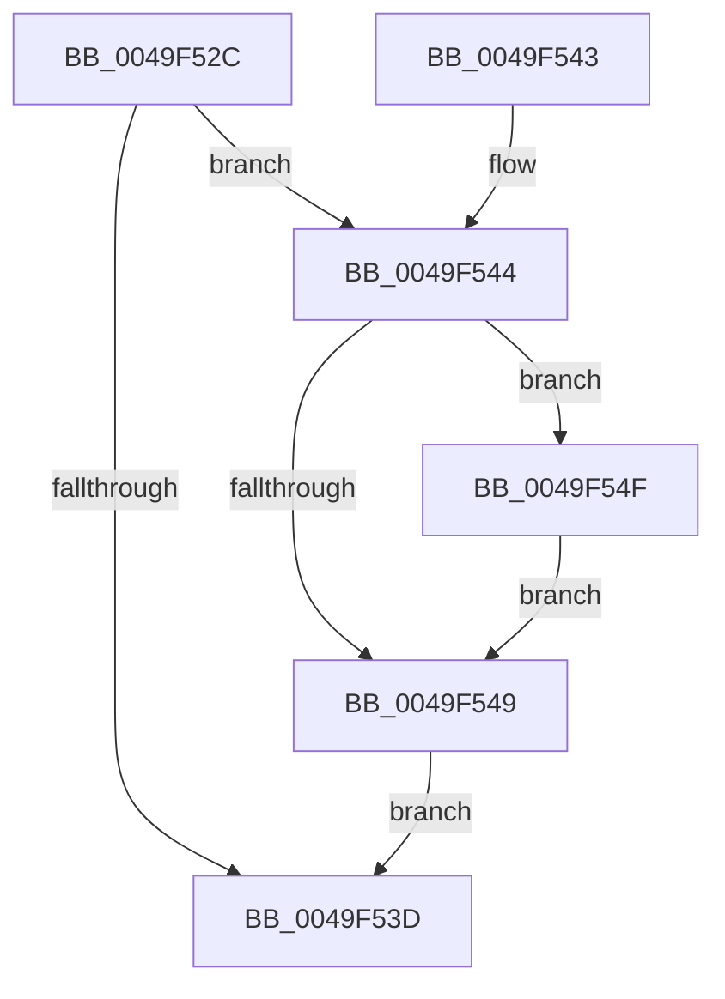

# MiCleanupBestCandidatesContext

- RVA: `0x0049F52C`–`0x0049F558` (길이 `44` bytes)
- VA: `0x000000014049F52C`
- 실행 섹션: `.text`
- PDB 이름 있음: `예`; PDB Function 태그: `아니요`
- unwind 정보 RVA: `0x00060A68`
- 디코드: `17`개 명령, `44/44` bytes 표시
- 미해석 바이트: `0` (있으면 어셈블리에 `.byte`로 보존)

> 이 문서는 커널 이미지의 기계어와 PDB 기호를 분석해 생성했습니다. 4번과 5번은 함수 원형과 자료형을 바이너리 사용 방식에서 추정한 C 해석이며 원본 소스 복구 결과는 아닙니다.

## 1. Dependencies

- 직접 호출 지점: **1**; 고유 호출 대상: **1**
- 직접 호출자로 확인된 함수: **1**
- RIP 상대 이미지 참조: **0**

### Outgoing calls
- `0x0049F551` → [ExFreePoolWithTag](../../poolcode/B8/ExFreePoolWithTag_function_00B82870.md) (function, `0x00B82870`)

### Direct callers
- [MiFindLargePageMemory](../../page/AA/MiFindLargePageMemory_function_00AA8334.md) at `0x00AA860B`
- [MiFindLargePageMemory](../../page/AA/MiFindLargePageMemory_function_00AA8334.md) at `0x00AA8666`

### Static image references
- 디코드된 RIP-relative 메모리 참조가 없습니다.

## 2. Other-region calls and transfers

- 다른 실행 섹션으로 향하는 call: **1**
  - `0x0049F551` → [ExFreePoolWithTag](../../poolcode/B8/ExFreePoolWithTag_function_00B82870.md) (`.text` → `POOLCODE`)
- 별도 외부 분기/꼬리 이동을 확인하지 못했습니다.

## 3. Assembly (complete function range)

```asm
0049F52C  40 53                           push rbx
0049F52E  48 83 EC 20                     sub rsp, 0x20
0049F532  48 8B D9                        mov rbx, rcx
0049F535  48 8B 09                        mov rcx, qword ptr [rcx]
0049F538  48 85 C9                        test rcx, rcx
0049F53B  75 07                           jne 0x14049f544
0049F53D  48 83 C4 20                     add rsp, 0x20
0049F541  5B                              pop rbx
0049F542  C3                              ret
0049F543  CC                              int3
0049F544  48 3B CA                        cmp rcx, rdx
0049F547  75 06                           jne 0x14049f54f
0049F549  48 83 23 00                     and qword ptr [rbx], 0
0049F54D  EB EE                           jmp 0x14049f53d
0049F54F  33 D2                           xor edx, edx
0049F551  E8 1A 33 6E 00                  call 0x140b82870
0049F556  EB F1                           jmp 0x14049f549
```

## 4. C-style interpretation (structured pseudocode)

```c
__int64 __fastcall MiCleanupBestCandidatesContext(__int64 a1, __int64 a2)
{
    __int64 result;
    __int64 v_rsp;

    v_rsp = (v_rsp) - (32);
    if (*(unsigned __int64 *)(a1) != 0) goto loc_0049F544;
loc_0049F53D:
    v_rsp = (v_rsp) + (32);
    return result;
loc_0049F544:
    if ((*(unsigned __int64 *)(a1)) != a2) goto loc_0049F54F;
loc_0049F549:
    goto loc_0049F53D;
loc_0049F54F:
    a2 = 0;
    result = ExFreePoolWithTag(*(unsigned __int64 *)(a1), a2, a3, a4);
    goto loc_0049F549;
}
```

## 5. (Beta) C Style

```c
int64_t MiCleanupBestCandidatesContext(void *Arg1, int64_t Arg2)
{
    uint8_t *arg1 = (uint8_t *)Arg1;

    int64_t result;
    int64_t local_rsp;

    local_rsp = (local_rsp) - (32);
    if (*(uint64_t *)(arg1) != 0) goto loc_0049F544;
loc_0049F53D:
    local_rsp = (local_rsp) + (32);
    return result;
loc_0049F544:
    if ((*(uint64_t *)(arg1)) != Arg2) goto loc_0049F54F;
loc_0049F549:
    goto loc_0049F53D;
loc_0049F54F:
    Arg2 = 0;
    result = ExFreePoolWithTag(*(uint64_t *)(arg1), Arg2, a3, a4);
    goto loc_0049F549;
}
```

### 관측된 메모리 오프셋

구조체 형식이 확인되지 않은 접근은 인자 기준의 오프셋으로만 기록했습니다.

| 기준 인자 | 오프셋 표현 | 폭 (bit) | 접근 |
|---|---:|---:|---|
| `Arg1` | `+ 0x0` | `64` | `R` |
| `Arg1` | `+ 0x0` | `64` | `R/W` |

## 6. Execution-region graph

[열기: 2D/3D 그래프와 함수 탐색 컨트롤 패널](../../../control-panel.html?section=text&rva=0x0049F52C&view=graph)

- 2D 그래프는 위에서 아래로 흐르고, 3D 그래프는 빈 공간을 드래그해 회전합니다. Shift+드래그는 이동, 휠은 확대·축소, 함수 노드 선택은 대상 보고서 이동입니다.

### Static fallback


