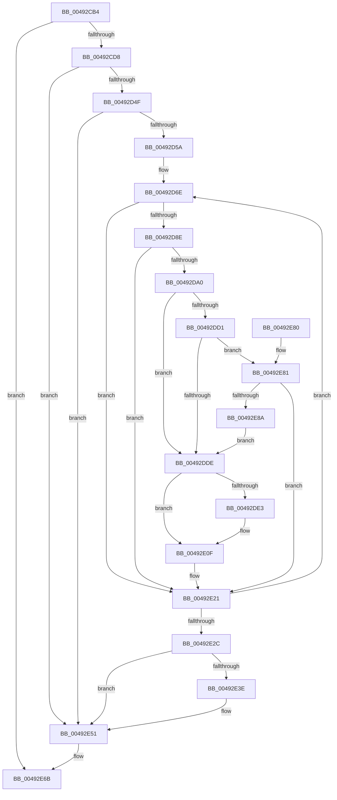

# MiConvertAndFlushWsleVas

- RVA: `0x00492CB4`–`0x00492E8F` (길이 `475` bytes)
- VA: `0x0000000140492CB4`
- 실행 섹션: `.text`
- PDB 이름 있음: `예`; PDB Function 태그: `아니요`
- unwind 정보 RVA: `0x000B3054`
- 디코드: `119`개 명령, `475/475` bytes 표시
- 미해석 바이트: `0` (있으면 어셈블리에 `.byte`로 보존)

> 이 문서는 커널 이미지의 기계어와 PDB 기호를 분석해 생성했습니다. 4번과 5번은 함수 원형과 자료형을 바이너리 사용 방식에서 추정한 C 해석이며 원본 소스 복구 결과는 아닙니다.

## 1. Dependencies

- 직접 호출 지점: **10**; 고유 호출 대상: **10**
- 직접 호출자로 확인된 함수: **1**
- RIP 상대 이미지 참조: **0**

### Outgoing calls
- `0x00492CE1` → [MiLockWorkingSetShared](../27/MiLockWorkingSetShared_function_0027CBF0.md) (function, `0x0027CBF0`)
- `0x00492D1F` → [MiLockLowestValidPageTableEx](../28/MiLockLowestValidPageTableEx_function_00280D10.md) (function, `0x00280D10`)
- `0x00492D91` → [MiGetWsleContents](../31/MiGetWsleContents_function_00316540.md) (function, `0x00316540`)
- `0x00492DE3` → [MiGetProcessorFlushList](../24/MiGetProcessorFlushList_function_00242C90.md) (function, `0x00242C90`)
- `0x00492E0A` → [MiInitializeTbFlushList](../29/MiInitializeTbFlushList_function_00294F00.md) (function, `0x00294F00`)
- `0x00492E1C` → [MiInsertTbFlushEntry](../29/MiInsertTbFlushEntry_function_00293670.md) (function, `0x00293670`)
- `0x00492E47` → [MiFreeWsleList](../24/MiFreeWsleList_function_00241168.md) (function, `0x00241168`)
- `0x00492E4C` → [MiReleaseProcessorFlushList](../31/MiReleaseProcessorFlushList_function_00313C70.md) (function, `0x00313C70`)
- `0x00492E57` → [MiUnlockPageTable](../21/MiUnlockPageTable_function_00216EC0.md) (function, `0x00216EC0`)
- `0x00492E62` → [MiUnlockWorkingSetShared](../27/MiUnlockWorkingSetShared_function_0027D690.md) (function, `0x0027D690`)

### Direct callers
- [MiEliminateZeroPages](../../page/8C/MiEliminateZeroPages_function_008CF1A0.md) at `0x008CF2B2`
- [MiEliminateZeroPages](../../page/8C/MiEliminateZeroPages_function_008CF1A0.md) at `0x008CF2DA`
- [MiEliminateZeroPages](../../page/8C/MiEliminateZeroPages_function_008CF1A0.md) at `0x008CF318`

### Static image references
- 디코드된 RIP-relative 메모리 참조가 없습니다.

## 2. Other-region calls and transfers

- 다른 실행 섹션으로 향하는 call: **0**
- 별도 외부 분기/꼬리 이동을 확인하지 못했습니다.

## 3. Assembly (complete function range)

```asm
00492CB4  48 89 5C 24 08                  mov qword ptr [rsp + 8], rbx
00492CB9  55                              push rbp
00492CBA  56                              push rsi
00492CBB  57                              push rdi
00492CBC  41 54                           push r12
00492CBE  41 55                           push r13
00492CC0  41 56                           push r14
00492CC2  41 57                           push r15
00492CC4  48 83 EC 30                     sub rsp, 0x30
00492CC8  83 7A 1C 00                     cmp dword ptr [rdx + 0x1c], 0
00492CCC  48 8B FA                        mov rdi, rdx
00492CCF  48 8B F1                        mov rsi, rcx
00492CD2  0F 84 93 01 00 00               je 0x140492e6b
00492CD8  48 8B 5A 28                     mov rbx, qword ptr [rdx + 0x28]
00492CDC  33 ED                           xor ebp, ebp
00492CDE  45 33 FF                        xor r15d, r15d
00492CE1  E8 0A 9F DE FF                  call 0x14027cbf0
00492CE6  44 8A E8                        mov r13b, al
00492CE9  88 44 24 78                     mov byte ptr [rsp + 0x78], al
00492CED  48 B8 F8 FF FF FF 7F 00 00 00   movabs rax, 0x7ffffffff8
00492CF7  48 8B D3                        mov rdx, rbx
00492CFA  48 C1 EA 09                     shr rdx, 9
00492CFE  48 23 D0                        and rdx, rax
00492D01  48 B8 00 00 00 00 80 F6 FF FF   movabs rax, 0xfffff68000000000
00492D0B  48 8B C0                        mov rax, rax
00492D0E  48 03 D0                        add rdx, rax
00492D11  4C 8D 84 24 80 00 00 00         lea r8, [rsp + 0x80]
00492D19  45 33 C9                        xor r9d, r9d
00492D1C  48 8B CE                        mov rcx, rsi
00492D1F  E8 EC DF DE FF                  call 0x140280d10
00492D24  48 C1 EB 12                     shr rbx, 0x12
00492D28  4C 8B E0                        mov r12, rax
00492D2B  81 E3 F8 FF FF 3F               and ebx, 0x3ffffff8
00492D31  48 89 84 24 80 00 00 00         mov qword ptr [rsp + 0x80], rax
00492D39  48 B8 00 00 00 40 FB F6 FF FF   movabs rax, 0xfffff6fb40000000
00492D43  48 03 D8                        add rbx, rax
00492D46  4C 3B E3                        cmp r12, rbx
00492D49  0F 85 02 01 00 00               jne 0x140492e51
00492D4F  33 DB                           xor ebx, ebx
00492D51  39 5F 1C                        cmp dword ptr [rdi + 0x1c], ebx
00492D54  0F 86 F7 00 00 00               jbe 0x140492e51
00492D5A  49 BD 00 00 00 00 80 F6 FF FF   movabs r13, 0xfffff68000000000
00492D64  49 BC F8 FF FF FF 7F 00 00 00   movabs r12, 0x7ffffffff8
00492D6E  4C 8B 74 DF 28                  mov r14, qword ptr [rdi + rbx*8 + 0x28]
00492D73  4D 8B D6                        mov r10, r14
00492D76  49 C1 EA 09                     shr r10, 9
00492D7A  4D 23 D4                        and r10, r12
00492D7D  49 8B C5                        mov rax, r13
00492D80  4D 8B 14 02                     mov r10, qword ptr [r10 + rax]
00492D84  41 F6 C2 01                     test r10b, 1
00492D88  0F 84 93 00 00 00               je 0x140492e21
00492D8E  49 8B D6                        mov rdx, r14
00492D91  E8 AA 37 E8 FF                  call 0x140316540
00492D96  24 0F                           and al, 0xf
00492D98  3C 0A                           cmp al, 0xa
00492D9A  0F 84 81 00 00 00               je 0x140492e21
00492DA0  49 C1 EA 0C                     shr r10, 0xc
00492DA4  48 B8 FF FF FF FF FF 00 00 00   movabs rax, 0xffffffffff
00492DAE  4C 23 D0                        and r10, rax
00492DB1  4B 8D 0C 52                     lea rcx, [r10 + r10*2]
00492DB5  48 C1 E1 04                     shl rcx, 4
00492DB9  48 B8 00 00 00 00 00 DE FF FF   movabs rax, 0xffffde0000000000
00492DC3  48 03 C8                        add rcx, rax
00492DC6  48 8B 41 28                     mov rax, qword ptr [rcx + 0x28]
00492DCA  48 0F BA E0 28                  bt rax, 0x28
00492DCF  72 0D                           jb 0x140492dde
00492DD1  48 8B 41 08                     mov rax, qword ptr [rcx + 8]
00492DD5  48 85 C0                        test rax, rax
00492DD8  0F 89 A3 00 00 00               jns 0x140492e81
00492DDE  4D 85 FF                        test r15, r15
00492DE1  75 2C                           jne 0x140492e0f
00492DE3  E8 A8 FE DA FF                  call 0x140242c90
00492DE8  41 B9 02 00 00 00               mov r9d, 2
00492DEE  C7 44 24 20 01 00 00 00         mov dword ptr [rsp + 0x20], 1
00492DF6  48 8B D6                        mov rdx, rsi
00492DF9  4C 8B F8                        mov r15, rax
00492DFC  48 8D A8 28 10 00 00            lea rbp, [rax + 0x1028]
00492E03  44 8B 45 0C                     mov r8d, dword ptr [rbp + 0xc]
00492E07  48 8B CD                        mov rcx, rbp
00492E0A  E8 F1 20 E0 FF                  call 0x140294f00
00492E0F  45 33 C9                        xor r9d, r9d
00492E12  49 8B D6                        mov rdx, r14
00492E15  48 8B CD                        mov rcx, rbp
00492E18  45 8D 41 01                     lea r8d, [r9 + 1]
00492E1C  E8 4F 08 E0 FF                  call 0x140293670
00492E21  FF C3                           inc ebx
00492E23  3B 5F 1C                        cmp ebx, dword ptr [rdi + 0x1c]
00492E26  0F 82 42 FF FF FF               jb 0x140492d6e
00492E2C  4C 8B A4 24 80 00 00 00         mov r12, qword ptr [rsp + 0x80]
00492E34  44 8A 6C 24 78                  mov r13b, byte ptr [rsp + 0x78]
00492E39  48 85 ED                        test rbp, rbp
00492E3C  74 13                           je 0x140492e51
00492E3E  45 33 C0                        xor r8d, r8d
00492E41  48 8B D5                        mov rdx, rbp
00492E44  48 8B CE                        mov rcx, rsi
00492E47  E8 1C E3 DA FF                  call 0x140241168
00492E4C  E8 1F 0E E8 FF                  call 0x140313c70
00492E51  49 8B D4                        mov rdx, r12
00492E54  48 8B CE                        mov rcx, rsi
00492E57  E8 64 40 D8 FF                  call 0x140216ec0
00492E5C  41 8A D5                        mov dl, r13b
00492E5F  48 8B CE                        mov rcx, rsi
00492E62  E8 29 A8 DE FF                  call 0x14027d690
00492E67  83 67 1C 00                     and dword ptr [rdi + 0x1c], 0
00492E6B  48 8B 5C 24 70                  mov rbx, qword ptr [rsp + 0x70]
00492E70  48 83 C4 30                     add rsp, 0x30
00492E74  41 5F                           pop r15
00492E76  41 5E                           pop r14
00492E78  41 5D                           pop r13
00492E7A  41 5C                           pop r12
00492E7C  5F                              pop rdi
00492E7D  5E                              pop rsi
00492E7E  5D                              pop rbp
00492E7F  C3                              ret
00492E80  CC                              int3
00492E81  48 8B 41 08                     mov rax, qword ptr [rcx + 8]
00492E85  48 85 C0                        test rax, rax
00492E88  75 97                           jne 0x140492e21
00492E8A  E9 4F FF FF FF                  jmp 0x140492dde
```

## 4. C-style interpretation (structured pseudocode)

```c
__int64 __fastcall MiConvertAndFlushWsleVas(__int64 a1, __int64 a2, __int64 a3, int a4)
{
    __int64 result;
    __int64 v_r10;
    __int64 v_r15;
    __int64 v_rbp;
    __int64 v_rbx;
    __int64 v_rsp;
    unsigned int v_stack_m48;
    unsigned __int8 v_stack_p10;
    unsigned __int64 v_stack_p18;
    unsigned __int64 v_stack_p8;

    v_stack_p8 = v_rbx;
    v_rsp = (v_rsp) - (48);
    if ((*(unsigned int *)(a2 + 28)) == 0) goto loc_00492E6B;
    v_rbp = 0;
    v_r15 = 0;
    result = MiLockWorkingSetShared(a1, a2, a3, a4);
    v_stack_p10 = (unsigned __int8)(result);
    a2 = (*(unsigned __int64 *)(a2 + 40)) >> (9);
    a2 = (a2) & (result);
    a2 = (a2) + (result);
    a4 = 0;
    result = MiLockLowestValidPageTableEx(a1, a2, v_stack_p18, a4);
    v_rbx = (*(unsigned __int64 *)(a2 + 40)) >> (18);
    v_rbx = (unsigned int)((v_rbx) & (0x3FFFFFF8ULL));
    v_stack_p18 = result;
    v_rbx = (v_rbx) + (result);
    if (result != v_rbx) goto loc_00492E51;
    v_rbx = 0;
    if ((*(unsigned int *)(a2 + 28)) <= 0) goto loc_00492E51;
loc_00492D6E:
    v_r10 = (*(unsigned __int64 *)(a2 + v_rbx * 8 + 40)) >> (9);
    v_r10 = (v_r10) & (result);
    if ((((unsigned __int8)(*(unsigned __int64 *)(v_r10 + (unsigned __int8)(result) * 1))) & (1)) == 0) goto loc_00492E21;
    result = MiGetWsleContents(a1, *(unsigned __int64 *)(a2 + v_rbx * 8 + 40), v_stack_p18, a4);
    result = (unsigned __int8)((result) & (15));
    if (((unsigned __int8)(result)) == 10) goto loc_00492E21;
    v_r10 = (*(unsigned __int64 *)(v_r10 + (unsigned __int8)(result) * 1)) >> (12);
    v_r10 = (v_r10) & (result);
    a1 = (v_r10 + v_r10 * 2) << (4);
    a1 = (a1) + (result);
    if (condition_is_below) goto loc_00492DDE;
    if (!sign_flag) goto loc_00492E81;
loc_00492DDE:
    result = *(unsigned __int64 *)(a1 + 8);
    if (0 == 0) {
        result = MiGetProcessorFlushList(a1, *(unsigned __int64 *)(a2 + v_rbx * 8 + 40), v_stack_p18, a4);
        a4 = 2;
        v_stack_m48 = 1;
        a2 = a1;
        v_r15 = result;
        v_rbp = result + 4136;
        a3 = *(unsigned int *)(v_rbp + 12);
        a1 = v_rbp;
        result = MiInitializeTbFlushList(a1, a2, a3, a4);
    }
    a4 = 0;
    result = MiInsertTbFlushEntry(v_rbp, *(unsigned __int64 *)(a2 + v_rbx * 8 + 40), a4 + 1, a4);
loc_00492E21:
    v_rbx = (unsigned int)((v_rbx) + 1);
    if (((unsigned int)(v_rbx)) < (*(unsigned int *)(a2 + 28))) goto loc_00492D6E;
    if (v_rbp != 0) {
        a3 = 0;
        a2 = v_rbp;
        a1 = a1;
        result = MiFreeWsleList(a1, a2, a3, a4);
        result = MiReleaseProcessorFlushList(a1, a2, a3, a4);
    }
    result = MiUnlockPageTable(a1, v_stack_p18, a3, a4);
    result = MiUnlockWorkingSetShared(a1, (unsigned __int8)(v_stack_p10), a3, a4);
loc_00492E6B:
    v_rsp = (v_rsp) + (48);
    return result;
loc_00492E81:
    if (*(unsigned __int64 *)(a1 + 8) != 0) goto loc_00492E21;
    goto loc_00492DDE;
}
```

## 5. (Beta) C Style

```c
int64_t MiConvertAndFlushWsleVas(int64_t Arg1, void *Arg2, int64_t Arg3, int32_t Arg4)
{
    uint8_t *arg2 = (uint8_t *)Arg2;

    int64_t result;
    int64_t local_r10;
    int64_t local_r15;
    int64_t local_rbp;
    int64_t local_rbx;
    int64_t local_rsp;
    uint32_t v_stack_m48;
    uint8_t v_stack_p10;
    uint64_t v_stack_p18;
    uint64_t v_stack_p8;

    v_stack_p8 = local_rbx;
    local_rsp = (local_rsp) - (48);
    if ((*(uint32_t *)(arg2 + 0x1C)) == 0) goto loc_00492E6B;
    local_rbp = 0;
    local_r15 = 0;
    result = MiLockWorkingSetShared(Arg1, Arg2, Arg3, Arg4);
    v_stack_p10 = (uint8_t)(result);
    Arg2 = (*(uint64_t *)(arg2 + 0x28)) >> (9);
    Arg2 = (Arg2) & (result);
    Arg2 = (Arg2) + (result);
    Arg4 = 0;
    result = MiLockLowestValidPageTableEx(Arg1, Arg2, v_stack_p18, Arg4);
    local_rbx = (*(uint64_t *)(arg2 + 0x28)) >> (18);
    local_rbx = (uint32_t)((local_rbx) & (0x3FFFFFF8ULL));
    v_stack_p18 = result;
    local_rbx = (local_rbx) + (result);
    if (result != local_rbx) goto loc_00492E51;
    local_rbx = 0;
    if ((*(uint32_t *)(arg2 + 0x1C)) <= 0) goto loc_00492E51;
loc_00492D6E:
    local_r10 = (*(uint64_t *)(arg2 + local_rbx * 8 + 0x28)) >> (9);
    local_r10 = (local_r10) & (result);
    if ((((uint8_t)(*(uint64_t *)(local_r10 + (uint8_t)(result) * 1))) & (1)) == 0) goto loc_00492E21;
    result = MiGetWsleContents(Arg1, *(uint64_t *)(arg2 + local_rbx * 8 + 0x28), v_stack_p18, Arg4);
    result = (uint8_t)((result) & (15));
    if (((uint8_t)(result)) == 10) goto loc_00492E21;
    local_r10 = (*(uint64_t *)(local_r10 + (uint8_t)(result) * 1)) >> (12);
    local_r10 = (local_r10) & (result);
    Arg1 = (local_r10 + local_r10 * 2) << (4);
    Arg1 = (Arg1) + (result);
    if (condition_is_below) goto loc_00492DDE;
    if (!sign_flag) goto loc_00492E81;
loc_00492DDE:
    result = *(uint64_t *)(Arg1 + 0x8);
    if (0 == 0) {
        result = MiGetProcessorFlushList(Arg1, *(uint64_t *)(arg2 + local_rbx * 8 + 0x28), v_stack_p18, Arg4);
        Arg4 = 2;
        v_stack_m48 = 1;
        Arg2 = Arg1;
        local_r15 = result;
        local_rbp = result + 4136;
        Arg3 = *(uint32_t *)(local_rbp + 0xC);
        Arg1 = local_rbp;
        result = MiInitializeTbFlushList(Arg1, Arg2, Arg3, Arg4);
    }
    Arg4 = 0;
    result = MiInsertTbFlushEntry(local_rbp, *(uint64_t *)(arg2 + local_rbx * 8 + 0x28), Arg4 + 1, Arg4);
loc_00492E21:
    local_rbx = (uint32_t)((local_rbx) + 1);
    if (((uint32_t)(local_rbx)) < (*(uint32_t *)(arg2 + 0x1C))) goto loc_00492D6E;
    if (local_rbp != 0) {
        Arg3 = 0;
        Arg2 = local_rbp;
        Arg1 = Arg1;
        result = MiFreeWsleList(Arg1, Arg2, Arg3, Arg4);
        result = MiReleaseProcessorFlushList(Arg1, Arg2, Arg3, Arg4);
    }
    result = MiUnlockPageTable(Arg1, v_stack_p18, Arg3, Arg4);
    result = MiUnlockWorkingSetShared(Arg1, (uint8_t)(v_stack_p10), Arg3, Arg4);
loc_00492E6B:
    local_rsp = (local_rsp) + (48);
    return result;
loc_00492E81:
    if (*(uint64_t *)(Arg1 + 0x8) != 0) goto loc_00492E21;
    goto loc_00492DDE;
}
```

### 관측된 메모리 오프셋

구조체 형식이 확인되지 않은 접근은 인자 기준의 오프셋으로만 기록했습니다.

| 기준 인자 | 오프셋 표현 | 폭 (bit) | 접근 |
|---|---:|---:|---|
| `Arg2` | `+ 0x1C` | `32` | `R` |
| `Arg2` | `+ 0x1C` | `32` | `R/W` |
| `Arg2` | `+ 0x28` | `64` | `R` |
| `Arg2` | `+ 0x28 + rbx*8` | `64` | `R` |

## 6. Execution-region graph

[열기: 2D/3D 그래프와 함수 탐색 컨트롤 패널](../../../control-panel.html?section=text&rva=0x00492CB4&view=graph)

- 2D 그래프는 위에서 아래로 흐르고, 3D 그래프는 빈 공간을 드래그해 회전합니다. Shift+드래그는 이동, 휠은 확대·축소, 함수 노드 선택은 대상 보고서 이동입니다.

### Static fallback


