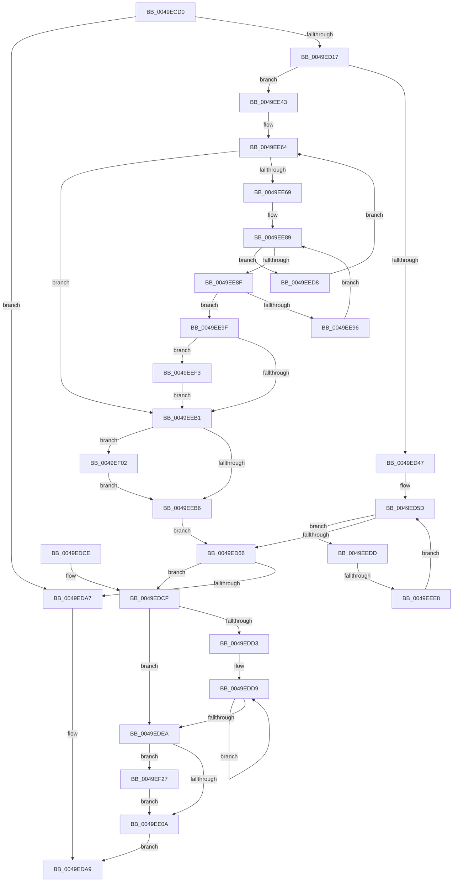

# MiCreatePageChains

- RVA: `0x0049ECD0`–`0x0049EF3D` (길이 `621` bytes)
- VA: `0x000000014049ECD0`
- 실행 섹션: `.text`
- PDB 이름 있음: `예`; PDB Function 태그: `예`
- unwind 정보 RVA: `0x000B5314`
- 디코드: `159`개 명령, `621/621` bytes 표시
- 미해석 바이트: `0` (있으면 어셈블리에 `.byte`로 보존)

> 이 문서는 커널 이미지의 기계어와 PDB 기호를 분석해 생성했습니다. 4번과 5번은 함수 원형과 자료형을 바이너리 사용 방식에서 추정한 C 해석이며 원본 소스 복구 결과는 아닙니다.

## 1. Dependencies

- 직접 호출 지점: **3**; 고유 호출 대상: **3**
- 직접 호출자로 확인된 함수: **5**
- RIP 상대 이미지 참조: **7**

### Outgoing calls
- `0x0049ED9A` → [MiAllocatePool](../35/MiAllocatePool_function_0035B540.md) (function, `0x0035B540`)
- `0x0049EDB1` → [_security_check_cookie](../6A/_security_check_cookie_function_006AC640.md) (function, `0x006AC640`)
- `0x0049EEA6` → [MiGetOptimalEngineMix](MiGetOptimalEngineMix_function_0049EF44.md) (function, `0x0049EF44`)

### Direct callers
- [MiInitializeMdlOneNodeBatchPages](../2C/MiInitializeMdlOneNodeBatchPages_function_002C9480.md) at `0x002C962D`
- [MiZeroAndReleasePages](../37/MiZeroAndReleasePages_function_003748D0.md) at `0x00374C3F`
- [MiGroupZeroHugeRange](../68/MiGroupZeroHugeRange_function_0068C384.md) at `0x0068C415`
- [sub_006E75BA](../6E/Unknown_function_006E75BA.md) at `0x006E75DE`
- [MiFindLargePageMemory](../../page/AA/MiFindLargePageMemory_function_00AA8334.md) at `0x00AA83DD`

### Static image references
- `0x0049ECE4` → RVA `0x00E0A740` (`.data`; read)
- `0x0049ED00` → RVA `0x00FC6A88` (`ALMOSTRO`; read)
- `0x0049ED24` → RVA `0x00E2DBF8` (`.data`; read)
- `0x0049ED4F` → RVA `0x00E2DBF2` (`.data`; read)
- `0x0049ED56` → RVA `0x00E2DBF6` (`.data`; read)
- `0x0049EE43` → RVA `0x00FC5000` (`ALMOSTRO`; read)
- `0x0049EE50` → RVA `0x00E2DBD0` (`.data`; read)

## 2. Other-region calls and transfers

- 다른 실행 섹션으로 향하는 call: **0**
- call이 아닌 외부 분기/꼬리 이동: **1**
  - `0x0049EEE2` → [sub_006F8344](../6F/Unknown_function_006F8344.md) (`tail-transfer`)

## 3. Assembly (complete function range)

```asm
0049ECD0  48 89 5C 24 18                  mov qword ptr [rsp + 0x18], rbx
0049ECD5  55                              push rbp
0049ECD6  56                              push rsi
0049ECD7  57                              push rdi
0049ECD8  41 54                           push r12
0049ECDA  41 55                           push r13
0049ECDC  41 56                           push r14
0049ECDE  41 57                           push r15
0049ECE0  48 83 EC 50                     sub rsp, 0x50
0049ECE4  48 8B 05 55 BA 96 00            mov rax, qword ptr [rip + 0x96ba55]
0049ECEB  48 33 C4                        xor rax, rsp
0049ECEE  48 89 44 24 40                  mov qword ptr [rsp + 0x40], rax
0049ECF3  4D 8B E9                        mov r13, r9
0049ECF6  44 89 44 24 20                  mov dword ptr [rsp + 0x20], r8d
0049ECFB  45 33 C9                        xor r9d, r9d
0049ECFE  8B FA                           mov edi, edx
0049ED00  48 0F BA 25 7F 7D B2 00 26      bt qword ptr [rip + 0xb27d7f], 0x26
0049ED09  48 89 4C 24 28                  mov qword ptr [rsp + 0x28], rcx
0049ED0E  41 8B D9                        mov ebx, r9d
0049ED11  0F 83 90 00 00 00               jae 0x14049eda7
0049ED17  33 C0                           xor eax, eax
0049ED19  48 8D 0C 7F                     lea rcx, [rdi + rdi*2]
0049ED1D  48 C1 E1 07                     shl rcx, 7
0049ED21  41 8B F1                        mov esi, r9d
0049ED24  48 03 0D CD EE 98 00            add rcx, qword ptr [rip + 0x98eecd]
0049ED2B  48 89 44 24 30                  mov qword ptr [rsp + 0x30], rax
0049ED30  89 44 24 38                     mov dword ptr [rsp + 0x38], eax
0049ED34  4C 8B 81 78 01 00 00            mov r8, qword ptr [rcx + 0x178]
0049ED3B  41 8B 40 24                     mov eax, dword ptr [r8 + 0x24]
0049ED3F  A8 01                           test al, 1
0049ED41  0F 84 FC 00 00 00               je 0x14049ee43
0049ED47  41 0F B7 E9                     movzx ebp, r9w
0049ED4B  41 8D 51 01                     lea edx, [r9 + 1]
0049ED4F  48 8D 05 9C EE 98 00            lea rax, [rip + 0x98ee9c]
0049ED56  48 8D 0D 99 EE 98 00            lea rcx, [rip + 0x98ee99]
0049ED5D  48 3B C1                        cmp rax, rcx
0049ED60  0F 8C 77 01 00 00               jl 0x14049eedd
0049ED66  0F B7 C5                        movzx eax, bp
0049ED69  49 8D 95 A8 00 00 00            lea rdx, [r13 + 0xa8]
0049ED70  44 8B E6                        mov r12d, esi
0049ED73  B9 40 00 00 00                  mov ecx, 0x40
0049ED78  49 C1 E4 07                     shl r12, 7
0049ED7C  41 B8 4D 69 5A 6D               mov r8d, 0x6d5a694d
0049ED82  49 03 D4                        add rdx, r12
0049ED85  44 8B FE                        mov r15d, esi
0049ED88  4C 8D 34 40                     lea r14, [rax + rax*2]
0049ED8C  49 C1 E6 04                     shl r14, 4
0049ED90  49 81 C6 78 01 00 00            add r14, 0x178
0049ED97  49 03 D6                        add rdx, r14
0049ED9A  E8 A1 C7 EB FF                  call 0x14035b540
0049ED9F  48 8B D0                        mov rdx, rax
0049EDA2  48 85 C0                        test rax, rax
0049EDA5  75 28                           jne 0x14049edcf
0049EDA7  33 C0                           xor eax, eax
0049EDA9  48 8B 4C 24 40                  mov rcx, qword ptr [rsp + 0x40]
0049EDAE  48 33 CC                        xor rcx, rsp
0049EDB1  E8 8A D8 20 00                  call 0x1406ac640
0049EDB6  48 8B 9C 24 A0 00 00 00         mov rbx, qword ptr [rsp + 0xa0]
0049EDBE  48 83 C4 50                     add rsp, 0x50
0049EDC2  41 5F                           pop r15
0049EDC4  41 5E                           pop r14
0049EDC6  41 5D                           pop r13
0049EDC8  41 5C                           pop r12
0049EDCA  5F                              pop rdi
0049EDCB  5E                              pop rsi
0049EDCC  5D                              pop rbp
0049EDCD  C3                              ret
0049EDCE  CC                              int3
0049EDCF  85 F6                           test esi, esi
0049EDD1  74 17                           je 0x14049edea
0049EDD3  48 05 18 01 00 00               add rax, 0x118
0049EDD9  48 89 40 08                     mov qword ptr [rax + 8], rax
0049EDDD  48 89 00                        mov qword ptr [rax], rax
0049EDE0  48 83 E8 80                     sub rax, -0x80
0049EDE4  49 83 EF 01                     sub r15, 1
0049EDE8  75 EF                           jne 0x14049edd9
0049EDEA  48 8D 8A A8 00 00 00            lea rcx, [rdx + 0xa8]
0049EDF1  0F B7 C5                        movzx eax, bp
0049EDF4  49 03 CC                        add rcx, r12
0049EDF7  48 89 8A 90 00 00 00            mov qword ptr [rdx + 0x90], rcx
0049EDFE  89 41 04                        mov dword ptr [rcx + 4], eax
0049EE01  4D 85 ED                        test r13, r13
0049EE04  0F 85 1D 01 00 00               jne 0x14049ef27
0049EE0A  48 8B 44 24 28                  mov rax, qword ptr [rsp + 0x28]
0049EE0F  F2 0F 10 44 24 30               movsd xmm0, qword ptr [rsp + 0x30]
0049EE15  48 89 02                        mov qword ptr [rdx], rax
0049EE18  8B 44 24 20                     mov eax, dword ptr [rsp + 0x20]
0049EE1C  89 42 14                        mov dword ptr [rdx + 0x14], eax
0049EE1F  8B 44 24 38                     mov eax, dword ptr [rsp + 0x38]
0049EE23  F2 0F 11 42 60                  movsd qword ptr [rdx + 0x60], xmm0
0049EE28  89 42 68                        mov dword ptr [rdx + 0x68], eax
0049EE2B  48 8B C2                        mov rax, rdx
0049EE2E  89 72 18                        mov dword ptr [rdx + 0x18], esi
0049EE31  89 5A 58                        mov dword ptr [rdx + 0x58], ebx
0049EE34  89 7A 5C                        mov dword ptr [rdx + 0x5c], edi
0049EE37  C7 42 70 01 00 00 00            mov dword ptr [rdx + 0x70], 1
0049EE3E  E9 66 FF FF FF                  jmp 0x14049eda9
0049EE43  0F B7 15 B6 61 B2 00            movzx edx, word ptr [rip + 0xb261b6]
0049EE4A  41 BF 04 00 00 00               mov r15d, 4
0049EE50  48 8B 05 79 ED 98 00            mov rax, qword ptr [rip + 0x98ed79]
0049EE57  8B CA                           mov ecx, edx
0049EE59  0F AF CF                        imul ecx, edi
0049EE5C  4C 8D 34 88                     lea r14, [rax + rcx*4]
0049EE60  4D 8D 24 96                     lea r12, [r14 + rdx*4]
0049EE64  4D 3B F4                        cmp r14, r12
0049EE67  73 48                           jae 0x14049eeb1
0049EE69  41 8B 1E                        mov ebx, dword ptr [r14]
0049EE6C  49 8B E9                        mov rbp, r9
0049EE6F  48 8D 04 5B                     lea rax, [rbx + rbx*2]
0049EE73  48 C1 E0 07                     shl rax, 7
0049EE77  48 03 05 7A ED 98 00            add rax, qword ptr [rip + 0x98ed7a]
0049EE7E  48 8B 80 78 01 00 00            mov rax, qword ptr [rax + 0x178]
0049EE85  48 83 C0 18                     add rax, 0x18
0049EE89  48 83 FD 03                     cmp rbp, 3
0049EE8D  7D 49                           jge 0x14049eed8
0049EE8F  0F B7 30                        movzx esi, word ptr [rax]
0049EE92  85 F6                           test esi, esi
0049EE94  75 09                           jne 0x14049ee9f
0049EE96  48 FF C5                        inc rbp
0049EE99  48 83 C0 02                     add rax, 2
0049EE9D  EB EA                           jmp 0x14049ee89
0049EE9F  4C 8D 44 24 30                  lea r8, [rsp + 0x30]
0049EEA4  8B D3                           mov edx, ebx
0049EEA6  E8 99 00 00 00                  call 0x14049ef44
0049EEAB  8B F0                           mov esi, eax
0049EEAD  85 C0                           test eax, eax
0049EEAF  74 42                           je 0x14049eef3
0049EEB1  4D 3B F4                        cmp r14, r12
0049EEB4  74 4C                           je 0x14049ef02
0049EEB6  8B C3                           mov eax, ebx
0049EEB8  48 8D 0C 40                     lea rcx, [rax + rax*2]
0049EEBC  48 8B 05 35 ED 98 00            mov rax, qword ptr [rip + 0x98ed35]
0049EEC3  48 C1 E1 07                     shl rcx, 7
0049EEC7  48 8B 8C 01 78 01 00 00         mov rcx, qword ptr [rcx + rax + 0x178]
0049EECF  0F B7 69 10                     movzx ebp, word ptr [rcx + 0x10]
0049EED3  E9 8E FE FF FF                  jmp 0x14049ed66
0049EED8  4D 03 F7                        add r14, r15
0049EEDB  EB 87                           jmp 0x14049ee64
0049EEDD  0F B7 30                        movzx esi, word ptr [rax]
0049EEE0  85 F6                           test esi, esi
0049EEE2  0F 85 5C 94 25 00               jne 0x1406f8344
0049EEE8  FF C2                           inc edx
0049EEEA  48 83 C0 02                     add rax, 2
0049EEEE  E9 6A FE FF FF                  jmp 0x14049ed5d
0049EEF3  C7 44 AC 30 01 00 00 00         mov dword ptr [rsp + rbp*4 + 0x30], 1
0049EEFB  BE 01 00 00 00                  mov esi, 1
0049EF00  EB AF                           jmp 0x14049eeb1
0049EF02  65 48 8B 04 25 20 00 00 00      mov rax, qword ptr gs:[0x20]
0049EF0B  BE 01 00 00 00                  mov esi, 1
0049EF10  8B DF                           mov ebx, edi
0049EF12  40 38 B0 08 8A 00 00            cmp byte ptr [rax + 0x8a08], sil
0049EF19  8D 4E 07                        lea ecx, [rsi + 7]
0049EF1C  4C 0F 45 F9                     cmovne r15, rcx
0049EF20  42 89 74 3C 30                  mov dword ptr [rsp + r15 + 0x30], esi
0049EF25  EB 8F                           jmp 0x14049eeb6
0049EF27  48 8B 8A 90 00 00 00            mov rcx, qword ptr [rdx + 0x90]
0049EF2E  49 03 CE                        add rcx, r14
0049EF31  48 89 8A 98 00 00 00            mov qword ptr [rdx + 0x98], rcx
0049EF38  E9 CD FE FF FF                  jmp 0x14049ee0a
```

## 4. C-style interpretation (structured pseudocode)

```c
__int64 __fastcall MiCreatePageChains(__int64 a1, int a2, int a3, __int64 a4)
{
    __int64 result;
    __int64 v_r12;
    __int64 v_r14;
    __int64 v_r15;
    __int64 v_rbp;
    __int64 v_rsp;
    unsigned __int64 v_stack_m48;
    unsigned int v_stack_m50;
    unsigned __int64 v_stack_m58;
    unsigned __int64 v_stack_m60;
    unsigned int v_stack_m68;
    unsigned __int64 v_stack_p18;
    unsigned int v_stack_p20;
    unsigned __int64 v_stack_p28;
    unsigned __int64 v_stack_p30;
    unsigned int v_stack_p38;

    v_stack_p18 = v_rbx;
    v_rsp = (v_rsp) - (80);
    result = (*(unsigned __int64 *)(v_rip + 9878101)) ^ (v_rsp);
    v_stack_m48 = result;
    v_stack_m68 = a3;
    a4 = 0;
    v_stack_m60 = a1;
    if (condition_is_above_or_equal) goto loc_0049EDA7;
    result = 0;
    a1 = ((unsigned int)(a2) + (unsigned int)(a2) * 2) << (7);
    a1 = (a1) + (*(unsigned __int64 *)(v_rip + 10022605));
    v_stack_m58 = 0;
    v_stack_m50 = 0;
    if ((((unsigned __int8)((unsigned int)(*(unsigned int *)(*(unsigned __int64 *)(a1 + 376) + 36)))) & (1)) == 0) goto loc_0049EE43;
loc_0049ED5D:
    if ((v_rip + 10022556) < (v_rip + 10022553)) goto loc_0049EEDD;
loc_0049ED66:
    v_r12 = (0) << (7);
    a2 = (a4 + 168) + (v_r12);
    v_r14 = (0 + 0 * 2) << (4);
    v_r14 = (v_r14) + (376);
    a2 = (a2) + (v_r14);
    result = MiAllocatePool(64, a2, (unsigned int)(0x6D5A694DULL), a4);
    if (result != 0) goto loc_0049EDCF;
loc_0049EDA7:
    result = 0;
loc_0049EDA9:
    a1 = (v_stack_m48) ^ (v_rsp);
    result = _security_check_cookie(a1, result, (unsigned int)(0x6D5A694DULL), a4);
    v_rsp = (v_rsp) + (80);
    return result;
loc_0049EDCF:
    if (0 == 0) goto loc_0049EDEA;
    result = (result) + (280);
loc_0049EDD9:
    *(unsigned __int64 *)(result + 8) = result;
    *(unsigned __int64 *)(result) = result;
    result = (result) - (-128);
    v_r15 = (0) - (1);
    if (condition_is_not_equal) goto loc_0049EDD9;
loc_0049EDEA:
    a1 = (result + 168) + (v_r12);
    *(unsigned __int64 *)(result + 144) = a1;
    *(unsigned int *)(a1 + 4) = 0;
    if (0 != 0) goto loc_0049EF27;
loc_0049EE0A:
    *(unsigned __int64 *)(result) = v_stack_p28;
    *(unsigned int *)(result + 20) = (unsigned int)((unsigned int)(v_stack_p20));
    *(unsigned __int64 *)(result + 96) = v_xmm0;
    *(unsigned int *)(result + 104) = (unsigned int)((unsigned int)(v_stack_p38));
    *(unsigned int *)(result + 24) = 0;
    *(unsigned int *)(result + 88) = (unsigned int)(v_stack_p18);
    *(unsigned int *)(result + 92) = (unsigned int)((unsigned int)(a2));
    *(unsigned int *)(result + 112) = 1;
    goto loc_0049EDA9;
loc_0049EE43:
    a1 = (unsigned int)(((unsigned int)((unsigned int)(*(unsigned __int16 *)(v_rip + 11690422)))) * ((unsigned int)((unsigned int)(a2))));
loc_0049EE64:
    if ((*(unsigned __int64 *)(v_rip + 10022265) + a1 * 4) >= (*(unsigned __int64 *)(v_rip + 10022265) + a1 * 4 + *(unsigned __int16 *)(v_rip + 11690422) * 4)) goto loc_0049EEB1;
    result = ((unsigned int)(*(unsigned int *)(*(unsigned __int64 *)(v_rip + 10022265) + a1 * 4)) + (unsigned int)(*(unsigned int *)(*(unsigned __int64 *)(v_rip + 10022265) + a1 * 4)) * 2) << (7);
    result = (result) + (*(unsigned __int64 *)(v_rip + 10022266));
    result = (*(unsigned __int64 *)(result + 376)) + (24);
loc_0049EE89:
    if (0 >= 3) goto loc_0049EED8;
    if ((unsigned int)(*(unsigned __int16 *)(result)) != 0) goto loc_0049EE9F;
    v_rbp = (0) + 1;
    result = (result) + (2);
    goto loc_0049EE89;
loc_0049EE9F:
    result = MiGetOptimalEngineMix(a1, (unsigned int)((unsigned int)((unsigned int)(*(unsigned int *)(*(unsigned __int64 *)(v_rip + 10022265) + a1 * 4)))), v_stack_p30, a4);
    if ((unsigned int)(result) == 0) goto loc_0049EEF3;
loc_0049EEB1:
    if ((*(unsigned __int64 *)(v_rip + 10022265) + a1 * 4) == (*(unsigned __int64 *)(v_rip + 10022265) + a1 * 4 + *(unsigned __int16 *)(v_rip + 11690422) * 4)) goto loc_0049EF02;
loc_0049EEB6:
    a1 = ((unsigned int)((unsigned int)((unsigned int)(*(unsigned int *)(*(unsigned __int64 *)(v_rip + 10022265) + a1 * 4)))) + (unsigned int)((unsigned int)((unsigned int)(*(unsigned int *)(*(unsigned __int64 *)(v_rip + 10022265) + a1 * 4)))) * 2) << (7);
    goto loc_0049ED66;
loc_0049EED8:
    v_r14 = (*(unsigned __int64 *)(v_rip + 10022265) + a1 * 4) + (4);
    goto loc_0049EE64;
loc_0049EEDD:
    a2 = (unsigned int)(((unsigned int)((unsigned int)((unsigned int)(*(unsigned int *)(*(unsigned __int64 *)(v_rip + 10022265) + a1 * 4))))) + 1);
    result = (*(unsigned __int64 *)(v_rip + 10022197)) + (2);
    goto loc_0049ED5D;
loc_0049EEF3:
    *(unsigned int *)(v_rsp + *(unsigned __int16 *)(*(unsigned __int64 *)(a1 + *(unsigned __int64 *)(v_rip + 10022197) * 1 + 376) + 16) * 4 + 48) = 1;
    goto loc_0049EEB1;
loc_0049EF02:
    v_r15 = 4;
    if ((*(unsigned __int8 *)(*(unsigned __int64 *)(gs_base + (0 + 32)) + 35336)) != 1) { v_r15 = 1 + 7; }
    *(unsigned int *)(v_rsp + v_r15 * 1 + 48) = 1;
    goto loc_0049EEB6;
loc_0049EF27:
    a1 = (*(unsigned __int64 *)(a2 + 144)) + (v_r14);
    *(unsigned __int64 *)(a2 + 152) = a1;
    goto loc_0049EE0A;
}
```

## 5. (Beta) C Style

```c
int64_t MiCreatePageChains(int64_t Arg1, void *Arg2, int32_t Arg3, void *Arg4)
{
    uint8_t *arg2 = (uint8_t *)Arg2;
    uint8_t *arg4 = (uint8_t *)Arg4;

    int64_t result;
    int64_t local_r12;
    int64_t local_r14;
    int64_t local_r15;
    int64_t local_rbp;
    int64_t local_rsp;
    uint64_t v_stack_m48;
    uint32_t v_stack_m50;
    uint64_t v_stack_m58;
    uint64_t v_stack_m60;
    uint32_t v_stack_m68;
    uint64_t v_stack_p18;
    uint32_t v_stack_p20;
    uint64_t v_stack_p28;
    uint64_t v_stack_p30;
    uint32_t v_stack_p38;

    v_stack_p18 = local_rbx;
    local_rsp = (local_rsp) - (80);
    result = (*(uint64_t *)(v_rip + 0x96BA55)) ^ (local_rsp);
    v_stack_m48 = result;
    v_stack_m68 = Arg3;
    Arg4 = 0;
    v_stack_m60 = Arg1;
    if (condition_is_above_or_equal) goto loc_0049EDA7;
    result = 0;
    Arg1 = ((uint32_t)(Arg2) + (uint32_t)(Arg2) * 2) << (7);
    Arg1 = (Arg1) + (*(uint64_t *)(v_rip + 0x98EECD));
    v_stack_m58 = 0;
    v_stack_m50 = 0;
    if ((((uint8_t)((uint32_t)(*(uint32_t *)(*(uint64_t *)(Arg1 + 0x178) + 0x24)))) & (1)) == 0) goto loc_0049EE43;
loc_0049ED5D:
    if ((v_rip + 10022556) < (v_rip + 10022553)) goto loc_0049EEDD;
loc_0049ED66:
    local_r12 = (0) << (7);
    Arg2 = (Arg4 + 168) + (local_r12);
    local_r14 = (0 + 0 * 2) << (4);
    local_r14 = (local_r14) + (376);
    Arg2 = (Arg2) + (local_r14);
    result = MiAllocatePool(64, Arg2, (uint32_t)(0x6D5A694DULL), Arg4);
    if (result != 0) goto loc_0049EDCF;
loc_0049EDA7:
    result = 0;
loc_0049EDA9:
    Arg1 = (v_stack_m48) ^ (local_rsp);
    result = _security_check_cookie(Arg1, result, (uint32_t)(0x6D5A694DULL), Arg4);
    local_rsp = (local_rsp) + (80);
    return result;
loc_0049EDCF:
    if (0 == 0) goto loc_0049EDEA;
    result = (result) + (280);
loc_0049EDD9:
    *(uint64_t *)(result + 0x8) = result;
    *(uint64_t *)(result) = result;
    result = (result) - (-128);
    local_r15 = (0) - (1);
    if (condition_is_not_equal) goto loc_0049EDD9;
loc_0049EDEA:
    Arg1 = (result + 168) + (local_r12);
    *(uint64_t *)(result + 0x90) = Arg1;
    *(uint32_t *)(Arg1 + 0x4) = 0;
    if (0 != 0) goto loc_0049EF27;
loc_0049EE0A:
    *(uint64_t *)(result) = v_stack_p28;
    *(uint32_t *)(result + 0x14) = (uint32_t)((uint32_t)(v_stack_p20));
    *(uint64_t *)(result + 0x60) = v_xmm0;
    *(uint32_t *)(result + 0x68) = (uint32_t)((uint32_t)(v_stack_p38));
    *(uint32_t *)(result + 0x18) = 0;
    *(uint32_t *)(result + 0x58) = (uint32_t)(v_stack_p18);
    *(uint32_t *)(result + 0x5C) = (uint32_t)((uint32_t)(Arg2));
    *(uint32_t *)(result + 0x70) = 1;
    goto loc_0049EDA9;
loc_0049EE43:
    Arg1 = (uint32_t)(((uint32_t)((uint32_t)(*(uint16_t *)(v_rip + 0xB261B6)))) * ((uint32_t)((uint32_t)(Arg2))));
loc_0049EE64:
    if ((*(uint64_t *)(v_rip + 0x98ED79) + Arg1 * 4) >= (*(uint64_t *)(v_rip + 0x98ED79) + Arg1 * 4 + *(uint16_t *)(v_rip + 0xB261B6) * 4)) goto loc_0049EEB1;
    result = ((uint32_t)(*(uint32_t *)(*(uint64_t *)(v_rip + 0x98ED79) + Arg1 * 4)) + (uint32_t)(*(uint32_t *)(*(uint64_t *)(v_rip + 0x98ED79) + Arg1 * 4)) * 2) << (7);
    result = (result) + (*(uint64_t *)(v_rip + 0x98ED7A));
    result = (*(uint64_t *)(result + 0x178)) + (24);
loc_0049EE89:
    if (0 >= 3) goto loc_0049EED8;
    if ((uint32_t)(*(uint16_t *)(result)) != 0) goto loc_0049EE9F;
    local_rbp = (0) + 1;
    result = (result) + (2);
    goto loc_0049EE89;
loc_0049EE9F:
    result = MiGetOptimalEngineMix(Arg1, (uint32_t)((uint32_t)((uint32_t)(*(uint32_t *)(*(uint64_t *)(v_rip + 0x98ED79) + Arg1 * 4)))), v_stack_p30, Arg4);
    if ((uint32_t)(result) == 0) goto loc_0049EEF3;
loc_0049EEB1:
    if ((*(uint64_t *)(v_rip + 0x98ED79) + Arg1 * 4) == (*(uint64_t *)(v_rip + 0x98ED79) + Arg1 * 4 + *(uint16_t *)(v_rip + 0xB261B6) * 4)) goto loc_0049EF02;
loc_0049EEB6:
    Arg1 = ((uint32_t)((uint32_t)((uint32_t)(*(uint32_t *)(*(uint64_t *)(v_rip + 0x98ED79) + Arg1 * 4)))) + (uint32_t)((uint32_t)((uint32_t)(*(uint32_t *)(*(uint64_t *)(v_rip + 0x98ED79) + Arg1 * 4)))) * 2) << (7);
    goto loc_0049ED66;
loc_0049EED8:
    local_r14 = (*(uint64_t *)(v_rip + 0x98ED79) + Arg1 * 4) + (4);
    goto loc_0049EE64;
loc_0049EEDD:
    Arg2 = (uint32_t)(((uint32_t)((uint32_t)((uint32_t)(*(uint32_t *)(*(uint64_t *)(v_rip + 0x98ED79) + Arg1 * 4))))) + 1);
    result = (*(uint64_t *)(v_rip + 0x98ED35)) + (2);
    goto loc_0049ED5D;
loc_0049EEF3:
    *(uint32_t *)(local_rsp + *(uint16_t *)(*(uint64_t *)(Arg1 + *(uint64_t *)(v_rip + 0x98ED35) * 1 + 0x178) + 0x10) * 4 + 0x30) = 1;
    goto loc_0049EEB1;
loc_0049EF02:
    local_r15 = 4;
    if ((*(uint8_t *)(*(uint64_t *)(gs_base + (0 + 0x20)) + 0x8A08)) != 1) { local_r15 = 1 + 7; }
    *(uint32_t *)(local_rsp + local_r15 * 1 + 0x30) = 1;
    goto loc_0049EEB6;
loc_0049EF27:
    Arg1 = (*(uint64_t *)(arg2 + 0x90)) + (local_r14);
    *(uint64_t *)(arg2 + 0x98) = Arg1;
    goto loc_0049EE0A;
}
```

### 관측된 메모리 오프셋

구조체 형식이 확인되지 않은 접근은 인자 기준의 오프셋으로만 기록했습니다.

| 기준 인자 | 오프셋 표현 | 폭 (bit) | 접근 |
|---|---:|---:|---|
| `Arg2` | `+ 0x0 + rdi*2` | `64` | `R` |
| `Arg4` | `+ 0xA8` | `64` | `R` |

## 6. Execution-region graph

[열기: 2D/3D 그래프와 함수 탐색 컨트롤 패널](../../../control-panel.html?section=text&rva=0x0049ECD0&view=graph)

- 2D 그래프는 위에서 아래로 흐르고, 3D 그래프는 빈 공간을 드래그해 회전합니다. Shift+드래그는 이동, 휠은 확대·축소, 함수 노드 선택은 대상 보고서 이동입니다.

### Static fallback


