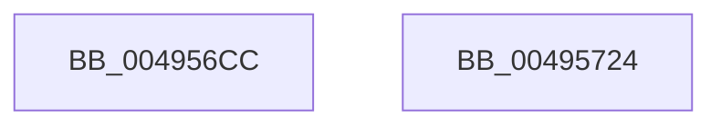

# MiDeleteCachedKernelShadowStack

- RVA: `0x004956CC`–`0x00495725` (길이 `89` bytes)
- VA: `0x00000001404956CC`
- 실행 섹션: `.text`
- PDB 이름 있음: `예`; PDB Function 태그: `아니요`
- unwind 정보 RVA: `0x00064C80`
- 디코드: `21`개 명령, `89/89` bytes 표시
- 미해석 바이트: `0` (있으면 어셈블리에 `.byte`로 보존)

> 이 문서는 커널 이미지의 기계어와 PDB 기호를 분석해 생성했습니다. 4번과 5번은 함수 원형과 자료형을 바이너리 사용 방식에서 추정한 C 해석이며 원본 소스 복구 결과는 아닙니다.

## 1. Dependencies

- 직접 호출 지점: **2**; 고유 호출 대상: **2**
- 직접 호출자로 확인된 함수: **3**
- RIP 상대 이미지 참조: **1**

### Outgoing calls
- `0x00495703` → [MiDeleteKernelStackPages](../2D/MiDeleteKernelStackPages_function_002D9938.md) (function, `0x002D9938`)
- `0x00495719` → [MiReleasePtes](../24/MiReleasePtes_function_00247240.md) (function, `0x00247240`)

### Direct callers
- [MiAdjustCachedStacks](../2D/MiAdjustCachedStacks_function_002D8AAC.md) at `0x002D8BE2`
- [MiPruneCachedStackList](MiPruneCachedStackList_function_00495638.md) at `0x004956AE`
- [MiRemoveNonIdealCachedStacks](../68/MiRemoveNonIdealCachedStacks_function_00686620.md) at `0x0068669A`

### Static image references
- `0x00495712` → RVA `0x00E35F40` (`.data`; read)

## 2. Other-region calls and transfers

- 다른 실행 섹션으로 향하는 call: **0**
- 별도 외부 분기/꼬리 이동을 확인하지 못했습니다.

## 3. Assembly (complete function range)

```asm
004956CC  40 53                           push rbx
004956CE  48 83 EC 30                     sub rsp, 0x30
004956D2  48 8B DA                        mov rbx, rdx
004956D5  49 B8 F8 FF FF FF 7F 00 00 00   movabs r8, 0x7ffffffff8
004956DF  48 C1 EB 09                     shr rbx, 9
004956E3  49 23 D8                        and rbx, r8
004956E6  49 B8 00 00 00 00 80 F6 FF FF   movabs r8, 0xfffff68000000000
004956F0  49 03 D8                        add rbx, r8
004956F3  48 89 54 24 20                  mov qword ptr [rsp + 0x20], rdx
004956F8  45 33 C9                        xor r9d, r9d
004956FB  48 8D 53 F8                     lea rdx, [rbx - 8]
004956FF  45 8D 41 01                     lea r8d, [r9 + 1]
00495703  E8 30 42 E4 FF                  call 0x1402d9938
00495708  41 B8 03 00 00 00               mov r8d, 3
0049570E  48 8D 53 F8                     lea rdx, [rbx - 8]
00495712  48 8D 0D 27 08 9A 00            lea rcx, [rip + 0x9a0827]
00495719  E8 22 1B DB FF                  call 0x140247240
0049571E  48 83 C4 30                     add rsp, 0x30
00495722  5B                              pop rbx
00495723  C3                              ret
00495724  CC                              int3
```

## 4. C-style interpretation (structured pseudocode)

```c
__int64 __fastcall MiDeleteCachedKernelShadowStack(__int64 a1, __int64 a2, __int64 a3, int a4)
{
    __int64 result;
    __int64 v_rbx;
    __int64 v_rsp;
    unsigned __int64 v_stack_m18;

    v_rsp = (v_rsp) - (48);
    v_rbx = (a2) >> (9);
    v_rbx = (v_rbx) & (a3);
    v_rbx = (v_rbx) + (a3);
    v_stack_m18 = a2;
    a4 = 0;
    result = MiDeleteKernelStackPages(a1, v_rbx - 8, a4 + 1, a4);
    result = MiReleasePtes(v_rip + 10094631, v_rbx - 8, 3, a4);
    v_rsp = (v_rsp) + (48);
    return result;
}
```

## 5. (Beta) C Style

```c
int64_t MiDeleteCachedKernelShadowStack(int64_t Arg1, int64_t Arg2, int64_t Arg3, int32_t Arg4)
{
    int64_t result;
    int64_t local_rbx;
    int64_t local_rsp;
    uint64_t v_stack_m18;

    local_rsp = (local_rsp) - (48);
    local_rbx = (Arg2) >> (9);
    local_rbx = (local_rbx) & (Arg3);
    local_rbx = (local_rbx) + (Arg3);
    v_stack_m18 = Arg2;
    Arg4 = 0;
    result = MiDeleteKernelStackPages(Arg1, local_rbx - 8, Arg4 + 1, Arg4);
    result = MiReleasePtes(v_rip + 10094631, local_rbx - 8, 3, Arg4);
    local_rsp = (local_rsp) + (48);
    return result;
}
```

## 6. Execution-region graph

[열기: 2D/3D 그래프와 함수 탐색 컨트롤 패널](../../../control-panel.html?section=text&rva=0x004956CC&view=graph)

- 2D 그래프는 위에서 아래로 흐르고, 3D 그래프는 빈 공간을 드래그해 회전합니다. Shift+드래그는 이동, 휠은 확대·축소, 함수 노드 선택은 대상 보고서 이동입니다.

### Static fallback


