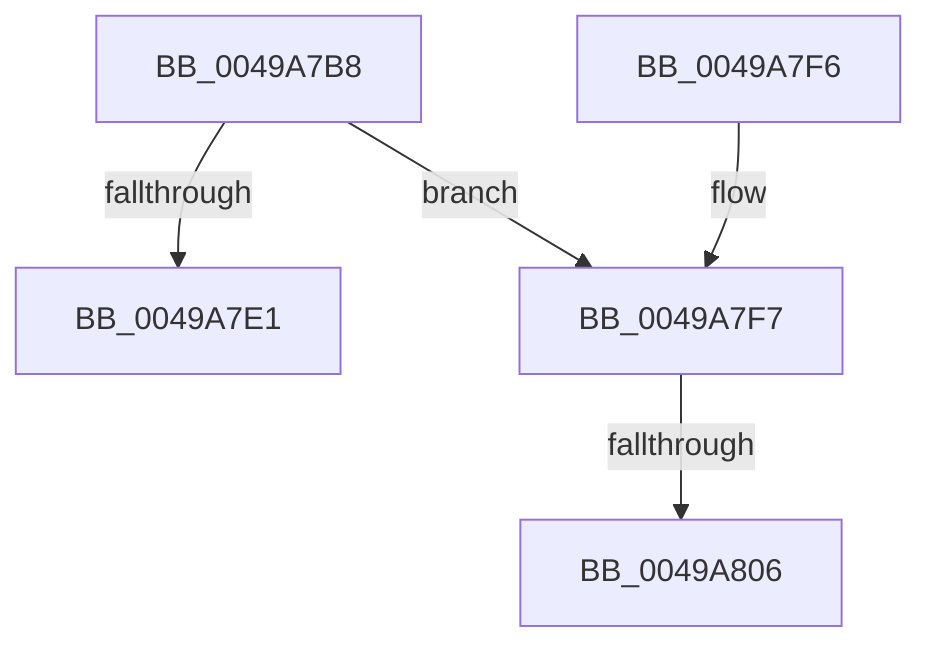

# MiDeleteCloneZombies

- RVA: `0x0049A7B8`–`0x0049A80D` (길이 `85` bytes)
- VA: `0x000000014049A7B8`
- 실행 섹션: `.text`
- PDB 이름 있음: `예`; PDB Function 태그: `예`
- unwind 정보 RVA: `0x0008CEBC`
- 디코드: `22`개 명령, `85/85` bytes 표시
- 미해석 바이트: `0` (있으면 어셈블리에 `.byte`로 보존)

> 이 문서는 커널 이미지의 기계어와 PDB 기호를 분석해 생성했습니다. 4번과 5번은 함수 원형과 자료형을 바이너리 사용 방식에서 추정한 C 해석이며 원본 소스 복구 결과는 아닙니다.

## 1. Dependencies

- 직접 호출 지점: **0**; 고유 호출 대상: **0**
- 직접 호출자로 확인된 함수: **4**
- RIP 상대 이미지 참조: **0**

### Outgoing calls
- 직접 디코드된 call 명령이 없습니다.

### Direct callers
- [MiCloneVads](../22/MiCloneVads_function_0022DC1C.md) at `0x0022DD7E`
- [MiCloneVads](../22/MiCloneVads_function_0022DC1C.md) at `0x0022E085`
- [MiInsertClone](../4D/MiInsertClone_function_004D4A7C.md) at `0x004D4A9B`
- [MiDeleteInsertedCloneVads](../../page/81/MiDeleteInsertedCloneVads_function_00811564.md) at `0x0081163C`
- [MiDeleteInsertedCloneVads](../../page/81/MiDeleteInsertedCloneVads_function_00811564.md) at `0x008116A7`
- [MmCleanProcessAddressSpace](../../page/A1/MmCleanProcessAddressSpace_function_00A17EC0.md) at `0x00A18088`

### Static image references
- 디코드된 RIP-relative 메모리 참조가 없습니다.

## 2. Other-region calls and transfers

- 다른 실행 섹션으로 향하는 call: **0**
- call이 아닌 외부 분기/꼬리 이동: **2**
  - `0x0049A800` → [sub_006F79AC](../6F/Unknown_function_006F79AC.md) (`tail-transfer`)
  - `0x0049A808` → [sub_006F79AC + 0xA](../6F/Unknown_function_006F79AC.md) (`tail-transfer`)

## 3. Assembly (complete function range)

```asm
0049A7B8  48 89 5C 24 08                  mov qword ptr [rsp + 8], rbx
0049A7BD  48 89 6C 24 10                  mov qword ptr [rsp + 0x10], rbp
0049A7C2  48 89 74 24 18                  mov qword ptr [rsp + 0x18], rsi
0049A7C7  57                              push rdi
0049A7C8  48 83 EC 20                     sub rsp, 0x20
0049A7CC  48 8B 81 10 04 00 00            mov rax, qword ptr [rcx + 0x410]
0049A7D3  33 ED                           xor ebp, ebp
0049A7D5  48 8B F9                        mov rdi, rcx
0049A7D8  66 39 A8 30 04 00 00            cmp word ptr [rax + 0x430], bp
0049A7DF  75 16                           jne 0x14049a7f7
0049A7E1  48 8B 5C 24 30                  mov rbx, qword ptr [rsp + 0x30]
0049A7E6  48 8B 6C 24 38                  mov rbp, qword ptr [rsp + 0x38]
0049A7EB  48 8B 74 24 40                  mov rsi, qword ptr [rsp + 0x40]
0049A7F0  48 83 C4 20                     add rsp, 0x20
0049A7F4  5F                              pop rdi
0049A7F5  C3                              ret
0049A7F6  CC                              int3
0049A7F7  48 8D B1 00 04 00 00            lea rsi, [rcx + 0x400]
0049A7FE  85 D2                           test edx, edx
0049A800  0F 84 A6 D1 25 00               je 0x1406f79ac
0049A806  B3 11                           mov bl, 0x11
0049A808  E9 A9 D1 25 00                  jmp 0x1406f79b6
```

## 4. C-style interpretation (structured pseudocode)

```c
__int64 __fastcall MiDeleteCloneZombies(__int64 a1, int a2)
{
    __int64 v_rbp;
    __int64 v_rsp;
    unsigned __int64 v_stack_p10;
    unsigned __int64 v_stack_p18;
    unsigned __int64 v_stack_p8;

    v_stack_p8 = v_rbx;
    v_stack_p10 = v_rbp;
    v_stack_p18 = v_rsi;
    v_rsp = (v_rsp) - (32);
    v_rbp = 0;
    if ((*(unsigned __int16 *)(*(unsigned __int64 *)(a1 + 1040) + 1072)) != 0) goto loc_0049A7F7;
    v_rsp = (v_rsp) + (32);
    return *(unsigned __int64 *)(a1 + 1040);
loc_0049A7F7:
}
```

## 5. (Beta) C Style

```c
int64_t MiDeleteCloneZombies(void *Arg1, int32_t Arg2)
{
    uint8_t *arg1 = (uint8_t *)Arg1;

    int64_t local_rbp;
    int64_t local_rsp;
    uint64_t v_stack_p10;
    uint64_t v_stack_p18;
    uint64_t v_stack_p8;

    v_stack_p8 = local_rbx;
    v_stack_p10 = local_rbp;
    v_stack_p18 = local_rsi;
    local_rsp = (local_rsp) - (32);
    local_rbp = 0;
    if ((*(uint16_t *)(*(uint64_t *)(arg1 + 0x410) + 0x430)) != 0) goto loc_0049A7F7;
    local_rsp = (local_rsp) + (32);
    return *(uint64_t *)(arg1 + 0x410);
loc_0049A7F7:
}
```

### 관측된 메모리 오프셋

구조체 형식이 확인되지 않은 접근은 인자 기준의 오프셋으로만 기록했습니다.

| 기준 인자 | 오프셋 표현 | 폭 (bit) | 접근 |
|---|---:|---:|---|
| `Arg1` | `+ 0x400` | `64` | `R` |
| `Arg1` | `+ 0x410` | `64` | `R` |

## 6. Execution-region graph

[열기: 2D/3D 그래프와 함수 탐색 컨트롤 패널](../../../control-panel.html?section=text&rva=0x0049A7B8&view=graph)

- 2D 그래프는 위에서 아래로 흐르고, 3D 그래프는 빈 공간을 드래그해 회전합니다. Shift+드래그는 이동, 휠은 확대·축소, 함수 노드 선택은 대상 보고서 이동입니다.

### Static fallback


