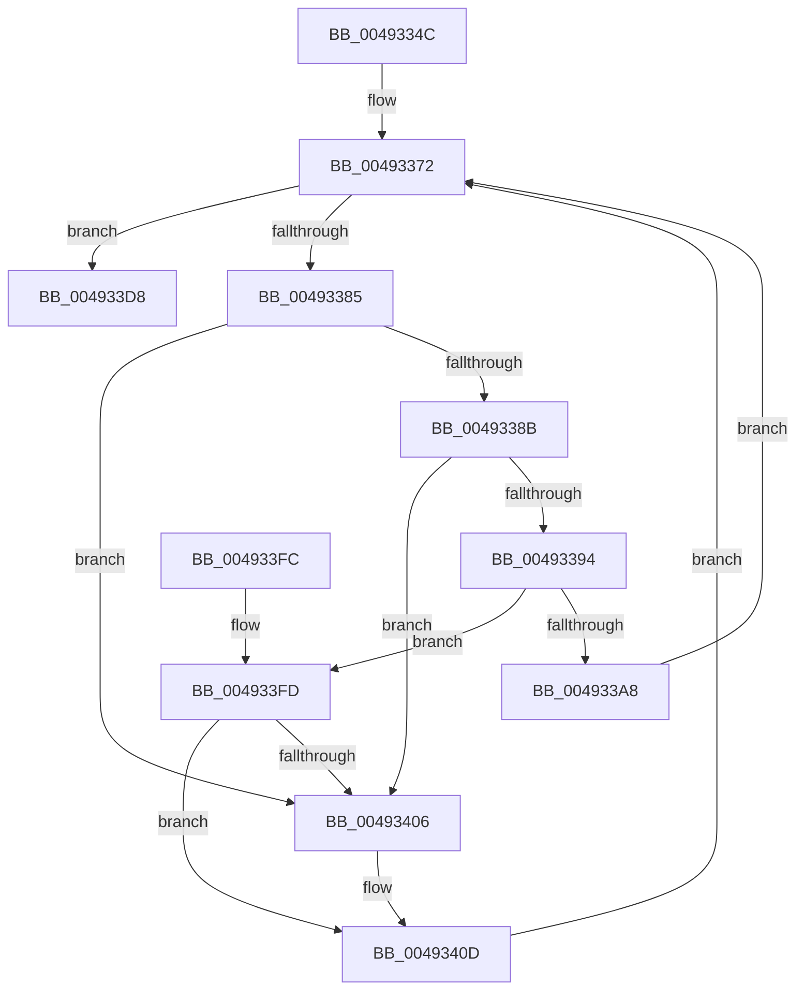

# MiDeleteEmptyControlAreas

- RVA: `0x0049334C`–`0x0049342B` (길이 `223` bytes)
- VA: `0x000000014049334C`
- 실행 섹션: `.text`
- PDB 이름 있음: `예`; PDB Function 태그: `아니요`
- unwind 정보 RVA: `0x000980C8`
- 디코드: `64`개 명령, `223/223` bytes 표시
- 미해석 바이트: `0` (있으면 어셈블리에 `.byte`로 보존)

> 이 문서는 커널 이미지의 기계어와 PDB 기호를 분석해 생성했습니다. 4번과 5번은 함수 원형과 자료형을 바이너리 사용 방식에서 추정한 C 해석이며 원본 소스 복구 결과는 아닙니다.

## 1. Dependencies

- 직접 호출 지점: **7**; 고유 호출 대상: **5**
- 직접 호출자로 확인된 함수: **1**
- RIP 상대 이미지 참조: **0**

### Outgoing calls
- `0x00493375` → [ExAcquireSpinLockExclusive](../24/ExAcquireSpinLockExclusive_function_00248690.md) (function, `0x00248690`)
- `0x0049339F` → [ExTryAcquireSpinLockExclusiveAtDpcLevel](../2B/ExTryAcquireSpinLockExclusiveAtDpcLevel_function_002BB800.md) (function, `0x002BB800`)
- `0x004933BC` → [ExReleaseSpinLockExclusiveFromDpcLevel](../24/ExReleaseSpinLockExclusiveFromDpcLevel_function_002497E0.md) (function, `0x002497E0`)
- `0x004933C8` → [MiReleaseSpinLockExclusive](../24/MiReleaseSpinLockExclusive_function_002482C0.md) (function, `0x002482C0`)
- `0x004933D1` → [MiSegmentDelete](../../page/A1/MiSegmentDelete_function_00A1FBB4.md) (function, `0x00A1FBB4`)
- `0x004933DE` → [MiReleaseSpinLockExclusive](../24/MiReleaseSpinLockExclusive_function_002482C0.md) (function, `0x002482C0`)
- `0x00493421` → [MiReleaseSpinLockExclusive](../24/MiReleaseSpinLockExclusive_function_002482C0.md) (function, `0x002482C0`)

### Direct callers
- [MiDeleteMoreUnusedSegments](../67/MiDeleteMoreUnusedSegments_function_00677DDC.md) at `0x00677E04`

### Static image references
- 디코드된 RIP-relative 메모리 참조가 없습니다.

## 2. Other-region calls and transfers

- 다른 실행 섹션으로 향하는 call: **1**
  - `0x004933D1` → [MiSegmentDelete](../../page/A1/MiSegmentDelete_function_00A1FBB4.md) (`.text` → `PAGE`)
- 별도 외부 분기/꼬리 이동을 확인하지 못했습니다.

## 3. Assembly (complete function range)

```asm
0049334C  48 89 5C 24 08                  mov qword ptr [rsp + 8], rbx
00493351  48 89 6C 24 10                  mov qword ptr [rsp + 0x10], rbp
00493356  48 89 74 24 18                  mov qword ptr [rsp + 0x18], rsi
0049335B  57                              push rdi
0049335C  41 56                           push r14
0049335E  41 57                           push r15
00493360  48 83 EC 20                     sub rsp, 0x20
00493364  48 8D B9 88 07 00 00            lea rdi, [rcx + 0x788]
0049336B  48 8D B1 C0 06 00 00            lea rsi, [rcx + 0x6c0]
00493372  48 8B CE                        mov rcx, rsi
00493375  E8 16 53 DB FF                  call 0x140248690
0049337A  48 8B 1F                        mov rbx, qword ptr [rdi]
0049337D  40 8A E8                        mov bpl, al
00493380  48 3B DF                        cmp rbx, rdi
00493383  74 53                           je 0x1404933d8
00493385  48 39 7B 08                     cmp qword ptr [rbx + 8], rdi
00493389  75 7B                           jne 0x140493406
0049338B  48 8B 03                        mov rax, qword ptr [rbx]
0049338E  48 39 58 08                     cmp qword ptr [rax + 8], rbx
00493392  75 72                           jne 0x140493406
00493394  48 89 07                        mov qword ptr [rdi], rax
00493397  48 8D 4B 40                     lea rcx, [rbx + 0x40]
0049339B  48 89 78 08                     mov qword ptr [rax + 8], rdi
0049339F  E8 5C 84 E2 FF                  call 0x1402bb800
004933A4  85 C0                           test eax, eax
004933A6  74 55                           je 0x1404933fd
004933A8  8B 43 30                        mov eax, dword ptr [rbx + 0x30]
004933AB  48 8B CE                        mov rcx, rsi
004933AE  0F BA F0 1C                     btr eax, 0x1c
004933B2  89 43 30                        mov dword ptr [rbx + 0x30], eax
004933B5  48 89 5B 08                     mov qword ptr [rbx + 8], rbx
004933B9  48 89 1B                        mov qword ptr [rbx], rbx
004933BC  E8 1F 64 DB FF                  call 0x1402497e0
004933C1  40 8A D5                        mov dl, bpl
004933C4  48 8D 4B 40                     lea rcx, [rbx + 0x40]
004933C8  E8 F3 4E DB FF                  call 0x1402482c0
004933CD  48 8D 4B F8                     lea rcx, [rbx - 8]
004933D1  E8 DE C7 58 00                  call 0x140a1fbb4
004933D6  EB 9A                           jmp 0x140493372
004933D8  40 8A D5                        mov dl, bpl
004933DB  48 8B CE                        mov rcx, rsi
004933DE  E8 DD 4E DB FF                  call 0x1402482c0
004933E3  48 8B 5C 24 40                  mov rbx, qword ptr [rsp + 0x40]
004933E8  48 8B 6C 24 48                  mov rbp, qword ptr [rsp + 0x48]
004933ED  48 8B 74 24 50                  mov rsi, qword ptr [rsp + 0x50]
004933F2  48 83 C4 20                     add rsp, 0x20
004933F6  41 5F                           pop r15
004933F8  41 5E                           pop r14
004933FA  5F                              pop rdi
004933FB  C3                              ret
004933FC  CC                              int3
004933FD  48 8B 07                        mov rax, qword ptr [rdi]
00493400  48 39 78 08                     cmp qword ptr [rax + 8], rdi
00493404  74 07                           je 0x14049340d
00493406  B9 03 00 00 00                  mov ecx, 3
0049340B  CD 29                           int 0x29
0049340D  48 89 03                        mov qword ptr [rbx], rax
00493410  40 8A D5                        mov dl, bpl
00493413  48 89 7B 08                     mov qword ptr [rbx + 8], rdi
00493417  48 8B CE                        mov rcx, rsi
0049341A  48 89 58 08                     mov qword ptr [rax + 8], rbx
0049341E  48 89 1F                        mov qword ptr [rdi], rbx
00493421  E8 9A 4E DB FF                  call 0x1402482c0
00493426  E9 47 FF FF FF                  jmp 0x140493372
```

## 4. C-style interpretation (structured pseudocode)

```c
__int64 __fastcall MiDeleteEmptyControlAreas(__int64 a1)
{
    __int64 result;
    __int64 v_rsp;
    unsigned __int64 v_stack_p10;
    unsigned __int64 v_stack_p18;
    unsigned __int64 v_stack_p8;

    v_stack_p8 = v_rbx;
    v_stack_p10 = v_rbp;
    v_stack_p18 = v_rsi;
    v_rsp = (v_rsp) - (32);
loc_00493372:
    result = ExAcquireSpinLockExclusive(a1 + 1728, a2, a3, a4);
    if ((*(unsigned __int64 *)(a1 + 1928)) == (a1 + 1928)) goto loc_004933D8;
    if ((*(unsigned __int64 *)(*(unsigned __int64 *)(a1 + 1928) + 8)) != (a1 + 1928)) goto loc_00493406;
    if ((*(unsigned __int64 *)(*(unsigned __int64 *)(*(unsigned __int64 *)(a1 + 1928)) + 8)) != (*(unsigned __int64 *)(a1 + 1928))) goto loc_00493406;
    *(unsigned __int64 *)(a1 + 1928) = *(unsigned __int64 *)(*(unsigned __int64 *)(a1 + 1928));
    *(unsigned __int64 *)(*(unsigned __int64 *)(*(unsigned __int64 *)(a1 + 1928)) + 8) = a1 + 1928;
    result = ExTryAcquireSpinLockExclusiveAtDpcLevel(*(unsigned __int64 *)(a1 + 1928) + 64, a2, a3, a4);
    if ((unsigned int)(result) == 0) goto loc_004933FD;
    *(unsigned int *)(*(unsigned __int64 *)(a1 + 1928) + 48) = (unsigned int)((unsigned int)(*(unsigned int *)(*(unsigned __int64 *)(a1 + 1928) + 48)));
    *(unsigned __int64 *)(*(unsigned __int64 *)(a1 + 1928) + 8) = *(unsigned __int64 *)(a1 + 1928);
    *(unsigned __int64 *)(*(unsigned __int64 *)(a1 + 1928)) = *(unsigned __int64 *)(a1 + 1928);
    result = ExReleaseSpinLockExclusiveFromDpcLevel(a1 + 1728, a2, a3, a4);
    result = MiReleaseSpinLockExclusive(*(unsigned __int64 *)(a1 + 1928) + 64, (unsigned __int8)((unsigned __int8)(result)), a3, a4);
    result = MiSegmentDelete(*(unsigned __int64 *)(a1 + 1928) - 8, (unsigned __int8)((unsigned __int8)(result)), a3, a4);
    goto loc_00493372;
loc_004933D8:
    result = MiReleaseSpinLockExclusive(a1 + 1728, (unsigned __int8)((unsigned __int8)(result)), a3, a4);
    v_rsp = (v_rsp) + (32);
    return result;
loc_004933FD:
    if ((*(unsigned __int64 *)(*(unsigned __int64 *)(a1 + 1928) + 8)) != (a1 + 1928)) {
        a1 = 3;
    }
    *(unsigned __int64 *)(v_stack_p8) = *(unsigned __int64 *)(a1 + 1928);
    *(unsigned __int64 *)(v_stack_p8 + 8) = a1 + 1928;
    *(unsigned __int64 *)(*(unsigned __int64 *)(a1 + 1928) + 8) = v_stack_p8;
    *(unsigned __int64 *)(a1 + 1928) = v_stack_p8;
    result = MiReleaseSpinLockExclusive(v_stack_p18, (unsigned __int8)(v_stack_p10), a3, a4);
    goto loc_00493372;
}
```

## 5. (Beta) C Style

```c
int64_t MiDeleteEmptyControlAreas(void *Arg1)
{
    uint8_t *arg1 = (uint8_t *)Arg1;

    int64_t result;
    int64_t local_rsp;
    uint64_t v_stack_p10;
    uint64_t v_stack_p18;
    uint64_t v_stack_p8;

    v_stack_p8 = local_rbx;
    v_stack_p10 = local_rbp;
    v_stack_p18 = local_rsi;
    local_rsp = (local_rsp) - (32);
loc_00493372:
    result = ExAcquireSpinLockExclusive(Arg1 + 1728, a2, a3, a4);
    if ((*(uint64_t *)(arg1 + 0x788)) == (Arg1 + 1928)) goto loc_004933D8;
    if ((*(uint64_t *)(*(uint64_t *)(arg1 + 0x788) + 0x8)) != (Arg1 + 1928)) goto loc_00493406;
    if ((*(uint64_t *)(*(uint64_t *)(*(uint64_t *)(arg1 + 0x788)) + 0x8)) != (*(uint64_t *)(arg1 + 0x788))) goto loc_00493406;
    *(uint64_t *)(arg1 + 0x788) = *(uint64_t *)(*(uint64_t *)(arg1 + 0x788));
    *(void **)(*(uint64_t *)(*(uint64_t *)(arg1 + 0x788)) + 0x8) = Arg1 + 1928;
    result = ExTryAcquireSpinLockExclusiveAtDpcLevel(*(uint64_t *)(arg1 + 0x788) + 64, a2, a3, a4);
    if ((uint32_t)(result) == 0) goto loc_004933FD;
    *(uint32_t *)(*(uint64_t *)(arg1 + 0x788) + 0x30) = (uint32_t)((uint32_t)(*(uint32_t *)(*(uint64_t *)(arg1 + 0x788) + 0x30)));
    *(uint64_t *)(*(uint64_t *)(arg1 + 0x788) + 0x8) = *(uint64_t *)(arg1 + 0x788);
    *(uint64_t *)(*(uint64_t *)(arg1 + 0x788)) = *(uint64_t *)(arg1 + 0x788);
    result = ExReleaseSpinLockExclusiveFromDpcLevel(Arg1 + 1728, a2, a3, a4);
    result = MiReleaseSpinLockExclusive(*(uint64_t *)(arg1 + 0x788) + 64, (uint8_t)((uint8_t)(result)), a3, a4);
    result = MiSegmentDelete(*(uint64_t *)(arg1 + 0x788) - 8, (uint8_t)((uint8_t)(result)), a3, a4);
    goto loc_00493372;
loc_004933D8:
    result = MiReleaseSpinLockExclusive(Arg1 + 1728, (uint8_t)((uint8_t)(result)), a3, a4);
    local_rsp = (local_rsp) + (32);
    return result;
loc_004933FD:
    if ((*(uint64_t *)(*(uint64_t *)(arg1 + 0x788) + 0x8)) != (Arg1 + 1928)) {
        Arg1 = 3;
    }
    *(uint64_t *)(v_stack_p8) = *(uint64_t *)(arg1 + 0x788);
    *(void **)(v_stack_p8 + 0x8) = Arg1 + 1928;
    *(uint64_t *)(*(uint64_t *)(arg1 + 0x788) + 0x8) = v_stack_p8;
    *(uint64_t *)(arg1 + 0x788) = v_stack_p8;
    result = MiReleaseSpinLockExclusive(v_stack_p18, (uint8_t)(v_stack_p10), a3, a4);
    goto loc_00493372;
}
```

### 관측된 메모리 오프셋

구조체 형식이 확인되지 않은 접근은 인자 기준의 오프셋으로만 기록했습니다.

| 기준 인자 | 오프셋 표현 | 폭 (bit) | 접근 |
|---|---:|---:|---|
| `Arg1` | `+ 0x0` | `64` | `R` |
| `Arg1` | `+ 0x0` | `64` | `W` |
| `Arg1` | `+ 0x6C0` | `64` | `R` |
| `Arg1` | `+ 0x788` | `64` | `R` |

## 6. Execution-region graph

[열기: 2D/3D 그래프와 함수 탐색 컨트롤 패널](../../../control-panel.html?section=text&rva=0x0049334C&view=graph)

- 2D 그래프는 위에서 아래로 흐르고, 3D 그래프는 빈 공간을 드래그해 회전합니다. Shift+드래그는 이동, 휠은 확대·축소, 함수 노드 선택은 대상 보고서 이동입니다.

### Static fallback


